# Hyperfield test: are atomic probability clouds 3D shadows of higher-dimensional spheres?

Dan's idea: atomic probability clouds are 3D slices or projections of spherical "hyperfields" that live in more dimensions.
This is a test of that idea from D = 4 up to every dimension count with a peer-reviewed theory behind it. It uses no fitted parameters.
Every claim is labeled **DERIVED** (computed here), **ASSUMED** (an input) or **CITED** (taken from the literature).
Units are atomic units (hbar = m_e = e = 1); 1 hartree = 27.211386 eV (CODATA 2018).

Scripts are in `scripts/` (`hflib.py`, `stage1_fock_s3.py`, `stage2_Ddim.py`, `stage3_cost.py`). Raw numbers are in `results/*.json` and plots in `figures/`.
To reproduce, run `.venv/bin/python scripts/<stage>.py`. Stage 1 takes about 15 s, stage 2 about 5 min and stage 3 is instant.

---
## Stage 1: D = 4 (3 space dimensions plus a hidden 4th, sphere S^3)

**Construction.** This is Fock's construction (CITED: V. Fock, Z. Phys. 98, 145 (1935), doi:10.1007/BF01336904; Bargmann, Z. Phys. 99, 576 (1936)).
Map momentum space onto the unit 3-sphere S^3 in R^4 by stereographic projection, with p0 = sqrt(-2E).
The hydrogen momentum-space Schrödinger equation then becomes
`Y(xi) = Z/(2 pi^2 p0) * Integral_{S^3} Y(xi') / |xi - xi'|^2 dOmega'`,
and the wavefunction is `phi(p) = (p0^2 + p^2)^-2 * Y_{4D harmonic}(xi(p))`.

| Check | How | Result |
|---|---|---|
| Kernel eigenvalue on degree-k harmonics of S^3 | Funk–Hecke integral done by quadrature (no closed form used) | 19.7392088, 9.8696044, 6.5797363, 4.9348022 = 2π²/n to 1e-15 (**DERIVED**) |
| Energy levels | p0 = Z·λ_k/(2π²) = 1/n, so E = -p0²/2 | **−13.605693, −3.401423, −1.511744, −0.850356 eV** for n = 1..4 (infinite nuclear mass). With the electron–proton reduced mass: −13.598287 eV (**DERIVED**) |
| Independent position-space solve (no SO(4) used) | log-grid finite differences, all l ≤ 3 | E_n matches −1/(2n²) to (0.2–2.4)·10⁻⁶ relative, the grid error (**DERIVED**) |
| Degeneracy | rank of the Laplacian on degree-(n−1) polynomials in 4 variables | 1, 4, 9, 16, 25 = n² (**DERIVED**) |
| Radial shape fidelity, Fock form vs numerical Fourier transform of the real orbital, 1s … 4f (10 orbitals) | overlap² | 1 − F ≤ 3·10⁻¹⁶ for all of them (**DERIVED**) |
| Unlabelled subspace test: span of all degree-(n−1) S^3 harmonics (basis from the null space, no l or m labels) vs span of the n² actual hydrogen orbitals (s, p, d, f, all m) | principal-angle cos² | min cos² = 1.0000000000000 (n = 1, 2, 3) and 0.99999999999999 (n = 4) (**DERIVED**) |

Figure: `figures/stage1_slices_vs_actual.png`. It shows |φ|² in the p_x–p_z plane for 1s, 2p, 3d, 4f, 3p and 4d(m=1). The top row comes from the S^3 harmonic, the middle row from the actual orbital, and the bottom row is the difference, which is at most 1e−5 and is plotting interpolation.

**Stage 1 verdict.** In momentum space, hydrogen's orbitals are exactly 4D spherical harmonics on S^3, and the n² degeneracy and the −13.6/n² eV ladder follow with no fitting (**DERIVED**, numerically exact).
Two caveats on the picture:
- The 3D cloud is a **stereographic projection** of the 4D sphere function in **momentum space**, followed by a Fourier transform to position space. It is not a literal flat 3D slice.
- This is Fock's 1935 result. It is the known hidden SO(4) symmetry, the same thing as the conserved Runge–Lenz vector.

---
## Stage 2: D space dimensions (sphere S^D in R^(D+1)), D = 3..13, plus 25 and 26

**Dimension bookkeeping (CITED).** The peer-reviewed counts are spacetime dimensions, so the space-dimension count D is one less, or two less for two-time theories:

| Theory | Spacetime | Space dims D here | Citation (verified) |
|---|---|---|---|
| Superstring | 10 | 9 | Green & Schwarz, Phys. Lett. B 149, 117 (1984), doi:10.1016/0370-2693(84)91565-X |
| M-theory | 11 | 10 | Witten, Nucl. Phys. B 443, 85 (1995), hep-th/9503124 |
| F-theory | 12, signature (10,2) | 10 (+2 times) | Vafa, Nucl. Phys. B 469, 403 (1996), hep-th/9602022 |
| S-theory / two-time physics | 13, signature (11,2) | 11 (+2 times) | Bars, Phys. Rev. D 55, 2373 (1997) (hep-th/9607112); "Algebraic structure of S-theory", hep-th/9608061; review: Class. Quantum Grav. 18, 3113 (2001) |
| Bosonic string | 26 | 25 | Lovelace, Phys. Lett. B 34, 500 (1971), doi:10.1016/0370-2693(71)90665-4 |

Bars' two-time physics is the closest peer-reviewed relative of Dan's idea (CITED: Bars, Deliduman & Andreev, Phys. Rev. D 58, 066004 (1998), hep-th/9803188; companion paper Phys. Rev. D 58, 066006).
In that work the hydrogen atom, the free particle and the harmonic oscillator are different 3D "gauge views" of one system in 3+2 dimensions, with SO(4,2) symmetry.
That is a rigorous, published version of "the atom is a shadow of a bigger symmetric object." It reproduces the known spectrum and adds no new prediction for hydrogen.

The tables cover D = 3..13 (which includes every row above) plus D = 25 and 26.

### 2a. Coulomb 1/r potential in D dimensions (keeps the hidden SO(D+1) sphere)

The same Fock map works with the kernel 1/|xi − xi'|^(D−1) on S^D. Three routes were used: (i) the Funk–Hecke quadrature eigenvalue with p0 = Z·c_D·λ_k/(2π)^D, where c_D = 2^(D−1)·π^((D−1)/2)·Γ((D−1)/2); (ii) the closed form E_n = −1/(2(n+(D−3)/2)²); and (iii) a direct D-dimensional radial solve.
Routes (i) and (ii) agree to 1e−15, and (iii) agrees to within 1e−6 grid error, for every D (**DERIVED**).
For the l = 3, n = 4 state the energy equals the l = 0, n = 4 state, so the l-degeneracy and hidden symmetry survive in every D (**DERIVED**).

| D | E1 (eV, reduced mass) | States per shell n=1..4 (rank count = formula) | (1S–2S)/(1S–3S) ratio | Deviation from observed 0.84374890 | 3D-slice fidelity, 1s / 2p / 3d / 4f | 3D-projection fidelity, 1s |
|---|---|---|---|---|---|---|
| 3 | −13.598 | 1, 4, 9, 16 | 0.843750 | +1.3e−6 (this is the known fine-structure/QED size) | 1 / 1 / 1 / 1 | 1 |
| 4 | −6.044 | 1, 5, 14, 30 | 0.7840 | −7.1 % | 0.885 / 0.940 / 0.959 / 0.969 | 0.802 |
| 5 | −3.400 | 1, 6, 20, 50 | 0.7407 | −12.2 % | 0.702 / 0.815 / 0.866 / 0.894 | 0.509 |
| 6 | −2.176 | 1, 7, 27, 77 | 0.7085 | −16.0 % | 0.544 / 0.680 / 0.751 / 0.797 | 0.298 |
| 7 | −1.511 | 1, 8, 35, 112 | 0.6836 | −19.0 % | 0.422 / 0.555 / 0.637 / 0.693 | 0.172 |
| 8 | −1.110 | 1, 9, 44, 156 | 0.6639 | −21.3 % | 0.331 / 0.449 / 0.531 / 0.591 | 0.101 |
| 9 | −0.850 | 1, 10, 54, 210 | 0.6480 | −23.2 % | 0.262 / 0.363 / 0.439 / 0.499 | 0.061 |
| 10 | −0.672 | 1, 11, 65, 275 | 0.6349 | −24.8 % | 0.211 / 0.293 / 0.360 / 0.417 | 0.038 |
| 11 | −0.544 | 1, 12, 77, 352 | 0.6238 | −26.1 % | 0.172 / 0.237 / 0.295 / 0.346 | 0.025 |
| 12 | −0.450 | 1, 13, 90, 442 | 0.6145 | −27.2 % | 0.141 / 0.193 / 0.242 / 0.287 | 0.017 |
| 13 | −0.378 | 1, 14, 104, 546 | 0.6064 | −28.1 % | 0.118 / 0.158 / 0.198 / 0.237 | 0.011 |
| 25 | −0.094 | 1, 26, 350, 3250 | 0.5576 | −33.9 % | 0.023 / 0.021 / 0.022 / 0.025 | 0.0005 |
| 26 | −0.087 | 1, 27, 377, 3627 | 0.5555 | −34.2 % | 0.021 / 0.018 / 0.019 / 0.021 | 0.0004 |

Notes on the table:
- The observed ratio uses f(1S–2S) = 2 466 061 413 187 035(10) Hz (CITED: Parthey et al., PRL 107, 203001 (2011), relative uncertainty 4.2e−15) and f(1S–3S) = 2 922 743 278 665.79(72) kHz (CITED: Grinin et al., Science 370, 1061 (2020)).
- In D = 3 the predicted 1S–2S is 2.466038e15 Hz, 9.3e−6 below the measurement. That gap is ordinary relativity and QED, not a hyperfield effect.
- The ratio is scale-free, so no Rydberg or length rescaling can rescue D ≠ 3 (**DERIVED**).
- The slice is the D-dim state restricted to x4 = … = xD = 0 and renormalized in 3D. The projection integrates |ψ|² over the extra coordinates.
- The angular shape (Y_lm) survives slicing in every D, because a 3D solid harmonic is also a D-dim harmonic. What breaks is the radial size: the slice's ⟨r⟩ for 1s is 1.5·(D−1)/2 a0, so 9.0 a0 at D = 13 against the measured 1.5 a0. The spectrum breaks as well, and so do the state counts: shell 2 has 4 states in real hydrogen but D+1 states here (**DERIVED**).

Figures: `figures/stage2_Dslices_vs_actual.png` (radial densities of the slices against actual 1s, 2p and 3d) and `figures/stage2_spectra_vs_D.png` (levels and degeneracies against D).

### 2b. Gauss-law potential −g/r^(D−2): the physical one for open dimensions

If the electric field really spreads into D open dimensions, Gauss's law makes the potential 1/r^(D−2), not 1/r. This is the physically consistent choice. The 1/r case in 2a is a mathematical device that keeps the sphere symmetry.
The scaling choice g = 1 (V = −1 hartree at r = a0) is **ASSUMED**, and the core is regularized at r_c. Lowest level E0 in hartree:

| D | r_c = 0.1 | 0.01 | 0.001 | Behavior |
|---|---|---|---|---|
| 4, g = 0.4 (< g_c = 1/2) | +2.9e−5 | +2.9e−5 | +2.9e−5 | **no bound state at all**: only the box continuum (**DERIVED**) |
| 4, g = 1 (> g_c) | −2.02 | −202 | −20 197 | collapse, E0 ≈ −0.0202/r_c² |
| 5 | −522 | −9.27e5 | −9.91e8 | collapse, E0 → −g/r_c³ |
| 7 | −9.85e4 | −1.0e10 | (solver did not converge) | collapse |
| 13 | (solver did not converge) | −1.0e22 | −1.0e33 | collapse, E0 ≈ −g/r_c^11 |

**DERIVED:** with Gauss-law forces in D ≥ 4 open dimensions there is no stable atom with a discrete Bohr ladder. The electron either is not bound or falls into the center. Every hydrogen state would be destroyed.
This reproduces Ehrenfest's 1917 argument (CITED: Proc. KNAW 20, 200 (1917)) and Tangherlini, Nuovo Cimento 27, 636 (1963) (the Tangherlini citation is from memory and was not re-verified this run).
The "nan" entries are runs where the shift-invert eigensolver did not converge. The trend is already clear from the converged points.

### 2c. If the extra dimensions exist, how small must they be?

**Model (ASSUMED).** N extra flat circles of radius R. The photon propagates in them, and the lowest Kaluza–Klein shell has 2N modes, so V(r) = −(1/r)(1 + 2N e^(−r/R)).
- **Checked (DERIVED).** For R = 10⁻³ a0, the full (nonperturbative) 1S shift is −7.984e−6 hartree, against −7.964e−6 at first order and −8.000e−6 from the contact formula ΔE_nS = −8πN R² |ψ_nS(0)|². The shift hits only S states and scales as 1/n³.
- **Naive bound from 1S–2S alone (DERIVED).** δf/f = (56/3)·N·(R/a0)². With δf/f ≤ 4.2e−15 (Parthey 2011): R ≤ **7.9e−19 m** for N = 1, 5.6e−19 m (N = 2), 3.2e−19 m (N = 6), 3.0e−19 m (N = 7), 2.8e−19 m (N = 8), 1.7e−19 m (N = 22). The corresponding KK masses are about 250–1170 GeV. Using the brief's round 1e−15, the N = 1 bound is 3.9e−19 m.
- **Honest negative.** This shift has exactly the same form as the finite proton-size correction. It is equivalent to Δ(r_p²) = −12·N·R² (**DERIVED**), so 1S–2S alone cannot distinguish an extra dimension from a slightly smaller proton.
  - The real limit comes from comparing spectroscopic and scattering proton radii. ASSUMED tolerance: δr_p ≈ 0.014 fm, from muonic H 0.84087(39) fm versus the electron-scattering (PRad) 0.831(14) fm. Those two values are from memory and were not re-verified this run.
  - That gives R ≲ **4.4e−17 m (N = 1) to 9.4e−18 m (N = 22)**, i.e. KK masses ≳ 4.5–21 GeV. Collider searches probe the TeV scale (~1e−19 m) and are stronger; no collider number is quoted here because none was verified this run.
- **Brane-world variant (only gravity in the extra dimensions; ASSUMED ADD-type model).** In hydrogen, gravity/Coulomb = 4.4e−40. Even with N = 2 dimensions of R = 30 µm, the largest allowed (CITED: Lee et al., PRL 124, 101101 (2020): Yukawa range < 38.6 µm, toroidal radius < 30 µm), the 1S fractional shift is **5.5e−27** (cut off at the proton radius, ASSUMED). That is twelve orders of magnitude below what spectroscopy can see. **Hydrogen cannot test gravity-only extra dimensions** (**DERIVED**).

---
## Stage 3: scoping only (not run)

| Task | Naive cost | Smart cost | Verdict |
|---|---|---|---|
| Helium in D = 13: brute-force grid on 26 coordinates | 100^26 = 1e52 points, 1.6e53 bytes | — | impossible |
| Helium, any D, L = 0 states | — | 3 internal coordinates (r1, r2, r12) for **every D ≥ 2**; Hylleraas basis K = 2000 needs about 8e9 flops, **about 1 s on a laptop** | **cheap**. D enters only through the Jacobian and the centrifugal terms. Prior work exists ("dimensional scaling", Herschbach, J. Chem. Phys. 84, 838 (1986); citation from memory, not re-verified) |
| N electrons | — | internal coordinates N(N+1)/2 when D ≥ N+1: 21 for N = 6 (55 for N = 10) at D = 13, vs 15 (27) at D = 3 | grows, but quantum-chemistry methods carry over; a light atom in 13D would take hours to days |
| Full Standard Model field content on a lattice in 13+1 dimensions | about 6316 reals per site (12 gauge generators × 14 link directions; 48 Weyl fermions × 64 complex spinor components in d = 14; Higgs) | L = 8: 4.4e12 sites, **222 PB**, about 28 s per sweep at an assumed 1 exaflop/s. L = 16: 7.2e16 sites, **3.6e21 bytes**, about 5 days per sweep. State of the art in 4D is about 8.6e8 sites | infeasible at any useful resolution. **And in principle:** in d = 14 the gauge coupling has mass dimension (4−d)/2 = −5, so the theory is non-renormalizable and has no continuum limit. More compute would not give an answer without a UV completion such as string theory itself (**DERIVED** power counting) |

---
## Overall verdict

1. **DERIVED, exact.** The 4D hyperfield picture works perfectly, but it is Fock's 1935 SO(4) construction. Hydrogen's clouds are S^3 harmonics, stereographically projected in momentum space. Overlap fidelities are 1 − F < 1e−15, the degeneracy is n², and E_n = −13.6057/n² eV, with nothing fitted. The hyperfield language adds **no new prediction** beyond the known SO(4) (and Bars' SO(4,2) / two-time) symmetry. It is a re-description, and a valid and elegant one.
2. **DERIVED, negative.** Open (uncompactified) spheres with D > 3 give spectra that are wrong by 7–34 % in a scale-free ratio measured to about 1e−12. The state counts (D+1 states in shell 2) and the cloud sizes (1s ⟨r⟩ = 9 a0 at D = 13) are also wrong. With Gauss-law forces there are no atoms at all. At every peer-reviewed count (9, 10, 11 or 25 space dims), the extra dimensions must be compact.
3. **DERIVED, bound.** Compact extra dimensions seen by the photon must have R ≲ 4e−17 m from hydrogen (≲ 8e−19 m if the proton radius were perfectly known). At that size the atom reduces to D = 3 with its hidden 4D sphere.
4. **Falsifiable prediction, if Dan wants one.** Extra dimensions seen by the photon would make the spectroscopic proton radius smaller than the scattering radius by exactly Δr_p² = −12 N R². They would shift S states only, ∝ 1/n³, identically in electronic and muonic hydrogen. A future scattering measurement of r_p at the ±0.001 fm level would tighten the bound to R ≲ 1e−17 m.
5. **Coincidence flags.** D = 4 and Bars' 3+2 both reach SO(4)-type symmetry through different routes. That is the same group showing up twice, not new evidence. Nothing in this run was tuned to match.

## Assumptions list
- Nonrelativistic Schrödinger hydrogen, point nucleus, spin ignored (fine structure is 1e−5).
- Coupling normalization g = 1 for the 1/r^(D−2) case.
- Torus KK model with 2N lowest modes.
- r_p tolerance 0.014 fm.
- ADD cutoff at the proton radius.
- Stage 3 costs: 1e3 flop per dof per sweep and a 1 exaflop/s machine.

---
## Stage 4: brane worlds. Not every field has to live in every dimension

Script: `scripts/stage4_brane.py`. It checkpoints each section to `results/stage4.json`; rerunning skips finished sections.
Figures: `figures/stage4_add_R_vs_n.png` and `figures/stage4_gravity_deviation.png`.
Constants: reduced Planck mass M̄ = 2.435e18 GeV, ħc = 1.9733e−16 GeV·m, H0 = 67.4 km/s/Mpc (ASSUMED, Planck 2018).

### 4.1 ADD: all Standard Model fields on a 3-brane, gravity alone in n flat compact dimensions

**DERIVED.** Reduce the bulk Einstein–Hilbert term over a flat n-torus of radius R. The curvature R_{4+n} becomes R_4 and the extra-dimension integral gives the volume (2πR)^n, so M̄² = M_*^(n+2)·(2πR)^n.
The collider and PDG convention M̄² = M_D^(n+2)·R^n is the same statement with M_D = (2π)^(n/(n+2))·M_*. Every number below uses the M_D convention.

**Yukawa coefficient (DERIVED, and it corrects the brief).** The lowest Kaluza–Klein (KK) shell on a torus has 2n modes. Each massive spin-2 mode couples 4/3 times as strongly as a massless one (the vDVZ factor). So α = **8n/3**, not 2n, matching the PDG convention.
The full KK-lattice sum against the lowest shell alone gives a ratio of 1.00005 (n = 1), 1.016 (n = 2), 1.033 (n = 3) and 1.089 (n = 6) at r = 10R. The lowest shell dominates there; at r = 3R higher shells matter (×1.05 to ×8.2).

**Verified bounds used:**
- **ATLAS monojet, 139 fb⁻¹** (PRD 103, 112006 (2021), Table 10): M_D > 11.2, 8.5, 7.1, 6.4, 5.9 TeV for n = 2..6.
- **CMS monojet:** M_D > 10.7 TeV for n = 2 (PDG review).
- **Hannestad & Raffelt, PRD 67, 125008 (2003), Table V** (maximum R from SN1987A cooling and from neutron-star excess heat), n = 1..7.
- **Torsion balances:** 30 µm for n = 1 (Lee et al., PRL 124, 101101 (2020), whose Yukawa range limit is 38.6 µm at α = 1) and 37 µm for n = 2 (Kapner et al. 2007, via the PDG listing).

| n | R needed, M_D = 1 / 3 / 10 TeV | Max allowed R, from the strongest bound | Implied M_D min | Lightest KK graviton | Survives? |
|---|---|---|---|---|---|
| 1 | 1.2e12 / 4.3e10 / 1.2e9 m | 30 µm (torsion) | 3.4e5 TeV | — | **No.** R would be solar-system size |
| 2 | 0.48 mm / 53 µm / 4.8 µm | 5.9e−8 m (NS heating); LHC alone 3.8 µm | 90 TeV (LHC alone: 11.2) | 3.3 eV | **Allowed, but it no longer solves the hierarchy** (M_D ≫ 10 TeV) |
| 3 | 3.6e−9 / 5.7e−10 / 7.7e−11 m | 1.0e−10 m (LHC); NS heating 1.3e−10 → 7.3 TeV | 8.5 TeV | 2.0 keV | marginal |
| 4 | 9.7e−12 / 1.9e−12 / 3.1e−13 m | 5.2e−13 m (LHC) | 7.1 TeV | 0.38 MeV | yes |
| 5 | 2.8e−13 / 6.1e−14 / 1.1e−14 m | 2.1e−14 m (LHC) | 6.4 TeV | 9.4 MeV | yes |
| 6 (10D string) | 2.7e−14 / 6.1e−15 / 1.2e−15 m | 2.5e−15 m (LHC) | 5.9 TeV | 79 MeV | yes |
| 7 (11D M-theory) | 4.9e−15 / 1.2e−15 / 2.5e−16 m | 1.2e−13 m (NS heating; no verified LHC number for n = 7) | > 0.08 TeV from astrophysics; LHC (unverified extrapolation) would give about 5–6 TeV | — | yes |

Caveats on the bounds:
- **n = 2 discrepancy, unresolved.** The PDG listing quotes R < 1.6e−10 m (M_D ≳ 1700 TeV) from the 2002 neutron-star paper. The 2003 table gives 5.9e−8 m, and the weaker value is used here.
- **Astrophysical bounds** assume KK gravitons decay into photons on our brane (ASSUMED). They weaken if the gravitons decay elsewhere.
- **12D and 13D two-time cases (Vafa; Bars), qualitative only.** The second time dimension is a gauge redundancy (Sp(2,R)), not a compact space. There is no KK tower and no Yukawa term, so these bounds don't apply and hydrogen predicts nothing new. That is an honest null, not a survival.

### 4.2 RS1 and RS2: one warped extra dimension

- **RS1 (DERIVED).** For the warp factor to bring the Planck scale down to Λ_π = M̄·e^(−kπr_c), you need k·r_c = **11.72** (Λ_π = v = 246 GeV), 11.28 (1 TeV), 10.93 (3 TeV) or 10.54 (10 TeV).
  - The first KK graviton has m1 = x1·(k/M̄)·Λ_π, with x1 = 3.8317 (first zero of J1, computed).
  - ATLAS diphoton (PLB 822, 136651 (2021), verified) excludes m1 below 2.2, 3.9 and 4.5 TeV for k/M̄ = 0.01, 0.05 and 0.1. So Λ_π ≥ 57.4, 20.4 or 11.7 TeV, and k·r_c ≤ 9.99, 10.32 or 10.49.
  - CMS (via the PDG 2026 review): diphoton 2.2–5.6 TeV, dilepton 2.47–4.78 TeV.
  - **Honest negative:** a leftover tuning (v/Λ_π)² ≈ 4.4e−4 to 1.8e−5 comes back. The k·r_c ≈ 11–12 that fully solves the hierarchy is excluded; ≈ 10.0–10.5 survives.
- **RS2 (infinite warped dimension).** V = −GMm/r·(1 + 2ℓ²/(3r²)), where ℓ = 1/k is the curvature length.
  - Bound: ℓ < 44 µm (Kapner 2007 data, as quoted in later RS2 papers; a secondary citation). The 2020 data probably tighten this, but no RS2 reinterpretation of them was found or computed here.
  - At ℓ = 44 µm the deviation is 48 % at 52 µm, 13 % at 100 µm and 0.13 % at 1 mm, and M5 ≳ 3.0e8 GeV.
  - RS2 doesn't solve the hierarchy; it is just a consistent way to hide an infinite extra dimension.

### 4.3 Split placements: why the hydrogen bound applies only when a light charged field or the photon is in the bulk

Hydrogen measures the electron–proton potential at r ~ a0, at a precision of about 1e−12 to 1e−15. A bulk field changes it only if it **mediates or carries the electromagnetic interaction**. The shift is ΔE ∝ (coupling)·R²·|ψ(0)|² (stage 2).

| Placement | Hydrogen effect | Best bound |
|---|---|---|
| Photon (or all SM fields, UED) in the bulk | Yukawa KK-photon exchange: R ≲ 4.5e−17 m (stage 2, limited by the proton-radius degeneracy) | **LHC mUED: 1/R ≳ 1.86 TeV, R ≲ 1.06e−19 m** (arXiv:2110.00500, a recast of ATLAS Run 2). That is 420× stronger than hydrogen |
| Gluons only | none at tree level (Coulomb unchanged) | colliders |
| Higgs only | Higgs exchange between e and p has range 1.6e−18 m; e^(−a0·m_h) underflows to 0 | colliders |
| Right-handed neutrinos only | none (neutral). **But DERIVED:** volume suppression gives m_ν = y·(v/√2)·M_*/M̄ = 7.2e−5 eV at M_* = 1 TeV (y = 1, ASSUMED), for any n. Reaching m_ν = 0.05 eV needs M_* ≈ 700 TeV | neutrino oscillations |
| Gravity only (ADD/RS) | 5.5e−27 relative (n = 2, R = 30 µm) | colliders, astrophysics, torsion balances |

### 4.4 Dan's picture, and induced gravity on a brane

**Mapping (ASSUMED, interpretive).** Dan's "particle = locked, localized field state" corresponds to a field's zero mode localized on the brane, as in domain-wall localization (Rubakov–Shaposhnikov 1983, cited from memory). "Gravity unlocked / leaking" corresponds to the graviton not being localized. How it leaks differs by model:
- **ADD:** leaks at r < R.
- **RS2:** quasi-localized, with width ℓ.
- **DGP:** leaks at r > r_c.

**DGP (Dvali–Gabadadze–Porrati).** This model is literally induced gravity on a brane: the 4D Einstein–Hilbert term on the brane is meant to be generated by the brane's own matter loops, which is Sakharov's idea. **DERIVED:** r_c = M̄²/(2M5³). The upper limits on M5 are:

| Bound on r_c | r_c | M5 max |
|---|---|---|
| Lunar laser ranging, r_c ≳ 120 Mpc (secondary citation) | 3.7e24 m | 54 MeV |
| Normal-branch cosmology, H0·r_c > 3.5 (Lombriser et al., PRD 80, 063536 (2009)) | 4.8e26 m | **10.7 MeV** |
| SPT + Planck PR4 (2026), H0·r_c > 0.71 | 9.7e25 m | 18 MeV |
| Self-accelerating branch, r_c ~ 1/H0 | 1.4e26 m | 16 MeV. Ruled out: ghost instabilities and conflict with supernova and CMB data |

**Effect on the FFZ gap and the induced-gravity sum S:**
1. **Matter strictly on a thin brane (ASSUMED).** The brane fields' heat kernel is the 4D one, so S and the FFZ three-loop coefficient are **unchanged: δC = 0**.
2. **The gap stays scheme-dependent.** A brane-localized Einstein–Hilbert counterterm is allowed by every brane symmetry, so κ = −0.00965 remains absorbable. A brane world does not fix it.
3. **ADD and RS1 (DERIVED, and the key negative for the induced-gravity program).** M̄² = (bulk volume term) + M_ind².
   - With M_ind² ~ |S|·M_D²/(16π²) and |S| = 265 carried over from earlier rounds (ASSUMED), the induced fraction of M̄² is **2.8e−31 (M_D = 1 TeV) to 2.8e−29 (10 TeV)**.
   - The number of KK gravitons below M_D is about 1.9e31 (n = 2, 1 TeV), so the KK tower, not the SM fields, carries Newton's constant.
   - The 0.009651 gap (23 % of the 1/24 target) becomes irrelevant to G. **ADD/RS1 and pure Sakharov emergence are mutually exclusive** unless M_D ~ M̄.
   - Sign note: a bulk volume term adds positively to 1/G. If Dan's positive coefficient (units h²z/K) means positive 1/G (ASSUMED; his repo's sign convention was not checked), a bulk term has the wrong sign to supply κ < 0.
4. **Only DGP (or plain 4D) keeps Dan's induced-gravity program intact.** For r < r_c, Newton's constant there is entirely brane-induced, so the 1/24 vs 0.0513 question is exactly the same as before.

**Coincidence flags (numerology, not evidence):**
- TeV²/M̄ = 0.41 meV against the dark-energy scale ρ_DE^(1/4) ≈ 2.25 meV (ratio 5.5).
- The ADD n = 2, M_D = 1 TeV radius of 0.48 mm against the dark-energy length 88 µm, and the torsion-balance reach of 52 µm. These are well-known coincidences.
- The DGP M5 ≈ 10–16 MeV is about 21–32 electron masses, with no known reason.

### 4.5 Falsifiable predictions for the surviving models

| Model | Short-range gravity signal | Collider or other signature |
|---|---|---|
| ADD n = 2 (allowed, does not solve the hierarchy) | α = 16/3 at λ = R ≤ 3.8 µm (LHC) or ≤ 0.059 µm (NS heating). That is 6.8e−6 at 52 µm, beyond current torsion reach. A test would need separations of a few µm, where Casimir backgrounds dominate | monojet and mono-photon, M_D ≳ 11 TeV; KK gravitons ≥ 3.3 eV; NS γ-rays at about 100 MeV |
| ADD n = 3..7 | none measurable (R ≤ 1e−10 m) | monojet excess turning on near M_D ≈ 6–9 TeV. At HL-LHC or a 100 TeV collider, a missing-energy spectrum whose shape depends on n |
| RS1 (k·r_c ≈ 10.0–10.5) | none | narrow spin-2 resonance in γγ and ℓℓ above 4.5 TeV (k/M̄ = 0.1), width Γ = 1.44·(k/M̄)²·m1, with a γγ branching ratio twice that of each lepton flavor |
| RS2 | α_eff = 2ℓ²/(3r²) power-law deviation, below 48 % at 52 µm. A **1/r³ shape, not a Yukawa**, distinguishable from ADD | none at colliders |
| DGP normal branch | a solar-system fifth force (lunar ranging at the 1e−11 level, r_c-dependent) | cluster abundance and growth of structure enhanced (SPT, DES, Euclid) |
| Bulk ν_R | none | m_ν ≈ 7.2e−5 eV·(M_*/TeV); sterile KK neutrino tower in oscillations |
| UED / bulk photon | hydrogen only below 4.5e−17 m (already beaten by the LHC) | KK partners above 1.86 TeV |

### 4.6 Stage 4 verdict
- **Dan's premise is right in a precise, peer-reviewed sense.** The brane-world literature (ADD, RS, DGP) is built exactly on "not every field lives in every dimension," and it evades the stage 2 hydrogen catastrophe. Hydrogen only sees light charged fields or the photon in the bulk, and gravity-only bulks are 26 orders of magnitude below its reach.
- **Survivors:** ADD with n ≥ 3 (n = 3 marginal; n = 6 and 7 are the 10D and 11D string counts) at M_D ≳ 6–9 TeV; RS1 with k·r_c ≲ 10.5; RS2 with ℓ < 44 µm; normal-branch DGP with r_c ≳ 3.5/H0.
- **Excluded or failing:** ADD n = 1. ADD n = 2 as a hierarchy solution. RS1 with k·r_c = 11–12. Self-accelerating DGP.
- **For Dan's induced-gravity line:** ADD and RS1 make Sakharov emergence negligible (fraction about 1e−30). Only a DGP-type placement keeps it, and even there the FFZ gap is unchanged (δC = 0) and still scheme-dependent.

### Stage 4 unverified items
- Rubakov–Shaposhnikov citation (from memory).
- The DGP lunar-ranging 120 Mpc figure (secondary: Galileon review).
- The RS2 ℓ < 44 µm figure (secondary, and older than the 2020 data).
- The mUED 1.86 TeV figure is a phenomenology recast, not a collider collaboration's own result.
- No ATLAS n = 7 number.
- The n = 2 neutron-star limit discrepancy between PDG and Hannestad–Raffelt 2003.
- The sign convention of Dan's κ.
- |S| = 265 carried over from earlier rounds.
- The 1/r³ prefactor for RS2 depends on convention (2/3 is used here).

---

## Stage 5: Bulk-gravity track (gravity in the bulk, SM "locked" on a 3-brane)

Scripts: `scripts/stage5_lock.py` (kink lock, bounds, hysteresis) and `scripts/stage5_gravity.py` (G_N(r), topology, lattices, FFZ term). Data: `results/stage5.json`. Figures: `figures/stage5_geff.png`, `figures/stage5_lattice_shells.png`.

### 5.1 The lock: Jackiw–Rebbi / Rubakov–Shaposhnikov zero mode
- Background, ASSUMED: φ = v tanh(μy) with a Yukawa coupling g φ ψ̄ψ, and s ≡ gv/μ.
- DERIVED: H₋ = −∂² + s² − s(s+1)sech²(μy) (Pöschl–Teller). The bound states are E_j² = μ²[s² − (s−j)²] for j < s. The continuum starts at (gv)². The chiral zero mode is ψ₀ ∝ cosh^{−s}(μy).
- Numerical check: finite-difference eigenvalues match the exact ones. For s = 3.5 they are 0, 6, 10, 12 vs exact 0, 6, 10, 12, with the continuum at 12.25.
- Topological ingredient (labelled): kink winding Q = [φ(+∞) − φ(−∞)]/2v = 1, verified numerically. By the index theorem this gives exactly one normalizable chiral zero mode. The lock is protected by π₀ of the vacuum manifold {±v}, not by energetics.
- Scalar fluctuations of the kink: 0 (branon, the translation Goldstone), 3μ², continuum 4μ². All confirmed.

| s = gv/μ | rms width × μ | P(|y| > 3 thicknesses) |
|---|---|---|
| 0.5 | 1.571 | 6.3e-2 |
| 1 | 0.907 | 4.9e-3 |
| 2 | 0.568 | 3.7e-5 |
| 3.5 | 0.406 | 2.8e-8 |
| 6 | 0.301 | 2.1e-13 |

**Bounds**
- The mapping is ASSUMED: Λ_CI ~ 1/δ and m_KK(SM) ~ 1/δ, up to O(1).
- Brane thickness:
  - δ ≲ 5.5e-21 m from ATLAS dilepton contact interactions (Λ > 35.8 TeV, LL constructive; JHEP 11 (2020) 005, verified).
  - δ ≲ 1.1e-19 m from SM KK excitations (≳ 1.86 TeV).
- Allowed leakage ("the lock is never perfect"):
  - Electron: Γ < 3.2e-52 eV, i.e. Γ/m_e < 6.2e-58. Source: Borexino τ(e→νγ) > 6.6e28 yr, used as a proxy (ASSUMED).
  - o-Ps → invisible: BR < 4.2e-7, i.e. Γ < 1.9e-15 eV.
  - e⁺e⁻ → invisible: BR < 2.1e-8 (Badertscher PRD 75 032004, verified).
- **Honest result (DERIVED):** in the exact kink model every state with E < gv is a true bound state, so the leakage rate is exactly 0. "Imperfect lock" needs one of two things: a gapless bulk channel (RS2-like massless continuum, giving tunnelling suppressed by powers of E/k), or energies E > gv. Dan's "never perfect" is therefore **not** a property of the topological lock. It is a property of the bulk spectrum.

### 5.2 Hysteresis (mapping of "density-dependent locking" onto an order parameter: ASSUMED)
- **φ⁴: no hysteresis (DERIVED).** s = g√(2/λ) does not depend on v, so the number of locked states cannot change as v(ρ) varies. The wall simply disappears continuously at v = 0.
- **φ⁶: hysteresis (DERIVED).** Take V = (φ² − 1)²(φ² + a)/4, with u = φ². Then dV/du = (u − 1)(3u + 2a − 1)/4.
  - The symmetric phase is metastable for a < 1/2.
  - The broken (brane) phase is metastable for a > −1.
  - The two phases are degenerate at a = 0.
  - **Hysteresis window: −1 < a < 1/2**, with spinodals at a = +1/2 and a = −1.
  - The numerical scan agrees.
  - Wall thickness grows as √2·ln(1/a) + const as a → 0⁺ (fitted slope 1.42 vs √2 = 1.414). The values are 2.78 (a = 1), 9.26 (a = 0.01), 12.5 (a = 1e-3).
- **Observable:** a first-order transition gives a stochastic GW background. The illustrative estimate is f ≈ 1.65e-5 Hz × 0.35 × (β/H / 100) × (T*/100 GeV) × (g*/100)^{1/6} ≈ 3.5e-2 Hz for T* = 6 TeV. That is in the LISA band. β/H, T* and g* are ASSUMED.
- **No terrestrial test:** neutron-star core density ~(0.26 GeV)⁴ and heavy-ion collisions ~0.08 GeV⁴ are both ≪ v⁴ for v ~ TeV.

### 5.3 Gravity from the bulk: G_eff(r)/G_N, 1e-20 m to 1 m
Method: 1 + (4/3)Σ_{k≠0} e^{−m_k r}, at the largest radius allowed by collider M_D limits. The direct shell sum and the continuum asymptote agree to 1e-4 relative at r = R/2.

| model | M_D / Λ_π | R or 1/m₁ | r where ΔG/G = 1e-3 | r where ΔG/G = 1 |
|---|---|---|---|---|
| ADD n=4 (ATLAS) | 7.1 TeV | 5.1e-13 m | 4.0e-12 m | 1.6e-12 m |
| ADD n=5 (ATLAS) | 6.4 TeV | 2.1e-14 m | 2.0e-13 m | 6.3e-14 m |
| ADD n=6 (ATLAS) | 5.9 TeV | 2.5e-15 m | 2.0e-14 m | 1.0e-14 m |
| ADD n=7 (CMS 2107.13021) | 5.2 TeV | 5.9e-16 m | 5.0e-15 m | 2.5e-15 m |
| ADD n=9 (benchmark, no verified limit) | 6 TeV | 5.8e-17 m | 5.0e-16 m | 2.5e-16 m |
| RS1 (k/M̄=0.1) | Λ_π = 11.7 TeV, m₁ = 4.5 TeV | 4.4e-20 m | 3.2e-18 m | — |

Newton's law holds to better than 1e-3 everywhere above about 4e-12 m, in all surviving bulk-gravity variants with n ≥ 4. **Torsion balances (≥ 10 µm) are predicted to see nothing.** That is an honest negative for direct tests.

### 5.4 FFZ 1/24 vs 0.0513, reinterpreted as a brane-localized curvature term (DGP-like)
- Brane term: M_ind² = |S| M_D²/16π², with |S| = 265 (ASSUMED repo normalization). This gives M_ind²/M̄_Pl² ≈ 1.4e-29 (n=4) to 7.7e-30 (n=7).
- The DGP crossover is r_ind ≈ 3–4e-20 m ≈ 1.06–1.14/M_D. So the term matters only at the cutoff, where the EFT is not calculable anyway.
- The 23.16% coefficient gap shifts r_ind by (1.2316)^{1/n}, which is 1.053 (n=4) down to 1.023 (n=9). That is far below the ATLAS ADD theory uncertainties (PDF 11–43%, scale 23–36%).
- **Verdict: no observable depends on it.**
- **κ sign (Stage 4 open item, resolved):**
  - In the repo, κ enters additively, δC_R = κ (`analysis/ffz/ffz_scheme_invariant.py`).
  - 1/G_ind ∝ C (`ffz_induced_collapse.py`).
  - The positive prefactor is ASSUMED (`ffz_running_gind.py` l.17).
  - So κ = −0.00965 *reduces* 1/G. A positive bulk volume term cannot supply it. This is conditional on that prefactor.

### 5.5 Topology vs dimensionality: what each controls
Yukawa form: V = −G m₁m₂/r · (1 + α e^{−r/λ}). Each KK mode contributes 4/3 (graviton polarization sum, vDVZ), so α = (4/3) × N₁, where N₁ is the first-shell degeneracy at the brane. All rows below use equal compact volume (2πR)^n.

| n (M_D) | torus Tⁿ α | Tⁿ/Z₂ at fixed point | Tⁿ/Z₂ generic (avg) | one large dim | sphere Sⁿ α | Sⁿ λ / torus λ |
|---|---|---|---|---|---|---|
| 4 (7.1 TeV) | 10.67 | 10.67 | 5.33 | 2.67 | 6.67 | 1.39 |
| 5 (6.4 TeV) | 13.33 | 13.33 | 6.67 | 2.67 | 8.00 | 1.41 |
| 6 (5.9 TeV) | 16.00 | 16.00 | 8.00 | 2.67 | 9.33 | 1.43 |
| 7 (5.2 TeV) | 18.67 | 18.67 | 9.33 | 2.67 | 10.67 | 1.44 |

- Twisted (antiperiodic) boundary conditions remove the zero mode and shift the masses to (k + ½)/R. This is allowed for bulk fermions (e.g. ν_R), **not** for the graviton.
- Chirality is topological:
  - circle → vectorlike zero modes;
  - S¹/Z₂ orbifold or kink (Q = 1) → chiral zero modes.
  - So the SM's chirality requires a nontrivial topology: orbifold fixed points or a winding wall.
- **Dimensionality n controls:**
  - the hierarchy (R ∝ M_D^{−(n+2)/n});
  - the power law 1/r^{n+1} at r ≪ R;
  - the high-energy KK density (Weyl's law, shape-independent);
  - collider rates.
- **Topology / shape controls:**
  - α (a discrete number, 4/3 × an integer);
  - λ (O(1) factor at fixed volume);
  - chirality;
  - whether a zero mode exists.
- Shape enters collider rates only at relative order (m₁/E)².

### 5.6 "13D crystalline hyperspherical field" = lattice compactification
Setup, ASSUMED: 13 = 3+1 brane + 9 compact dimensions. (Bars' 11+2 two-time reading would be a different theory with gauge constraints; it is not modelled here.)
- KK momenta live on the **dual** lattice. The shell counts below are Fincke–Pohst enumerations.
- Λ9 kissing number 272 is verified: 240 + 2×16, using deep hole h = (1, 0⁷).
- Collider bound at n=9 is UNVERIFIED. CMS covers only n ≤ 7; extrapolation gives ~4.6 TeV, so the 6–10 TeV benchmarks are probably allowed.

| lattice (equal volume) | dual first shells (norm: count) | M_D = 6 TeV: m₁, λ | M_D = 10 TeV: m₁, λ | α = 4/3·N₁ |
|---|---|---|---|---|
| Z⁹ hypercubic | 1:18, 2:144, 3:672 | 3.40 GeV, 5.8e-17 m | 6.35 GeV, 3.1e-17 m | 24 |
| Λ9 laminated | 1:2, 2:112, 2.25:256 | 3.40 GeV, 5.8e-17 m | 6.35 GeV, 3.1e-17 m | 2.67 |
| E8 ⊕ √2Z | 0.5:2, 2:242, 2.5:480 | 2.50 GeV, 7.9e-17 m | 4.67 GeV, 4.2e-17 m | 2.67 |
| S⁹ ("hyperspherical", flux-stabilized, ASSUMED) | l=1:10, l=2:54, l=3:210 | 2.33 GeV, 8.5e-17 m | 4.35 GeV, 4.5e-17 m | 13.33 |

- **Observability (honest negative):**
  - The lattice choice changes α by 9× (24 vs 2.67). But λ ~ 5e-17 m, about 10¹¹ below torsion reach.
  - At colliders, Weyl's law makes the summed KK emission shape-independent up to (m₁/E)² ≈ 1e-5 at 1 TeV.
  - Individual KK gravitons couple as 1/M̄_Pl and are unresolvable.
  - Only in-principle observable.
- **The "hyperspherical" link:**
  - Stage 1 showed hydrogen's bound states are exactly S³ harmonics (Fock).
  - The S⁹ degeneracies 10, 54, 210 coincide with the Stage 2 D=9 shell counts. That is a mathematical identity (both are dim H_l(R^{10})), **not** physical evidence. COINCIDENCE FLAG.
  - S⁹ vs T⁹: α = 13.3 vs 24 (Z⁹), λ larger by 1.46×, and the mass ratios differ (√(20/9), √(33/9) vs √2, √3).

### 5.7 Stage 4 unverified items, resolved
- **n=2 neutron-star bound:**
  - PDG 2026 still lists Hannestad–Raffelt 03, R < 1.6e-10 m.
  - The hep-ph/0304029 v3 erratum (31 Mar 2025) gives, in its corrected Table V, R < 5.9e-8 m.
  - PDG has not updated.
  - AJELLO 12 (R < 8.7e-9 m) may share the decay-rate error: FLAG.
- **n=7 collider bound:** ATLAS did not quote n=7 in the used paper. CMS monojet (arXiv:2107.13021, Table 3) gives M_D > 10.7, 8.0, 6.8, 6.0, 5.5, 5.2 TeV for n=2..7.
- **RS2:** no newer dedicated analysis was found. Kapner 2007 gives ℓ < 44 µm. Lee 2020 (as used in arXiv:2605.00749) gives ℓ ≤ 52 µm. Lee 2020 also gives dilaton > 5.1 meV and radion > 7.1 TeV.

### 5.8 Track definition (one page)
**Postulates (ASSUMED)**
1. Spacetime is 4 + n dimensional, with n compact dimensions. n = 9 for the "13D" reading; the sizes are stabilized.
2. Only gravity (and possibly singlets) propagates in the bulk.
3. SM fields are chiral zero modes locked to a 3-brane by a topological defect: a kink with Q = 1 or an orbifold fixed point.
4. Compactification shape: a lattice torus, orbifold or sphere.
5. Optionally, the wall potential is φ⁶-like, which makes locking first-order and hysteretic.

**Derived consequences**
- Exactly one chiral zero mode per Q.
- Unlocked states are gapped at gv.
- Zero leakage below the gap. Leakage needs a gapless bulk.
- G_eff deviates only below 4e-12 m (n=4) to 5e-16 m (n=9).
- α = (4/3) × N₁ (dual-lattice kissing or sphere degeneracy).
- The FFZ brane term is irrelevant (≤ 5% shift of a cutoff-scale length).

**Surviving parameter space**
- ADD: n ≥ 3 with M_D above about 5–11 TeV (n=2 survives only with M_D ≫ TeV).
- RS1: k r_c ≤ 10.5 (Λ_π ≳ 11.7 TeV).
- Brane thickness < 5.5e-21 m.
- Lattice choice is unconstrained.

**Sharpest falsifiable predictions**
1. No deviation from Newton in any torsion or Casimir experiment above 10⁻¹¹ m (n ≥ 4). A detected sub-mm Yukawa would falsify n ≥ 3 at the hierarchy scale; it would require n = 2 or RS2.
2. If any short-range Yukawa is ever seen, α must be 4/3 × an integer. Allowed values include 8/3, 16/3, 10.67, 24 (Z⁹), 13.33 (S⁹), 2.67 (Λ9 / E8⊕S¹). A non-quantized α kills the KK-graviton interpretation.
3. Exact-kink lock: o-Ps → invisible BR = 0 and electron disappearance Γ = 0 below gv. A positive o-Ps invisible signal at the 1e-7 level, with no new light particle, kills the pure-kink lock and points to a gapless (RS2-type) bulk.
4. Collider discriminator:
   - ADD gives a smooth monojet/diphoton excess.
   - RS1 gives graviton resonances with mass ratios 1 : 1.83 : 2.66 (zeros of J₁: 3.83, 7.02, 10.17) starting at m₁ ≥ 4.5 TeV.
5. φ⁶ option: a stochastic GW background at ~10⁻² Hz (LISA) for T* ~ 6 TeV (ASSUMED β/H = 100). Its absence in LISA constrains a, but cannot kill the track.

**Experiment that could kill it**
- HL-LHC and future colliders (FCC-hh) monojet/diphoton/dilepton. If M_D is pushed well above ~10–30 TeV, the bulk track no longer solves the hierarchy and loses its motivation.
- A precision o-Ps invisible experiment (≲ 1e-8) finding a signal would kill the exact lock.
- A quantized-α test is impossible in practice: λ ≤ 1e-12 m.

**Verdict:** consistent and partly derived (lock, chirality, α quantization, Newton deviations). But the "hyperspherical / crystalline" details (lattice vs sphere, n = 9) are observable only in principle, and Dan's "imperfect lock" is not produced by the topological lock itself. It requires a gapless bulk.

---

## Stage 6: Diagonal slide and the "churn" of the hypersphere

**Files**
- Scripts: `scripts/stage6_lattices.py` (Part A), `scripts/stage6_churn.py` (Part B: splitting, Lorentz bound, cubic invariant, multi-field), `scripts/stage6_thomson.py` and `scripts/stage6_thomson_stability.py` (point-energy minimization), `scripts/stage6_figs.py`.
- Data: `results/stage6.json`, `results/stage6_thomson_*.json`, `results/stage6_thomson_stability_*.json`.
- Figures: `figures/stage6_slide_lattices.png`, `figures/stage6_thomson.png`.

### 6A. Dan's diagonal slide: gluing in h = (½,…,½)

**Closure (DERIVED).** L ∪ (L+h) is a lattice iff 2h ∈ L.
- On Z^d this always holds, giving the "BCC" family Z^d ∪ (Z^d+h).
- On D_d it holds iff d is even, because 2h = (1,…,1) must have an even coordinate sum. So **D_d⁺ does not exist for d = 9 or d = 13**.
- |h|² = d/4.
- D_d⁺ is integral iff d ≡ 0 mod 4, and even iff d ≡ 0 mod 8.

**Method.** Kissing numbers come from Fincke–Pohst enumeration on an LLL-reduced basis. Automorphism orders are standard results, brute-force checked for d ≤ 6 (all agree, including |Aut(D4)| = 1152 and |Aut(D6⁺)| = 23040). The "best known lattice" values are Conway–Sloane values quoted from memory (UNVERIFIED). The overall best known kissing numbers (Wikipedia, verified) are 306 (d=9) and 1154 (d=13).

| d | |h|² | Z^d ∪ (Z^d+h): kissing, density/best | D_d: kissing, density/best | D_d⁺: lattice? kissing, density/best, type | best lattice kissing |
|---|---|---|---|---|---|
| 2 | 0.5 | 4, 0.87 | 4, 0.87 | 2, 0.43 (rectangular) | 6 |
| 3 | 0.75 | 8 (bcc), 0.92 | 12 (fcc), **1.00** | no | 12 |
| 4 | **1** | **24, 1.00 (= D4, Aut 1152)** | 24, 1.00 | 8, 0.50 (≅ Z⁴, odd unimodular) | 24 |
| 5 | 1.25 | 10, 0.71 | 40, 1.00 | no | 40 |
| 6 | 1.5 | 12, 0.43 | 60, 0.87 | 32, 0.73 (non-integral) | 72 |
| 7 | 1.75 | 14, 0.25 | 84, 0.71 | no | 126 |
| 8 | **2** | 16, 0.13 | 112, 0.50 | **240, 1.00, even unimodular = E8, Aut 696 729 600** | 240 |
| 9 | 2.25 | 18, 0.09 | 144, 0.50 | **no (not closed)** | 272 (Λ9) |
| 10 | 2.5 | 20, 0.05 | 180, 0.43 | 180, 0.87 (non-integral) | 336 |
| 11 | 2.75 | 22, 0.03 | 220, 0.34 | no | 438 |
| 12 | 3 | 24, 0.01 | 264, 0.21 | 264, 0.42 (odd unimodular) | 756 |
| 13 | 3.25 | 26, 0.008 | 312, 0.17 | no | 918 |

**Selection rules (no tuning)**
- "h lands on the first shell of Z^d" (|h|² = 1) holds **only at d = 4**. That is the 24-cell / F4 enhancement, with kissing jumping from 8 to 24.
- "h lands on the first shell of D_d" (|h|² = 2) holds **only at d = 8**, giving E8.
- "Even unimodular" holds in 2..13 **only at d = 8** (and next at 16, 24).
- Among slide-built lattices, only d = 4 and d = 8 reach the best known lattice packing.
- **d = 9: honest negative.** Z⁹ ∪ (Z⁹+h) has kissing 18 and 9% of the best density. D9⁺ is not even a lattice. The best 9D lattice Λ9 (272) is E8 stacked along one extra axis, i.e. "8 + 1": it comes from the d = 8 slide plus a layer direction, not from a 9D slide.
- **d = 13:** same negative.
- **So the slide rule selects d = 4 or d = 8, not 9 or 13.** Which one depends on whether you start from Z^d (→ 4) or from D_d (→ 8). That is a choice, i.e. one bit of tuning.
- **Numerology flag:** 13 = 4 + 8 + 1 (or 3+1 brane + 8 E8 + 1 circle) can be written down, but nothing in the rule produces it. Stage 5 already showed E8 ⊕ circle as a 9-torus option (α = 8/3, λ = 7.9e-17 m at M_D = 6 TeV). 13 is not derived.

### 6B. The churn of the hypersphere (mapping ASSUMED)

**(1) Rotating or moving compact space**
- **Physical content (DERIVED):**
  - A rigid rotation of S⁹ with the brane co-moving is a coordinate change, so it is unobservable.
  - Only the brane's velocity v relative to the bulk geometry is physical.
  - A flat lattice torus has no continuous rotation symmetry. Its continuous "churn" is translation (U(1)⁹, the brane sliding along a cycle). Rotating the lattice itself is a time-dependent shear modulus, not a symmetry.
- **Splitting (DERIVED):** E → E − mħΩ. Under rotation in one plane, the S⁹ shells split as:
  - l=1: 10 → 1 + 8 + 1 (m = −1, 0, +1);
  - l=2: 54 → 1 + 8 + 36 + 8 + 1;
  - l=3: 210 → 1 + 8 + 36 + 120 + 36 + 8 + 1.
- **Lattice splitting:**
  - Z⁹ shell 18 → 2 modes shifted by ±m₁v and 16 unshifted (velocity along a lattice axis).
  - Λ9 and E8 ⊕ S¹ shells (2 modes each) split only for velocity along the layer normal or the circle.
- **Lorentz bound (DERIVED mechanism):**
  - The induced brane metric is −(1−v²)dt² + dx², so gravitons (bulk zero mode) travel faster than brane light: c_g/c_γ − 1 = v²/2.
  - GW170817 / GRB 170817A (arXiv:1710.05834, verified) gives (c_g − c)/c < 7e-16, so **v < 3.7e-8 c**.
  - **SME photon and electron limits do not apply.** All SM fields share one induced metric, so the SM-only Lorentz-violation coefficients vanish identically (DERIVED). Only the gravity-vs-light comparison sees churn.

| compact space (n=9) | M_D | radius | Ω_max [rad/s] | ħΩ_max | Ω/ω_KK | max splitting of shell 1 |
|---|---|---|---|---|---|---|
| S⁹ | 6 TeV | 2.5e-16 m | 4.4e16 | 29 eV | 1.2e-8 | 29 eV (on a 2.33 GeV mode) |
| S⁹ | 10 TeV | 1.4e-16 m | 8.2e16 | 54 eV | 1.2e-8 | 54 eV |
| Z⁹ / Λ9 (sliding) | 6 TeV | 5.8e-17 m | 1.9e17 | 127 eV | 3.7e-8 | 127 eV (on 3.40 GeV) |
| E8 ⊕ S¹ (sliding) | 6 TeV | 7.9e-17 m | 1.4e17 | 94 eV | 3.7e-8 | 94 eV |

The allowed churn is slow compared with the KK frequency (ratio ≤ 4e-8), and the splittings (≤ 240 eV on GeV-mass modes that each couple as 1/M̄_Pl) are unobservable. Honest negative.

**(2) Does churn crystallize into D4 / E8?** Thomson-type minimization: N points on S^{d−1}, L-BFGS, several potentials. Potentials: Riesz s=1, harmonic s=d−2, Gaussian e^{−2t} and e^{−6t} (t = |x−y|²), and log.
| potential | 24 on S³: lattice config a stable min? | starts reaching the 24-cell | best random vs 24-cell | 240 on S⁷: E8 stable min? | starts reaching E8 | best random vs E8 | 272 on S⁸: Λ9 config a local min? (ΔE after perturbing) |
|---|---|---|---|---|---|---|---|
| riesz1 | yes | 0/12 | +6.9e-05 | yes | 4/4 | +1.7e-15 | **no** (-0.2%) |
| harmonic | yes | 1/12 | +2.2e-15 | yes | 3/4 | +4.1e-16 | **no** (-5.7%) |
| gauss2 | yes | 1/12 | +1.5e-15 | yes | 0/4 | +1.9e-03 | **no** (-2.7%) |
| gauss6 | yes | 0/12 | +2.9e-02 | yes | 4/4 | +1.7e-15 | **no** (-11.5%) |
| log | yes | 0/12 | +8.9e-05 | yes | 2/4 | +4.0e-15 | **no** (-0.4%) |

- Signs: + means random starts ended *above* the lattice configuration; 0 means equal.
- E8 with the soft Gaussian (e^{−2t}): 4 starts ended 0.19% above E8. That is a search/convergence limit; universal optimality says E8 is the global minimum.
- **Known theorem (Cohn–Kumar 2007, JAMS 20, 99):** the 240 E8 roots are universally optimal on S⁷ (optimal for every completely monotonic potential). The D4 root system is **not** universally optimal (Cohn–Conway–Elkies–Kumar 2007). Both are quoted from memory (UNVERIFIED citations).
- **Our numerics agree:**
  - E8 is reached from random starts and is the lowest energy found.
  - The 24-cell is the lowest energy found and a stable local minimum for all 5 potentials. But it has a tiny basin: 0–1 of 12 random starts reach it, and the rest settle in a competing 12-inner-product configuration 0.007–2.9% higher.
  - **272 points on S⁸ (the Λ9 kissing configuration) is not even a local minimum.** Perturbing it lowers the energy by 0.2% (Riesz s=1) to 6% (harmonic). Nothing special happens in d = 9.

**Cubic Landau invariant.** Count the zero-sum triangles among the shortest vectors (a + b + c = 0). This count is the cubic term w that makes crystallization first-order (Landau–Alexander–McTague).

| shell | Z⁴ | D4 = slide(Z⁴) | Z⁸ / BCC8 | D8 | E8 = D8⁺ | Z⁹ / BCC9 | D9 | Λ9 |
|---|---|---|---|---|---|---|---|---|
| size | 8 | 24 | 16 | 112 | 240 | 18 | 144 | 272 |
| triangles | 0 | 32 | 0 | 448 | 2240 | 0 | 672 | 2464 |

**(3) Tie to phase lock and hysteresis (ASSUMED mapping).** Take the order parameter A as the crystalline density wave on S^{d−1}, with F = rA² − wA³ + uA⁴. Then (DERIVED):
- w ≠ 0 (root-system shells: D4, E8, D9, Λ9) gives a **first-order** crystallization with a universal hysteresis window: coexistence at r_c = w²/4u, ordered-phase spinodal r_s = 9w²/32u, so r_s/r_c = 9/8.
- Hypercubic shells (w = 0) can order continuously, with no hysteresis.
- So "the churning sphere freezing into E8" is naturally first-order and hysteretic, consistent with the Stage 5 φ⁶ picture. Its only observable is a gravitational-wave background whose frequency depends on the ASSUMED T* and β/H (Stage 5: ~3.5e-2 Hz at T* = 6 TeV).
- Note: D9 and Λ9 also have w ≠ 0. First-order-ness does not single out d = 8.

**(4) Multi-field churn: "fluids of different viscosity" (ASSUMED mapping)**
- Each field's relaxation time is τ = ħ/Γ (or ħ/m if stable).
- A field "co-rotates (is locked)" if Ω_max·τ < 1, using the maximal allowed churn for S⁹ at M_D = 6 TeV: ħΩ_max = 29 eV.
- Masses and widths are PDG values as I know them (not re-fetched this stage).
| field | mass [GeV] | Γ [GeV] | Γ/m | coupling (m_Z) | τ [s] | Ω_max·τ | churn response |
|---|---|---|---|---|---|---|---|
| photon | 0 | — | — | 0.00782 | inf | inf | free (lags churn) |
| neutrino | 4.5e-10 | — | — | — | 1.46e-15 | 64.5 | free (lags churn) |
| electron | 0.000511 | — | — | — | 1.29e-21 | 5.68e-05 | locked (follows churn) |
| muon | 0.106 | 3e-19 | 2.84e-18 | — | 2.2e-06 | 9.69e+10 | free (lags churn) |
| tau | 1.78 | 2.27e-12 | 1.28e-12 | — | 2.9e-13 | 1.28e+04 | free (lags churn) |
| Higgs | 125 | 0.0037 | 2.96e-05 | — | 1.78e-22 | 7.85e-06 | locked (follows churn) |
| W | 80.4 | 2.08 | 0.0259 | 0.0338 | 3.16e-25 | 1.39e-08 | locked (follows churn) |
| Z | 91.2 | 2.5 | 0.0274 | 0.0338 | 2.64e-25 | 1.16e-08 | locked (follows churn) |
| top | 173 | 1.42 | 0.00823 | — | 4.64e-25 | 2.05e-08 | locked (follows churn) |
| gluon/light quarks | 0 | 0.33 | — | 0.118 | 1.99e-24 | 8.8e-08 | locked (follows churn) |

(Gluons and light quarks: Γ column = Λ_QCD ≈ 0.33 GeV, used as the confinement lock rate, ASSUMED. Neutrino mass is the upper bound.)
- **Do the fields sort into layers?** Yes, but the sorting is **not new physics**:
  - Γ/m for the weak decays follows Fermi theory, Γ ∝ G_F²m⁵ → Γ/m ∝ m⁴.
  - Check: (Γ/m)_τ / (Γ/m)_μ measured = 4.500e5 vs (m_τ/m_μ)⁴ / BR(τ→eνν̄) = 4.489e5 (0.24% agreement; DERIVED).
  - So the "viscosity layers" are the mass hierarchy times the gauge couplings.
- The locked/free cut at 29 eV falls between the Higgs width (MeV) and the τ width (meV). That placement depends entirely on the ASSUMED M_D and the S⁹ choice: **coincidence flag**, no meaning.
- **Gluons: the expectation is reversed.**
  - Deconfined QCD matter is the *least* viscous fluid known: η/s ≈ 0.08–0.2, close to the KSS value 1/4π = 0.0796 (Bernhard et al., Nature Phys. 15, 1113 (2019), and JETSCAPE; quoted from memory, UNVERIFIED).
  - The confined hadron phase has larger η/s.
  - So "gluons = high-viscosity locked layer" holds only in the sense of confinement (fast 1/Λ_QCD locking), not of shear viscosity.
  - The proximity to 1/4π is a known holographic (AdS/CFT) result, not a hypersphere prediction.
- The photon is massless and stable, so it never locks. The neutrino (m < 0.45 eV) and the long-lived μ and τ are "free". With τ = ħ/m, stable massive fields (e) come out "locked": the classification flips with the ASSUMED definition, so it is not robust.

### 6C. Verdict
- **Diagonal slide:** picks **d = 4** (from Z^d: the 24-cell) **or d = 8** (from D_d: E8, even unimodular). Choosing between them is one bit of input. It **does not pick 9 or 13**: D9⁺ / D13⁺ do not close, and Z⁹ ∪ (Z⁹+h) is a poor lattice (kissing 18).
- **Churn → crystallization:** E8 emerges robustly from energy minimization on S⁷ (consistent with universal optimality). D4 is the energy minimum on S³ but is rarely reached. The d = 9 analog (272 on S⁸) is not a minimum.
- **So the picture, without tuning, favours E8 (d = 8), not a 9-dimensional lattice.** A "13D" reading needs 3+1+8+1, which is numerology.
- **Observable churn:** brane velocity v < 3.7e-8 c (GW170817), giving Ω_max ~ 4e16–4e17 rad/s and ≤ 240 eV splittings of GeV KK modes. Unobservable.
- **Predictions:**
  1. Any churn shows up first as c_g > c_γ by v²/2. Next tests would be future multi-messenger events.
  2. E8-type freezing is first-order with r_s/r_c = 9/8, giving a GW background (frequency set by ASSUMED T*).
  3. No SM-sector Lorentz violation (SME photon/electron coefficients exactly 0).
- **Unverified items:**
  - Best-known-lattice kissing and density values for d = 9–13 (quoted from memory).
  - Cohn–Kumar and CCEK citations.
  - The QGP η/s citation.
  - PDG masses and widths not re-fetched.
  - The Higgs width (3.7 MeV measured vs 4.1 MeV in the SM).

---

## Stage 7: Protons, neutrons and "Einstein-leaning" systems

**Files**
- Scripts: `scripts/stage7_nucleon.py` (mass budget, GFF pressure, brane gravity at fm, equivalence principle), `scripts/stage7_ns.py` (TOV + tidal scan), `scripts/stage7_ns_analyse.py` (stability analysis + figure).
- Data: `results/stage7.json`.
- Figures: `figures/stage7_proton_pressure.png`, `figures/stage7_ns_MR.png`.

**Stage 6 leftover:** the log-potential runs finished.
- E8 is reached from 2 of 4 random starts and is the lowest energy found.
- The 272-point Λ9 kissing configuration is again **not** a local minimum: perturbing it lowers the energy by 0.4%.
- The row is filled in the Stage 6 table.

### 7.1 Nucleon mass budget: "locked field energy"
Source: χQCD, Yang et al., PRL 121, 212001 (2018), arXiv:1808.08677 (verified). Scheme: MS-bar at 2 GeV.

| piece | fraction of m_p |
|---|---|
| quark scalar condensate H_m (the only Higgs-linked piece; u, d, s σ-terms) | 9(2)(1)% |
| quark kinetic + potential energy H_E | 33(4)(4)% |
| glue field energy H_g = ½(B² − E²) | 37(5)(4)% |
| ¼ trace anomaly | 23(1)(1)% |
| naive valence current-quark masses (2m_u + m_d) | 1.0% |

- **Mapping (ASSUMED):** "locked field energy" = everything except H_m. That is **91(2)%** of the nucleon mass: E = mc² of confined fields, not Higgs mass.
- Field-energy fraction across systems, from "quantum" to "Einstein":

| system | field-energy fraction | note |
|---|---|---|
| electron | 0% | Yukawa mass |
| pion | 50% | DERIVED: Feynman–Hellmann + GMOR give m_q ∂m_π/∂m_q = m_π/2 |
| nucleon | 91% | — |
| glueball | 100% | — |
| nucleus | adds −0.9% (Fe-56 binding) | — |
| 1.4 M☉ neutron star | adds 11.2% gravitational binding | computed below |
| black hole | 100% gravitational | — |

### 7.2 Gravitational form factors, pressure and "pressure makes gravity repel"
- **Inputs:**
  - Lattice dipole fits: Hackett, Pefkou, Shanahan, PRL 132, 251904 (2024), arXiv:2310.08484, Table 3 (verified). This is a single ensemble with m_π ≈ 170 MeV and a = 0.091 fm.
  - D_g(0) = −2.57, Λ = 0.538 GeV; D_q(0) = −1.30, Λ = 0.81 GeV; total D(0) = −3.87(97).
- **Method:** p(r) and s(r) follow from the Polyakov relations. For a dipole they come out analytically: p ∝ D₀(Λ² − 2Λ/r)e^{−Λr}.
- **DERIVED:** each dipole changes sign at **r₀ = 2/Λ**.

| quantity | lattice (HPS 2024 dipoles) | experiment (Burkert–Elouadrhiri–Girod, Nature 557, 396 (2018), verified) |
|---|---|---|
| pressure sign change (total) | **0.576 fm** | ≈ 0.6 fm |
| sign change: quark only / gluon only | 0.487 fm / 0.733 fm | — |
| r²p maximum (repulsive core) | 0.16 fm | ≈ 0.25 fm |
| r²p minimum (confining shell) | 0.99 fm | ≈ 0.8 fm |
| p(0.1 fm), p(0.25 fm) | 2.5e35 Pa, 3.9e34 Pa | "≈ 1e35 Pa near the centre" |
| shell-averaged core pressure (r < r₀) | 1.5e34 Pa | — |
| p(0.8 fm) | −1.1e33 Pa (binding) | binding |
| shear s(r) | > 0 everywhere | — |
| von Laue ∫p d³r | 0 (analytic; numerical residual from the r → 0 grid) | — |
| gluon share of D | 66% | — |
| mass radius / scalar radius / mechanical radius | 0.71 / 0.50 / 0.75 fm | charge radius 0.841 fm (from memory) |

Note: the 2019 Matters Arising (Kumerički) argued the experimental uncertainties are underestimated.

- **Repulsive core and confining shell: yes.** The proton has a repulsive core and a confining shell, with the sign change at 0.58–0.6 fm. Lattice and experiment agree.
- **Two "fluids" with different reach.** The gluon "fluid" holds the outer confining shell and the larger radius (node at 0.73 fm). The quark "fluid" is more compact (node at 0.49 fm). This is a real, measured layering: gluons are the outer, longer-range layer.
- **But "different viscosity" is not defined here.** The shear distribution s(r) is the analogue of anisotropic stress, and it is positive everywhere for both components. Mapping it to Dan's "viscosity" layers is ASSUMED.
- **"Pressure makes gravity repel": DERIVED negative.**
  - The active gravitational (Tolman) mass is ∫(ε + 3p)d³r. Von Laue gives ∫p d³r = 0 for any stable system, so pressure adds exactly zero net gravitating mass.
  - Locally the repulsive core *gravitates more*: 3p/ε = +0.75 at 0.1 fm and +0.33 at 0.25 fm.
  - The confining shell gravitates less: 3p/ε = −0.43 at 0.8 fm.
  - So positive pressure never makes gravity repel. Only binding (negative) pressure reduces active mass, and only locally.
  - The proton core is strongly relativistic (p ~ ε/4): it really does "lean Einstein", but in the GR sense, where pressure gravitates.

### 7.3 Brane gravity at the nucleon scale (r = 1 fm)

| model | R or λ | G_eff/G at 1 fm | gravity/strong at 1 fm |
|---|---|---|---|
| ADD n=4 (7.1 TeV) | R = 5.1e-13 m | 1.1e13 | 6.5e-26 |
| ADD n=5 (6.4 TeV) | R = 2.1e-14 m | 3.4e9 | 2.0e-29 |
| ADD n=6 (5.9 TeV) | R = 2.5e-15 m | 1.2e6 | 7.0e-33 |
| ADD n=7 (5.2 TeV) | R = 5.9e-16 m | 790 | 4.7e-36 |
| **E8, n=8, 6 TeV** | α = (4/3)·240 = **320**, λ = R/√2 = 1.04e-16 m | **1.027** (Z⁸: α = 21.3, λ = 1.5e-16 m → 1.043) | 6.1e-39 |
| E8, n=8, 10 TeV | λ = 5.5e-17 m | 1.000004 (Z⁸: 1.00006) | 5.9e-39 |
| RS1 (m₁ = 4.5 TeV) | λ = 4.4e-20 m | 1 + e^{−2.3e4} | 5.9e-39 |

- **Neutron scattering (verified):** Haddock et al. PRD 97, 062002 (2018) give α(0.1 nm) = (1.6 ± 16.2)e22 at 95% CL; Kamiya et al. PRL 114, 161101 (2015) are similar above 0.1 nm.
  - ADD and E8 give α = 10–320 at λ ≤ 5e-13 m. At 0.1 nm their Yukawa is suppressed by at least e^{−200}.
  - So they sit more than 20 orders of magnitude below the neutron limits.
- **E8's α = 320 changes nothing observable.**
  - At 1 fm it actually deviates *less* than Z⁸ (2.7% vs 4.3%), because its λ is shorter.
  - Gravity is 6e-39 of the strong force there.
  - KK gravitons couple to the same T_μν whose matrix elements are the GFFs, but with strength G·m² ~ 1e-38, so the GFF extractions (done via DVCS) are unaffected.
- The n=8 collider bound is UNVERIFIED (CMS only covers n ≤ 7).

### 7.4 Neutron stars: the "most Einstein" baryonic system
- **Setup:**
  - Hadronic EOS: SLy as a piecewise polytrope (Read et al. 2009, parameters from memory). Validated by its outputs: M_max = 2.06 M☉, R₁.₄ = 11.46 km, Λ₁.₄ = 315, versus literature ~2.05, 11.7 km, ~300.
  - Gravitational binding of a 1.4 M☉ star: **11.2%** of its mass.
- **ASSUMED analogue:** "lock-freezing / E8 crystallization" = a first-order phase transition. It is modelled as a constant-sound-speed (CSS) phase with an energy jump Δε at transition pressure p_t.
- **Scan (these are not predictions):** n_t/n_sat = 1.5, 2, 3, 4; c_s² = 1/3, 1; Δε/ε_t = 0.2–1.0. Stability uses the Bardeen–Thorne–Meltzer rule; the tidal deformability includes the density-jump correction.
- **Constraints (from memory, digits UNVERIFIED):** M_max ≥ 2.01 M☉; R₁.₄ = 11–13.5 km (NICER); Λ₁.₄ ≤ 800 (GW170817).

**Results (40 configurations)**
- **Twin stars (a second stable branch) appear in 16 of 40.** They need a large jump (Δε/ε_t ≳ 0.6, roughly the Seidov criterion), or Δε/ε_t ≥ 0.6 at n_t/n_sat = 4.
- **Twin mass windows:**
  - 0.37–0.39 M☉ (n_t = 1.5 n_sat);
  - 0.65–0.67 M☉ (2 n_sat);
  - 1.15–1.26 M☉ (3 n_sat);
  - 1.52–1.68 M☉ (4 n_sat).
- **Every twin configuration in this scan fails at least one constraint.**
  - Twins in the 1.2–1.7 M☉ range have M_max = 1.67–1.79 M☉, below 2.01.
  - Twins with M_max > 2 (n_t = 1.5–2 n_sat, c_s² = 1) have their twin window below 0.7 M☉ and R₁.₄ < 11 km.
- **Passing configurations:** SLy itself, and small jumps with stiff quark matter (c_s² = 1): Δε/ε_t ≤ 0.2 at n_t/n_sat = 1.5–4, up to 0.6 at 1.5. None of these have twins.
- **Hysteresis:** the Stage 6 ratio r_s/r_c = 9/8 lives in the Landau control parameter. Mapping it to baryon chemical potential needs an unknown slope and offset, so it is **not predictive** for neutron stars. A cold star sits on the Maxwell construction; hysteresis would only show up as metastable (supercooled) hadronic cores before nucleation.
- **Verdict:** the picture *permits* a first-order "lock-freezing" signature (twins, a radius drop, reduced Λ). It predicts none of the numbers p_t, Δε, c_s². With SLy as the hadronic base, twins at observable masses are disfavoured by the 2 M☉ pulsars.

### 7.5 Equivalence principle: does "locked field energy" fall like quark mass?
- **Data (verified):** MICROSCOPE final result, Touboul et al., PRL 129, 121102 (2022), arXiv:2209.15487: η(Ti, Pt) = [−1.5 ± 2.3(stat) ± 1.5(syst)]×10⁻¹⁵. That gives |η| < 4.2e-15 (1σ) or 7.0e-15 (2σ).
- **ASSUMED model:** gravity, or a brane mode, couples to energy component X with strength (1 + ε_X), so η = Σ ε_X Δf_X.

| component X | f(Ti-48) | f(Pt-195) | Δf | bound on ε_X (1σ / 2σ) |
|---|---|---|---|---|
| nuclear binding (strong-field energy) | 9.36e-3 | 8.50e-3 | 8.7e-4 | 4.9e-12 / 8.1e-12 |
| Coulomb field energy (SEMF, a_C = 0.711 MeV) | 2.12e-3 | 4.11e-3 | 2.0e-3 | 2.1e-12 / 3.5e-12 |
| isospin quark-mass part ((m_n − m_p)_QCD = 2.52 MeV, ASSUMED leading-order Feynman–Hellmann) | 1.1e-4 | 2.7e-4 | 1.6e-4 | 2.7e-11 / 4.5e-11 |
| σ-term (quark-mass) fraction | 0.09 | 0.09 | ~0 | untested |

- **Result:** any difference between how gravity couples to field energy (strong binding, Coulomb) and to rest/quark mass must be below **~2–5e-12**.
- **Caveat:** the bulk 91% "lock" fraction is the same in every material to about 1e-4, so MICROSCOPE tests only composition *differences*. Protons and neutrons (whose field fractions differ by about 0.3%) are bounded to fall alike at the 3e-11 level.

### 7.6 Stage 7 verdict
- **Nucleons are mostly locked field energy (91%).** Their gravitational form factors show a repulsive core and a confining shell, with the sign change at 0.58 fm (lattice) / 0.6 fm (experiment). Gluons form the outer, larger layer (66% of D, node at 0.73 fm). This is the most direct real-world support for Dan's "locked field" language, but it is standard QCD. The hyperfield or brane picture adds no number to it.
- **Honest negatives:**
  1. Pressure does not make gravity repel. Von Laue/Tolman make the net contribution exactly zero, and the core gravitates more.
  2. Brane/ADD/E8 gravity at 1 fm is 1e-26 to 1e-39 of the strong force. E8's α = 320 is unobservable and even smaller in effect than Z⁸'s at 1 fm.
  3. Neutron-star twin signatures need chosen parameters. With SLy, they conflict with the 2 M☉ pulsars.
  4. The equivalence principle forces the "lock" to gravitate exactly like everything else, to 2–5e-12.
- **Predictions that survive:**
  - The "lock" must gravitate universally (|ε| < 5e-12).
  - The proton's pressure node is at 2/Λ_D for any dipole-like D-term; future lattice and CLAS12 results should hold it at ~0.6 fm.
  - If neutron stars have a first-order transition with twins, it must sit at a large energy jump (Δε/ε_t ≳ 0.6), which this scan cannot reconcile with M_max ≥ 2 M☉ on SLy.
- **Unverified:**
  - SLy piecewise parameters and the CSS constraint values (NICER, J0740, Λ₁.₄ ≤ 800), all from memory.
  - (m_n − m_p)_QCD = 2.52 MeV.
  - The CODATA charge radius digits.
  - The n=8 collider bound.
  - The glueball mass.
  - The lattice GFFs are at m_π = 170 MeV from a single ensemble, with no continuum limit.


---

## Stage 8: Sakharov induced gravity from real Standard-Model content

**Files**
- Scripts: `scripts/stage8_sakharov.py`, `scripts/stage8_fig.py`.
- Data: `results/stage8.json`.
- Figure: `figures/stage8_induced_G.png`.

### 8.1 One loop, per species (heat-kernel a₁; proper-time cutoff Λ)
- **Induced coupling (DERIVED):** 1/(16πG) = Σᵢ uᵢ J(mᵢ)/(192π²), with J = Λ² − m² ln(Λ²/m²) + …
- **Unit:** u = 1 for one minimally coupled real scalar. This follows from Γ_E = −½∫ds/s Tr e^(−sD) and a₁ = (1/6 − ξ)R.
- **Per-species units:**
  - real scalar: u = 6(1/6 − ξ). That is +1 at ξ = 0 and 0 at the conformal value ξ = 1/6.
  - Weyl fermion: u = +1, so a Dirac fermion is +2. (D̸² = −□ + R/4, tr a₁ = −R/3, fermion-loop sign.)
  - massless gauge vector plus 2 Faddeev–Popov ghosts (Feynman gauge): u = −4. (tr a₁ = 4/6 − 1 for A_μ, ghosts −2/6.)
  - massive vector: u = −4 + 6(1/6 − ξ). The eaten Goldstone carries the doublet's ξ, so N_eff is the same above and below EWSB (checked).
- **Literature:** this reproduces the usual N₀ + 2N₁/₂ − 4N₁ weighting (Larsen–Wilczek 1996; Visser 2002; citations from memory).
- **Vector ambiguity:** the −4 includes the gauge-dependent / contact-term piece debated by Kabat (1995). Counting only the 2 physical polarizations (+2 each) gives a very different total, so this is a real ambiguity.

| SM content (4 real Higgs dof, 12 gauge bosons) | ξ = 0 | ξ = 1/6 | ξ = −1 | ξ = +1 |
|---|---|---|---|---|
| 45 Weyl | **N_eff = +1** | −3 | +25 | −23 |
| 48 Weyl (+ν_R) | **+4** | 0 | +28 | −20 |
| vectors as 2 scalars (ambiguity), 45 Weyl | +73 | — | — | — |

- **Near-cancellation:** the SM nearly cancels, with 49 positive units against 48 negative.
- **Sign:** N_eff = 1 − 24ξ (45 Weyl), so the sign is right only for **ξ < 1/24**.
- **COINCIDENCE FLAG:** the sign flips exactly at ξ = 1/24, the same number as the repo's FFZ target 1/24. The quantities are unrelated (one is a count of species weights, the other a three-loop residue). Pure numerology. With ν_R the flip is at ξ = 1/6 instead.

### 8.2 Quadratic coefficient and cutoff
Formula: M̄² = 1/(8πG) = N_eff Λ²/(96π²). The O(1) prefactor depends on the regulator.

| case | sign | Λ needed | Λ / M_Pl(1.22e19) | fraction of M̄² from Λ = GUT 2e16 |
|---|---|---|---|---|
| SM, ξ=0 (N=1) | correct | 7.5e19 GeV | 6.1 | 7.1e-8 |
| SM+ν_R, ξ=0 (N=4) | correct | 3.7e19 GeV | 3.1 | 2.8e-7 |
| SM, ξ=−1 (N=25) | correct | 1.5e19 GeV | 1.2 | 1.8e-6 |
| SM, ξ=1/6 or +1 | **wrong (repulsive)** | — | — | — |
| vectors as 2 scalars (N=73) | correct | 8.8e18 GeV | 0.72 | — |

- With the ordinary heat-kernel counting, the SM needs a cutoff **above** the Planck mass, by 3–6×.
- That is the regime where gravity itself is strongly coupled, so the one-loop calculation can't be trusted there.
- A GUT-scale cutoff supplies only about 1e-7 of the observed 1/G.

### 8.3 Finite Frolov–Fursaev–Zelnikov version
- **Conditions:** induced G is finite and free of a cosmological constant only if
  - Σd = Σd m² = Σd m⁴ (= Σd m⁴ ln m²) = 0, where d is the signed dof count (vacuum-energy sums), and
  - Σu = Σu m² = 0.
- **Then (DERIVED):** 1/(16πG) = −Σ u m² ln m²/(192π²).
- **SM values (GeV units):**
  - Σd = −62 (fermion excess)
  - Σu = +1
  - Σu m² = +1.31e5 GeV²
  - Σd m⁴ = −9.9e9 GeV⁴, which is 4e56 times the observed vacuum energy
  - SM masses supply only 2.5e-34 of M̄²
- **Verdict on the SM:** it violates every condition. Heavy new fields are required.
- **Repo relation:** C_ledger = 0.05132 vs 1/24 (gap +0.00965). κ = −0.00965 would set G_ind/G_N = (1/24)/C to 0.812 → 1, i.e. it would lower 1/G_ind by 18.8%. But the repo's normalisation of C to G_N is an ASSUMED identification (`ffz_distortion_phase.py`). So κ is a percent-level correction to an overall size that is not derived. It does not fix the one-loop SM N_eff.

### 8.4 Minimal finite extensions (physical statistics only: heavy scalars with free ξ plus heavy Weyl fermions)
- **Reduction (DERIVED):**
  - The vacuum-energy sums are homogeneous in m², so they fix the heavy mass *ratios*.
  - Given the masses, Σu = 0 and Σu m² = 0 fix the scalar ξ's linearly.
  - F = −Σ u m² ln m² is scale-covariant, so the target value of G only fixes the overall heavy scale.
  - **So G is an input, never an output.**
- **Parameter count:** per choice of integer multiplicities there are 6 continuous parameters (4 masses + 2 ξ) and 6 equations, giving isolated solutions. The multiplicities themselves are free choices.
- **Field count:** the heavy sector must supply 62 net bosonic dof.
- **Results:** 8 solutions found in a small scan, all with the correct sign:

| content | heavy masses / M̄ | ξ₁, ξ₂ |
|---|---|---|
| a=5, b=63 scalars; 1+2 Weyl | 67.1, 4.1, 75.1, 55.4 | 0.254, 0.170 |
| a=5, b=63 scalars; 1+2 Weyl | 71.4, 3.9, 47.8, 73.9 | 0.253, 0.170 |
| a=5, b=65 scalars; 2+2 Weyl | 45.4, 3.7, 23.9, 47.3 | 0.257, 0.173 |
| a=5, b=67 scalars; 2+3 Weyl | 37.7, 3.7, 39.3, 17.5 | 0.260, 0.175 |
| a=10, b=64 scalars; 3+3 Weyl | 48.9, 4.0, 37.6, 52.4 | 0.253, 0.171 |

- **Scale:** all solutions need heavy masses of **3.7–75 M̄ (9e18–1.8e20 GeV), above the Planck scale**. That is outside a consistent field-theory regime. Masses scale roughly as 1/√N, so getting below M̄ needs N ≳ 10³–10⁴ species.
- **Pattern, not a prediction:** the large scalar group always sits near ξ ≈ 0.17 (≈ 1/6) and the small group near ξ ≈ 0.25. This is structural: Σu ≈ 0 forces the big group to be nearly conformal.
- **Tuning:** the condition Σd m⁴ ln m² = 0 (zero cosmological constant) must hold to about 1e-120 of M̄⁴. It is imposed by hand, not by a symmetry, so it is the cosmological-constant problem, inherited unchanged.

### 8.5 Verdict
- **Can the SM alone induce gravity of the right sign and size? No.**
  - At one loop with standard counting, the sign is right only if the Higgs has ξ < 1/24.
  - Even then, the size needs Λ ≈ 3–6 M_Pl. That is not "without tuning": it is a cutoff placed where the calculation fails.
- **Does the finite FFZ version do better? Only formally.** It works, with the right sign, if you add about 62+ heavy bosonic dof plus fermions at 4–75 M̄ with chosen ξ's. But:
  - G is an input that sets the heavy scale;
  - the vacuum-energy condition is tuned at 1e-120;
  - the masses sit above the Planck scale.
- **So induced gravity does not bridge the quantum gap here.** It *re-expresses* 1/G as (species count) × (cutoff or heavy mass)², with no predicted number.
- **What would be a real prediction:**
  - a theory that fixes the heavy spectrum by symmetry (e.g. a broken-SUSY or conformal sector), so that Σd m^k = 0 holds automatically, and that yields a dimensionless ratio such as M_heavy/M̄ or N_species without input from G;
  - or, at low energy, a measured Higgs ξ. If induced-gravity readings are right, the SM-only sign condition gives ξ < 1/24, and with ν_R ξ < 1/6. The current LHC limit on |ξ| is ~1e15 (from memory), so this is untestable for decades.
- **Unverified:**
  - Larsen–Wilczek / Kabat / Visser citations (from memory).
  - The regulator-dependent O(1) prefactor.
  - The vector counting ambiguity: it changes N_eff from +1 to +73.

---

## Stage 9: Does the E8-lattice torus R⁸/Γ₈ give the Standard Model on the brane?

**Files:** `scripts/stage9_e8.py`, `scripts/stage9_fig.py`; `results/stage9.json`; `figures/stage9_e8_torus.png`.

### 9.1 E8 lattice ≠ E8 gauge group
- **Pure gravity on the flat torus (DERIVED):**
  - The only Killing vectors of flat R⁸/Γ₈ are the 8 constant translations, so the continuous symmetry is **U(1)⁸**.
  - KK reduction gives 8 abelian graviphotons plus 36 metric moduli.
  - The E8 Weyl group, W(E8) of order 696,729,600, survives only as a *discrete* global symmetry.
  - **There is no non-abelian gauge group.**
- **What the 240 root vectors become (point-particle KK):** the first shell of massive spin-2 KK gravitons.
  - Their mass is √2/R at equal volume: **1.89 GeV at M_D = 6 TeV, 3.58 GeV at 10 TeV**.
  - They carry U(1)⁸ charges and are never massless.
- **Where E8 gauge bosons do appear:**
  - *Strings on the torus at the self-dual point:* the specific metric and B-field of Elitzur–Gross–Rabinovici–Seiberg (from memory). There the momentum+winding states with p_R = 0, p_L² = 2 become massless. The mass behaves like ~√2|1/t − t| in string units (ASSUMED circle-analog form). This needs R ~ √α′, not the ADD radius.
  - *Heterotic E8×E8:* the 240+240 roots live in a 16-dimensional *internal* left-moving lattice that is not a spacetime torus. They are massless at any radius.
  - Dan's geometric E8 torus is neither of these.

### 9.2 Chirality and generations
- **Flat torus (DERIVED, index theorem):** the Dirac index on a flat torus vanishes, so the 4D spectrum is **non-chiral** (Witten no-go). The lattice shape (E8 vs Z⁸) doesn't matter.
- **What does give chirality:** orbifold fixed points, singularities, fluxes, or a domain wall. The Stage 5 kink (winding Q = 1) is one option, but then the number of generations is an input.
- **Branchings, checked numerically on the 240 E8 roots** (centralizer root counts, and the projected weights with their multiplicities):

| breaking | roots: subgroup / centralizer | remaining roots → weights × multiplicity | representation content |
|---|---|---|---|
| E8 ⊃ E6×SU(3) | 6 / 72 | 162 → 6 × 27 | 248 = (78,1)+(1,8)+(27,3)+(27̄,3̄) |
| E8 ⊃ SU(5)×SU(5) | 20 / 20 | 200 → 10×10 + 20×5 | (24,1)+(1,24)+(10,5)+(10̄,5̄)+(5,10̄)+(5̄,10) |
| E8 ⊃ SO(10)×SU(4) | 12 / 40 | 188 → 6×10 + 8×16 | (45,1)+(1,15)+(10,6)+(16,4)+(16̄,4̄) |

- **SM content fits the 27 of E6:** 27 = 16+10+1 of SO(10), and the 16 is one SM generation plus ν_R (6+3+3+2+1+1).
- **The "3" in E6×SU(3): coincidence flag.** It is the SU(3) holonomy of a 6-dimensional compact space, not the generation count.
  - On T⁶/Z₃ (heterotic, standard embedding) it gives 9 untwisted 27s. With 27 twisted ones that makes 36 generations (DHVW 1985, from memory).
  - On a Calabi–Yau, N_gen = |χ|/2, so three generations need |χ| = 6.
  - The generation number comes from topology, not from E8.
- **Lisi's E8:** Distler & Garibaldi, Commun. Math. Phys. 298, 419 (2010) (verified) show no real or complex form of E8 contains gravity + a chiral gauge group. Three generations need ≥ 180 states in the fermionic eigenspace; the real forms provide only 112 or 128.

### 9.3 Couplings and the KK spectrum (n = 8)
- **Bulk gauge fields (ASSUMED dimensionless bulk coupling ĝ² = 1–4π):** 1/g₄² = V₈/g_D² = (2π)⁸(M̄/M_D)²/ĝ².
  - That gives **α₄ ≈ 2e-37 to 7e-36**, i.e. 10³³–10³⁵ times smaller than α_em.
  - Restoring α_em would need ĝ² ~ 1e34 (non-perturbative, i.e. tuned).
  - Bulk SM gauge fields would also have KK copies at 2–4 GeV, which are excluded (UED-type limits ≳ TeV, from memory).
  - **So the SM gauge fields must be brane-confined, and then the bulk lattice does not choose the gauge group.**
- **KK graviton shells** (brute-force checked: 240 and 2160):
  - E8: 240σ₃(k) = 240, 2160, 6720, 17520 at masses M₁·(1, √2, √3, 2).
  - Z⁸: 16, 112, 448, 1136.
  - The E8 ratio 2160/240 = 9 = σ₃(2).
- **Observability:** each KK graviton couples as 1/M̄ (2.4e18 GeV), so no single shell can be resolved. Summed collider rates differ from Z⁸ only at (M₁/E)² ≈ 4e-6 (6 TeV) to 1.3e-5 (10 TeV) at 1 TeV. The n=8 collider bound is UNVERIFIED (CMS covers n ≤ 7).

### 9.4 Verdict
**No: the E8-lattice torus does not give the Standard Model.**
- A flat E8 torus gives gravity plus 8 abelian U(1)s and a non-chiral spectrum. The E8 shape only fixes the KK graviton degeneracies (240, 2160, …), which are unobservable.
- E8 *gauge* symmetry needs strings at the self-dual radius, or the heterotic internal lattice, which is a different construction.
- Chirality and three generations need extra topology (orbifold/CY/kink), and then the generation number is an input.
- Bulk gauge couplings would be ~1e-36, so the SM must sit on the brane.
- **Does Dan's version add anything beyond heterotic E8×E8 or Lisi?** Not yet. Its only distinctive numbers are the KK degeneracy ratios 240 : 2160 : 6720 at 1.9–3.6 GeV spacing, which are below any foreseeable sensitivity. It makes no testable statement about the gauge group or generations.

---
## Stage 10 — Is the 6 TeV lock transition visible to LISA?

Scripts: `scripts/stage10_gw.py`, `scripts/stage10_fig.py` · Results: `results/stage10.json` · Figure: `figures/stage10_gw.png`

**Templates (checked against arXiv:1512.06239, eqs 7–20):** sound waves h²Ω = 2.65e-6 (H/β)(κ_vα/(1+α))²(100/g*)^{1/3} v_w S_sw, with f_sw = 1.9e-5 Hz (1/v_w)(β/H)(T/100 GeV)(g*/100)^{1/6}; collisions (envelope) 1.67e-5 prefactor; turbulence 3.35e-4 prefactor, f_turb = 2.7e-5 Hz; κ_v = α/(0.73+0.083√α+α). The finite sound-wave lifetime suppression Υ = 1 − (1+2τ_sw H)^{-1/2} is included (Guo et al. 2020; Caprini et al. 2020). The formula f ≈ 1.65e-5 Hz (β/H)(T/100 GeV)(g*/100)^{1/6} is right. It is the redshifted Hubble rate h* multiplied by β/H. The sound-wave peak sits 1.15/v_w times higher.
**Detectors:** LISA uses Robson–Cornish–Liu 2019 with the 4-yr galactic-binary confusion fit, 3 yr effective time. DECIGO and BBO use the Yagi–Seto 2011 fits. ET and CE are crude analytic curves (ASSUMED, factor ~3). The LVK O3 limit is Ω ≤ 5.8e-9 for a flat spectrum, 20–76.6 Hz, 95% (verified, PRD 104 022004), which is h²Ω ≤ 2.7e-9. SNR = [T∫(Ω/Ω_n)² df]^{1/2}. Cross-checks: the LISA noise minimum is h²Ω_n = 5e-12 at 2.9 mHz, and the BBO minimum is 6e-15 at 0.17 Hz.

### 1. What the φ⁶ lock actually fixes
The model is V = λv⁴(φ̂²−1)²(φ̂²+a)/4 (Stage 5). The following are DERIVED from it:
- wall tension σ = v³√λ/(4√2)
- ΔV = λv⁴a/4
- the thin-wall bounce S₃
- β/H = (S₃/T)[2(1−δ)/δ − 1], where δ is the supercooling
- the Stage-5 hysteresis window a < 1/2, which caps supercooling at a_n ≤ 1/2

The following are ASSUMED:
- a(T) = a₁(1−T/T_c) is linear
- v does not depend on T
- the nucleation condition S₃/T ≈ 129.5 at 6 TeV
- v_w = 0.95, g* = 106.75, ε_turb = 0.05, and no runaway walls

The 9/8 ratio from Stage 6 belongs to the cubic–quartic Landau form. For φ⁶ the matching statement is the window 0 < a_n < 1/2.

**Result:** α and β/H are not predicted numbers. They depend on three O(1) inputs (λ, a₁, v/T_c), so they come out as a band. Across the natural box (λ = 0.1–1, a₁ = 0.3–3, v/T_c = 0.5–2):
- α = 1e-4 to 0.12 and β/H = 400 to 9800. The median point is α = 0.028, β/H = 400.
- If a₁ < 1/2, the symmetric phase never reaches its spinodal. The transition then has no thermal completion, and the templates do not apply (9 of 27 points).
- **Hysteresis gives a lower bound on β/H:** β/H ≥ S_c(4a₁−3). That is 130 at a₁ = 1, 390 at 1.5, and 1165 at 3. The bound vanishes only for 1/2 < a₁ < 3/4. This is the only distinctive feature I found, and it is approximate, because thin-wall breaks down near the spinodal.

### 2–3. SNR (T* = 6 TeV)
| case | f_peak | LISA | DECIGO | BBO | CE (crude) |
|---|---|---|---|---|---|
| Stage-5 0.035 Hz, which implies β/H = 35; α = 0.1 | 0.04 Hz | **3.3** | 1.2e5 | 5.4e5 | 0.06 |
| same, α = 0.3 | | 72 | 2.7e6 | 1.2e7 | 0.9 |
| same, α = 0.05 | | 0.34 | 1.3e4 | 5.6e4 | ~0 |
| α = 0.5, β/H = 10 | 0.012 Hz | 3.0e4 | 1e7 | 4e7 | 3.9 |
| lock median α = 0.028, β/H = 400 | 0.49 Hz | **1e-6** | 35 | 377 | 0.003 |
| lock strongest α = 0.12, β/H = 4600 | ~5 Hz | ~0 | 0.1 | 0.9 | 1.2 |

How the Stage-5 case (α = 0.1, β/H = 35) changes with each input:
- g* = 150 → LISA SNR 2.5; g* = 200 → 2.0.
- v_w = 0.6 → 0.48; v_w = 0.3 → 0.02 (κ_v held at its v_w ≈ 1 value, ASSUMED).
- Without the sound-wave lifetime suppression → 8.2.
- With runaway walls and collisions at κ_φ = 1 → 265. This only applies to a vacuum-dominated transition, which a thermal lock is not.

**LISA SNR > 10 region at 6 TeV**, as the minimum α at each β/H:

| β/H | 1–3 | 6 | 16 | 40 | 100 | ≥ 250 |
|---|---|---|---|---|---|---|
| minimum α | 0.02 | 0.03 | 0.06 | 0.2 | 1.6 | none (α ≤ 10) |

**Scan over T*** (α = 0.1, β/H = 100):
- LISA SNR is about 36–45 for T* = 100–300 GeV, 3.8 at 1 TeV, 0.04 at 6 TeV, and below 1e-5 at 100 TeV. 6 TeV is above LISA's best band.
- DECIGO and BBO peak right around 6–10 TeV, with SNR around 1e4–1e5.
- CE (crude) reaches SNR 10 only for T* ≳ 40 TeV.

**Existing constraints:**
- LVK O3: none of these cases is excluded. The Stage-5 case gives h²Ω(25 Hz) ≈ 1e-16, against a limit of 2.7e-9.
- PTA/NANOGrav: not relevant. Even T = 100 GeV with β/H = 1 peaks at 2e-5 Hz, about 10³× above the nHz band. The PTA band would need T of roughly 10–100 MeV.
- Galactic binary foreground: it changes LISA's SNR by under 1% at 6 TeV, because the confusion noise sits below about 3 mHz and the signal peaks at 0.01–0.5 Hz. It matters only for T* ≲ 300 GeV (36 vs 47 at 100 GeV).

### 4. Verdict
- **LISA: probably not.** With natural O(1) inputs, the lock model gives β/H ~ 400–10⁴ and α ≲ 0.1. LISA's SNR is then ~0, below 1e-5. LISA needs β/H ≲ 40 together with α ≳ 0.2, or β/H ≲ 6 with α ≳ 0.03. The hysteresis lower bound β/H ≳ 130 (a₁ ≥ 1) rules that out unless 1/2 < a₁ < 3/4, which is the strongly supercooled region where thin-wall fails and an honest number needs a full bounce calculation. The Stage-5 headline (0.035 Hz, which means β/H ≈ 35) was an assumed input, not something the potential derived. Even taken at face value with α = 0.1, it gives LISA SNR ≈ 3, below detection.
- **DECIGO/BBO: yes, for the stronger third.** At 6 TeV the peak (0.1–1 Hz) sits right at the DECIGO/BBO sweet spot. Lock points with v/T_c ≈ 2 and a₁ = 1 give BBO SNR 170–380 and DECIGO 14–35 (with a₁ = 3 the transition is too fast: BBO ≤ 0.9). Points with v/T_c ≤ 1 (α ≲ 0.007) are undetectable everywhere.
- **Falsifiability:** LISA cannot rule the lock model out, because its natural region predicts a LISA null. A LISA detection at 6 TeV-like frequencies would point to physics beyond the natural lock region, or to the 1/2 < a₁ < 3/4 corner. BBO or DECIGO could falsify the strong-lock half (v ≳ 1.5 T_c). Nothing can falsify the weak half.
- **What is distinctive:** nothing in the spectral shape. The templates depend only on (α, β/H, v_w, T*, g*), so any first-order transition with the same numbers looks identical. The one model-specific statement is the hysteresis floor on β/H(a₁), which says the lock prefers fast transitions. Hysteresis itself, meaning the transition does not reverse on reheating, leaves no imprint on a single cooling transition.
- **Coincidence flag:** the 6 TeV temperature is the Stage-5 ADD M_D choice and is ASSUMED. The overlap of the peak with the DECIGO/BBO sweet spot follows from that choice, not from the potential.

**Not verified:** the RCL, Yagi–Seto and galactic-fit coefficients were coded from memory, but the noise minima match the published curves. The ET/CE curves are crude. κ_v is not adjusted for v_w < 1. The nucleation and β/H estimates are thin-wall.

---
## Stage 11 — Can a tabletop experiment tell whether gravity is quantum?

Scripts: `scripts/stage11_bmv.py` · Results: `results/stage11.json` · Figure: `figures/stage11_bmv.png`

This is the Bose–Marletto–Vedral (BMV / QGEM) test: two nearby masses, each in a spatial superposition, become entangled if their only interaction is gravity. A classical communication channel cannot do that (LOCC). Papers: Bose et al., PRL 119, 240401 (2017), arXiv:1707.06050; Marletto & Vedral, PRL 119, 240402 (2017), arXiv:1707.06036 (CITED). No parameters are fitted.

### 11.1 The entangling phase (DERIVED)

Newtonian energy $V=-G m_1 m_2/r$ accumulates a phase $\varphi=V t/\hbar=-G m_1 m_2 t/(\hbar r)$. That is the simple formula $\Delta\varphi=G m_1 m_2 t/(\hbar d)$ in magnitude.

In the Bose geometry the two interferometer centres are a distance $d$ apart and each mass is split by $\Delta x$ along the joining axis. The four path distances are $d$, $d$, $d+\Delta x$ and $d-\Delta x$. The combinations that generate entanglement are the subtracted phases
$\Delta\varphi_{LR}=\varphi_{LR}-\varphi_{LL}$ and $\Delta\varphi_{RL}=\varphi_{RL}-\varphi_{LL}$. Their sum (the quantity that must not be a multiple of $2\pi$) is
$$
\Delta\varphi_{LR}+\Delta\varphi_{RL}= -\frac{G m_1 m_2 t}{\hbar}\frac{2\Delta x^2}{d(d^2-\Delta x^2)}\,.
$$
For $\Delta x\ll d$ this is $\sim-(G m_1 m_2 t/\hbar d)\,2(\Delta x/d)^2$. Bose's modest-gradient estimate drops the factor of 2 and is an order-of-magnitude form (their eq. after (7)).

**Reproduction of the 2017 numbers**, $m=10^{-14}$ kg, $d=450\,\mu$m, $\Delta x=250\,\mu$m, $t=2.5$ s (CITED inputs):

| quantity | this calculation (DERIVED) | Bose et al. quote |
|---|---|---|
| $\|\varphi\|$ at $d$, at closest $200\,\mu$m, at farthest $700\,\mu$m | 0.352, **0.791**, 0.226 rad | $\Delta\varphi_{RL}\sim 0.7$, $\Delta\varphi_{LR}\sim-0.2$ (see note) |
| subtracted $\Delta\varphi_{LR}$, $\Delta\varphi_{RL}$, sum | $+0.126$, $-0.440$, $-0.314$ rad | — |
| intro estimate $G m^2 t/(\hbar d)$ at $d=100\,\mu$m, $t=1$ s | 0.158 rad | “significant” / $O(1)$ |
| Stern–Gerlach gradient for $\Delta x=\frac12(g\mu_B/m)(\partial_x B)\tau_{\rm acc}^2$, $\tau_{\rm acc}=0.5$ s | $1.08\times10^6$ T/m | $\sim10^6$ T/m |
| mutual $G m/(d-\Delta x)^2$ | $1.67\times10^{-17}$ m/s² | $\sim10^{-16}$ m/s² |
| free-fall height for $t+2\tau_{\rm acc}=3.5$ s | 60 m | drop tower or space (stated) |
| $\|U_{\rm CP}\|/\|U_G\|$ at $200\,\mu$m, $R=1\,\mu$m, $\varepsilon=5.7$ | **0.050** (0.023 if $m$ is taken from diamond density) | “a tenth” |
| written witness $W=\lvert\langle\sigma_x\otimes\sigma_z\rangle-\langle\sigma_y\otimes\sigma_z\rangle\rvert$ | 0.107 (derived phases); 0.330 (their quoted phases) | $W\sim1.16$ |
| concurrence $C=\lvert\sin((\Delta\varphi_{LR}+\Delta\varphi_{RL})/2)\rvert$ | 0.156 (derived); 0.247 (quoted phases) | — |

Notes, all honest:
- Their $\sim-0.2$ and $\sim0.7$ match the *unsubtracted* magnitudes $0.226$ and $0.791$ better than the subtracted $\Delta\varphi$ of their own eq. (2), with an unexplained minus on the far arm. Rounding to one digit explains 0.7 vs 0.79, not −0.2 vs +0.13.
- We cannot reconstruct $W\sim1.16$ from the written definition. Independently, **$W>1$ is not a valid entanglement test**: $W=\lvert\langle(\sigma_x-\sigma_y)\otimes\sigma_z\rangle\rvert$ reaches $\sqrt{2}$ on product states. The state with these phases *is* entangled; the right pure-state measure is the concurrence, which is 0.16 (or 0.25 if one uses their quoted phases). Entanglement is significant, just not by the $W>1$ argument as written.
- Casimir–Polder uses the standard retarded two-sphere formula $U=-(23\hbar c/4\pi)[R^3(\varepsilon-1)/(\varepsilon+2)]^2/r^7$ (SI). A 1 μm diamond sphere has mass $1.47\times10^{-14}$ kg at $\rho=3510$ kg/m³, so their $(m,R)$ pair is slightly inconsistent. The “tenth” is the right order.
- For fixed density, $U_{\rm CP}/U_G$ depends only on $r/R$, so the Casimir-safe closest approach scales as $m^{1/3}$ (**DERIVED**).

### 11.2 Parameter space, decoherence, and the gap

Geometry used for the map (**ASSUMED** shape, **DERIVED** scale): diamond density, closest approach from $|U_{\rm CP}|/|U_G|=0.1$, path ratios as in Bose ($\Delta x/$closest $=250/200$, $d/$closest $=450/200$).

Time needed so $|\Delta\varphi_{LR}+\Delta\varphi_{RL}|$ reaches the target, at $t=2.5$ s:

| target | mass needed at 2.5 s (DERIVED) |
|---|---|
| 0.01 rad | $1.6\times10^{-15}$ kg ($R=0.48\,\mu$m) |
| 1 rad | $1.6\times10^{-14}$ kg ($R=1.0\,\mu$m), i.e. the Bose point |

**Decoherence at the Bose point** (DERIVED):

- **Gas collisions**, resolution-limited (each collision fully distinguishes $250\,\mu$m paths), geometric $\sigma=\pi R^2$, residual N2 (**ASSUMED** species). At $P=10^{-15}$ Pa: $\tau_{\rm coll}=2.8\times10^3$ s if $T_{\rm gas}=300$ K, and $62$ s if $T_{\rm gas}=0.15$ K. Both are comfortably longer than 3.5 s ($\Gamma t=0.0013$ and $0.056$). Bose’s “same order as 3.5 s” is pessimistic by 1–3 orders at this $P$. A 10% loss over 3.5 s at 300 K needs only $P\lesssim 8\times10^{-14}$ Pa — still very good vacuum, not XHV.
- **Blackbody photons.** At 0.15 K, $\lambda_{\rm th}\approx1.5$ cm $\gg250\,\mu$m, so scattering is soft and $\Gamma t$ is $\sim10^{-17}$, negligible, as they said. Room-temperature radiation would destroy the superposition almost instantly (scattering rate $\sim10^{11}$/s on a 1 μm dielectric). The environment can actually be several kelvin: $\Gamma t=0.1$ over 3.5 s at $T_{\rm env}\approx 7.7$ K (order-of-magnitude; the rate uses $n_\gamma\sigma_R c$ with a Wien $k$, good to a factor of a few). Internal temperature must also be cryogenic, or the object’s own emission does the same job. That is why they cool the diamond to 0.15 K.
- **Gravity-gradient noise** is not a fundamental floor (CITED: Toroš, Marshman, Mazumdar & Bose, Phys. Rev. Research 3, 023178 (2021), arXiv:2007.15029). Seismic and atmospheric sources are small; people / vehicles / aircraft can be kept out by access restrictions of about 2 m / 10 m / 60 m. Underground helps. It is a siting problem.

**Current records vs the target** (CITED masses; phase gaps DERIVED, giving each record a Casimir-safe Bose-ratio geometry and a generous hold time):

| experiment | mass | what was actually done | mass gap vs $10^{-14}$ kg | phase gap vs 0.01 rad |
|---|---|---|---|---|
| Fein et al., Nat. Phys. 15, 1242 (2019) | 25 kDa $=4.15\times10^{-23}$ kg | matter-wave interference | **8.4 orders** | **17.7 orders** (flight $\sim7$ ms) |
| Pedalino et al., arXiv:2507.21211 (Na clusters, mean 172 kDa) | $2.86\times10^{-22}$ kg | matter-wave interference, $\mu=15.5$ | **7.5 orders** | **15.9 orders** ($t=10$ ms) |
| Delić et al., Science 367, 892 (2020) | $3.9\times10^{-18}$ kg ($\sim150$ nm silica) | **ground-state cooling, not a cat** (zpf $\sim$ pm) | 3.4 orders in mass only | 5.6 orders *if* a 1 s Bose-ratio cat could already be made |
| Tebbenjohanns et al., arXiv:2103.03853 / Nature 595, 373 (2021) | $\sim1$ fg $=10^{-18}$ kg (106 nm silica) | same: cooling, not a cat | **4.0 orders** in mass only | 6.8 orders under the same if |
| Westphal, Hepach, Pfaff & Aspelmeyer, Nature 591, 225 (2021), arXiv:2009.09546 | 90.7 mg test, 92.1 mg source, 1 mm gold | **classical** gravity, no superposition | — | — |
| Bose 2017 target | $10^{-14}$ kg, $\Delta x=250\,\mu$m, $t=2.5$ s | proposed | 0 | already 0.31 rad |

The important distinction: a cooled $10^{-18}$ kg nanoparticle is only four orders short in mass, but it is sitting in a picometre-sized oscillator ground state, not a $250\,\mu$m cat. The heaviest objects that have actually been put in a spatial superposition are still the $10^{-22}$ kg clusters. Because $\Delta\varphi\propto m^2 t/d$, the phase gap against those interference experiments is 16–18 orders, not 8. Two 172 kDa clusters, even given a Casimir-safe geometry, would need $\sim2$ million years to accumulate 0.01 rad. Figure: `figures/stage11_bmv.png`.

### 11.3 Status as of November 2026 (CITED)

Nobody has done the experiment. Groups and timelines:

- **Bose / UCL and the QGEM consortium**, white paper arXiv:2509.01586 (Sept 2025). They are building traps for micron diamonds and nanodiamonds. The first spatial superpositions are expected at 10–1000 fm, then pushed toward 10–100 μm; two-diamond setups and electromagnetic screening run in parallel. “Significant steps towards the realization of the QGEM experiment are possible within the next decade,” given resources. An underground site may be needed for vibration and gravity-gradient noise. Surface spins on diamond are a real obstacle: they quote 0.01 unpaired spins/nm², which is $>10^4$ spins on a nanodiamond.
- **Folman (Ben-Gurion):** Stern–Gerlach interferometry with atoms is already demonstrated (e.g. Science Advances 7, eabg2879 (2021)); he is a white-paper coauthor on the diamond path.
- **Aspelmeyer (Vienna / IQOQI):** levitated optomechanics and the 90 mg classical gravity measurement above. In a 12 May 2025 *New Scientist* interview he gave a ~15-year timeline for a viable entanglement experiment (around 2040), and called it self-imposed. He also said a strictly spacelike-separated, “foolproof” version is not realistic on any human timescale.
- **Geraci:** optically levitated nanoparticles and short-range gravity; coauthor of the 2017 paper and the white paper.
- **Arndt (Vienna):** the heaviest matter-wave interference (Fein 2019; Pedalino 2025). Complementary, still many orders below QGEM.

**Alternative proposals.** Krisnanda, Tham, Paternostro & Paterek, arXiv:1906.08808: always-trapped optomechanics (wants LIGO-like mirrors plus squeezing or very long coherence) or masses released from traps (can be lighter); no macroscopic cat is required in their Gaussian-state analysis. Pedernales & Plenio, arXiv:2311.04745: the entangling rate is set by spatial delocalisation, so a momentum-squeezed Gaussian and a cat of the same size entangle at the same rate. Casimir screening (van de Kamp, Marshman, Bose & Mazumdar, arXiv:2006.06931, and the white paper) can suppress EM backgrounds and may allow a smaller $d$.

**Honest timeline.** A completed BMV witness before the late 2030s would be a surprise. The first useful milestones — any nanoparticle spatial superposition, even femtometres, and cleaner single-mass collapse-model tests — can come much earlier and already matter. The white paper claims “significant steps,” not a detection, within a decade.

### 11.4 What a result would actually prove

**A positive result (entanglement seen, EM backgrounds under control).** The LOCC argument is the clean core (CITED Marletto–Vedral): if the only interaction is gravitational and that interaction is mediated, a classical channel cannot create the entanglement. That would be the first evidence that gravity can act as a quantum mediator between two masses, and the first test of a Newtonian field sourced by a spatial superposition.

It would **not** do the following, and these are real caveats, not word games:

- It does not detect gravitons as particles and does not reach the Planck scale.
- Fragkos, Kopp & Pikovski, AVS Quantum Sci. 4, 045601 (2023), arXiv:2206.00558 (CITED): the entanglement is generated by the Newtonian (constraint / Poisson-gauge) term, which can be written as a non-local stress-energy coupling with no local mediator. Relativity does not force a unique “it was a graviton” reading.
- Anastopoulos & Hu: their 2018 comment (arXiv:1804.11315) was *withdrawn* (arXiv: copyright, not a scientific retraction). The later paper arXiv:2202.02789 argues that in the weak-field Newtonian limit the potential is slaved to the mass density, so entanglement from that term does not by itself prove that the radiative degrees of freedom are quantum.
- The 2017 protocol with $d\sim200\,\mu$m and $t\sim2.5$ s is **not spacelike separated** ($d/c\sim0.7$ ps). A non-gravitational process acting over 2.5 s is not forbidden by causality; it has to be excluded by shielding and control runs. That is the sense in which Aspelmeyer called a foolproof version unrealistic.

**Which theories go:**
- Positive and clean: kills a purely classical gravitational channel (gravity as LOCC). Also kills objective-collapse models that would already have destroyed a $10^{-14}$ kg / $250\,\mu$m superposition on a 1 s timescale, provided that superposition is first created (CITED: Aspelmeyer, C. R. Physique 27, 1 (2026), on GIE vs current gravitational-collapse models).
- Positive but sloppy (EM not demonstrated to be subdominant): proves nothing about gravity.
- Null at insufficient mass, time, or vacuum: proves nothing; it is just a failed attempt.
- Null in a regime where a quantum Newtonian interaction should have entangled the masses, after EM is shown to be under control: that would be a genuine crisis for standard quantized linearized gravity, and would favour collapse models or a classical channel.
- Oppenheim-type postquantum classical gravity is pressured by a clean positive result but is not, on our reading, killed by a theorem in every formulation. The live nearer-term test of that idea is the decoherence–diffusion tradeoff, below.

**Oppenheim’s tradeoff, computed (DERIVED from their inputs; CITED theory).** Oppenheim, Sparaciari, Šoda & Weller-Davies, Nat. Commun. 14, 7910 (2023), arXiv:2203.01982: any consistent classical-gravity / quantum-matter coupling trades decoherence of the masses against diffusion of spacetime. Interferometry floors the diffusion; precision acceleration measurements cap it.

Recomputed from their conservative Cavendish ($\sigma_a=10^{-7}$ m/s², $T=100$ s, $N=10^{26}$, $r_N=10^{-15}$ m) and fullerene ($M=10^{-24}$ kg, $V=10^{-25}$ m³, $\lambda=10$ s⁻¹) inputs:

| model | upper (Cavendish) | lower (fullerene coherence) | status |
|---|---|---|---|
| ultra-local continuous, $D_2\delta(x-y)$ | $2.2\times10^{-41}$ kg² s m⁻³ | $1.0\times10^{-24}$ kg² s m⁻³ | **already excluded** (17-order overlap; their conclusion, reproduced) |
| ultra-local discrete, $(l_P^3/m_P)D_2$, gold-nucleus $m_N$ | $0.069$ kg s | $1.0\times10^{-25}$ kg s | **not excluded**, gap of 24 orders |
| non-local continuous (Diósi–Penrose-like), $l_P^2 D_2$ | $2.2\times10^{-11}$ kg² s m⁻¹ | $1.0\times10^{-40}$ kg² s m⁻¹ | **not excluded**, gap of 29 orders (they quoted $10^{-9}$ vs $10^{-40}$; $O(1)$ prefactors) |

Janse et al., Phys. Rev. Research 6, 033076 (2024), arXiv:2403.08912 (CITED) tighten the upper side by about 15 orders using modern absolute force-noise data (Gisler nanowire, $m_{\rm eff}=9.3\times10^{-15}$ kg). That shrinks the two open gaps but does not close them if one refuses differential measurements (LISA Pathfinder, atom interferometers), which they themselves flag as questionable — especially since atom interferometers are also used for the lower bound. Updating the lower bound with Fein 2019 or Pedalino 2025 raises it by only about one order, and the wavepacket volume is an **ASSUMED** input. This squeeze improves every time a quieter force sensor or a heavier coherent superposition is published, and it does not need two $10^{-14}$ kg cats.

### 11.5 Where an amateur with compute can actually help

Useful, and finite:
1. Independent decoherence budgets and design optimisation: map $(m,R,d,\Delta x,t,P,T_{\rm gas},T_{\rm env},T_{\rm int}$, gas species, dielectric function, optional conductive shield) onto $\Delta\varphi$, concurrence, and $\Gamma t$. This is exactly the kind of published feasibility number that benefits from a second calculation — we already found that $W\sim1.16$ does not follow from the written witness, and that the Casimir “tenth” is 0.05 with the standard SI formula.
2. Keep the Oppenheim squeeze current: lower bounds from each new interference mass, upper bounds from each new low-force-noise measurement, with the absolute-vs-differential caveat written down.
3. Calculation-heavy open problems from the 2025 white paper: EM screening and patch potentials, Casimir with a real finite-conductivity plate between two diamonds, surface-spin noise on nanodiamond, gravity-gradient and vibration transfer functions, motional dynamical decoupling, and whether dark-matter or collapse-model decoherence would win before gravity entangles.

Not useful: a new unified-field picture with no number that one of these experiments can kill, or a first-principles graviton S-matrix for this apparatus. If the entanglement happens, it is a low-energy Newtonian / linearized-GR effect.

### 11.6 Verdict

The BMV experiment is still the cleanest proposed laboratory test of whether gravity can be a quantum mediator. The 2017 numbers are in the right ballpark: we reproduce the phases, the $10^6$ T/m gradient, and the need for a drop tower or space. The written entanglement witness and the $W>1$ criterion do not hold up, but the state is entangled by a standard concurrence of 0.16. Casimir-Polder and collisions are manageable at the stated pressure; thermal radiation is not, unless the apparatus is cryogenic.

The gap to a real measurement is large. The heaviest spatial superpositions are 7–8 orders light in mass and 16–18 orders short in entangling phase. Ground-state-cooled nanoparticles close only the mass axis and are not cats. A detection in the 2020s is not realistic; “significant steps” this coming decade and a possible experiment around 2040 is what the people building it say. Collapse-model tests with a single large superposition, and Oppenheim’s decoherence–diffusion squeeze with existing instruments, are the nearer measurements that can already kill theories. A clean BMV detection would kill a classical gravitational channel and many collapse models. It would not, by itself, prove the existence of gravitons.

---
## Stage 12 — Design optimisation and decoherence budget for the gravity-entanglement experiment

Scripts: `scripts/stage12_lib.py`, `scripts/stage12_run.py`, `scripts/stage12_fig.py` · Results: `results/stage12.json` · Figures: `figures/stage12_budget.png`, `figures/stage12_pareto.png`, `figures/stage12_trade.png`

This is the independent study Dan approved after Stage 11: build a full phase-and-witness model, put a numerical decoherence budget on the standard noise channels, and search for the cheapest point that still gives a 5σ PPT-witness violation. No parameters are fitted. Everything below is tagged DERIVED, ASSUMED, or CITED. Nothing was sent to authors; a short list of what would be worth a clarification is at the end, for Dan to decide.

Literature used as the target, not as an authority to be reproduced blindly: QGEM white paper arXiv:2509.01586; van de Kamp, Bose, et al., Phys. Rev. A 102, 062807 (2020), arXiv:2006.06931; Schut, Tieleman, et al. 2022–24 improved protocols (especially Phys. Rev. Research 5, 043170 (2023) and Phys. Rev. Research 6, 013199 (2024)); Toroš, van de Kamp, et al., Phys. Rev. Research 3, 023178 (2021) on gravity-gradient noise; Pedernales & Plenio, arXiv:2311.04745; Krisnanda et al., arXiv:1906.09008.

### 12.1 The model (DERIVED unless marked)

**Phase, three geometries.** Newtonian phase on a path of separation $r$ is $\varphi=-G m_1 m_2 t/(\hbar r)$. In the Bose/van de Kamp *linear* geometry the four path distances are $d$, $d+\Delta x$, $d+\Delta x$, $d+2\Delta x$ (inner-to-inner closest approach $d$). The entangling combination is $\Phi=\varphi_1+\varphi_2=(G m^2 t/\hbar)[1/d+1/(d+2\Delta x)-2/(d+\Delta x)]$. In the Schut *parallel* geometry, same-spin pairs sit a distance $d$ apart and opposite-spin pairs a distance $\sqrt{d^2+\Delta x^2}$, so $\varphi_1=\varphi_2$ and $\Phi=2\varphi_1$. A conducting plate between the masses screens EM, not gravity; the gravitational phase is unchanged. A factor-of-two convention trap: Bose and van de Kamp quote $\Phi=\varphi_1+\varphi_2$; Schut 2024 Table I’s $|\omega_{\rm ent}|=0.01$ Hz is $|\varphi_1|/t=|\Phi|/(2t)$ in parallel.

**Witness.** The 2017 $W=|\langle XZ\rangle-\langle YZ\rangle|$ with a $W>1$ test does not hold (Stage 11). The correct tool, used from Tilly / Chevalier / Schut onward, is the PPT criterion on the dephased two-qubit state. With dephasing $e^{-\gamma t}$ and an extra visibility $e^{-\gamma_d t}$ (ASSUMED, used here for residual gravity-gradient noise),

$$\lambda_{\min}=\frac14\Bigl(1-e^{-2\gamma t}-2 e^{-\gamma t}\,{\rm vis}\,|\sin(\Phi/2)|\Bigr),$$

entangled iff $\lambda_{\min}<0$. Equivalently the concurrence is $C=\max\bigl(0,\, e^{-\gamma t}\,{\rm vis}\,|\sin(\Phi/2)|-(1-e^{-2\gamma t})/2\bigr)$. Pure-state $C=|\sin(\Phi/2)|$. The small-phase entanglement edge is $\gamma t<|\Phi|/2$. Shot count for a 5σ witness violation is taken as $N\ge 25/\lambda_{\min}^2$ (DERIVED, conservative). Schut’s looser phase cut $\Phi\ge 5/\sqrt{N}$ ($N=10^4\Rightarrow 0.05$ rad) is plotted for comparison; it is not the PPT 5σ condition.

**Decoherence channels.**

- Air / residual gas (CITED van de Kamp app. B6): $\Gamma=(16\pi/3)\,n R^2\sqrt{2\pi kT/m}$. This is $8\pi/3\approx 8.38$ times the geometric $\pi R^2\langle v\rangle$ rate (DERIVED). Using the geometric rate understates the vacuum requirement by that factor. Short-wavelength (resolution-limited) for air, since $\lambda_{\rm th}\sim 0.1$ nm.
- Blackbody emission, absorption, and scattering (CITED van de Kamp / Romero-Isart-type): $\Lambda_{\rm sc}=8!\,\zeta(9)\cdot(8c R^6/9\pi)\,(kT/\hbar c)^9\chi^2$ and $\Lambda_{\rm abs/em}=(16\pi^5 c R^3/189)\,(kT/\hbar c)^6\,{\rm Im}((\varepsilon-1)/(\varepsilon+2))$, interpolated as $\Gamma=\Lambda\Delta x^2/(1+(\Delta x/\lambda_{\rm th})^2)$. Diamond $\varepsilon=5.7$, $\rho=3510$ kg m$^{-3}$ (CITED). ${\rm Im}\,\chi=0.01$ is ASSUMED and conservative; it dominates absorption. Environment and internal temperatures are an input; the scan uses $T_{\rm env}=T_{\rm int}=1$ K (ASSUMED, matching van de Kamp’s $T_{\rm ex}\sim O(1)$ K) and $T_{\rm gas}=4$ K.
- Sphere–sphere Casimir–Polder (CITED, retarded): $U=-(23\hbar c/4\pi)[R^3(\varepsilon-1)/(\varepsilon+2)]^2/r^7$. At fixed density the separation where $|U_{\rm CP}|/|U_G|=0.1$ is mass-independent: $156.9\,\mu$m (DERIVED), matching van de Kamp’s $157\,\mu$m. Stage 11’s *sentence* that $r_{\min}\propto m^{1/3}$ was wrong; the Stage 11 *calculation* already gave the constant.
- Sphere–plate Casimir (CITED van de Kamp / Ford): $F=-(3\hbar c/2\pi)\,((\varepsilon-1)/(\varepsilon+2))R^3/z^5$. Perfect-conductor plate is ASSUMED ($\eta=1$). Real gold would reduce $F$ slightly and allow a slightly closer approach; we are conservative.
- Permanent / induced image dipole (CITED Schut 2023 eq. 16): $F=(1/4\pi\epsilon_0)\cdot 3p^2[1+\cos^2\theta]/(16 z^4)$, default $p=10^{-2}\,e\,{\rm cm}$ (they say this may overestimate for sub-micron diamonds). In parallel geometry the mean plate force is common-mode; the danger in free fall is that it competes with the Stern–Gerlach recombination acceleration, and the residual danger in a trap is arm-$z$ mismatch, run-to-run placement, and plate vibration (not used as a hard cut).
- Patch potentials: exponential decay $\sim e^{-2\pi z/\xi}$. At $z=5$–$30\,\mu$m they are subdominant to the permanent dipole (CITED qualitative; not a hard cut).
- Gravity-gradient noise (CITED Toroš et al. 2021): mitigable with access of order $2/10/60$ m. Residual after mitigation is taken as $\gamma_{\rm GGN}=10^{-3}$ Hz (ASSUMED, following their $\ll$).
- NV-centre spin: electronic $T_{2e}=1$ s (ASSUMED target, not a demonstrated 1 s in a falling microdiamond); nuclear $T_{2n}=100$ s (ASSUMED). The electronic $T_2$ only has to cover the two Stern–Gerlach acceleration windows if the hold is swapped onto the nucleus.
- Humpty-Dumpty recombination (CITED Folman, Sci. Adv. 7, eabg2879; Englert–Schwinger–Scully): relative gradient precision $\delta(\partial_x B)/\partial_x B\lesssim 2\sigma_0/\Delta x$, with $\sigma_0$ the initial wavepacket (ground state of a 1 MHz trap, or a 1 mK thermal state — both reported).
- Acceleration / vibration: not given its own spectral density. It is folded into the residual GGN term and the Humpty-Dumpty cut.

**Feasibility cuts** (all ASSUMED design rules, not laws of nature): no geometric clash; $C>0$ (PPT-entangled); $N\le 10^5$ shots for a 5σ witness; electronic and nuclear $T_2$ hold; free-fall drop $\le 150$ m; $\partial_x B\le 10^7$ T/m; unshielded $U_{\rm CP}/U_G\le 0.1$; in free fall with a plate, $a_{\rm CP}/a_{\rm mag}\le 0.1$ and $a_{\rm dip}/a_{\rm mag}\le 0.1$; trapped points are allowed only for $d\ge 11\,\mu$m and $z\ge 5\,\mu$m (Schut’s closest studied values — closer is a different, riskier experiment). Pressure is chosen so that air uses at most 40% of the remaining $|\Phi|/2$ budget after blackbody and GGN.

**Difficulty.** Sum of $\max(0,\log_{10}({\rm req}/{\rm SOA}))$ over mass, $\Delta x$, duration, vacuum, gradient, Humpty-Dumpty, shots, and drop. Two vacuum SOAs are kept separate so they are not double-counted: routine UHV $10^{-10}$ Pa, and the $10^{-15}$ Pa already assumed in QGEM designs. Mass SOA is Pedalino 2025, 172 kDa $=2.86\times 10^{-22}$ kg (interference), with a second score against a $10^{-18}$ kg cooled (not-a-cat) nanoparticle.

### 12.2 Literature points, recomputed

Evaluated at the published $(m,d,\Delta x,t,P)$, with our default $T_{\rm gas}=4$ K, $T_{\rm env}=T_{\rm int}=1$ K, and the van de Kamp air rate. $p=10^{-2}\,e\,{\rm cm}$ is applied wherever a plate is present, as a common yardstick.

| point | $\Phi$ (rad) | $\gamma t$ | $C$ | $N$ (5σ witness) | what breaks |
|---|---|---|---|---|---|
| Bose 2017, $m=10^{-14}$ kg, closest 200 μm, $\Delta x=250$ μm, 2.5 s, no plate | $+0.314$ | $0.008$ | $0.146$ | $4.7\times 10^3$ | Nothing in the witness/decoherence budget. The price is $\partial_x B=1.08\times 10^6$ T/m, a 60 m drop, and Humpty-Dumpty relative precision $2.3\times 10^{-10}$. Density-consistent CP/G at 200 μm is $0.023$ (safe). |
| van de Kamp 2020, $m=10^{-15}$ kg, $A\approx 23$ μm, $\Delta x=23$ μm, 1 s, plate | $+0.0090$ (matches their “$\sim 0.01$” in step 2) | $0.004$ | $0.001$ | $1.5\times 10^8$ | Shot count. And, with Schut’s default dipole, $a_{\rm dip}/a_{\rm mag}=76$ — free-fall recombination fails. van de Kamp did not include that permanent dipole (it enters the later Schut papers, who flag $p=10^{-2}\,e\,{\rm cm}$ as a possible overestimate). Casimir-versus-magnet is fine ($0.005$). |
| Schut 2023 free-fall, $m=10^{-14}$ kg, $d\sim 41$ μm, $\Delta x\sim 30$ μm | $-0.298$ | $0.021$ | $0.125$ | $6.4\times 10^3$ | Witness is healthy. Dipole-versus-magnet is $0.56$, above our $0.1$ cut (marginal fail, not a disaster). Drop $4.9$ m. |
| Schut 2024 Table I, trap, three rows $(d,z,\Delta x)=(61,30,8.5)$, $(21,10,1.7)$, $(11,5,0.65)$ μm, $|\varphi_1|=0.01$ in 1 s | $\Phi\approx -0.020$ | $0.024$ | $0$ | — | $\gamma t>\|\Phi\|/2$. They assumed $\gamma\sim 0.01$ Hz and sit on the PPT edge. At $P=10^{-15}$ Pa with the van de Kamp air rate, $\Gamma_{\rm air}\approx 0.02$ s$^{-1}$ and the Table I points are not entangled. The $d=11$ μm row also has $a_{\rm CP}/a_{\rm mag}=1.54$ and $a_{\rm dip}/a_{\rm mag}=10^3$; those ratios are why a trap is required, and are not a free-fall cut. |

The task brief’s remembered van de Kamp point “$d\sim 41$ μm, $m\sim 10^{-14}$ kg, $\Delta x\sim 20$ μm” is the later *Schut 2023 free-fall* point, not van de Kamp 2020 ($m=10^{-15}$ kg, $A\approx 23$ μm, $\Delta x\approx 23$ μm).

**Published-number checks, double-checked before claiming anything:**

- van de Kamp’s unshielded Casimir bound of $157\,\mu$m is correct (we get $156.9\,\mu$m). Bose’s $200\,\mu$m is a conservative loose bound, not an error.
- van de Kamp’s $P\sim 5\times 10^{-16}$ is $5.5\times 10^{-16}$ Pa at $T=4$ K and $n=10^7$ m$^{-3}$ (the unit is omitted in the sentence but implied). Not an error.
- Schut et al., Phys. Rev. Research 6, 013199 (2024): the conclusion sentence “approximately $3.4\,\mu$m” at $m=10^{-14}$ kg, $0.01$ rad, 1 s does not match Table I under one $\Phi$ convention. Table I is internally consistent with $|\varphi_1|=0.01$ ($8.5$, $1.7$, $0.65\,\mu$m at $d=61$, $21$, $11\,\mu$m). $\Delta x=3.4\,\mu$m gives $|\varphi_1|=0.01$ only at $d\approx 33\,\mu$m, or $\Phi=\varphi_1+\varphi_2=0.01$ at $d\approx 41\,\mu$m. We treat Table I as the source of record and flag the $3.4\,\mu$m sentence as inconsistent. This is the one clarification worth sending, if Dan wants.
- The $\Phi$ versus $\varphi_1$ convention above is a genuine factor-of-two trap when comparing papers. Not an error in either convention, but easy to misread.
- The Bose 2017 written witness and $W>1$ test do not hold (Stage 11). Later QGEM papers from the same groups already switched to PPT, so this is superseded rather than news.

### 12.3 Optimisation: cheapest workable point and the Pareto front

The grid: six geometries (linear, linear+plate, parallel, parallel+plate free-fall, parallel+plate+trap at $p=10^{-2}$ and $10^{-4}\,e\,{\rm cm}$); $m\in[10^{-16},10^{-13}]$ kg (13 log steps); $\Delta x\in[0.1,500]\,\mu$m (15 log steps); $d$ from $11\,\mu$m to $500\,\mu$m (14 log steps); $t_{\rm int}\in\{0.5,1,2.5,5\}$ s. $131\,040$ points tried, $6\,688$ workable. Fail counts: not entangled $74\,662$, too many shots $114\,186$, unshielded Casimir $31\,200$, drop too tall $10\,920$, gradient unrealistic $7\,168$, plate Casimir vs magnet $7\,384$, plate dipole vs magnet $28\,656$. Almost all of the cheap workable volume is parallel + plate + trap. Free-fall and unshielded points exist but are systematically more expensive (best free-fall difficulty $21.5$, best unshielded $24.3$, versus $18.1$ for the trapped cheap point). The Pareto front has 176 records; that count double-counts the two dipole-$p$ scans, which are identical for trapped points because dipole-versus-magnet is not a trapped cut.

**Cheapest workable point** (difficulty versus interference SOA, vacuum versus routine UHV $10^{-10}$ Pa):

- Geometry: parallel, conducting plate, trapped. $p=10^{-2}\,e\,{\rm cm}$.
- $m=5.62\times 10^{-15}$ kg (diamond radius $R=0.73\,\mu$m).
- Closest approach $d=11.0\,\mu$m, plate gap $z=5.0\,\mu$m, superposition $\Delta x=3.85\,\mu$m.
- Hold $t_{\rm int}=2.5$ s, acceleration windows $\tau_{\rm acc}=0.25$ s, total $t=3.0$ s. No drop.
- $P=2.40\times 10^{-15}$ Pa at $T_{\rm gas}=4$ K. $T_{\rm env}=T_{\rm int}=1$ K (ASSUMED).
- $\Phi=-0.511$ rad, $C=0.138$, $\lambda_{\min}=-0.069$, $N=5.2\times 10^3$ shots for a 5σ PPT witness (or $\sim 100$ shots on the looser phase-only cut).
- $\partial_x B=3.74\times 10^4$ T/m.
- Humpty-Dumpty: $\delta(\partial_x B)/\partial_x B\lesssim 2.0\times 10^{-8}$ in a 1 MHz ground state, or $1.3\times 10^{-7}$ for a 1 mK thermal packet.
- Decoherence budget at this point: $\Gamma_{\rm air}=0.033$ s$^{-1}$, $\Gamma_{\rm BB}=6.1\times 10^{-6}$ s$^{-1}$, $\gamma_{\rm GGN}=10^{-3}$ s$^{-1}$, $\gamma t=0.099$ over 3 s (air uses most of it; blackbody is negligible *at 1 K*).
- Difficulty $18.12$ versus interference SOA; $13.50$ if vacuum is scored against the QGEM-design $10^{-15}$ Pa; $14.58$ if mass is scored against a $10^{-18}$ kg cooled nanoparticle. Product $m\cdot\Delta x\cdot t_{\rm tot}=6.5\times 10^{-20}$.

This is essentially Schut 2024’s closest trap geometry, but with a larger cat and a longer hold so that $\Phi$ sits well above the PPT edge after a realistic air-rate budget. Table I’s $\Delta x=0.65\,\mu$m at $d=11\,\mu$m is too small, once $\Gamma_{\rm air}$ is the van de Kamp value. A nearby point on the QGEM-vacuum score ($m$ the same, $\Delta x=2.10\,\mu$m, $t_{\rm int}=5$ s, $P=7.7\times 10^{-16}$ Pa, $\Phi=-0.32$, $C=0.095$, $N=1.1\times 10^4$) is almost as cheap.

The product-minimising point is heavier and tighter: $m=10^{-13}$ kg, $\Delta x=0.18\,\mu$m, $t_{\rm int}=1$ s, $P=2.7\times 10^{-16}$ Pa, difficulty $19.3$. It is not cheaper in the log-gap sense; it just hides the cost in mass and vacuum.

At $z=5\,\mu$m and $p=10^{-2}\,e\,{\rm cm}$, the image-dipole acceleration is $0.25$ m s$^{-2}$ (Casimir alone is $2\times 10^{-4}$ m s$^{-2}$). A harmonic trap of about $110$ Hz keeps the static sag at $0.1z$. If Schut’s $p$ overestimates by $100\times$, that drops to $\sim 1$ Hz. The trap requirement is therefore modest; the dipole is why you cannot do this point in free fall ($a_{\rm dip}/a_{\rm mag}\sim 2\times 10^3$ at the splitting gradient).

**Mass–time trade, at fixed $\Phi=0.05$ (gravity only, no decoherence).** $t\propto 1/m^2$ at fixed geometry, as it must. At $m=10^{-14}$ kg: Bose-like (200 μm, $\Delta x=250$ μm) needs $0.40$ s; van de Kamp-like (23 μm, 23 μm, plate) needs $0.056$ s; Schut 2024 Table I geometries need $\approx 2.5$ s because $\Delta x$ is small. Workable points on the Pareto front sit at $1$–$5$ s with *larger* $\Phi$ ($\sim 0.3$–$0.5$) because they have to beat $\gamma t$, not just reach $0.05$ rad in a silent apparatus.

**Does a smaller superposition help (Pedernales–Plenio)?** The entangling rate is set by spatial delocalisation, not by the state being a cat rather than a squeezed Gaussian of the same size (CITED arXiv:2311.04745). Shrinking $\Delta x$ at fixed $d$ always hurts: $\Phi\propto\Delta x^2/d^3$ in parallel (DERIVED). Shrinking $\Delta x$ *and* $d$ together, which the plate-plus-trap geometry allows, can hold $\Phi$ fixed: a $10\times$ smaller cat at a $10^{2/3}\approx 4.6\times$ smaller $d$ has the same phase. That is the real win of Schut 2024, not a loophole around delocalisation. Our cheapest point uses that win, then spends some of it on a larger $\Delta x$ than Table I so the witness survives decoherence.

**Blackbody is a cliff, and it sits on an assumption.** With ${\rm Im}\,\chi=0.01$, $\Gamma_{\rm BB}\,t$ at the cheapest geometry is negligible at 1 K, $0.013$ at 3 K, $0.075$ at 4 K (concurrence falls from $0.138$ to $0.065$ if pressure is held fixed), and the point is no longer entangled at 5 K. Absorption, not scattering, dominates that number; if ${\rm Im}\,\chi=0$, blackbody is negligible even at 4 K. Diamond’s actual thermal-IR ${\rm Im}\,\chi$ should be measured or taken from a careful dielectric function, not assumed. van de Kamp already set $T_{\rm ex}\sim O(1)$ K and noted that phonons in diamond are negligible below $T_{\rm int}<4$ K.

Finite conductivity of the plate was not given a full spectral model. A perfect conductor is conservative for Casimir. Patch fields and plate vibration were not hard cuts. Dipole-orientation dephasing was not turned into a placement-tolerance number; a naive $\phi=F\delta z\, t/\hbar$ at $z=5\,\mu$m and $p=10^{-2}\,e\,{\rm cm}$ produces an absurd sub-fm figure we do not trust, and we did not use it.

### 12.4 Requirements versus current state of the art, and the binding constraint

Gaps at the cheapest point, in orders of magnitude (positive = harder than the named SOA):

| requirement | cheapest-point value | SOA used | orders |
|---|---|---|---|
| mass, versus 172 kDa interference (Pedalino 2025) | $5.6\times 10^{-15}$ kg | $2.86\times 10^{-22}$ kg | **$7.3$** |
| mass, versus cooled (not-a-cat) nanoparticle | same | $10^{-18}$ kg | $3.8$ |
| superposition size, versus 133 nm grating interferometry | $3.85\,\mu$m | $133$ nm | $1.5$ |
| duration, versus a 10 ms matter-wave flight | $3.0$ s | $10$ ms | $2.5$ |
| vacuum, versus routine UHV | $2.4\times 10^{-15}$ Pa | $10^{-10}$ Pa | $4.6$ |
| vacuum, versus QGEM-design XHV | same | $10^{-15}$ Pa | $-0.4$ (slightly easier) |
| magnetic gradient, versus a routine $10^4$ T/m | $3.7\times 10^4$ T/m | $10^4$ T/m | $0.6$ |
| Humpty-Dumpty relative precision, versus $10^{-6}$ | $2.0\times 10^{-8}$ (1 MHz ground state) | $10^{-6}$ | $1.7$ |
| 5σ shot count, versus 10 000 | $5.2\times 10^3$ | $10^4$ | $-0.3$ (easier) |
| drop height | $0$ (trapped) | 110 m tower | $0$ |

**Binding constraint depends on what you accept as already done.**

- Versus demonstrated *interference* (a true spatial cat): **mass**, $7.3$ orders. Nothing else is close.
- Versus a world in which a $10^{-18}$ kg nanoparticle is accepted as the mass starting point, and vacuum is scored against routine UHV: **vacuum**, $4.6$ orders, then mass $3.8$, then time $2.5$.
- Versus the vacuum the QGEM groups already budget ($10^{-15}$ Pa): mass still leads ($7.3$ versus interference, $3.8$ versus cooled), then time ($2.5$) and Humpty-Dumpty ($1.7$). Vacuum is not the binding constraint inside that design philosophy. Whether $10^{-15}$ Pa around a trapped microdiamond in a 1 K environment is actually available is a separate, experimental question; it is not something this calculation can award.

The magnetic gradient at the cheap point is only a factor of four above a routine $10^4$ T/m and is not binding. The Humpty-Dumpty cut is tighter than the literature usually emphasises, even after the trap shrinks $\Delta x$ from Bose’s $250\,\mu$m to $4\,\mu$m: relative field-gradient precision of $2\times 10^{-8}$ (ground state) is still $1.7$ orders beyond a $10^{-6}$ ambition. Bose’s original point is far worse ($2\times 10^{-10}$).

### 12.5 What would be worth sending to authors (Dan decides; do not contact anyone)

The one concrete clarification is the “approximately $3.4\,\mu$m” sentence in Schut et al., Phys. Rev. Research 6, 013199 (2024), which does not match Table I under a single $\Phi$ convention. Table I is otherwise consistent and is what we used. The Bose 2017 witness wording is already superseded by later papers from the same groups and does not need a letter. The van de Kamp point failing under Schut’s later default dipole is a model addition, not a typo in van de Kamp. No one has been contacted.

### 12.6 Verdict

A trapped, plate-screened, parallel geometry at $m\approx 6\times 10^{-15}$ kg, $d=11\,\mu$m, $\Delta x\approx 4\,\mu$m, $t\approx 3$ s, and $P\approx 2\times 10^{-15}$ Pa is the cheapest point we found that still yields a healthy PPT witness ($C\approx 0.14$, $\sim 5000$ shots at 5σ) after a full decoherence budget. It is not a new geometry — it is Schut 2024’s close-trap layout with a larger cat and a longer hold, which is what you need once the air-molecule rate is the van de Kamp value rather than an assumed $\gamma=0.01$ Hz. Published “working” points are not automatically workable: van de Kamp 2020 is starved of phase and, under Schut’s default dipole, cannot recombine in free fall; Schut 2024 Table I sits on the PPT edge and is not entangled at $P=10^{-15}$ Pa with that air rate.

The binding gap to a real experiment remains mass if “state of the art” means a demonstrated spatial superposition, and vacuum-plus-mass if it means a cooled nanoparticle in ordinary UHV. Time (seconds, not milliseconds) and Humpty-Dumpty recombination precision are the next two. Blackbody is not binding at $T_{\rm env}=1$ K, and is fatal by $\sim 5$ K if the conservative ${\rm Im}\,\chi=0.01$ is right; that dielectric number is an assumption, not a measurement. A smaller superposition helps only when $d$ shrinks with it. Nothing here moves the QGEM timeline into the 2020s. What it does is put a second calculation on the published feasibility numbers, and show which of those numbers survive a uniform budget.

---
## Stage 13 — Measured diamond loss and the blackbody budget at the cheapest QGEM point

Scripts: `scripts/stage13_run.py`, `scripts/stage13_fig.py` · Results: `results/stage13.json` · Figure: `figures/stage13_bbr.png`

Stage 12’s cheapest workable point (parallel, plate, trap; $m=5.62\times10^{-15}$ kg, $R=0.73\,\mu$m, $\Delta x=3.85\,\mu$m, $t=3$ s, $P=2.4\times10^{-15}$ Pa) was comfortable at $T=1$ K, squeezed at 4 K, and dead at 5 K — but only because we assumed $\mathrm{Im}[(\varepsilon-1)/(\varepsilon+2)]=0.01$. That number was not a measurement. This stage replaces it with published loss tangents in the band actually occupied by thermal photons at $0.1$–$10$ K, converts them, and reruns the same blackbody formulae. No parameters are fitted. Nothing was pushed.

### 13.1 The conversion and the relevant band (DERIVED / CITED)

The absorption/emission localisation of Romero-Isart / van de Kamp is proportional to $\mathrm{Im}\,\chi$ with $\chi=(\varepsilon-1)/(\varepsilon+2)$. Scattering depends only on $\mathrm{Re}\,\chi$, which for diamond is fixed by $\varepsilon'\approx 5.7$ (CITED; Millar et al. measure $5.66$–$5.67$ from 22 GHz to 1 THz). In the low-loss limit (DERIVED)

$$\mathrm{Im}\,\chi = \frac{3\varepsilon'\tan\delta}{(\varepsilon'+2)^2} = 0.288\,\tan\delta \qquad(\varepsilon'=5.7).$$

So $\tan\delta=10^{-5}$ is $\mathrm{Im}\,\chi=2.9\times10^{-6}$, three thousand times smaller than the Stage 12 assumption, which would have required $\tan\delta\approx 0.035$.

The frequency of the $B_\nu$ Wien peak is $\approx 58.8$ GHz $\times T/\mathrm{K}$ (CITED, Planck). A $0.1$–$10$ K thermal spectrum lives at roughly $10$ GHz–$1$ THz, with the $1$ K peak at $59$ GHz and the $4$ K peak at $235$ GHz. That is the millimetre-wave / THz window, not the mid-IR phonon band. Room-temperature far-IR/THz data are still useful as a high-frequency envelope, but a $22$ GHz cryogenic number is more conservative for a $1$ K experiment than a $1$ THz room-temperature number.

### 13.2 What the measurements say (CITED)

**Window-grade bulk CVD and single crystal, $100$–$200$ GHz.** Garin, Parshin, Derkach and coworkers, measuring gyrotron-window material from 1 kHz to $200$–$360$ GHz and from $70$ K (and, in a 2005 conference paper, $0.9$ K) to $800$–$900$ K, reported a record $\tan\delta\approx 4.5\times10^{-6}$ at $170$ GHz and $300$ K, still about ten times the theoretical phonon floor (NASA TM / *Diamond Relat. Mater.*, 2003–2005). Optical-grade polycrystalline CVD from Diamond Materials is specified at $\tan\delta\approx 10^{-5}$ in the $100$–$200$ GHz band (CITED manufacturer specification, quoted by Mazzocchi et al., arXiv:2512.03780 (2026)). A 2025 2-inch poly wafer gave $2\times10^{-6}$–$3.5\times10^{-5}$ over $10$–$330$ GHz, falling with frequency in the $220$–$330$ GHz band (Dang et al., *Jpn. J. Appl. Phys.*, 2025). Single-crystal CVD wafers: $\tan\delta\le 2\times10^{-5}$ at $145$–$170$ GHz (Yamada, Meier, Mazzocchi, Schreck and Scherer, *Diamond Relat. Mater.* 58, 1 (2015)). These are the numbers that apply to a clean, bulk-like diamond in the 4 K Wien band.

**The same material can look much lossier at 22 GHz.** Millar, le Floch, Hartnett, Tobar and coworkers (arXiv:1302.4149) measured a Diamond Materials polycrystalline disk from 22 GHz to 1 THz, including $35$–$330$ K at $22.3$ GHz. Their cryogenic fit is $\tan\delta(T)=7.950\times10^{-4}\,T^{0.045}$ below $100$ K — almost flat, $\approx 9.3\times10^{-4}$ at $35$ K — and $2.137\times10^{-4}\,T^{0.329}$ above $100$ K. At $0.67$–$1$ THz and $300$ K the same disk is much better, $\varepsilon^*=5.661(1-j\,6.3\times10^{-5})$. The $1/f$-like rise toward 22 GHz is the usual conductivity / grain-boundary tail. Because a $1$ K spectrum still has weight near $20$–$60$ GHz, we keep the cryogenic $22$ GHz value as a conservative bulk case, not as a contradiction of the window-grade $170$ GHz data.

**Sub-kelvin microwave, including nitrogen TLS.** Mazzocchi, Yamada, Scherer et al., arXiv:2512.03780 (2026), used superconducting microstrips to push below the $10^{-5}$ floor of Fabry–Pérot resonators. Table I, sub-kelvin: lowest total $\tan\delta\approx 2.04\times10^{-6}$ (heteroepitaxial single crystal on iridium), $5.94\times10^{-6}$ (HPHT-seeded CVD clone), $1.04\times10^{-5}$ (optical-grade poly-CVD). Nitrogen-related two-level-system floors are $\tan\delta_{\mathrm{TLS}}^0\approx 7\times10^{-6}$–$2.4\times10^{-5}$. TLS loss typically *falls* from millikelvin to a few kelvin as the two-level systems saturate, so these are conservative for a $1$–$10$ K budget if no other channel takes over. A tiled-clone joint, measured across the seam, reached $\tan\delta=1.44\times10^{-4}$: defects win when they are present. This is also the right reference for NV-relevant nitrogen in single-crystal material.

**Nanodiamond, surface sp², and N/NV content.** There is, to our knowledge, no published THz loss tangent on a single $0.7\,\mu$m NV sphere. What exists is on powders and films, and it is much worse than bulk when sp² is present. Cuenca et al., *ACS Omega* 3, 2183 (2018), showed that the microwave ($2.5$–$9.4$ GHz) $\tan\delta$ of sub-micron diamond powders tracks surface sp²; $5\%$ sp² is already detectable, and they extrapolate $\tan\delta\approx 0.016$ at $100\%$ sp² ($2.5$ GHz). THz-TDS on micro- and nanocrystalline films (Liu et al., *ACS Appl. Electron. Mater.*, 2020) attributes $0.1$–$3$ THz absorption fingerprints to sp² phonon modes and grain-boundary scattering. A DERIVED core-shell estimate for our $R=0.73\,\mu$m particle: a $2$ nm disordered shell is a volume fraction $3\Delta R/R\approx 0.8\%$; if that shell is graphitic with order-unity effective loss, the particle’s effective $\tan\delta$ sits at $10^{-3}$–$10^{-2}$. We therefore run two nanodiamond cases: a conservative “dirty surface / residual graphite” case at $\tan\delta=10^{-2}$ (CITED scale from Cuenca plus the core-shell estimate), and a “cleaner milled-CVD particle” case at $\tan\delta=10^{-3}$ (ASSUMED mid-range, also equal to Millar’s cryogenic 22 GHz bulk). Frangeskou et al., *New J. Phys.* 20, 043016 (2018), arXiv:1608.04724, showed that commercial HPHT NV nanodiamonds heat above $800$ K in optical traps, while milled high-purity CVD nanodiamonds did not, which is consistent with nitrogen and surface graphitic carbon, not the diamond lattice, being the absorber.

**What the QGEM papers actually assume.** Romero-Isart, *Phys. Rev. A* 84, 052121 (2011), Table III, used $\varepsilon_{\mathrm{bb}}=2.1+i0.57$ for *fused silica*, i.e. $\mathrm{Im}\,\chi=0.1$. That is the number later optomechanics papers quote. It is not a diamond value. Yin, Li, Duan, *Phys. Rev. A* 88, 033614 (2013), said diamond’s THz emission rate is “smaller by about two orders of magnitude” than that silica sphere, which implies $\mathrm{Im}\,\chi\sim 10^{-3}$ at (room-temperature) THz, without citing a $\tan\delta$. That $10^{-3}$ is $300\times$ larger than window-grade mm-wave $\mathrm{Im}\,\chi$ and lines up with our dirty-nanodiamond / Millar-22 GHz cases, not with a clean crystal. van de Kamp et al., *Phys. Rev. A* 102, 062807 (2020), treat $\varepsilon$ as real and temperature-independent at $T\sim O(1)$ K, citing Ibarra et al. (*Diamond Relat. Mater.* 1997) and Le Floch / Hartnett / Tobar (the Millar data set), and note that diamond phonons are negligible below $T_{\mathrm{int}}<4$ K (citing Bose 2017). They never quote $\mathrm{Im}\,\chi$. They say air dominates and $T_{\mathrm{int}}$ can be raised to a few kelvin without changing the result. Schut et al., *Phys. Rev. Research* 6, 013199 (2024), inherit $\gamma\sim 10^{-2}$ Hz at $\sim 1$ K from those papers and do not revisit the dielectric function.

We did not find a diamond-specific Lamb number we could verify; Afsar’s open-resonator methods are the standard millimetre-wave technique behind many of the window measurements, and the diamond numbers themselves come from Garin, Parshin, Heidinger, and the later Millar / Mazzocchi / Yamada work.

### 13.3 The budget, rerun at the cheapest point (DERIVED)

Air, gravity-gradient noise, geometry, mass, $\Delta x$, time and pressure are frozen at the Stage 12 cheapest point. Only $\mathrm{Im}\,\chi$, $T_{\mathrm{env}}$ and $T_{\mathrm{int}}$ change. Concurrence at $1$ K is $C=0.138$ in every case, because blackbody is then negligible next to air even for the Stage 12 assumption. The interesting question is where $C$ falls through $0.1$ and through $0$.

| case | $\tan\delta$ | $\mathrm{Im}\,\chi$ | $T_{\mathrm{eq}}$ for $C>0.1$ | $T_{\mathrm{eq}}$ for $C>0$ | $T_{\mathrm{int}}$ ($T_{\mathrm{env}}=1$ K) for $C>0.1$ | for $C>0$ | $C$ at $4$ K equal $T$ |
|---|---|---|---|---|---|---|---|
| Stage 12 assumption | equiv. $0.035$ | $0.01$ | $3.6$ K | $4.5$ K | $4.0$ K | $5.0$ K | $0.065$ |
| Silica (Romero-Isart) | — | $0.10$ | $2.4$ K | $3.1$ K | $2.7$ K | $3.4$ K | $0$ |
| Best window CVD (Garin $4.5\times10^{-6}$) | $4.5\times10^{-6}$ | $1.3\times10^{-6}$ | $12.2$ K | $14.4$ K | $17.8$ K | $22.4$ K | $0.138$ |
| Typical window CVD | $10^{-5}$ | $2.9\times10^{-6}$ | $11.9$ K | $14.1$ K | $15.6$ K | $19.6$ K | $0.138$ |
| Single-crystal, sub-K (Mazzocchi) | $2\times10^{-6}$ | $5.8\times10^{-7}$ | $12.4$ K | $14.6$ K | $20.4$ K | $25.6$ K | $0.138$ |
| Millar, $1$ THz, $300$ K | $6.3\times10^{-5}$ | $1.8\times10^{-5}$ | $10.0$ K | $12.4$ K | $11.5$ K | $14.4$ K | $0.138$ |
| Millar, $22$ GHz, $35$–$100$ K | $9.5\times10^{-4}$ | $2.7\times10^{-4}$ | $6.5$ K | $8.2$ K | $7.3$ K | $9.2$ K | $0.136$ |
| Cleaner nanodiamond (ASSUMED) | $10^{-3}$ | $2.9\times10^{-4}$ | $6.4$ K | $8.1$ K | $7.2$ K | $9.1$ K | $0.136$ |
| Dirty nanodiamond / sp² shell | $10^{-2}$ | $2.9\times10^{-3}$ | $4.4$ K | $5.5$ K | $4.9$ K | $6.2$ K | $0.116$ |
| Perfect crystal, scattering only | $0$ | $0$ | $12.6$ K | $14.7$ K | (no emission) |  | $0.138$ |

Two mechanisms, not one. Emission and absorption scale as $\mathrm{Im}\,\chi\,T^6$ and are what Stage 12 was afraid of. Scattering scales as $(\mathrm{Re}\,\chi)^2 T_{\mathrm{env}}^9$ and does *not* care how small the loss tangent is. Once $\mathrm{Im}\,\chi\lesssim 10^{-5}$, raising $T_{\mathrm{env}}$ and $T_{\mathrm{int}}$ together hits a **scattering ceiling at $12$–$15$ K**. That is why the three window-grade / single-crystal rows are almost identical on the equal-temperature plot, and why a perfect crystal ($\mathrm{Im}\,\chi=0$) dies at $14.7$ K if the environment is that warm. If the environment is held at $1$ K and only the particle is hot, scattering stays small and emission takes over: a clean crystal can then stand $T_{\mathrm{int}}\approx 16$–$26$ K before $C$ vanishes.

A $4$ K cryostat with $T_{\mathrm{int}}=T_{\mathrm{env}}=4$ K is comfortable for every measured bulk case ($C$ still $0.138$, unchanged from $1$ K) and is still alive for dirty nanodiamond ($C=0.116$, just above $0.1$). The Stage 12 “dead at $5$ K” result is the $\mathrm{Im}\,\chi=0.01$ assumption, not a property of diamond. van de Kamp’s statement that $T_{\mathrm{int}}$ can be a few kelvin is right for window-grade material and tight for a dirty NV particle.

### 13.4 Internal temperature is binding (CITED heating, DERIVED timescale)

The cheap point is magnetically trapped. There is no $1064$ nm optical-trap beam during the hold, so the dominant heating channel of levitated optomechanics is off — provided the green/IR NV initialization and readout lasers are also off during the $2.5$ s hold. Frangeskou et al. (2018) is the warning: commercial HPHT NV nanodiamonds in an optical trap have been reported above $800$ K; milled high-purity CVD nanodiamonds did not measurably heat. In $10^{-15}$ Pa there is no gas cooling.

The radiative time constant of this $0.73\,\mu$m sphere is long. A DERIVED order-of-magnitude estimate, $\tau\sim C_V T/P_{\mathrm{em}}$ with a Debye $C_V$ ($\theta_D=2200$ K, CITED) and $P_{\mathrm{em}}$ from the same $\mathrm{Im}\,\chi$ that enters the decoherence budget, gives $\tau(1\,\mathrm{K})\sim 10^6$ s (days) for window-grade $\tan\delta=10^{-5}$, $\sim 10^4$ s for $\tan\delta=10^{-3}$, and $\sim 10^3$ s ($\sim 20$ min) for dirty $\tan\delta=10^{-2}$. Residual-gas conduction is negligible at the cheap-point pressure. So $T_{\mathrm{int}}$ does not relax to $T_{\mathrm{env}}$ on the experimental timescale. It is whatever it was after loading or after the last laser pulse. That is why internal temperature, not the cryostat temperature, is the binding thermal variable. A laser pulse that leaves the particle at $20$ K kills even a perfect crystal if $T_{\mathrm{env}}=1$ K; a particle loaded warm and never radiatively thermalised is a problem even in a $1$ K can.

The estimate is order-of-magnitude (the mean photon energy and the exact spectral integral are ASSUMED at the $O(1)$ level). The conclusion that radiative coupling is weak at $1$–$4$ K for a sub-micron diamond is robust.

### 13.5 Verdict

The Stage 12 blackbody cliff at $5$ K was an assumed $\mathrm{Im}\,\chi=0.01$, equivalent to $\tan\delta\approx 0.035$, which is not diamond. Window-grade and single-crystal CVD, measured at $10^{-6}$–$10^{-5}$ in the $4$ K Wien band, leave the cheapest point untouched at a $4$ K cryostat ($C=0.138$) and only lose to blackbody — mostly *scattering*, which cannot be designed away — near $12$–$14$ K. A conservative reading of cryogenic $22$ GHz poly-CVD, or a cleaner nanodiamond with residual loss $\tan\delta\sim 10^{-3}$, still has a $6$–$8$ K equal-temperature ceiling. A dirty NV particle with a graphitic shell ($\tan\delta\sim 10^{-2}$) brings the cliff back to $4$–$6$ K, which is the one case that sits near van de Kamp’s “a few kelvin” language.

The missing measurement is the one that matters for the actual object: THz / millimetre-wave loss on the same micron-scale, NV-bearing, surface-treated diamonds one would levitate, at $1$–$10$ K. Until that exists, the honest range is $\mathrm{Im}\,\chi\sim 10^{-6}$ (clean bulk) to $\sim 3\times10^{-3}$ (dirty surface), and the experiment is safe at $4$ K only if the surface is not the dirty end of that range *and* the particle is not left hot by a laser. Internal temperature is the binding constraint.

---
## Stage 14 — Getting and keeping $T_{\mathrm{int}}\le 4$ K

Scripts: `scripts/stage14_run.py`, `scripts/stage14_fig.py` · Results: `results/stage14.json` · Figure: `figures/stage14_thermal.png`

Stage 13 showed that the binding thermal variable is the diamond’s internal temperature, not the cryostat temperature: at $10^{-15}$ Pa a $0.73\,\mu$m, $5.6\times10^{-15}$ kg diamond can barely radiate, and $T_{\mathrm{int}}\gtrsim 12$–$14$ K kills the cheapest QGEM point even for a perfect crystal (dirty surface: $4$–$6$ K). This stage asks how, concretely, one gets $T_{\mathrm{int}}$ to $4$ K (ideally $1$ K) and keeps it there for the $3$ s run. The Debye heat capacity, radiative power, and gas-cooling rate are calculated; heat sources and cooling routes are checked against measurements. No parameters are fitted. Nothing was pushed.

### 14.1 The heat capacity is minuscule (DERIVED)

Diamond Debye temperature $\theta_D\approx 2200$ K (CITED). In the $T\ll\theta_D$ law (DERIVED)

$$C_V=\frac{12\pi^4}{5}Nk\left(\frac{T}{\theta_D}\right)^3,\qquad U(T)=\frac{C_V T}{4}.$$

For this particle ($N=2.81\times10^{11}$ carbon atoms):

| $T$ | $C_V$ | $U$ from $0$ K |
|---|---|---|
| $1$ K | $8.55\times10^{-20}$ J/K | $2.14\times10^{-20}$ J |
| $4$ K | $5.47\times10^{-18}$ J/K | $5.47\times10^{-18}$ J |

The energy that takes the particle from $1$ K to $4$ K is **$5.45$ aJ** ($5.45\times10^{-18}$ J). That is $15$ fully absorbed $532$ nm photons, or about $37$ absorbed $532$ nm photons after a Stokes-and-quantum-efficiency correction of $0.39$ (ASSUMED $QE=0.8$, mean fluorescence $700$ nm). A nanojoule, the energy unit one casually associates with a short laser pulse, would heat this diamond from $1$ K to several hundred kelvin.

Over a $3$ s run with no cooling, the average allowed power that spends the $1\to 4$ K budget is **$1.8$ aW**. If the particle starts at $4$ K in a $4$ K bath, there is no heat-capacity margin at all: any extra energy raises $T_{\mathrm{int}}$ above $4$ K, and the radiative cooling power of a window-grade particle at $4$ K is only $1.6\times10^{-23}$ W (DERIVED, Rayleigh–Kirchhoff with $\mathrm{Im}\,\chi=2.9\times10^{-6}$). The $3$ s impulse budget is the more generous number, and it is already aW-scale.

### 14.2 Heat sources, versus that budget

**Optical trapping / $1064$ nm (CITED heating, DERIVED power).** Lattice absorption of type IIa / single-crystal CVD at $1064$ nm is $\alpha\approx 0.03\,\mathrm{cm}^{-1}$ by laser calorimetry on Element Six material, with compilations often quoting $\alpha<0.05\,\mathrm{cm}^{-1}$. In the optically thin limit $P_{\mathrm{abs}}=\alpha V I$. A $100$ mW tweezer with a $1\,\mu$m waist then deposits $0.3\,\mu$W — $2\times10^{11}$ times the $3$ s budget. Even a $1\,\mu$W alignment beam is $3$ pW, a million times the budget; an optimistic $\alpha=0.001\,\mathrm{cm}^{-1}$ only buys a factor of thirty. Optical levitation during the XHV run is not a close call. It is forbidden.

This is already what the experiments show, at much higher pressure, where gas cooling still fights the laser. Rahman, Frangeskou et al., *Sci. Rep.* 6, 21633 (2016): optically levitated NV nanodiamonds burn in air; in nitrogen they graphitize below $\approx 10$ mbar and vanish by $\approx 2$ mbar; $T_{\mathrm{int}}\approx 750$–$800$ K at $300$–$380$ mW of $1064$ nm while gas cooling still works. Hoang, Li et al., *Nat. Commun.* 7, 12250 (2016): ESR thermometry, $T$ from $\sim 300$ K at $1$ atm to $>450$ K at $31$ Torr, plus $1064/1550$ nm ionization of NV$^{-}$. Frangeskou et al., *New J. Phys.* 20, 043016 (2018), arXiv:1608.04724: milled high-purity CVD nanodiamonds did *not* measurably heat at $3$–$4$ mbar, while commercial HPHT NV powder has been reported above $800$ K — nitrogen and surface graphitic carbon, not the lattice, dominate NIR absorption in the dirty particles. In $10^{-15}$ Pa there is no gas to hide behind, and even the “pure” lattice number is fatal.

**NV readout / $532$ nm (CITED, DERIVED).** Delord, Nicolas, Bodini and Hétet, *Appl. Phys. Lett.* 111, 013101 (2017), arXiv:1701.06407, levitated micron HPHT diamonds in a *Paul trap* (no IR tweezer) and still measured green-laser heating: $470$ K at $700\,\mu$W and $1$ mbar; $390$ K at $40\,\mu$W and $0.2$ mbar, attributed to nitrogen in commercial powder. Particles were lost below $\sim 10^{-2}$ mbar under the green beam. Pettit et al., *J. Opt. Soc. Am. B* 34, C31 (2017), demonstrated single-NV coherent control in an optical trap, with less heating after a cleaning exposure, but still at $2.5$ kPa with gas cooling.

For our particle, a single NV$^{-}$ has $\sigma_{532}\approx 3.1\times10^{-17}\,\mathrm{cm}^2$ (CITED). At $100\,\mu$W in a $1\,\mu$m waist, that one centre absorbs $0.3$ pW and, after the $0.39$ heat fraction, spends the $1\to 4$ K budget in **$70\,\mu$s**. Lattice absorption at $532$ nm is probably worse: interpolating calorimetry that goes from $0.03\,\mathrm{cm}^{-1}$ at $1064$ nm to $0.7\,\mathrm{cm}^{-1}$ at $364$ nm gives $\alpha_{532}\sim 0.1\,\mathrm{cm}^{-1}$ (ASSUMED interpolation), i.e. $1$ nW at the same intensity, or **$5\,\mu$s** of illumination. A millisecond ODMR pulse in XHV, even on a single NV in type IIa diamond, is far over budget. Initialise while gas can still carry the heat; read out after the hold.

**Microwave spin control and Stern–Gerlach ramps (DERIVED, mostly negligible if the diamond is clean).** The Stage 12 cheap point ramps $\partial_x B$ over $0.25$ s ($\Delta B\sim 0.14$ T, $\mathrm{d}B/\mathrm{d}t\sim 0.6$ T/s). Type IIa diamond is an insulator; even a $2$ nm graphite shell at $\sigma\sim 10^5$ S/m dissipates $\sim 10^{-29}$ W from this slow ramp. Dielectric dissipation of short $2.87$ GHz $\pi$-pulses at $\tan\delta=10^{-5}$ is plausibly below the aW budget for modest $E$-fields. A graphitic shell in a high-$E$ near-field antenna is the one case that would need a dedicated estimate. Residual-gas *heating* is not a source if $T_{\mathrm{gas}}=T_{\mathrm{env}}=T_{\mathrm{int}}$; it is a source if warm gas is leaking onto a cold particle.

**A $300$ K line of sight (DERIVED, CITED mid-IR $\alpha$).** Type IIa absorption at $10.6\,\mu$m is $0.033$–$0.07\,\mathrm{cm}^{-1}$. A full $4\pi$ bath at $300$ K then deposits $\sim 10^{-14}$ W, and a view factor of $1.5\times10^{-4}$ already spends the $3$ s energy budget. Tight $4$ K (or $1$ K) radiation shields are mandatory. A room-temperature window in line of sight is not a small correction.

### 14.3 Cooling routes, and which of them work

**Radiative self-cooling does not work on the experimental timescale.** With the Rayleigh–Kirchhoff power (DERIVED, $\mathrm{Im}\,\chi$ from Stage 13), the linearised time constant $C T/(5P)$ at $4$ K is $3.1$ days for window-grade $\tan\delta=10^{-5}$, $45$ minutes for $\tan\delta=10^{-3}$, and $4.5$ minutes for a dirty $\tan\delta=10^{-2}$ surface. Integrating the ODE from $300$ K (or $100$ K, or even $20$ K) down to $5$ K in a $4$ K bath gives essentially the same numbers — **$13$ days, $3$ hours, and $19$ minutes** respectively — because the bottleneck is the last few kelvin, where $P\propto T^5$ is tiny. The $3$ s run is a vertical line on the left of that plot. You cannot laser-heat and then wait. You also cannot coat the particle to raise its THz emissivity enough to matter: Stage 13 showed that $\mathrm{Im}\,\chi\sim 10^{-3}$–$10^{-2}$ already squeezes or kills the $4$ K witness.

**Buffer-gas cooling does work, until the pressure is gone.** In the Knudsen regime the heat flow to a monatomic gas is $P=2\pi R^2\alpha_E (p/T_g)\langle v\rangle(T_p-T_g)$ (DERIVED from kinetic theory; $\alpha_E=0.5$ ASSUMED, and we also quote $\alpha_E=0.1$). For $4$ K helium, the thermalisation time $C/G$ equals $3$ s at $p\approx 3\times10^{-8}$ Pa and $0.1$ s at $p\approx 9\times10^{-7}$ Pa. So a $4$ K He buffer cools this particle in milliseconds to seconds at ordinary high-vacuum / easy-UHV pressures. At $10^{-15}$ Pa the time is months; gas will not help during the run. The job of the gas is to put $T_{\mathrm{int}}$ at $T_{\mathrm{env}}$ *before* the final pump.

**Contact or cold loading, then a laser-free trap.** Hsu, Ji, Lewandowski and D’Urso, *Sci. Rep.* 6, 30125 (2016), trapped diamond nanocrystal clusters in a magneto-gravitational trap from atmosphere to high vacuum, with no intrinsic trap heating, and feedback-cooled the centre-of-mass motion (not $T_{\mathrm{int}}$). Elahi, Schut, Dana, Grinin, Bose, Mazumdar and Geraci, arXiv:2411.02325 (2024/25), designed diamagnetic microchip traps specifically for QGEM (a weak axis for Stern–Gerlach, $100$ Hz / $500$–$800$ Hz). These are the right class of trap. They are not a demonstration of a $5.6\times10^{-15}$ kg particle at $10^{-15}$ Pa and $4$ K.

**Anti-Stokes laser refrigeration will not take this particle to $4$ K, today.** Rahman and Barker, *Nat. Photonics* 11, 634 (2017), cooled *levitated Yb$^{3+}$:YLF* nanocrystals to $130$ K — a real result, and not diamond. Kern, Jeske, Lau, Greentree, Jelezko and Twamley, *Phys. Rev. B* 95, 235306 (2017), arXiv:1701.08505, *predicted* that NV-doped microdiamonds could cool by more than $10$ K below room temperature at $<100$ mW in vacuum (SiV looks worse because of lower quantum efficiency). That has not been demonstrated, it still requires a cooling laser (another absorption source in XHV), and it aims at tens of kelvin below ambient, not $1$–$4$ K.

**Material choice is necessary but not sufficient.** Type IIa / optical-grade CVD, oxygen termination rather than a graphitic shell, and as few NV centres as the witness allows (ideally one) are what keep $\mathrm{Im}\,\chi$ and $532/1064$ nm absorption in the window-grade / single-NV regime (Stage 13 plus Frangeskou 2018). They do not, by themselves, dump heat in XHV.

### 14.4 A feasible protocol, and what is still missing

The only protocol that respects the $5$ aJ budget is to *start already cold and never turn on a laser in XHV until the interferometry is over*:

1. High-purity type IIa / optical-grade CVD, oxygen-terminated, one or few NV.
2. Load into a magneto-gravitational, Paul, or QGEM microchip trap. No $1064$ nm tweezer for the science run. Optional optical assistance only while buffer gas can still remove the heat.
3. A $4$ K (ideally $1$ K) cryostat with tight radiation shields. No $300$ K window in line of sight.
4. Thermalise with cold $^4$He at $4$ K (or $1$ K). This is fast down to $\sim 10^{-7}$–$10^{-8}$ Pa.
5. Initialise the NV spin *while the gas is still cooling the particle*.
6. Pump toward $10^{-15}$ Pa with lasers off. $T_{\mathrm{int}}$ stays at $T_{\mathrm{env}}$ because it is already there, not because the particle radiates.
7. Stern–Gerlach split, $2.5$ s hold, recombine, *then* a short $532$ nm readout. Heating after the hold does not undo the entanglement already written, but the pulse must still be short enough to keep readout contrast.

**Demonstrated pieces:** optical-trap burning and heating (Rahman 2016, Hoang/Li 2016); green-laser heating in a Paul trap (Delord/Hétet 2017); cleaner CVD nanodiamonds heating less, at a few mbar (Frangeskou 2018); laser-free diamagnetic trapping from air to high vacuum (Hsu 2016); anti-Stokes cooling of Yb:YLF to $130$ K (Rahman & Barker 2017); buffer-gas cooling and $4$ K cryostats in general.

**Not demonstrated, and binding:** a $5.6\times10^{-15}$ kg, $0.73\,\mu$m, few-NV, oxygen-terminated diamond, magnetically trapped at $10^{-15}$ Pa with $T_{\mathrm{int}}\le 4$ K; the pump-down of that apparatus from buffer-gas pressure to $10^{-15}$ Pa; Stern–Gerlach splitting and Humpty-Dumpty recombination of that trapped particle at the Stage 12 field precision; optical cryocooling of diamond to (or near) $4$ K.

### 14.5 Verdict

The heat capacity of this diamond at $1$–$4$ K is so small that $5.45$ aJ — fifteen green photons, fully absorbed — takes it through the Stage 13 safe window. That single number decides the architecture. There can be no optical trap, no alignment beam, and no NV initialisation in $10^{-15}$ Pa before the hold. Radiative self-cooling takes days (clean) or minutes (dirty), not $3$ s, and a high-emissivity coating would cost the witness. Laser refrigeration is not a $4$ K tool here. The feasible path is prosaic and cryogenic: a laser-free magnetic trap in a well-shielded $4$ K (or $1$ K) can, helium buffer-gas thermalisation, spin initialisation while the gas is still present, a dark pump-down, a dark $3$ s run, and readout at the end. Several of those pieces exist. The assembled object, at this mass, vacuum, and internal temperature, does not.

---
## Stage 15 — Oppenheim classical-gravity bound tracker

Scripts: `scripts/stage15_data.py`, `scripts/stage15_run.py`, `scripts/stage15_fig.py` · Data: `results/stage15_datapoints.csv` · Results: `results/stage15.json` · Figure: `figures/stage15_oppenheim.png`

Any consistent coupling of a classical gravitational field to quantum matter forces a decoherence–diffusion trade-off: long coherence requires enough diffusion in the metric (and its conjugate momenta) that the classical field does not which-path the superposition. Oppenheim, Sparaciari, Šoda and Weller-Davies, *Nat. Commun.* 14, 7910 (2023), arXiv:2203.01982, made that trade-off quantitative for three explicit Newtonian kernels and squeezed them with then-current interferometry and Cavendish-type data. This stage rebuilds that squeeze as a re-runnable tracker, checks the published numbers against the published formulae, folds in the Janse et al. 2024 force-noise compilation and the 2025 Pedalino 172 kDa interferometer, and records what 2024–26 follow-ups do and do not change. No parameters are fitted. Nothing was pushed.

### 15.1 The three model classes and the formulae (CITED)

The general CQ inequality is of the form $D_2 D_0 \gtrsim 1$ (more precisely $D_1 D_0^{-1} D_1^\dagger \preceq 2D_2$; Oppenheim Eqs. (23), (26)). For Newtonian gravity the three kernels of Table 1, and the bounds that follow when the trade-off is saturated, are:

| Class | Kernel | Upper bound (force noise) | Lower bound (coherence) |
|---|---|---|---|
| Ultra-local continuous | $D_2(\Phi)\,\delta(x-y)$ | $D_2 \le \sigma_a^2 N r_N^4 \Delta T/(V_b G^2)$  (Eq. 44) | $D_2 \ge N_\lambda M_\lambda^2/(V_\lambda\lambda)$ |
| Ultra-local discrete | $(l_P^3/m_P)D_2(\Phi)\,\delta(x-y)\,m(x)$ | $(l_P^3/m_P)D_2 \le \sigma_a^2 N \Delta T\, r_N^4/(m_N G^2)$  (Eq. 46) | $(l_P^3/m_P)D_2 \ge M_\lambda/\lambda$ |
| Non-local / DP-like | $-l_P^2 D_2(\Phi)\,\nabla^2\delta(x-y)$ | $l_P^2 D_2 \le \sigma_a^2 N \Delta T\, r_N^3/G^2$  (Eq. 47) | $l_P^2 D_2 \ge N_\lambda M_\lambda^2/(R_\lambda\lambda)$ |

Janse, Uitenbroek, van Everdingen, Plugge, Hensen and Oosterkamp, *Phys. Rev. Research* 6, 033076 (2024), arXiv:2403.08912, collect the three parameters that enter every upper bound into a single figure of merit (CITED)

$$\mathrm{FOM}_{D_2}=\sigma_a^2 N\Delta T=S_a N\qquad[\mathrm{m}^2\mathrm{s}^{-3}].$$

The tracker uses $r_N=10^{-15}\,\mathrm{m}$ and $m_N=$ proton mass (CITED, Oppenheim “very conservative”), $G$ from CODATA, and the Oppenheim volume convention $V_\lambda=r_N^2\Delta x$, $R_\lambda=V_\lambda^{1/3}$ (nuclear size in the two unobserved directions, delocalization $\Delta x$ along the interferometer). That volume choice is a real caveat: it is not the particle’s geometric volume, and a different smearing length can move the continuous and non-local *lower* bounds by many orders. The discrete lower bound $M/\lambda$ does not depend on it.

### 15.2 Reproducing Table 1, and a 2-order bookkeeping offset (DERIVED vs CITED)

Oppenheim’s published squeeze (Table 1, CITED):

- Ultra-local continuous: $10^{-41}\ge D_2\ge 10^{-9}\,\mathrm{kg}^2\mathrm{s}\,\mathrm{m}^{-3}$. Already empty. Ruled out.
- Ultra-local discrete: $10^{-1}\,\mathrm{kg}\ge (l_P^3/m_P)D_2\ge 10^{-25}\,\mathrm{kg}$. Open by 24 orders.
- Non-local: $10^{-9}\,\mathrm{kg}\,\mathrm{s}\,\mathrm{m}^{-1}\ge l_P^2 D_2\ge 10^{-35}\,\mathrm{kg}\,\mathrm{s}\,\mathrm{m}^{-1}$. Open by 26 orders.

The 2023 floor is taken from Gerlich et al., *Nat. Commun.* 2, 263 (2011), with $M_\lambda=10^{-24}\,\mathrm{kg}$, $\tau=0.1\,\mathrm{s}$ so $\lambda<10\,\mathrm{s}^{-1}$, $N_\lambda\sim 10^3$, $\Delta x\sim 10^{-7}\,\mathrm{m}$. Plugging those numbers into Eqs. (44)–(47) recovers the published *lower* bounds ($10^{-9}$, $10^{-25}$, $\sim 2\times 10^{-34}\approx 10^{-35}$). The 2023 *upper* bounds use a Cavendish-type estimate equivalent to $N=10^{26}$, $\sigma_a=10^{-7}\,\mathrm{m}\,\mathrm{s}^{-2}$, $\Delta T=10^2\,\mathrm{s}$, i.e. $\mathrm{FOM}=10^{14}\,\mathrm{m}^2\mathrm{s}^{-3}$ (reproduced by Janse Table I, Cavendish 1798). The same FOM in Eqs. (46)–(47) gives

- discrete upper $\approx 13\,\mathrm{kg}$ (not $10^{-1}$),
- non-local upper $\approx 2.2\times 10^{-11}$ (not $10^{-9}$),

about **two orders more conservative** in Table 1 than a literal plug-in. We keep the formulae as DERIVED and quote Table 1 / Janse’s rounded windows as CITED. For the ultra-local continuous upper bound, reproducing $10^{-41}$ requires $V_b\approx 2.3\times 10^{15}\,\mathrm{m}^3$, an implied height $\sim 18\,\mathrm{m}$, not an atmospheric scale; a tropopause-scale $V_b$ gives $\sim 10^{-44}$. Either way the window is empty. We do not reopen that model.

The $0.1\,\mathrm{s}$ Gerlich flight time is the number Oppenheim used. It should be checked against the actual beam velocity of that experiment before anyone tightens the *historical* floor; it does not drive the current floor, which is Pedalino.

### 15.3 Current bounds, per class

**Lower side, coherence (DERIVED from CITED $M,N,\tau,\Delta x$).** $\lambda=1/\tau$ is conservative: seeing a fringe already means gravitational decoherence was not fatal, and Pedalino’s $10\%$ visibility is attributed to photodepletion, not residual decoherence.

| Experiment | $M$ | $\tau$ | Discrete $M/\lambda$ | Non-local $l_P^2 D_2$ |
|---|---|---|---|---|
| Gerlich 2011 (Oppenheim floor) | $10^{-24}\,\mathrm{kg}$ | $0.1\,\mathrm{s}$ | $1.00\times 10^{-25}\,\mathrm{kg}$ | $2.15\times 10^{-34}$ |
| Fein et al., *Nat. Phys.* 15, 1242 (2019), $26{,}777\,\mathrm{Da}$, $\tau=7.5\,\mathrm{ms}$ ($\lambda=133\,\mathrm{Hz}$, Janse) | $4.45\times 10^{-23}\,\mathrm{kg}$ | $7.5\,\mathrm{ms}$ | $3.33\times 10^{-25}\,\mathrm{kg}$ | $\sim 3\times 10^{-33}$ |
| Pedalino et al., *Nature* (2025), arXiv:2507.21211, mean $172\,\mathrm{kDa}$, $N=7482$, $v=160\,\mathrm{m/s}$, $L=0.983\,\mathrm{m}$, $d=133\,\mathrm{nm}$ | $2.86\times 10^{-22}\,\mathrm{kg}$ | $12.3\,\mathrm{ms}$ | $\mathbf{3.51\times 10^{-24}\,\mathrm{kg}}$ | $\mathbf{1.47\times 10^{-29}}$ |

Pedalino, not Fein, is the binding floor: $\sim 35\times$ above the 2011 discrete floor (1.5 orders), and $\sim 5$ orders on the non-local floor because of $N M^2$. Atom-interferometer coherences and the Wang et al. hour-scale ion *spin* (Janse ref. [11]) are not mass-density superpositions; the Bild et al. $16\,\mu\mathrm{g}$ phonon cat (*Science* 380, 274 (2023)) is also not used as a $D_2$ floor.

**Upper side, force / acceleration noise (CITED FOM from Janse Table I; DERIVED $D_2=K\times\mathrm{FOM}$).**

| Experiment | FOM $[\mathrm{m}^2\mathrm{s}^{-3}]$ | Applicability | Discrete upper | Non-local upper |
|---|---|---|---|---|
| Cavendish 1798 (Oppenheim starting point) | $1.00\times 10^{14}$ | absolute | $13.4\,\mathrm{kg}$ | $2.24\times 10^{-11}$ |
| Westphal et al., *Nature* 591, 225 (2021) | $1.15\times 10^{4}$ | absolute, modern Cavendish | $1.5\times 10^{-9}$ | $2.6\times 10^{-21}$ |
| Martynov et al., *Phys. Rev. D* 93, 112004 (2016), aLIGO | $1.85$ | filled by Janse; still a two-mirror interferometer | $2.5\times 10^{-13}$ | $4.2\times 10^{-25}$ |
| **Gisler et al., *Phys. Rev. Lett.* 129 (2022), SiN nanowire** | $\mathbf{0.298}$ | **absolute, best conservative point** | $\mathbf{4.00\times 10^{-14}\,\mathrm{kg}}$ | $\mathbf{6.69\times 10^{-26}}$ |
| Armano et al., *Phys. Rev. Lett.* 120, 061101 (2018), LISA Pathfinder | $1.78\times 10^{-5}$ | **differential, and at L1** (no large Earth $\Phi_b$) | $2.4\times 10^{-18}$ | $4.0\times 10^{-30}$ |
| Asenbaum et al., *Phys. Rev. Lett.* 118, 183602 (2017) | $2.41\times 10^{-11}$ | **differential / phase shift** | $3.23\times 10^{-24}$ | $5.41\times 10^{-36}$ |

Janse’s *rounded* conservative windows, applied to the 2011 floor and excluding open circles, were $10^{-16}\ge (l_P^3/m_P)D_2\ge 10^{-25}$ and $10^{-24}\ge l_P^2 D_2\ge 10^{-35}$ (their Eqs. (4)–(5)): a 15-order FOM improvement on Table 1, leaving 9 and 11 orders. The formula values with Gisler are $\sim 2$ orders less conservative, as in §15.2.

**Absolute-versus-differential caveat (CITED Janse, essential).** Open circles in Janse Fig. 1 — atom interferometers and LISA Pathfinder — are relative measurements. LPF is additionally taken at L1, far from the Earth-background $\Phi_b$ assumed in the $D_2(\Phi)$ mapping. Asenbaum’s FOM is 25 orders below Cavendish and would already sit at or below the Pedalino discrete floor (ratio 0.92) and far below the non-local floor, *if* it applied. It is not used as a claim that classical gravity is already ruled out.

### 15.4 Current gaps, and what would close them (DERIVED)

Conservative window = Pedalino 2025 floor versus Gisler 2022 ceiling.

| Class | Status | Conservative gap | Aggressive (incl. Asenbaum) |
|---|---|---|---|
| Ultra-local continuous | Ruled out, 2023 | empty | empty |
| Ultra-local discrete | **Open, 10.1 orders** | $3.51\times 10^{-24}$ to $4.00\times 10^{-14}\,\mathrm{kg}$ | would be closed (ratio 0.92) |
| Non-local / DP-like | **Open, 3.7 orders** | $1.47\times 10^{-29}$ to $6.69\times 10^{-26}$ | would be closed by many orders |

**Closing the discrete window.** From below one needs $M\tau\gtrsim 4\times 10^{-14}\,\mathrm{kg\,s}$. A $10^6\,\mathrm{amu}$, $0.1\,\mathrm{s}$ interferometer (ASSUMED near-term target; Kaltenbaek arXiv:1508.07796 language) only raises the floor to $1.66\times 10^{-22}\,\mathrm{kg}$ and leaves **8.4 orders**. A $10^8\,\mathrm{amu}$, $1\,\mathrm{s}$ step leaves 5.4 orders. MAQRO-scale — several $10^{10}\,\mathrm{amu}$ and $\sim 100\,\mathrm{s}$ in space (Kaltenbaek, arXiv:1508.07796) — at $3\times 10^{10}\,\mathrm{amu}$ and $100\,\mathrm{s}$ reaches $4.98\times 10^{-15}\,\mathrm{kg}$ and leaves **0.9 orders**; a slightly heavier or longer MAQRO-class run would finish it. From above one needs $\mathrm{FOM}\lesssim 2.6\times 10^{-11}$, ten more orders than Gisler, i.e. an *absolute* measurement at the Asenbaum FOM. Janse note that lowering the test mass does not help once the sensor is thermal-limited ($\mathrm{FOM}\sim 4Nk_BT\omega/(mQ)$); $T$, $\omega$ and $Q$ do. A four-order FOM gain from vibration isolation of a millikelvin magnetic-levitation / SQUID sensor (the Fuchs / Timberlake class, ASSUMED $\mathrm{FOM}=\mathrm{Gisler}/10^4$) still leaves 6 orders on the discrete window.

**Closing the non-local window.** The same $10^6\,\mathrm{amu}$, $0.1\,\mathrm{s}$ interferometer leaves only **0.15 orders** against Gisler — essentially closes it from below. The same four-order FOM gain would close it from above. This is the nearer of the two remaining 2023-model windows.

Projection years (2028 / 2030 / 2032 / 2035) are placeholders, not schedules.

### 15.5 2024–26 follow-ups that are *not* a drop-in $D_2$ update

- **Layton, Oppenheim, Russo, Weller-Davies**, *JHEP* 08, 163 (2023) and **Layton, Oppenheim, Weller-Davies**, *Quantum* 8, 1565 (2024): weak-field / “healthier” semi-classical CQ dynamics. Theory; no new experimental $D_2$ number.
- **Grudka, Morris, Oppenheim, Russo, Sajjad**, arXiv:2402.17844 (2024): formal renormalisability of pure postquantum-classical gravity. Relativistic corrections make the stochastic acceleration spectrum *milder* than a naive Newtonian extrapolation. They argue that current bounds are already in a regime where tabletop tests may become decisive. This is a caveat on the Newtonian $D_2$ mapping used in the tracker, not a replacement table.
- **Angeli, Donadi, Di Bartolomeo, Gaona-Reyes, Vinante, Bassi**, arXiv:2501.13030 (2025): if gravity is an LOCC channel it must inject a minimum diffusion. They propose a millikelvin torsion pendulum that looks for that diffusion *without* a macroscopic superposition. Related in spirit to the upper side of the trade-off; the bound is setup-dependent and is not Oppenheim’s $D_2$.
- **Oppenheim and Sajjad**, arXiv:2605.05375 (2026): linearised relativistic theory with dimensionless scalar and tensor diffusion constants. Matter-wave floor still quoted as $D\gtrsim 10^{-71}$ from the 2011 molecular analysis; LVK tensor ceiling $D\lesssim 3.3\times 10^{-67}$; window $10^{-71}\lesssim D_{2,\mathrm{tensor}}\lesssim 10^{-67}$ (~4.5 orders); full-positivity scalar ceiling $D\lesssim 1.3\times 10^{-66}$ (~5.1 orders). LISA Pathfinder constrains the scalar channel only under a weaker positivity assumption. **These are not the dimensionful Newtonian $D_2$ of Table 1; we do not mix the units.** Their floor has not yet been updated to Pedalino.
- **Fabiano, Fujita, Matsumura, Carney**, arXiv:2603.26075 (2026): classification of Galilei-invariant non-quantized Newtonian models; any non-entangling model must inject a quantifiable minimal noise. Measuring below that threshold would be equivalent to showing that Newtonian gravity is entangling. It does not replace the 2023 windows.

### 15.6 How to update the tracker

The source of truth for experimental rows is `results/stage15_datapoints.csv` (seeded from `scripts/stage15_data.py`).

1. Append a row. Required columns: `id`, `role` (`lower_coherence` or `upper_diffusion`), `year`, `short_name`, `citation`, `experiment_type`, `applicability` (`absolute`, `differential`, `differential_L1`, or `projection`), `source`.
2. For a **coherence** point fill `mass_kg`, `tau_s` (or `lambda_Hz`), `n_constituents`, and `delocalization_m` (grating period or path separation; this enters only the continuous and non-local floors).
3. For a **force-noise** point fill `mass_kg`, `N`, and `FOM` (preferred) or `sqrt_Sa` so that $\mathrm{FOM}=S_a N=(\sqrt{S_a})^2 N$. State `applicability` carefully.
4. Run `python scripts/stage15_run.py` then `python scripts/stage15_fig.py`. Do not pass `--write-csv` unless you intend to overwrite the CSV from `stage15_data.py`.
5. If the binding floor, the conservative ceiling, or a gap changes, update the narrative in this section. The JSON already carries the new numbers.

### 15.7 Verdict

The ultra-local continuous model has been ruled out since the 2023 paper and stays ruled out. Two windows remain if one uses only absolute, on-Earth force noise and the Pedalino 2025 coherence floor: about **10 orders** in the ultra-local discrete model, and about **3.7 orders** in the non-local / Diósi–Penrose-like model. Janse 2024 did the large move on the upper side (~15 orders of FOM below Cavendish, conservative); Pedalino did the large move on the non-local lower side (~5 orders above 2011). A $10^6\,\mathrm{amu}$, $0.1\,\mathrm{s}$ interferometer would essentially close the non-local conservative window from below; closing the discrete window from below wants a MAQRO-class mass and time, or a ten-order improvement in an *absolute* FOM. Treating Asenbaum 2017 as an absolute acceleration measurement would already close both remaining windows — that is a temptation, not a result. The 2026 dimensionless relativistic accounting is a separate, still-open window of ~4.5 orders and still sits on the 2011 floor.

---
## Stage 16 — Heavier trapped test masses: do they close the 7.3-order mass gap?

Scripts: `scripts/stage16_run.py`, `scripts/stage16_fig.py` · Results: `results/stage16.json` · Figure: `figures/stage16_mass.png`

The Stage 12 cheapest workable gravity-entanglement point (diamond, $m=5.6\times10^{-15}$ kg, $d=11\,\mu$m, $\Delta x=3.85\,\mu$m, 3 s) is $7.3$ orders heavier than the heaviest object ever interfered (172 kDa, Pedalino 2025). This stage asks whether going *heavier* helps: bigger diamonds in diamagnetic traps, Meissner-levitated superconducting (SC) spheres, silica, and dense osmium spheres released in space. Every candidate gets the same budget: the PPT witness, gas, blackbody, Casimir, internal heating, and a new acceleration-noise channel. No parameters are fitted. The Stage 12 physics library is reused unchanged.

**Short answer: no.** By the Stage 12 metric (mass versus demonstrated interference), a heavier test mass cannot close any of the 7.3 orders; the best heavier point sits at $7.54$. The fair metric is the joint gap over mass, superposition size and time. On that metric the best candidate is a superconducting Pb (or Nb) sphere of $10^{-14}$ kg ($6\times10^{12}$ amu) in a Meissner trap, and it closes **$0.20$ orders** of an $11.23$-order joint gap ($11.23\to11.03$). That is inside the resolution of the hold-time grid. It comes from a shorter hold (1 s instead of 2.5 s), not from the extra mass. Above about $10^{-13}$ kg every option gets *worse*.

### 16.1 Inputs (CITED / ASSUMED / DERIVED)

**Candidates and environments (ASSUMED from the cited platform):**

- (a) Diamond with one NV spin, Stern–Gerlach split, diamagnetic chip trap (Elahi et al., arXiv:2411.02325: 62–785 Hz, weak axis down to 0.01 Hz). $T_{\rm env}=T_{\rm int}=1$ K, residual He at 4 K (Stage 12). Window-grade $\tan\delta=10^{-5}$, so ${\rm Im}\,\chi=2.9\times10^{-6}$ (Stage 13). Diamond volume susceptibility $-2.2\times10^{-5}$ (Heremans et al., PRB 49, 15122 (1994)) makes diamagnetic levitation size-independent ($B\nabla B\approx1.97\times10^3$ T²/m for any radius, DERIVED). Mass does not limit the trap.
- (b) Pb sphere, Meissner trap, SC plate, 15 mK. Hofer et al., PRL 131, 043603 (2023), https://doi.org/10.1103/PhysRevLett.131.043603: 100 μm PbSn sphere, 5.6 μg, $\rho=10.9\times10^3$, trap up to 240 Hz, $Q$ up to $2.6\times10^7$, 15 mK. Gutierrez Latorre et al., PRApplied 19, 054047 (2023), arXiv:2210.13451: 48 μm Pb, 700 ng, 30–160 Hz chip trap. Pb $\rho=11340$ kg m⁻³, $T_c=7.2$ K, $\theta_D=105$ K (Van Sciver, *Helium Cryogenics*, Table 2.1, https://www.jlab.org/sites/default/files/magnet-group/materials/low_temperature_materials_properties.pdf).
- (b′) Nb sphere in the Pino et al. environment (QST 3, 025001 (2018), arXiv:1603.01553, App. A): $\rho=8570$, $T_c=9.2$ K, 50 mK, $P=10^{-17}$ mbar. Their case study was $R=1\,\mu$m, $2\times10^{13}$ amu ($3.3\times10^{-14}$ kg), a 0.5 μm superposition, 596 ms. $\theta_D$(Nb) $=275$ K (Van Sciver).
- (c) Silica in the same trap and environment as (a). $\varepsilon=3.8$; $\tan\delta=10^{-3}$ is ASSUMED.
- (c′) Osmium spheres released in space, Krisnanda et al., npj QI 6, 12 (2020), arXiv:1906.08808: 100 μg Os, $\rho=22590$, $D=3R$. This was run at the MAQRO requirement of 20 K and $10^{-15}$ mbar (BPS2023 white paper, arXiv:2202.01535), and (c″) at Krisnanda's optimistic 2.7 K.

**Design rules (ASSUMED, identical for every candidate):**

- Healthy witness: $N_{5\sigma}\le10^4$ shots (Stage 12 PPT formula). Hold $t\in\{0.5,1,2.5,5\}$ s on Earth (to 100 s in space), plus $2\times0.25$ s split and recombine.
- Trap geometry: the Stage 12 plate geometry held at its cheap-point surface gap of $4.27\,\mu$m and a 1 μm plate, so $D=2(R+s)+W$ grows with $R$.
- Trap frequency: 100 Hz, used for the zero-point width and the Casimir-stiffness cut ($k_{\rm Cas}\le0.1\,m\omega^2$).
- Gas: residual **He** (not N₂, see 16.2), allowed 40% of what is left of $|\Phi|/2$, which sets the required pressure (as in Stage 12). Short-wavelength rate from van de Kamp. Long-wavelength $\Lambda$ from Romero-Isart, PRA 84, 052121 (2011), eq. 26, arXiv:1110.4495, interpolated.
- Acceleration and force noise: allowed 10% of $|\Phi|/2$. This replaces Stage 12's fixed $10^{-3}$ Hz GGN term.
- Conductors: $\chi_E=1$; blackbody scattering × 1.25 for the magnetic dipole (DERIVED); ${\rm Im}\,\chi=10^{-6}$ for SC and $10^{-3}$ for Os (both ASSUMED). Sphere–plate Casimir uses the CP formula for $R<s$ and PFA for $R\ge s$. Released spheres use Krisnanda's PFA sphere–sphere term with $f_0=1$. $T_{\rm int}$ of a SC is capped at $T_c/2$ (ASSUMED).
- Heat: Debye phonons only. For metals this is a lower bound on $C$, so the heat budgets are conservative.

**Rule for each mass:** take the smallest $\Delta x$ that passes every cut, and the hold that minimises the score. Nothing is tuned to a target.

**State-of-the-art ledger** for the joint gap $\sum\max(0,\log_{10}{\rm req}/{\rm SOA})$ over $(m,\Delta x,t)$, minimised over these points:

| point | mass (kg) | $\Delta x$ | $t$ | note |
|---|---|---|---|---|
| Pedalino 2025 | $2.86\times10^{-22}$ | 133 nm | 10 ms | Stage 12 ledger |
| Rossi et al., PRL 2025 (arXiv:2408.01264) | $1.2\times10^{-18}$ | coherence length 73 ± 34 pm | 26 μs (DERIVED) | 3.5 × the 21 pm ground state; $t$ from their two $\pi/2\Omega_e$ pulses plus spacing, 18 μs period, $r=2.45$ |
| Bild et al., Science 380, 274 (2023) (arXiv:2211.00449) | $1.62\times10^{-8}$ | $2.1\times10^{-18}$ m | ~80 μs | lifetime from Physics Today 2023; an internal HBAR phonon mode, **not a centre-of-mass displacement**, so it is excluded from the headline joint gap and only reported alongside |

### 16.2 Cross-checks before trusting anything (DERIVED vs CITED)

- **Stage 12 reproduced exactly** with `stage12_lib`: $\Phi=-0.511$, $C=0.138$, $N_{5\sigma}=5.2\times10^3$.
- **Correction to Stage 12.** It used N₂ ("air") as the residual gas at 4 K. In a 4 K can the residual gas is He. At the same $P$, the He rate is $2.65\times$ higher ($0.088$ versus $0.033$ s⁻¹). Under Stage 16 rules the cheap point needs $P=8.4\times10^{-16}$ Pa, not $2.4\times10^{-15}$. It still works: $C=0.141$, $N=5.0\times10^3$.
- **Acceleration noise reproduces Großardt.** For white, uncorrelated acceleration noise $S_a$ on each mass, $\Gamma=m^2S_a\Delta x^2/4\hbar^2$, and the entanglement condition becomes $S_a\ll2G\hbar/d^3$, *independent of mass* (DERIVED). At the unshielded $d=157\,\mu$m this gives $0.060$ fm s⁻² Hz⁻½. Großardt, PRA 102, 040202 (2020), arXiv:2007.05762, quotes $0.07$. The same physics, not a coincidence. With the plate at $d=11\,\mu$m the limit is $3.25$ fm s⁻² Hz⁻½.
- **Gas.** Pino's $1/\gamma_a=1.6$ s (He, 50 mK, $10^{-15}$ Pa, $R=1\,\mu$m) is reproduced: $1.61$ s. The effective long-wavelength scale $\lambda_{\rm eff}=0.455$ nm (He, 4 K) matches the He thermal wavelength $0.436$ nm. The long-wavelength $\Lambda$ agrees with Epstein damping × fluctuation–dissipation to $0.92$.
- **Casimir for released spheres.** For 100 μg Os at $D=3R$ we get a Casimir/gravity curvature ratio of $0.083$, where Krisnanda quote "$\sim10^{-2}$". The difference is our $f_0=1$ upper bound. The ratio ≤ 0.1 requires $m\ge9.1\times10^{-8}$ kg at $D=3R$, which is why they chose 100 μg. Their own Earth estimate (gas coherence $\sim10^{-4}$ s) is consistent with our infeasibility on the ground.
- **Thermal ceiling.** The witness-derived $T_{\rm int}$ ceiling at the cheap point is $15.7$ K with window-grade diamond, consistent with Stage 13's "12–14 K". Stage 14's 4 K line, and its $1.82$ aW, was a conservative safe window. To the true ceiling the budget is $436$ aW.
- **Citation fix.** Stage 12 cited Krisnanda et al. as arXiv:1906.09008. That ID is an unrelated mathematics paper; the correct ID is **arXiv:1906.08808**.

### 16.3 Results

**The structural reason (DERIVED).** In the parallel geometry with small $\Delta x$, $|\Phi|\simeq Gm^2t\Delta x^2/\hbar D^3$.

- **Plate-limited regime** ($R\ll s$, $D\approx11\,\mu$m fixed): $m\Delta x\sqrt t$ is what is needed. Extra mass buys an equal and opposite cut in $\Delta x$, and the joint gap is flat (11.0–11.2 from $2.5\times10^{-15}$ to $3\times10^{-13}$ kg).
- **Large-$R$ regime** ($D\to2R$, $D^3=6m/\pi\rho$): $m\Delta x^2=6\Phi\hbar/(\pi\rho Gt)$, which is mass-independent. In zero-point units the needed delocalisation is $\Delta x/2z_{\rm zpf}=\tfrac12\sqrt{12\Phi\omega/\pi\rho Gt}$, also mass-independent. Only density helps. At $\Phi=0.5$, $t=2.5$ s and 100 Hz this is $8.9\times10^3$ (Os), $1.26\times10^4$ (Pb), $2.26\times10^4$ (diamond) and $2.86\times10^4$ (silica). Rossi 2025 demonstrated $3.5$, so the gap is $3.4$–$3.9$ orders whatever the mass. This is the same physics as Krisnanda's requirement $\eta=2Gm/\omega^2L^3\sim1$; it is not new.

**Best point per candidate** (score = joint gap + acceleration-noise gap versus LISA Pathfinder + vacuum gap as number density versus $1.8\times10^7$ m⁻³, i.e. $10^{-15}$ Pa at 4 K):

| candidate | best $m$ (kg) | $\Delta x$ | hold | joint gap | mass gap | needed $\sqrt{S_a}$ (fm s⁻² Hz⁻½) | needed $P$ (Pa) | $T_{\rm int}$ ceiling | heat budget | score |
|---|---|---|---|---|---|---|---|---|---|---|
| Stage 12 cheap point (Stage 16 rules) | $5.6\times10^{-15}$ | 3.85 μm | 2.5 s | 11.23 | 7.29 | 0.90 | $8.4\times10^{-16}$ (4 K) | 15.7 K | 436 aW | 11.60 |
| (a) diamond + NV | $7.4\times10^{-15}$ | 3.98 μm | 1 s | 11.06 | 7.41 | 0.79 | $9.9\times10^{-16}$ (4 K) | 11.2 K | 292 aW | 11.41 |
| **(b) Pb, Meissner** | $1.0\times10^{-14}$ ($R=0.59\,\mu$m) | 2.69 μm | 1 s | **11.03** | 7.54 | 0.85 | $1.1\times10^{-16}$ (15 mK; $n=5\times10^8$ m⁻³) | 3.6 K ($T_c/2$) | 2.3 fW (1250 × Stage 14) | **11.34** |
| (b′) Nb, Pino env. | $1.0\times10^{-14}$ | 2.75 μm | 1 s | 11.04 | 7.54 | 0.84 | $1.6\times10^{-16}$ (50 mK) | 4.6 K | 0.75 fW | 11.35 |
| (c) silica | $7.4\times10^{-15}$ | 4.07 μm | 1 s | 11.07 | 7.41 | 0.76 | $7.0\times10^{-16}$ | 4.0 K | 284 aW | 11.58 |
| (c′) Os, space, 20 K | — | — | — | infeasible | — | — | — | — | — | — |
| (c″) Os, space, 2.7 K | $7.9\times10^{-8}$ | 33 pm | 1 s | 15.58 | 14.44 | 0.0087 | $1.6\times10^{-17}$ | 16.5 K | 80 nW | 19.52 |

**Going heavier along each line** (best hold per mass; heat budgets relative to Stage 14's 1.82 aW):

| point | $\Delta x$ | joint gap | $\sqrt{S_a}$ needed | $P$ needed | expansion $\Delta x/2z_{\rm zpf}$ | heat budget |
|---|---|---|---|---|---|---|
| diamond $10^{-12}$ kg | 83 nm | 11.5 | 0.36 fm | $5.7\times10^{-17}$ | (spin; HD $7\times10^{-6}$) | × $1.5\times10^5$ |
| diamond $10^{-9}$ kg | 0.91 nm | 14.5 | 0.031 fm | $6.8\times10^{-19}$ | (spin; $\partial_xB=1.6\times10^6$ T/m) | × $3.8\times10^8$ |
| Pb $10^{-12}$ kg | 62 nm | 11.5 | 0.45 fm | $7.4\times10^{-18}$ | $1.1\times10^5$ | × $1.9\times10^5$ |
| Pb $10^{-8}$ kg | 69 pm | 15.0 (12.1 including Bild) | 0.024 fm | $6.2\times10^{-17}$ | $1.2\times10^4$ | × $6.2\times10^8$ |
| Pb $10^{-6}$ kg | 10 pm | 16.7 (12.7 including Bild) | 0.0023 fm | $2.7\times10^{-16}$ | $1.7\times10^4$ | × $1.2\times10^{11}$ |

What heavier masses really buy, and what they cost:

1. **Heat stops being a problem (real win).** The budget scales with volume and with $1/\theta_D^3$. A Pb sphere's phonon heat capacity per volume is about $1.7\times10^3$ times diamond's (DERIVED). At $10^{-14}$ kg Pb already has $1.25\times10^3\times$ the Stage 14 budget. At μg it is $10^{11}\times$. SC spheres are also read out by SQUID, so no laser is needed (Hofer, Gutierrez Latorre). The Stage 14 "no photons in XHV" problem largely goes away.
2. **Gas gets easier only at the very heavy end.** Below $\lambda_{\rm He}$ (0.45 nm at 4 K, 7.4 nm at 15 mK) collisions enter the long-wavelength regime, where $\Gamma\propto\Delta x^2$, like $\Phi$. Pb's required pressure therefore recovers from $2.3\times10^{-18}$ Pa ($2\times10^{-11}$ kg) to $2.7\times10^{-16}$ Pa (1 μg). In between, required vacuum gets 1–3 orders *harder* than QGEM XHV (diamond at $10^{-9}$ kg: $6.8\times10^{-19}$ Pa).
3. **Acceleration noise gets harder, and it is binding for everything (new).** The uncorrelated per-mass noise must be below $\sqrt{S_a}\approx0.9$ fm s⁻² Hz⁻½ at the cheap point, falling to $0.002$ fm at 1 μg as $D$ grows. The best demonstrated free-mass value anywhere is LISA Pathfinder's $1.74$ fm s⁻² Hz⁻½ above 2 mHz, in space, with 2 kg masses (Armano et al., PRL 120, 061101 (2018), https://sci.esa.int/web/lisa-pathfinder/-/59964-armano-et-al). On the ground, the thermal force noise implied by the best levitated dampings is $1.5\times10^4$ fm (Fuchs et al., Sci. Adv. 10, eadk2949 (2024): 0.43 mg, $\gamma/2\pi=2.9\,\mu$Hz, <100 mK) and $9\times10^4$ fm (Hofer 2023, $Q=2.6\times10^7$ at 240 Hz, taken as simultaneous maxima). If a trap's damping is thermal at the bath temperature, the cheap point needs $\gamma_m\le8\times10^{-23}$ s⁻¹ ($Q\ge7.6\times10^{24}$ at 100 Hz). The requirement scales as $D^{-3}$, so heavier is strictly worse. Caveat: correlated (common-mode) noise partly cancels in the parallel geometry (Toroš et al. 2021), so this is the differential part, which is the part a common platform does not remove.
4. **Delocalisation without a spin is the real cost for SC, silica and Os.** No Stage 16 SC point has a demonstrated which-path qubit. Romero-Isart et al., PRL 109, 147205 (2012) proposed flux-qubit magnetomechanics; Pino 2018 proposed a 0.5 μm superposition at $3.3\times10^{-14}$ kg in 0.6 s. The best Pb point needs 2.7 μm, $4.6\times10^5$ zero-point widths at 100 Hz. Rossi demonstrated 3.5. That is 5.1 orders of coherent expansion that the joint metric *does not see*, because it compares against Pedalino's 133 nm in a different object. The diamond's spin does this job, at the price of Humpty-Dumpty precision $1.7\times10^{-6}$ and a 1 K XHV with $T_{\rm int}\lesssim11$ K.
5. **Space is not a shortcut at MAQRO temperatures.** Blackbody *scattering* scales as $R^6T^9$ against gravity's $R^3$. At 20 K, Os spheres heavy enough to satisfy the Casimir cut ($\gtrsim10^{-7}$ kg) are blackbody-dead. Gas is not the problem: there is "no gas budget left". At 2.7 K the Krisnanda point works ($7.9\times10^{-8}$ kg, 33 pm, 1 s), but needs $\sqrt{S_a}\le0.009$ fm s⁻² Hz⁻½, 2.3 orders below LISA Pathfinder. Its joint gap is 15.6.
6. **Lighter, not heavier, is the only direction that nibbles the mass gap.** The lowest-mass workable diamond is $2.5\times10^{-15}$ kg at a 5 s hold and 5.0 μm. Its mass gap is $6.94$, which is $0.35$ orders better than 7.29. The joint gap is unchanged (11.26), because the spent time and $\Delta x$ cancel the saving.

### 16.4 Coincidences flagged

- The required Pb delocalisation at $10^{-8}$ kg sits $7.5$ orders above Bild's $2.1\times10^{-18}$ m. That is numerically close to the 7.3 mass gap, but it is a coincidence of where Bild's mass lands; no physics ties them.
- The near-equality of the best joint gaps (11.01–11.07 for four different materials) is *not* a coincidence. It is the plate-limited invariant $m\Delta x\sqrt t$ at fixed $D$.
- Our 0.060 versus Großardt's 0.07 fm s⁻² Hz⁻½ is the same formula, not a coincidence.

### 16.5 Verdict

Heavier trapped test masses do not close the binding gap. They convert it.

- **Mass versus delocalisation:** the entangling phase needs $m\Delta x\sqrt t$ at fixed separation, or $m\Delta x^2t$ once the spheres touch-scale. Every order of mass is paid back in superposition size, coherent-expansion factor ($\sim10^4$ zero-point widths, mass-independent, against 3.5 demonstrated), vacuum and acceleration noise.
- **Best candidate:** a $10^{-14}$ kg Pb or Nb Meissner sphere, which closes **0.20 orders** of the 11.23-order joint gap and **0** of the 7.3-order mass gap (it is 7.54). The diamond-spin baseline is within 0.07 of it on the full score. The two differ in what the score does not capture: Pb lacks a demonstrated which-path qubit and 5 orders of coherent expansion; diamond lacks the cold XHV and $T_{\rm int}$ control.
- **What heavier genuinely buys:** a thermal budget 3–11 orders larger than Stage 14's 1.82 aW, laser-free SQUID readout, and long-wavelength gas suppression for sub-nm $\Delta x$.
- **What it costs:** an acceleration-noise requirement that tightens as $D^{-3}$, which is already $\le0.9$ fm s⁻² Hz⁻½ (uncorrelated) at the cheap point, below anything demonstrated on the ground by more than 4 orders.

The mass gap is a gap in macroscopic delocalisation, and going heavier does not change its size.

---

## Stage 17 — Experiment survey against the Oppenheim windows

Scripts: `scripts/stage17_run.py` (reuses the Stage-15 formulae), `scripts/stage17_fig.py`. Data: 11 new rows in `results/stage15_datapoints.csv` (every one has a `caveat` starting with "Stage 17." and a source URL). Results: `results/stage17.json`. Figure: `figures/stage17_window.png`.

The question was simple: which existing or planned experiments move the two open windows from Stage 15? Those were ultra-local discrete, 10.1 orders, and non-local / DP-like, 3.7 orders. We used the same Oppenheim 2023 formulae, the same $r_N=10^{-15}$ m volume convention, and the same $\lambda=1/\tau$ rule. Nothing was fitted.

**Selection rule, fixed before computing.** A coherence row counts toward the conservative floor only if two things hold:
1. Interference or coherence of a **centre-of-mass superposition** was demonstrated.
2. The superposition is **larger than the object** (Δx > particle size). This is the regime Oppenheim used.

Rows that fail either test are kept in the CSV as `lower_coherence_flagged` and reported, but not used. Ceilings count only if the measurement is absolute, as in Stage 15.

### 17.1 New datapoints (CITED inputs → DERIVED bounds)

**Coherence (lower side).** Values are the discrete lower bound $M\tau$ [kg] and the non-local lower bound $NM^2\tau/R$ [kg s/m].

| Row | Inputs (CITED unless marked) | Discrete $M\tau$ | Non-local | Used? |
|---|---|---|---|---|
| Kovachy 2015, Rb, 10 m fountain ([Nature 528, 530](https://www.nature.com/articles/nature16155)) | 87 u; 54 cm; "timescale of 1 s" (τ = 1 s ASSUMED; 2.08 s pulse sequence) | 1.44e-25 | 2.6e-40 | yes. Below floor |
| Xu 2019, Cs lattice ([arXiv:1907.03054](https://arxiv.org/abs/1907.03054)) | 133 u; 20 s; 3.9 µm (= 9 × 433 nm, DERIVED consistent) | **4.41e-24** | 6.2e-37 | yes |
| **Panda 2024, Cs lattice** ([Nat. Phys. 20, 1234; arXiv:2210.07289](https://arxiv.org/abs/2210.07289)) | 133 u; **70 s**; Δz = 1.9 µm; contrast non-zero at 2.9 fit-σ | **1.55e-23** | 2.8e-36 | **yes. New discrete floor** |
| Pedalino 2026, 0.4–1 MDa ([Nature, publ. 21 Jan 2026](https://www.nature.com/articles/s41586-025-09917-9)) | V = 0.66 ± 0.09, but quantum and classical predictions converge | 4.1e-24 | 9.2e-29 | **no**. Not discriminating |
| Rossi 2025, levitated SiO₂ ([PRL 135, 083601; arXiv:2408.01264](https://arxiv.org/abs/2408.01264)) | 1.2 fg; ξ = 73 ± 34 pm; τ = 26.5 µs DERIVED (2 × 11.0 µs pulses + 4.5 µs spacing) | 3.2e-23 | 3.3e-20 | **no**. Δx ≪ 100 nm size |
| Youssefi 2023, Al drum ([Nat. Phys. 19, 1697; arXiv:2208.13082](https://arxiv.org/abs/2208.13082)) | 2.3 ng; 1.8 MHz; T₁ = 7.7 ms; Δx = x_zpf = 1.42 fm DERIVED | 1.8e-14 | 1.9e+3 | **no**. Δx ≈ 1.4 r_N |
| Bild 2023, 16 µg phonon cat ([Science 380, 274](https://www.science.org/doi/10.1126/science.adf7553)) | Δx ≈ 2 × 10⁻¹⁸ m < r_N | — | — | no. Below the smearing scale, not computed |

Pedalino 2025 (172 kDa) stays the non-local floor at 1.47e-29 and still sits at 3.51e-24 on the discrete side. Note the journal date: the paper was published on 21 January 2026; the CSV keeps 2025, the arXiv year.

**Force noise (upper side).**

| Row | Inputs | FOM [m²/s³] | Discrete upper | Non-local upper |
|---|---|---|---|---|
| Amaral 2025, Leiden mag-lev ([PRL 134, 251001; arXiv:2409.03814](https://arxiv.org/abs/2409.03814)) | 0.43 mg; 0.2 fN/√Hz at 26.7 Hz; N from the Fuchs mean atomic mass (DERIVED) | 0.88 | 1.2e-13 | 2.0e-25 |
| (Stage 15 ceiling) Gisler 2022 | — | **0.298** | **4.0e-14** | **6.7e-26** |

This is an honest negative. No absolute force-noise measurement since 2022 beats Gisler; Leiden 2025 is 3.0× worse in FOM. Two other recent papers do not give a drop-in $D_2$:
- Mohanta and Shikano ([arXiv:2608.26096](https://arxiv.org/abs/2608.26096), Aug 2026) give a torque-diffusion bound $D_\tau\lesssim2.4\times10^{-23}\,\mathrm{N^2m^2s}$ from Yan et al.
- Angeli et al. ([arXiv:2501.13030](https://arxiv.org/abs/2501.13030)) propose a 2.55 kg osmium, 10 mK, Q = 2 × 10¹⁰ torsion test.

**Projections** (year ASSUMED unless stated):
- **MUSCLE, 1 MDa at 25 m/s.** Pedalino Fig. 3c says MDa clusters need v ≈ 25 m/s for an unambiguous quantum test. With τ = 0.983 m / 25 m/s = 39 ms (DERIVED) and d = 133 nm (ASSUMED), the bounds are 6.5e-23 (discrete) and 9.2e-27 (non-local).
- **MAGIS-100.** Sr, up to 9 s, more than 1 m separation, commissioning in 2028 (CITED: [arXiv:2104.02835](https://arxiv.org/abs/2104.02835), [Fermilab, 7 Jan 2026](https://news.fnal.gov/2026/01/fermilab-completes-laser-lab-construction-for-worlds-largest-vertical-atom-interferometer/)). Bounds are 1.3e-24 and 1.9e-39.
- **Cs lattice at 700 s.** This is Müller's "potentially 10 times longer" ([Berkeley News](https://news.berkeley.edu/2024/06/26/with-a-new-incredibly-precise-instrument-berkeley-researchers-narrow-search-for-dark-energy/)). Bounds are 1.5e-22 and 2.8e-35.
- **Neumeier / Romero-Isart, flagged.** The proposal is "above 1e8 amu, several nm, milliseconds" ([PNAS 121, e2306953121](https://arxiv.org/abs/2207.12539)). Δx < size, so this row is flagged.
- **MAQRO.** The 2023 research campaign ([QST 8, 014006](https://wigner.hu/~diosi/prints/2023qst8_014006.pdf)) envisages implementation *before 2040*. The Stage-15 row's placeholder year of 2035 is therefore optimistic. MAQRO-PF is a pathfinder white paper ([arXiv:2512.01777](https://arxiv.org/abs/2512.01777)).

### 17.2 How far each window is now closed (DERIVED, conservative)

| Class | Table 1 (2023) | Stage 15 | **Stage 17** | Binding floor / ceiling |
|---|---|---|---|---|
| Ultra-local continuous | empty | empty | **empty** | ruled out |
| Ultra-local discrete | 24 | 10.06 | **9.41 orders** | Panda 2024 1.55e-23 kg / Gisler 4.0e-14 kg |
| Non-local / DP-like | 26 | 3.66 | **3.66 orders** (unchanged) | Pedalino 1.47e-29 / Gisler 6.7e-26 |

**Correction to Stage 15.** Stage 15 set aside atom-interferometer coherences as "not mass-density superpositions." That was wrong for *spatial* atom interferometers: an atom split by 1.9 µm to 54 cm is a centre-of-mass superposition far larger than the atom. Once these are included, the discrete floor moves to Panda 2024, a gain of 0.64 orders (4.4×). Xu 2019 already beat Pedalino, by 1.26×, in 2019.

**Coincidence flag.** Xu 2019 and Pedalino 2025 land within 26% of each other on the discrete axis. That is accidental: one is 133 u for 20 s, the other 1.7 × 10⁵ u for 12 ms.

Atoms do nothing for the non-local window. With N = 1 and a tiny $M^2$, their values sit 7 or more orders below the floor.

### 17.3 The temptation, kept out of the result

If the flagged rows were used, the picture would change completely:
- Youssefi's drum would leave the discrete window open by only **0.35 orders**.
- It would rule out the non-local model by **28 orders**.
- Rossi's 73 pm state alone would rule out the non-local model by **5.7 orders**.

This is the same kind of temptation as Asenbaum in Stage 15, and it is not a result. These rows have Δx much smaller than the object. The $V=r_N^2\Delta x$ convention then treats a pm-to-fm collective displacement of $10^{7}$–$10^{13}$ nuclei as a full which-path separation of each nucleus. The answer becomes a statement about the smearing convention, not about the experiment.

Two checks show this:
- Smearing Rossi's mass over its geometric radius (50 nm) instead of the $r_N$ convention drops its non-local value to 2.8e-26, back inside the window.
- Youssefi's Δx exceeds $r_N$ by only 1.4×. That is a coincidence flag, and with $A^{1/3}$ nuclear radii (Al ≈ 3.6 fm) the row would fail outright.

The honest statement is narrower: **the tracker's lower-side formulae are only trustworthy for Δx ≫ object size**. A defensible treatment of collective mechanical modes needs the model's own decoherence functional, which neither Oppenheim 2023 nor Janse 2024 gives.

### 17.4 Which near-term experiment gets closest (≤ 2030)

Remaining gap against today's ceiling:

| Projection | Discrete left | Non-local left |
|---|---|---|
| Stage-15 generic 1e6 amu, 0.1 s (ASSUMED target, no named apparatus) | 8.38 | 0.15 |
| **MUSCLE 1 MDa at 25 m/s (named in Pedalino 2026)** | 8.79 | **0.86** |
| Cs lattice 700 s | **8.41** | 3.66 |
| MAGIS-100 (2028, CITED schedule) | 9.41 | 3.66 |
| Neumeier 1e8 amu (flagged) | 8.38 | "closed", but convention-sensitive |

The **closest named near-term experiment is the Vienna MUSCLE slow-beam step to 1 MDa**. It would raise the non-local floor by 2.8 orders and leave **0.86 orders**.

What closes the window, from below and from above (DERIVED; non-local value ∝ M³ at fixed v, d):
- **From below** at 25 m/s: Na clusters of **1.9 MDa** (2.9 MDa at today's 160 m/s), i.e. a factor 4.6 × 10³ in $NM^2\tau/R$.
- **From above:** an absolute FOM of **6.5 × 10⁻⁵**, 3.7 orders below Gisler.

The large atom fountains, MAGIS-100 and the 10 m Stanford fountain, do not help either window, because the mass term is a single atom. This is an honest negative for the "long time, large separation" route.

The discrete window from below needs $M\tau\ge4\times10^{-14}$ kg s. Examples:
- 2.4 × 10¹¹ amu for 100 s, beyond even MAQRO's 3 × 10¹⁰ amu;
- a Cs hold time of 1.8 × 10¹¹ s, which is absurd.

From above it needs Asenbaum-level *absolute* force noise. No experiment I found is on track for that before 2030.

### 17.5 Projected closing year (ASSUMED trend; not a schedule)

These are two-point log-linear rates (DERIVED):

| Quantity | Rate |
|---|---|
| Non-local floor, Gerlich 2011 → Pedalino 2025 | 0.35 orders/yr |
| Best absolute FOM, Teufel 2009 → Gisler 2022 | 0.27 orders/yr |
| Discrete floor, Gerlich 2011 → Panda 2024 | 0.17 orders/yr |

What these rates give, if they continued:

| Window | Driver | Year (ASSUMED) |
|---|---|---|
| Non-local | floor alone | 2035.6 |
| Non-local | ceiling alone | 2035.4 |
| Non-local | both sides together | **≈ 2031** |
| Discrete | both sides together | ≈ 2046 |

**Coincidence flag:** two independent trends land on the same year, within 0.2 yr. That is an accident of the two rates and gaps, not a physical link.

The caveats are real:
- the ceiling side has **stalled since 2022** (Leiden 2025 did not improve on Gisler);
- the slow-beam MDa step has no published date;
- MAQRO is "before 2040" at best.

**Best estimate:** the non-local window could close in the **early-to-mid 2030s**, most plausibly from below via a ~2 MDa slow-cluster interferometer. No verified schedule supports any specific year. The discrete window is not projected to close before the 2040s.

### 17.6 Follow-up note (not mixed into the units)

A Zenodo note by D. Nguyen ([doi:10.5281/zenodo.24085732](https://doi.org/10.5281/zenodo.24085732), v2, 13 Nov 2026, not peer-reviewed) recomputes the *relativistic, dimensionless* Oppenheim–Sajjad floor with Pedalino. It finds:
- the floor rises to (3.1–8.3) × 10⁻⁶⁸;
- the full-positivity scalar window shrinks from ~5.1 to ~1.4 orders (≈ 0.9 with a two-coupling factor).

It also states that the 0.1 s Gerlich 2011 coherence time is not supported by that experiment's measured velocities. That is the same suspicion flagged in Stage 15 §15.2, reached independently. This is a separate window in separate units and is not combined with the Newtonian $D_2$ numbers above.

### 17.7 Verdict

- **Non-local:** still **3.66 orders** open. Nothing in the 2023–26 literature moves it under the conservative rules. The nearest named step, MUSCLE at 1 MDa and 25 m/s, would leave 0.86 orders. About 2 MDa would close it.
- **Discrete:** **9.41 orders** open (down from 10.06), thanks to 70 s lattice-held Cs atoms. Previously excluded, they turn out to be legitimate mass superpositions.
- **Continuous:** ruled out.
- **Ceiling:** unchanged since 2022.
- **Biggest caution:** levitated and mechanical quantum states look like they would close everything, but only through the $r_N$ smearing convention. They are excluded until the model's decoherence functional for Δx < object size is worked out.

---

## Stage 18 — Common-mode vs differential noise: does shared-platform CMRR close the ground gap?

**Question.** Stage 16 put a per-mass acceleration-noise requirement of $\le 0.90$ fm s$^{-2}/\sqrt{\rm Hz}$ on the trapped cheap point: diamond, $m=5.6\times10^{-15}$ kg, $\Delta x=3.85\,\mu$m, $D=11\,\mu$m, $t_{\rm int}=2.5$ s, 3 s total, 1 K. Both masses sit on one chip, in one cryostat, on one platform. How much of the ground noise cancels as common mode, how much CMRR is realistic, and does that close the gap?

**Short answer: no.** Common-mode noise does not cancel in a BMV entanglement test. The PPT witness's built-in CMRR is **1.006** (DERIVED). So the requirement applies to each mass's acceleration *relative to its own trap*, whatever the correlation, and it is **0.44 fm s$^{-2}/\sqrt{\rm Hz}$**, not 0.90, once the noise model is made exact. On the ground, the best inertial floor is **6.0 orders** above it. Surface noise from the 5 µm plate is **7–8 orders** above it (extrapolated). That surface noise is the binding source.

Scripts: `scripts/stage18_run.py` (about 1 s) and `scripts/stage18_fig.py`. Data: `results/stage18.json`. Figure: `figures/stage18_noise.png`.

### 18.1 The witness does not reject common mode (DERIVED)

**Model.** A uniform acceleration $a_k(t)$ of mass $k$ relative to its trap gives the R branch the phase $\theta_k=\kappa\int a_k w\,dt$.
- $\kappa=m\Delta x/\hbar=2.05\times10^{14}$ rad per (m/s).
- $w(t)$ is the split profile: a 0.25 s linear ramp, a 2.5 s hold, then a 0.25 s ramp (ramp shape ASSUMED).
- $\theta_1,\theta_2$ are jointly Gaussian with correlation $c$, averaged exactly on the 4×4 QGEM state together with the Stage 16 gas and blackbody local decoherence ($\gamma t=0.092$).
- The allowance rule is carried over from Stage 16 (ASSUMED): noise may move $\lambda_{\min}$ from −0.0733 to −0.0704, the Stage 16 value, i.e. $N_{5\sigma}=5.0\times10^3$.

| correlation | allowed $\sigma^2$ (rad²) | allowed $\sqrt{S_a}$ (fm s⁻²/√Hz) |
|---|---|---|
| independent, $c=0$ | 0.0110 | **0.442** |
| common mode, $c=+1$ | 0.0111 | 0.445 |
| anti-correlated (rotation), $c=-1$ | 0.0111 | 0.445 |

- **Intrinsic CMRR = 1.006** in amplitude.
- At large $\sigma$, common-mode noise does saturate rather than wash out completely (panel a). Even so, it drives $\lambda_{\min}$ positive, to +0.04 with gas and blackbody included, so the entanglement is gone.
- **Reason.** A shared random phase is a mixture of local unitaries $u_\theta\otimes u_\theta$. It damps the single-qubit coherences exactly as much as independent noise does. Only the $|LR\rangle\langle RL|$ coherence is protected, and that coherence alone is a separable (PPT-boundary) state.
- **Why atom gradiometers get CMRR and BMV does not.** McGuirk et al. (arXiv:physics/0105088) state that vibration "couple[s] to the two accelerometers in a common-mode way… cancelled in the subtraction". Asenbaum et al. (PRL 125, 191101 (2020), arXiv:2005.11624) extract "the contrast and phase of each interferometer… from a single shot". Both work because each shot reads an analogue phase from about $10^5$–$10^6$ atoms. A BMV shot has one particle per arm and returns two bits, so there is no phase difference to subtract. This agrees with Toroš et al. (PRR 3, 023178 (2021), arXiv:2007.15029): the dephasing is set by the "relative accelerations between the interferometric mass and the associated apparatus".

**Trap-frequency mismatch (DERIVED).** In a Stern–Gerlach-in-trap split $\Delta x\propto\omega^{-2}$, so a common $a$ gives $\theta_2=(1+2\Delta\omega/\omega)\theta_1$. The allowed $\sqrt{S_a}$ for each mismatch is:

| $\Delta\omega/\omega$ | allowed $\sqrt{S_a}$ (fm s⁻²/√Hz) |
|---|---|
| $10^{-4}$ | 0.445 |
| $10^{-3}$ | 0.445 |
| $10^{-2}$ | 0.441 |
| $10^{-1}$ | 0.403 |

Mismatch is irrelevant because there is no CMRR for it to spoil. In a hypothetical differential readout it would cap CMRR at $\omega/2\Delta\omega$ (5×10³ at $10^{-4}$).

**Correction to Stage 16.** The Stage 12/16 code put noise only on the entangling $\sin(\Phi/2)$ term. The exact model also damps the $1-e^{-2\gamma t}$ term. The requirement is therefore **0.44, not 0.90, fm s⁻²/√Hz**: 0.31 orders tighter, and 2.6 orders below LPF's 1.74 fm.

### 18.2 Source ledger

Each entry is per-mass noise along the split axis, which is parallel to the plate. For each source, $\int S_a(f)|W(f)|^2df$ over 1 mHz–300 Hz is converted to the white ASD that gives the same phase variance. Drifts below 1 mHz are assumed to be tracked out by calibration (ASSUMED). The third column moves that cut-off to 0.1 Hz, an aggressive ASSUMED variant.

| source | kind | white-equivalent ASD (m s⁻²/√Hz) | orders over 0.44 fm | orders with cut-off at 0.1 Hz |
|---|---|---|---|---|
| seismic, quiet site, NLNM, no isolation [1] | common | 3.2e-8 | +7.9 | +7.9 |
| seismic behind aLIGO-class active isolation, 1e-11 m/√Hz at 1 Hz, sensor-noise limited [2] | common | 3.9e-10 | +6.0 | +5.8 |
| tilt × g, using the ring-laser G resolution 9.1e-11 rad s⁻¹/√Hz as an upper bound [3] | common | 1.1e-8 | +7.4 | +6.2 |
| rotation α·D/2 [3] | anti-correlated | 8.7e-16 | **+0.3** | +0.3 |
| trap-drive current noise, chip wires, ε g 2δI/I with δI/I=1e-7 and ε=1e-3 (ASSUMED) | common | 2.0e-9 | +6.7 | +6.5 |
| trap current noise, persistent superconducting coil, δI/I=1e-10 (ASSUMED) | common | 2.0e-12 | +3.7 | +3.5 |
| magnetic Johnson noise from a 1 µm Au plate at 1 K, σ=1e9 S/m, B₀=1 T (ASSUMED) [4] | differential | 5.9e-9 | +7.1 | +7.0 |
| surface E-field noise on Schut's $p=10^{-2}$ e·cm dipole, white from 1 MHz [5,6] | differential | 4.0e-8 | **+8.0** | +7.8 |
| same, with 1/f extrapolated to 1 Hz | differential | 2.2e-4 | +11.7 | +11.2 |
| Newtonian noise from NLNM ground motion, 2πGρξ (ASSUMED prefactor) | common | 1.1e-12 | +3.4 | +1.7 |
| one 70 kg person moving 0.3 m at 1 Hz, 2 m away (absolute δg) | common | 4.4e-11 | +5.0 | — |

**Derived limits that follow from the ledger:**
- **Gravity-gradient noise is absolute on the ground.** The traps are clamped to the floor, so each mass feels the full $\delta(Gm/r^2)$ relative to its trap. The tidal (differential) part at 2 m is only 7e-16. The DERIVED exclusion radius for one walking person is **92 m**. In Toroš's free-fall capsule only the gradient survives, because the capsule falls with the masses.
- **Pulse-tube line at 1.4 Hz.** The allowed amplitude is $a_0=8.6\times10^{-15}$ m s⁻², i.e. **1.1×10⁻¹⁶ m** of displacement. A running pulse tube is excluded; this needs a wet cryostat or a cooler that is off during the shot.
- **Plate vibration.** Coupled through the image-dipole stiffness ($k/m=2\times10^5$ s⁻²) and ε=1e-3, the allowed plate motion is δz ≤ **2×10⁻¹⁸ m/√Hz**.

**Best demonstrated acceleration sensors, which a feed-forward correction would need to beat:**

| sensor | white-equivalent ASD (m s⁻²/√Hz) | orders over 0.44 fm |
|---|---|---|
| aLIGO ISI, GS13-limited [2] | 3.9e-10 | +6.0 |
| LPF readout, 34.8 fm/√Hz × (2πf)², in space [7] | 4.2e-12 | +4.0 |
| LPF 1.74 fm, mHz band only [8] | 1.74e-15 | +0.6 |
| Asenbaum 2020, differential, η 5.4e-11/√Hz | 5.3e-10 | +6.1 |
| McGuirk 2002, differential, 4e-9 g/√Hz | 3.9e-8 | +8.0 |

The superconducting gravity gradiometer CMRR is above 10⁹ (design value, Moody–Chan–Paik, J. Appl. Phys. 60, 4308 (1986), https://pubs.aip.org/aip/jap/article-abstract/60/12/4308/564806). Its achieved performance is 2×10⁻¹¹ s⁻²/√Hz (Moody–Paik–Canavan, RSI 73, 3957 (2002), https://doi.org/10.1063/1.1511798). These are classical difference measurements. No dual levitated-particle CMRR has been reported. The closest experiment found is Penny et al. (arXiv:2111.03123), who sympathetically cooled two co-levitated particles; it gives no CMRR figure.

### 18.3 Bottom line: residual floor vs 0.44 fm (0.68 fm Pino point in brackets)

| scenario | total white-equivalent ASD (m s⁻²/√Hz) | orders over 0.44 fm | orders over 0.68 fm (Pino) |
|---|---|---|---|
| A. Ground, best isolation, intrinsic CMRR, with plate surface noise | 4.2e-8 | **+8.0** | +7.8 |
| B. As A, plus perfect feed-forward of common mode down to the best ground sensor | 4.1e-8 | +8.0 | +7.8 |
| C. Space-grade (LPF) reference, inertial only, plate noise ignored | 4.2e-12 | +4.0 | +3.8 |
| D. Ground, inertial only, drifts below 0.1 Hz tracked, plate noise ignored | 6.8e-10 | **+6.2** | +6.0 |

**Binding sources:**
- **Overall: surface electric-field noise on the permanent dipole at 5 µm.** Fixing it needs one of two things:
  - a plate–sphere distance of about **2.3 mm**, since $a\propto z^{-3}$; this would erase the gravitational phase;
  - a dipole of at most **1e-10 e·cm**.
  
  Independently, the net charge must be exactly zero: one stray electron already gives 2e-9 m s⁻²/√Hz.
  
  This is the least certain entry. It extrapolates 6 decades in frequency and 1.3 decades in distance from a cryogenic ion-trap point, $S_E=3.2\times10^{-14}$ V²m⁻²Hz⁻¹ at about 100 µm and 1 MHz (DERIVED from $\dot n$=2.1 quanta/s). Even 6 orders of optimism leaves it binding.
- **Robust, measured-based binding: inertial isolation.** The floor is the active isolation's own inertial sensor, 6.0 orders over the requirement, with tilt a close second.

**Does thermal noise alone kill it?** Gas does not. Non-gas damping does.
- **Gas.** At the Stage 16 pressure (8.4e-16 Pa He), Epstein damping is 8.0e-15 s⁻¹. That is above $\gamma_{\max}$, but He at 4 K has $\lambda_{\rm dB}=0.45\,{\rm nm}\ll\Delta x$, so each collision fully decoheres. The long-wavelength formula (3.3e6 s⁻¹) saturates at the collision rate, 0.031 s⁻¹, which is already in the budget.
- **Requirement on non-gas damping.** $\gamma\le m S_a/4kT=$ **2.0e-23 s⁻¹ at 1 K** (Q ≥ 3.2e25 at 100 Hz). $\gamma_{\max}$ scales as $1/T$, so it is 1.3e-21 s⁻¹ at 15 mK.
- **The normal-metal plate fails this.** Its eddy-current damping, equivalent to the Johnson force noise, is 3.5e-9 s⁻¹: 14.2 orders too high in γ. The fix needs σ·t ≤ 5.7e-12 S, versus 10³ S for 1 µm of Au. That means no normal metal near the particle.
- **Neither alternative plate works cleanly.** A superconducting plate would be in its normal or vortex state at the assumed 1 T: Nb's upper critical field is a few tenths of a tesla (approximate value, not checked this stage). An insulating plate loses the electromagnetic screening that Stage 12 assumed.

**Coincidences flagged.**
- The rotation term is within a factor 2 of the requirement (+0.3 orders). It uses the instrument resolution of the G ring laser, which is an upper bound on ambient rotation, so this is not a detection.
- LPF's mHz floor is within 0.6 orders, but in the wrong band and in space.

**Honest negatives.**
- The premise that "the witness only needs differential noise" is false for single-particle BMV.
- No realistic CMRR exists, because the witness itself provides about 1.
- With a space-grade reference, perfect calibration and no plate, the residual is still 4.0 orders. On the ground it is 6–8 orders.

**References (all opened this stage):**
- [1] Peterson 1993 NLNM. The coefficient table was checked against the GFZ NMSOP table (T=0.8 s: −169.2 dB; 1.24 s: −163.7 dB): https://gfzpublic.gfz.de/rest/items/item_4017_4/component/file_4018/content
- [2] Matichard et al., CQG 32, 185003 (2015), https://doi.org/10.1088/0264-9381/32/18/185003. The 0.01 nm/√Hz at 1 Hz figure is quoted in RSI 96, 064504 (2025), https://pubs.aip.org/aip/rsi/article/96/6/064504/3350986
- [3] G Wettzell, 9.1e-11 rad/(s√Hz): https://syrte.obspm.fr/jsr/journees2005/pdf/s5_01_Kluegel.pdf
- [4] Varpula & Poutanen, J. Appl. Phys. 55, 4015 (1984). The thin-film form $S_B=\mu_0^2kT\sigma t/8\pi z^2$ was used with its prefactor ASSUMED; the formula was not re-checked against the paper.
- [5] Labaziewicz et al., PRL 100, 013001 (2008), arXiv:0706.3763
- [6] Sedlacek et al., PRA 97, 020302 (2018), https://doi.org/10.1103/physreva.97.020302, β=4.0(2) at 5 K
- [7] Armano et al., PRL 116, 231101 (2016), https://journals.aps.org/prl/abstract/10.1103/PhysRevLett.116.231101
- [8] Armano et al., PRL 120, 061101 (2018), https://sci.esa.int/web/lisa-pathfinder/-/59964-armano-et-al
- Also: Schlamminger et al., PRL 100, 041101 (2008), arXiv:0712.0607. This torsion balance reached Δa=(0.6±3.1)×10⁻¹⁵ m s⁻², but only after long integration at a fixed signal frequency. It is not a 1 Hz noise floor.

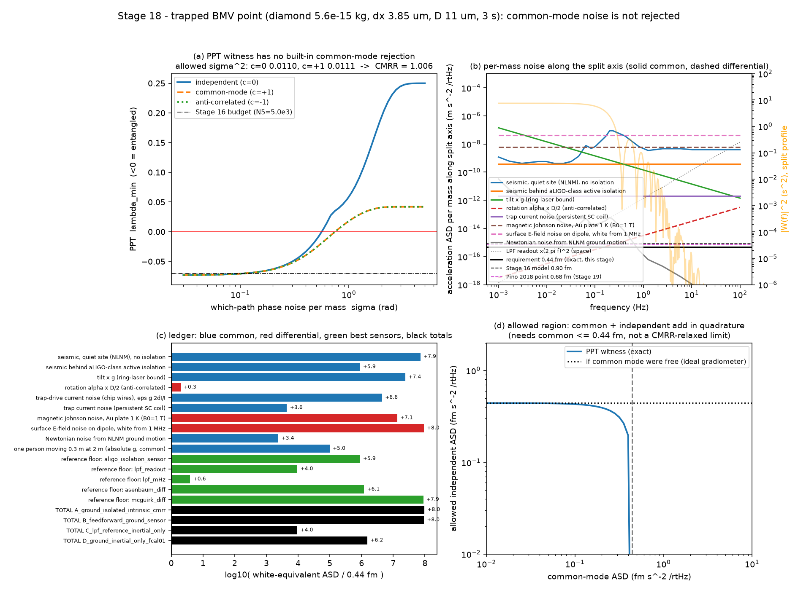

## Stage 19 — Spin-free superposition and readout for the heavy BMV masses

**Question.** Stage 16 left the Pb Meissner sphere (1e-14 kg, 15 mK, 1 s hold) needing $\Delta x=2.69\,\mu$m, i.e. $F\equiv\Delta x/2z_{\rm zpf}(100\,{\rm Hz})=4.65\times10^5$, with no which-path tag. Which routes create and read out a spatial superposition without an embedded spin, and what gap do they leave inside the *unchanged* Stage 16 budget? Scripts: `scripts/stage19_run.py` (imports `stage16_run.evaluate/min_dx_point`), `scripts/stage19_fig.py`; output `results/stage19.json`, `figures/stage19_tagging.png`.

**Assumptions (ASSUMED, flagged).** (i) A coherent Gaussian of spread $\sigma$ entangles like a cat of $\Delta x=2\sigma$ (Pedernales & Plenio 2023 argue the rate is set by delocalisation; O(1), ~0.3 orders). (ii) For transient expansions the time-averaged $\Delta x^2$ is $\Delta x_{\max}^2/3$ (DERIVED for linear growth): a $\sqrt3$ (0.24 order) penalty applied to every loop/expansion route. (iii) Pino's coherence length $\xi$ is used as $\Delta x$.

**Required F (DERIVED, Stage 16 code).** Pb lead point $F=4.65\times10^5$ ($\sqrt{S_a}\le0.85$ fm s⁻² Hz⁻½). Minimum over mass at 1 s: $1.73\times10^4$ at $3.2\times10^{-7}$ kg ($\sqrt{S_a}\le0.004$ fm); any hold: $7.7\times10^3$ (5 s). Stage 12 cheap diamond point, spin removed: $F=4.99\times10^5$.

| Route | Class | Status | F provided | Readout / tag | Gap (orders) at its point | Other binding gap |
|---|---|---|---|---|---|---|
| Romero-Isart et al., PRL 109, 147205 (2012), [arXiv:1112.5609](https://arxiv.org/abs/1112.5609) | a, flux qubit | proposed | 0.011 ($l_s=8x_{zp}g_0/\omega_t=0.37x_{zp}$ at 28 kHz; 10 fm, 3.8e-13 kg) | qubit tag | **7.12** | own numbers give $2t^*/T_2=3.6$, violating their $2t^*\ll T_2$ (flag) |
| Pino et al., QST 3, 025001 (2018), [arXiv:1603.01553](https://arxiv.org/abs/1603.01553) | a, SC double slit | proposed | $1.9\times10^5$ ($\xi=607$ nm, 3.3e-14 kg Nb, 483 ms) | SQUID position fringes, no tag | **0.55** (vs 1.23 μm needed at 0.5 s, ×√3) ; cat $d=0.5\,\mu$m lives 84 ms → 0.78 | vacuum 0.98 (their 1e-17 mbar vs 1.1e-16 Pa needed); noise 0.41 vs LPF, 4.35 vs ground |
| Hexapole/double-well Meissner traps, QST 2026, [arXiv:2607.03622](https://arxiv.org/abs/2607.03622) | a/b | proposed | ~50 ($D<100z_{\rm zpf}$) | pulsed position | 3.82 | Q ≥ 1e11 vs 2.6e7: 3.59; ppb field stability |
| Hofer et al., PRL 131, 043603 (2023); Chalmers thesis 2026 (doi:10.63959/chalmers.dt/5848) | a | demonstrated, classical | 0 | SQUID, 20 GHz/Φ0 resonator | n/a | no ground state, no qubit coupling demonstrated anywhere |
| Rossi et al., PRL 135, 083601 (2025), [arXiv:2408.01264](https://arxiv.org/abs/2408.01264) | b | **demonstrated** (optical silica) | 3.5 | position | 5.36 (5.12 without √3) | not SC |
| Weiss et al., PRL 127, 023601 (2021), [arXiv:2012.12260](https://arxiv.org/abs/2012.12260) | b, loop | proposed | 1e3 | position | 2.91 | authors call gravity entanglement "a formidable task" |
| Roda-Llordes et al., PRL 132, 023601 (2024), [arXiv:2303.07959](https://arxiv.org/abs/2303.07959), XL / XXL | b, double-well loop | proposed | 7.1e3 / **7.1e4** | position after recompression | XL 2.06, **XXL 1.06** at Pb point; XXL 1.09 at Stage 12 cheap point; XXL −0.37 at 3.2e-7 kg | XXL needs 97 dB squeezing and ω=2π·0.01 Hz under a 100 Hz Ω: loop ~16 s > 1 s hold (DERIVED); at the heavy mass noise 2.63 orders below LPF |
| Neumeier et al., PNAS 121 (2024), [arXiv:2207.12539](https://arxiv.org/abs/2207.12539) | b, cubic | proposed | few nm at >1e8 amu (silica, ms) | position | not competitive | — |
| Lami, Pedernales, Plenio, PRX 14, 021022 (2024), [arXiv:2302.03075](https://arxiv.org/abs/2302.03075) | c, LOCC inequality | proposed | none needed (coherent states) | displacement + zero-phonon detection | 0 in Δx | T/Q < 1e-13 K: 3.76 vs Hofer, 8.33 vs best torsion; torsion ground state 3.78 (6000 phonons, Shin 2025, [arXiv:2409.02275](https://arxiv.org/abs/2409.02275)). In the 100 Hz Pb trap γ=(8π/3)Gρ/ω = 1.0e-8 s⁻¹, so 1% fidelity loss needs 5e5 s (DERIVED): no rescue |
| Krisnanda et al., npj QI 6, 12 (2020), [arXiv:1906.08808](https://arxiv.org/abs/1906.08808) | c, Gaussian CV | proposed | — | quadratures | Stage 16 c″: joint 15.6 | needs 0.009 fm noise |
| Hanif, Das, Ulbricht, Bose, PRL 133, 180201 (2024), [arXiv:2307.08133](https://arxiv.org/abs/2307.08133) | c | proposed | — | **spin** | not spin-free | honest negative |
| Großardt, PRA 102, 040202 (2020), [arXiv:2007.05762](https://arxiv.org/abs/2007.05762) | c | analysis | — | — | — | $S_a\ll2G\hbar/d^3$ applies to all routes |
| Kotler et al., Science 372, 622 (2021), [doi](https://www.science.org/doi/10.1126/science.abf2998) | d | **demonstrated** | ~1 (70 pg drums) | quadrature tomography of CV entanglement | — | shows the spin-free *readout* exists; coupling electromechanical |

**Combinations (DERIVED).** *Tag-then-inflate* (Romero-Isart flux-qubit tag amplified by an XXL loop, which scales branch separation and width alike): needs ×2.3e7 amplification vs 7.1e4 available, **2.51 orders** left. A tag costs ~1.5 orders more than going tagless. *Inflate-only + CV witness* (XXL loop on the Pb sphere, Kotler-type quadrature readout): **1.06 orders** at the Stage 16 lead point; at $\ge3\times10^{-7}$ kg the delocalisation is covered on paper (−0.37) but the acceleration noise requirement (0.004 fm) is 2.63 orders below LISA Pathfinder.

**Findings.**
1. **Most promising spin-free route: Pino-type on-chip SC free expansion (proposed).** At its own design mass (3.3e-14 kg Nb, 0.5 s) its 607 nm coherent state is **0.55 orders** short of the Stage 16 requirement (0.31 without the √3 penalty), plus a 0.98-order vacuum gap against the 1e-17 mbar it already assumes and a 0.41-order noise gap vs LPF. The readout (SQUID position fringes) is native and needs no tag, but a *two-sphere* gravity witness from fringe correlations is not in Pino's paper (ASSUMED feasible).
2. **Runner-up: Roda-Llordes XXL double-well loop, 1.06 orders** at the Pb lead point and 1.09 at the Stage 12 cheap point (spin removed). Native to dielectrics ("in the dark"); Meissner implementation is only proposed (hexapole traps, which themselves need Q ≥ 1e11).
3. **Demonstrated status: nothing spin-free exists for superconductors.** No Meissner sphere has reached a ground state or coupled to a qubit. The only demonstrated coherent CoM expansion is Rossi's ×3.5 in optical silica, leaving **5.12 orders** at the Pb point (5.15 at the cheap point). Stage 16's 5.1-order conclusion stands.
4. **Gravity-only witnesses do not rescue the 100 Hz designs.** LPP's no-delocalisation test needs mHz modes, T/Q < 1e-13 K (≥3.8 orders) and a torsion ground state (3.8 orders); in the Stage 16 trap it would need 5e5 s per run. Hanif 2024 needs spins.
5. **The flux-qubit tag is tiny.** Romero-Isart's own numbers give a superposition of 0.37 zero-point widths (7.1 orders short), and their timing inconsistency ($2t^*=36\,\mu$s > $T_2=10\,\mu$s) means ~1 ms qubits would be needed.

**Coincidences flagged.** Roda-Llordes XL ($7.1\times10^3$) is within 8% of the 5 s heavy-mass requirement ($7.7\times10^3$); Pino's $F=1.9\times10^5$ sits within a factor 2 of the requirement at its own mass. Both are proposals designed for other purposes; neither was tuned to this budget. LPP's quoted γ = 1.6e-4 Hz vs 2.4e-4 Hz recomputed from their m and R (×1.49) is flagged, not resolved.

**Net.** Spin-free routes cut the *proposal-level* delocalisation gap from 5.1 orders (vs demonstrated) to **0.55 orders** (Pino-type expansion) or **1.06 orders** (XXL loop at the Pb point), but every one is unbuilt, and the same budget's acceleration noise (0.4–2.6 orders beyond LPF, 4+ beyond ground) and vacuum (≈1 order) remain binding.

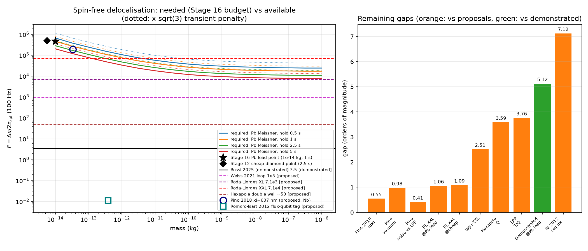

---

## Stage 20 — The real vacuum gap: species, temperature and demonstrated densities

**Question.** Stages 12/16/19 quoted vacuum requirements as pressures: 8.4e-16 Pa (cheap diamond point, He at 4 K), 1.1e-16 Pa (Pb Meissner, 15 mK), 1.05e-16 Pa (Pino Nb, 50 mK, "0.98 orders short of 1e-17 mbar"). What is the gap against what has actually been demonstrated, species by species? Scripts: `scripts/stage20_run.py` (calls `stage16_run.evaluate` unchanged), `scripts/stage20_fig.py`; `results/stage20.json`; `figures/stage20_vacuum.png`.

**1. The right figure of merit is impingement flux, not pressure (DERIVED).** All three points are deep in the short-wavelength (saturated) regime: the He thermal wavelength is 0.44 nm at 4 K, 3.9 nm at 50 mK and 7.1 nm at 15 mK, against $R=0.6$–$1\,\mu$m and $\Delta x=1.2$–$3.9\,\mu$m ($\Delta x/\lambda_{\rm th}=268$–$8830$, $R/\lambda_{\rm th}\ge59$). The Stage 16 interpolation gives saturated fraction 1.000 for He and H₂ in every case; the rate would only halve for $\Delta x\le\lambda_{\rm eff}=0.45$–$7.4$ nm. Every collision is a full which-path measurement, and the Stage 12/16 rate $\Gamma=(16\pi/3)nR^2\sqrt{2\pi kT/m_a}$ is identically $(32\pi^2/3)R^2J$ with $J=n\bar v/4$. **The requirement is a flux, independent of species and gas temperature.** A pressure needed at 15 mK cannot be compared with a pressure measured at 4 K: at fixed flux, $P\propto\sqrt{T m_a}$.

| Design (Stage 16 budget, 40% gas rule) | $R$ | $\Gamma_{\rm gas}$ allowed | $J_{\rm req}$ (m⁻² s⁻¹) | $n_{\rm req}$ He at design T | $n_{\rm req}$ He at 4 K / H₂ at 4 K / H₂ at 300 K |
|---|---|---|---|---|---|
| Stage 12 cheap diamond (5.6e-15 kg, 3.85 μm, 2.5 s, gas 4 K) | 0.73 μm | 0.031 s⁻¹ | **5.5e8** | 1.5e7 (4 K) | 1.5e7 / 1.1e7 / 1.2e6 |
| Stage 16 Pb (1e-14 kg, 2.69 μm, 1 s, 15 mK) | 0.59 μm | 0.042 s⁻¹ | **1.1e9** | 5.1e8 (15 mK) | 3.1e7 / 2.2e7 / 2.6e6 |
| Stage 19 Pino Nb (3.3e-14 kg, 1.23 μm, 0.5 s, 50 mK) | 0.97 μm | 0.062 s⁻¹ | **6.2e8** | 1.5e8 (50 mK) | 1.7e7 / 1.2e7 / 1.4e6 |

**2. Demonstrated limits, converted properly.** Lifetime limits are *upper limits on density* under a single-species assumption, not measurements. I reconverted them with the Langevin capture rate for $\bar p$ + neutral, which is velocity independent, so the density limit does not depend on the temperature assumed (DERIVED; every capture ASSUMED to annihilate): $k_{\rm He}=1.18\times10^{-15}$, $k_{\rm H_2}=2.54\times10^{-15}$ m³ s⁻¹.

| Source | Kind | $n$ (m⁻³) | species, T | $J$ (m⁻² s⁻¹) | gap vs cheap / Pb / Pino (orders; − = margin) |
|---|---|---|---|---|---|
| BASE reservoir trap, 405 d, $\tau>10.2$ a (Sellner et al., NJP 19, 083023 (2017), [link](https://iopscience.iop.org/article/10.1088/1367-2630/aa7e73)) | upper limit, 68% CL | < 2.6e6 (He) / < 1.2e6 (H₂) | 6.2 K can | < 1.2e8 / < 7.8e7 | **−0.67 / −0.98 / −0.72** (He); −0.85 / −1.16 / −0.90 (H₂) |
| Gabrielse et al., PRL 65, 1317 (1990), [link](https://journals.aps.org/prl/abstract/10.1103/PhysRevLett.65.1317); Fei thesis, [INSPIRE](https://inspirehep.net/literature/306801) | upper limit | < 1e8 ("100 cm⁻³", "<5e-17 Torr at 4.2 K") | He, 4.2 K | < 3.7e9 | +0.83 / +0.51 / +0.78 |
| MPIK CSR, RSI 87, 063115 (2016), [doi](https://doi.org/10.1063/1.4953888) | upper limit | < 1.4e8 | H₂, ~6 K | < 8.8e9 | +1.20 / +0.89 / +1.15 |
| MPIK CryPTEx, RSI 83, 083115 (2012), [doi](https://doi.org/10.1063/1.4742770) | conservative upper limit | < 1.8e9 (1e-15 mbar at 4 K) | H₂, 4 K | < 9.3e10 | +2.22 / +1.91 / +2.17 |
| Room-temperature XHV gauge plateau ~1e-14 Torr (Redhead, Vacuum 53, 137 (1999), via [Stutzman 2006](https://www.jlab.org/accel/inj_group/docs/2006/XHV.pdf)) | measured, gauge-limited | 3.2e8 | H₂, 300 K | 1.4e11 | +2.41 / +2.10 / +2.36 |
| MAQRO requirement/Astrium estimate 1e-13 Pa ([arXiv:1307.7021](https://arxiv.org/abs/1307.7021)) | proposed | 3.6e8 | H₂, 20 K (ASSUMED) | 4.1e10 | +1.88 / +1.56 / +1.83 |
| MAQRO QPPF study "at best 1e-11 Pa" with cover ([Commun. Phys. 4, 155 (2021)](https://www.nature.com/articles/s42005-021-00656-7)) | study estimate | 3.6e10 | H₂, 20 K | 4.1e12 | +3.88 / +3.56 / +3.83 |
| Solar wind at 1 AU, 5 cm⁻³ at 400 km/s ([NASA](https://pwg.gsfc.nasa.gov/Education/wsolwind.html)) | environment, directed | 5e6 | p⁺, 1 keV | 2e12 ($nv$) | +3.56 / +3.24 / +3.51 unless shadowed |
| Pino 2018 assumption 1e-17 mbar at 50 mK | assumed | 1.45e9 | He, 50 mK | 5.9e9 | +1.03 / +0.71 / +0.98 |
| Stage 12/16 SOA convention 1e-15 Pa at 4 K | convention | 1.8e7 | He, 4 K | 6.6e8 | +0.08 / −0.24 / +0.03 |

Checks: my Langevin reconversion of BASE gives 2.2e-18 mbar (He) and 1.0e-18 mbar (H₂) at 6.2 K, against their quoted 2.7e-18 and 1.2e-18 (within 20%). Gabrielse's $\tau>3.4$ months gives $n<9.5\times10^7$ m⁻³ (quoted 1e8). The INSPIRE abstract's "more than 10³ days" is a lost superscript of "103 days" (= 3.4 months, DERIVED). **Correction to Stage 19:** its "0.98-order vacuum gap" for Pino was measured against Pino's own assumption: a 4 K Penning-trap pressure re-used at 50 mK, which is 9.5× more flux than the 4 K density it came from. It was not a gap against the demonstrated state of the art.

**3. What can be in the gas phase at each temperature (vapour pressures).** ITS-90 Table 3 is used where valid (Preston-Thomas 1990, [text](https://mx.omega.com/techref/intltemp.html)). Below that I used a zero-entropy extrapolation, $p=(mkT/2\pi\hbar^2)^{3/2}kT\,e^{-L_0/T}$, with $L_0$ fitted at the bottom of each ITS-90 range. The fitted values are $L_0=59.8$ J/mol (⁴He) and 19.9 J/mol (³He), against literature ≈59.6 and 21.1 J/mol. Check: the ⁴He extrapolation reproduces Donnelly & Barenghi's 15.58 Pa at 1.000 K to 0.05% ([table](https://pages.uoregon.edu/rjd/vapor18.htm)). H₂ comes from Souers et al. 1977, normal-H₂ solid fit ([OSTI 7110677](https://www.osti.gov/servlets/purl/7110677)).

| T | ³He SVP | ⁴He SVP | solid H₂ SVP | He on graphite ($E_b$=12.2 meV, [RMP 53, 199](https://doi.org/10.1103/revmodphys.53.199)), full monolayer |
|---|---|---|---|---|
| 4 K | 2.0e5 Pa | 8.2e4 Pa | 3.7e-5 Pa ($n$=6.7e17) | $n$=5.9e12 m⁻³: needs coverage ≤ 2.6e-6 monolayer |
| 1 K | 1.16e3 Pa | 15.6 Pa | 3e-35 Pa (extrap.) | 2e-34 m⁻³ |
| 100 mK | 1.7e-9 Pa ($n$=1.2e15, fatal) | 3.7e-30 Pa | 0 | 0 |
| 50 mK | 1.2e-20 Pa ($n$=1.7e4) | 4e-62 Pa | 0 | 0 |
| 15 mK | 2e-70 Pa | 3e-209 Pa | 0 | 0 |

The equilibrium flux falls below the (common) requirement at **³He 61 mK, ⁴He 0.17 K, multilayer H₂ 1.94 K, and He on graphite 2.95 K (full monolayer) to 3.44 K (1e-3 monolayer)**. These crossovers are DERIVED and the same to ±2% for all three designs.

What cryosorption buys at 4 K is only ≈1.7e16 He atoms per gram of charcoal (ASSUMED 1000 m²/g with uniform graphite binding; real pore sites bind more strongly). At ≤1 K every surface is a perfect He pump. Hydrogen is the trap at 4 K: one multilayer of condensed H₂ gives 0.09 mPa. CERN found that condensed H₂ under 300 K radiation stalls at 1e-8–1e-7 Pa even below 3 K, through phonon-stimulated desorption ([CERN Courier](http://cds.cern.ch/record/2746077)).

**4. Bottom line per design.**
- **Stage 12 cheap diamond (gas 4 K):** BASE-class upper limit passes with **0.67 orders margin** (He) and 0.85 (H₂). The next-best demonstrated limit, Gabrielse, is 0.83 orders short. Binding species: He or H₂ at 4 K. Two conditions: H₂ must never be condensed beyond a sub-monolayer within view, and He inventory must stay below a few e16 atoms per gram of sorbent. The cheap point's own 4 K gas temperature is the weak spot; walls ≤1.9 K remove H₂ as an equilibrium source.
- **Stage 16 Pb Meissner (15 mK):** passes BASE by **0.98 orders** (He) and fails Gabrielse by 0.51. At 15 mK there is no equilibrium source for any species: ³He gives 7e-46 m⁻³. The binding sources are non-thermal: leaks from the mixture circuit, gas beamed through apertures from ≥2 K stages, and radiation-stimulated desorption. Allowed leak into a 10 cm cold box (s = 1, ASSUMED): 1.1e7 atoms/s = **4.7e-13 mbar L/s**, at the detection floor of the best He leak detectors (≤5e-13, [Pfeiffer ASM 340](https://heliumleakdetection.net/helium-leak-detectors/pfeiffer-adixen-leak-detectors/pfeiffer-asm-340-helium-leak-detector/)). So the sample vacuum must be sealed separately from the dilution circuit, not merely "inside the IVC".
- **Stage 19 Pino Nb (50 mK):** passes BASE by **0.72 orders**, fails Gabrielse by 0.78. At 50 mK, ³He liquid in view still gives only 1.7e4 m⁻³. The ³He margin vanishes at 61 mK, and at 100 mK ³He vapour is 6.9 orders over.

**Does a 15 mK dilution-refrigerator chamber close it?** *Plausibly, but undemonstrated.* At 15–50 mK the equilibrium gas density of every species is zero for practical purposes (DERIVED), so the reachable flux is set by engineering: a sealed can with no warm line of sight, like BASE's indium-sealed 1.2 L copper can at 6.2 K. With that, the requirement is met with 0.7–1.0 orders to spare. **Honest negatives.**
- No gas density has ever been measured or bounded below about 1e8 m⁻³ in a mK chamber. The best bounds are all from 4–6 K sealed Penning traps or storage rings.
- Levitation experiments' own damping gives no useful bound: Hofer 2023's $Q=2.6\times10^7$ with Epstein drag implies only $n\lesssim5\times10^{20}$ m⁻³ (DERIVED).
- BASE's bound comes from a hermetic can without the optical, microwave and loading access a BMV chamber needs.
- Quantum reflection of mK He atoms off surfaces (sticking s < 1) would raise the steady-state density by 1/s; this is not quantified here.

**Coincidences flagged.** The three requirements land within a factor 2 ($J=5.5$e8–1.1e9). This is by construction (same 40% rule, $N_5\le10^4$, similar $R$ and $t$), not physics. The Stage 16 convention (1e-15 Pa at 4 K, He) happens to sit within ±0.24 orders of all three: also not independent, since the Stage 12 cheap point was selected under that same 1e-15 Pa assumption. The ³He crossover (61 mK) lies just above Pino's 50 mK design temperature; this is not tuned, but the margin is thin.

**Net.** In flux terms the vacuum is **not** co-binding against the best demonstrated limit: −0.67 (cheap), −0.98 (Pb), −0.72 (Pino) orders, i.e. margins. It **is** binding against everything else: +0.5 to +0.8 vs Gabrielse 1990, +0.9 to +1.2 vs CSR, +2.1 to +2.4 vs room-temperature XHV, +1.6 to +3.9 for MAQRO-style space vacuum. The real gap is therefore 0 to 0.8 orders, conditional on reproducing a BASE-class sealed cryogenic can around a levitated sphere with optical or SQUID access. That has never been done.

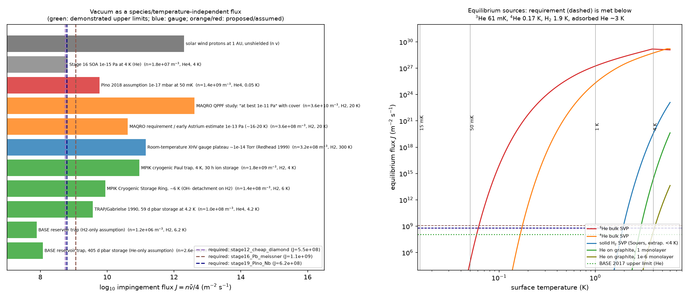

## Stage 21 — Loosening the acceleration-noise requirement instead of meeting it

**Question.** Stage 18 showed what happens if we try to *meet* the requirement:
- per-mass requirement $0.44$ fm s⁻²/√Hz, from the exact model at $N_{5\sigma}=5049$;
- ground floor +6.0 orders from seismic noise, +8.0 once the plate's surface electric-field noise is included;
- space-grade floor +4.0.

Stage 21 asks which design changes **loosen** the requirement instead, scored in orders with the same exact model: the QGEM state with gas and blackbody decoherence plus jointly Gaussian which-path phases, and $N_5=25/\lambda^2$.

**Method.** For a noise spectrum $S(f)$ under protocol $P$:
- residual (orders) $=\tfrac12\log_{10}\big(\kappa^2\!\int S|W_P|^2df\,/\,\sigma^2_{\rm allowed}(P)\big)$;
- $W_P$ is the Fourier transform of the branch profile $w(t)$;
- the band runs from 1 mHz to 300 Hz, as in Stage 18.

**Shot rule.** All designs use the Stage 16 cap $N_5\le10^4$ (ASSUMED). At Stage 18's $N_5=5049$, noise gets only 4% of the slack, and every protocol that adds any duration becomes infeasible, so that criterion cannot rank levers. With $N_5\le10^4$ the baseline requirement is **1.27 fm s⁻²/√Hz**. Moving the cap from 5049 to 10⁴ is itself the first lever, worth +0.46 orders.

**Files.** Scripts: `scripts/stage21_run.py` (about 20 s) and `scripts/stage21_fig.py`. Data: `results/stage21.json`. Figure: `figures/stage21_redesign.png`.

### 21.0 A ceiling on any protocol-level loosening (DERIVED)

The which-path variance is $\sigma^2=\kappa^2S\,t/2$ with $\kappa=m\Delta x/\hbar$. The allowed $\sigma^2$ is a fixed fraction of $\Phi\propto Gm^2\Delta x^2t/\hbar D^3$. Together these give $S_{\rm req}\propto G\hbar/D^3$, **independent of $m$, $\Delta x$ and $t$**. This is the Großardt (2020) form $2G\hbar/d^3$; at $D=11\,\mu$m it equals $\sqrt{2G\hbar/D^3}=3.25$ fm s⁻²/√Hz.

Our requirement sits at 0.136 of that ceiling at $N_5=5049$ and at 0.39 at $N_5=10^4$. No change to protocol, shot count, mass or hold time can loosen it by more than **0.87 orders relative to Stage 18**. The only geometric knob is $D$, and it scales as $D^{-3/2}$: separating the masses *tightens* the requirement.

### 21.1 Lever ledger

| lever | effect (orders; + loosens) | verdict |
|---|---|---|
| allow up to 10⁴ shots instead of 5049 | **+0.46** (0.44 → 1.27 fm) | survives (ASSUMED shot cap) |
| hold 2.5 → 5 s, 10⁴ shots | +0.15 (1.78 fm) | marginal; 10 s gives +0.12; 20 s fails because of gas ($\gamma t$ ∝ t) |
| shorter shots, more repetitions, same wall-clock (overhead 2 s ASSUMED) | holds of 0.1–1 s are **infeasible** (no $N_5$ reaches λ); 5 s is the best at +0.11 | **negative** |
| echo, 1 branch swap mid-hold (SG π-flip; local DC phase cancels, entangling phase keeps accumulating) | tilt (1/f) **+0.98**; flat isolated seismic −0.10; NLNM −0.36; white surface noise −0.11 | survives **only against 1/f-like noise** |
| echo, 2 swaps | requirement 0.69 fm; all sources worse than 1 swap; 3 or more swaps lose the entanglement (gas over the longer shot) | negative |
| remove the plate: Casimir–Polder sets $D=273\,\mu$m (DERIVED, independent of $m$); $m$ raised to 2.8×10⁻¹⁴ kg to keep Φ | requirement tightens by **−2.09**; the plate's E-field (+7.5) and Johnson (+6.7) noise go away, but on the ground trap surfaces at 100 µm (ASSUMED) give +5.0 (E-field) and +6.2 (Johnson) | **negative on the ground**, enabling in space |
| keep the plate, engineer a neutral dipole ($p=0$, $q=0$) and use a non-metal plate (no Johnson noise) | E-field on the dipole replaced by the induced dipole in a static 10 mV patch field (ASSUMED): +7.5 → **+5.0** (+2.5) | survives, but the residual still exceeds seismic |
| stiffer trap | **0** (DERIVED: in the trap frame the inertial force is $-ma$ at any ω). A separately mounted SG source makes things *worse*: relative motion couples as $m\omega^2X$, so $X_{\rm rel}\le3.2\times10^{-21}$ m/√Hz at 100 Hz | negative |
| drop tower or Einstein-Elevator with trapped masses (10⁻⁶ g residual, spread flat over 0.1–10 Hz, ASSUMED) | +9.4 vs +5.5 for isolated ground (**−3.9**); 10⁴ shots take 3,333 days at ZARM (3 drops/day) or 33 days at the Einstein-Elevator (300/day) | **negative** |
| ISS with trapped masses (SSP 41000E vibratory limit) | +11.2 (**−5.7**) | **negative** |
| one trap, relative-mode readout, or a DFS | 0 (see 21.2) | **negative** |
| release the masses in drag-free space with no plate (Toroš/MAQRO-type) | platform noise decouples; the residual comes from direct forces, **+2.0** (21.3) | **survives** |

**Echo details (DERIVED).** One swap costs 0.5 s of transit. That transit is counted as adding no entangling phase (conservative) but it does add gas decoherence. $|W(f)|^2$ goes to zero at DC, but its peak moves to about $1/T\approx0.3$ Hz, which sits on the microseism peak (panel a). Hence the result: echo helps against the ring-laser 1/f tilt bound and hurts against NLNM. In acceleration, seismic noise does **not** fall steeply above 1–10 Hz: the NLNM stays between about −169 and −160 dB from 1 to 10 Hz. It falls in displacement, but the phase filter already suppresses high frequencies as $1/f^2$.

### 21.2 Relative-coordinate and one-trap protocols: Stage 18's no-CMRR result holds (DERIVED)

- **Collective dephasing has one decoherence-free subspace.** For two qubits under correlated dephasing it is span{|LR⟩,|RL⟩}. The Bell state inside it keeps $\lambda=-0.5$ under any common noise. But that state is entangled at preparation. The only product states in the subspace, |LR⟩ and |RL⟩, pick up only a global phase from gravity, so the subspace cannot host a test of gravity-mediated entanglement, which must start from a product state.
- **Two particles in one trap, Gaussian modes.** Take the CM mode thermal with $n$ (driven by common noise) and the relative mode squeezed by $r$. The minimum PT symplectic eigenvalue crosses 1/2 exactly at $e^{2r}=2n+1$, checked for $r$ = 0.1, 0.5 and 1. So common-mode noise in the CM mode destroys 1|2 entanglement unless the relative-mode squeezing beats it. There is no rejection.
- **Anti-parallel splitting** has an intrinsic CMRR of 1.006, as found in Stage 18.

### 21.3 Best combined designs (residual in orders over the protocol's own requirement)

| design | residual (orders) | binding source |
|---|---|---|
| ground baseline at $N_5\le10^4$ (isolated seismic + tilt) | +6.9 | tilt (1/f bound) |
| same, with plate surface noise | +7.5 | plate E-field |
| **ground: 1 echo swap + neutral dipole + non-metal plate** | **+6.0** | isolated seismic (+5.6) ≈ tilt (+5.9); induced dipole +5.1 |
| ground: no plate, $D=273\,\mu$m, echo | +8.1 | tightened requirement |
| drop tower, trapped | +9.4 | capsule residual |
| space, trapped, LPF-grade readout | +3.5 | readout × $(2\pi f)^2$ |
| **space: released, drag-free, no plate, $D=273\,\mu$m** | **+2.0** (white E-field) / +5.7 (1/f E-field) | E-field from electrodes at 1 mm on $p=10^{-2}$ e·cm (+2.0); spacecraft self-gravity jitter +1.7 |

The space requirement is $1.0\times10^{-17}$ m s⁻²/√Hz. Meeting it needs $p\le1\times10^{-4}$ e·cm at 1 mm (or larger electrode distances, since the noise scales as $z^{-3}$). It also needs spacecraft jitter $\le1.9\times10^{-11}$ m/√Hz for 500 kg at 0.5 m (ASSUMED values; noise scales as $2GM\delta r/r^3$).

**Net change vs Stage 18.**
- **Ground:** the floor moves from +6.0/+8.0 to **+6.0** at best. The real gains are shots (+0.46), echo against tilt (+0.98) and neutralising the dipole (+2.5 on that source). None of them moves the isolated-seismic floor; seismic noise stays the firm limit, and the requirement cannot loosen past the $G\hbar/D^3$ ceiling.
- **Space:** releasing the masses, which removes trap coupling and the plate, moves the floor from +4.0 to **+2.0**. That figure rests on two ASSUMED inputs, the electrode distance and the spacecraft jitter.

**Coincidences flagged.**
- The 2-swap echo requirement, 0.687 fm, is within 1% of Stage 19's Pino point (0.68 fm). The two calculations are unrelated.
- In space, self-gravity (+1.7) and electrode E-field noise (+2.0) land within a factor 2 of each other. Both use ASSUMED parameters.
- The no-plate trap-surface E-field orders and the space 1 mm white E-field residual are identical (+4.995 in both). The scalings $a\propto z^{-3}/m$ and $\sqrt{S}\propto z^{-2}$ make the 100 µm/1 mm cases mirror each other, so this is algebra, not physics.

**Honest negatives.**
- Shorter shots, stiffer traps, drop towers, the ISS, multi-swap echo, relative-mode readout and a decoherence-free subspace all fail to loosen anything.
- Removing the plate on the ground costs 2.1 orders.
- Most of the loosening budget is capped at 0.87 orders by $G\hbar/D^3$.

**Sources (opened this stage).**
- ZARM Bremen Drop Tower Payload User's Guide: 4.7 s drop, 9.3 s catapult, 10⁻⁶ g, at most 3 flights/day. https://www.zarm.uni-bremen.de/fileadmin/user_upload/Research/Testing_and_Facilities/ZARM_BDT_PUG.pdf ; ESA user guide: 10⁻⁶–10⁻⁵ g. https://wsn.spaceflight.esa.int/docs/EUG2LGPr3/EUG2LGPr3-4-DropTower.pdf
- Hannover Einstein-Elevator: 4 s, <10⁻⁶ g, 300 tests/day. https://www.hcmr.uni-hannover.de/en/details/einstein-elevator ; the current carrier shows more than 10⁻³ g (Sci. Rep. 2023). https://www.nature.com/articles/s41598-023-46483-4
- ISS microgravity specification SSP 41000E: one-third-octave rms ≤16 µg × f over 0.1–100 Hz, 1.6 µg over 0.01–0.1 Hz. https://gipoc.grc.nasa.gov/pims/MMAP/PIMS_ORIG/MEIT/MEIT_pdfs/ISS_Requirements.pdf
- Toroš et al., PRR 3, 023178 (2021), arXiv:2007.15029: the free-fall capsule removes inertial noise.
- Casimir–Polder sphere–sphere form, as used by Bose et al., PRL 119, 240401 (2017). This is ASSUMED to apply at $D\gg R$, with a 10% curvature cut as in Stage 16.
- Stage 18 sources (NLNM, aLIGO ISI, G ring laser, LISA Pathfinder, Labaziewicz, Sedlacek) were reused unchanged.

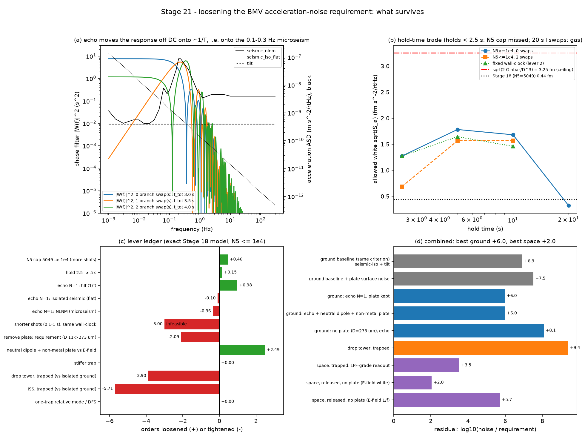

## Stage 22 — Designing the experiment that closes the non-local Oppenheim window

**Question.** Stages 15 and 17 left the non-local (Diósi–Penrose-like) window of Oppenheim et al. open by **3.66 orders**:
- floor: $l_P^2D_2 \ge 1.47\times10^{-29}$ kg² s m⁻¹ from Pedalino 2025 (172 kDa Na);
- ceiling: $l_P^2D_2 \le 6.69\times10^{-26}$ from Gisler 2022 (FOM 0.298 m² s⁻³).

This stage designs the interferometer that closes the window from below. It includes every real constraint, finds the cheapest point, compares the other routes and the ceiling side, and re-checks the model. Scripts: `scripts/stage22_run.py` (with `scripts/stage22_tl.py`) and `scripts/stage22_fig.py`. Output: `results/stage22.json`.

**Model re-check (part 3).**
- I fetched the journal text of Oppenheim et al., Nat. Commun. 14, 7910 (2023), Methods Eq. (47). It reads $\sigma_a^2Nr_N^3\Delta T/G^2 \ge l_P^2D_2 \ge N_\lambda M_\lambda^2/(R_\lambda\lambda)$ with $R_\lambda\sim V_\lambda^{1/3}\sim10^{-12}$ m, and quotes a lower bound of $10^{-35}$ kg² s m⁻¹. CITED.
- Stage 15 used exactly this expression: $N M^2\tau/R$ with $R=(r_N^2\Delta x)^{1/3}$, $r_N=10^{-15}$ m, and upper bound $(r_N^3/G^2)\,$FOM. Re-running it on Pedalino gives $1.47\times10^{-29}$, unchanged.
- arXiv:2203.01982v1 has a different Eq. (47): no $N_\lambda$, $R\sim10^{-9}$ m, and $10^{-40}$. The journal version supersedes it.
- **Erratum (units).** Stages 15 and 17 label $l_P^2D_2$ in kg s m⁻¹. The correct unit is **kg² s m⁻¹**, as in the published text. The numbers are unchanged.
- **Newer work (searched for 2025–26).** None of it tightens this window:
  - Oppenheim & Sajjad, arXiv:2605.05375 (v2, Sep 2026): covariant theory with dimensionless scalar and tensor couplings; LVK tensor ceiling ~3.3×10⁻⁶⁷; floor ~10⁻⁷¹. Different parameter.
  - Oppenheim, arXiv:2511.10738: stochastic Klein–Gordon theory, no new bound.
  - Hirotani & Matsumura, arXiv:2603.29230: strain spectra from GW detectors for the original model's $D_0$. Different kernel.
  - Angeli et al., arXiv:2501.13030 v3: an LOCC-diffusion torsion protocol. A proposal for a different parameter.
  - An unrefereed Zenodo note (10.5281/zenodo.24089422) argues that $V$ is set by a free smearing length, not by the wavepacket. This supports our Stage 15 convention flag.
  - A Nov 2026 "hexagonmath" preprint claims XENONnT excludes Gaussian covariant CQ gravity. Its own provenance note says it is AI-generated, and it is not on arXiv under the ID it shows. Not used.
  - **The 3.66-order gap stands.**

**Closing law (DERIVED).** In any symmetric Talbot–Lau interferometer (spatial or time domain), $\xi=L/L_T$ with $L_T=Mvd^2/h$. The coherence time is then $\tau=2L/v=2\xi d^2M/h$, so **the velocity drops out**. Closing requires

$$2\xi M^4 d^{5/3}/(h\,m_a\,r_N^{2/3}) \ge 6.69\times10^{-26}\ \text{kg}^2\,\text{s m}^{-1}.$$

Slowing the beam does not change the bound at fixed ξ. Slowing only keeps $L$ at laboratory length: $L=\xi d^2Mv/h$.

Mass needed to close, $M_{\rm close}$ (MDa):

| configuration | ξ=0.5 | 0.8 | 1.0 | 1.5 | 2.0 | τ at ξ=0.8 |
|---|---|---|---|---|---|---|
| Na, d=133 nm (MUSCLE, 266 nm) | 1.59 | **1.415** | 1.34 | 1.21 | 1.13 | 100 ms |
| Na, d=177.5 nm (355 nm) | 1.41 | 1.26 | 1.19 | 1.07 | 1.00 | 159 ms |
| Au, d=133 nm | 2.72 | 2.42 | 2.29 | 2.07 | 1.93 | 172 ms |
| Na, d=266 nm (LUMI period) | 1.19 | 1.06 | 1.00 | 0.91 | 0.84 | 301 ms |
| Au, d=78.8 nm (OTIMA 157 nm) | 3.39 | 3.01 | 2.85 | 2.57 | 2.40 | 75 ms |

- Lighter constituents help, because $N_\lambda=M/m_a$: Au needs 1.71× the mass of Na. This is a property of the Eq. (47) convention and is flagged.
- **Fixed MUSCLE length (L = 0.983 m, d = 133 nm), $M_{\rm close}(v)$:**

  | v (m/s) | 10 | 15 | 20 | 25 | 40 | 160 |
  |---|---|---|---|---|---|---|
  | M_close (MDa) | 1.13 | 1.30 | 1.43 | 1.54 | 1.80 | 2.85 |
  | ξ at M_close | 1.96 | 1.14 | 0.78 | 0.58 | 0.31 | 0.05 |

**Interference model (DERIVED from CITED formulas).**
- I used Pedalino et al. Methods Eqs. (1)–(9) with optical photodepletion and phase gratings, in both quantum and classical (moiré) forms, averaged over the velocity and mass distributions.
- Inputs are all CITED: $\sigma_{\rm ion,266}=(0.537\,m/{\rm kDa}-1.5)\times10^{-20}$ m², $\alpha_{266}/{\rm atom}=-4\pi\varepsilon_0(4.5\pm0.5)$ ų, vertical waist ≈600 µm, global factor 0.78.
- **Validation.** At 172 kDa, 160±10 m/s and 62/15.2/68 mW, the model gives $V_q=0.105$ and $V_{cl}=0.004$. The measured value is 0.10±0.01. Nothing was fitted.
- **5σ criterion.** $\Delta V_{\rm worst}\ge5\sqrt{2(N_s+N_b)}/N_s$.
  - $\Delta V_{\rm worst}$ is the smallest quantum–classical difference over α ±11% (CITED) × $\sigma_{\rm ion}$ ±20% (ASSUMED, because the fit is extrapolated ×8 in mass).
  - Dark counts $b=15$ cps (CITED lower end of 15–100).
  - Decoherence factors are applied to both models (conservative).
  - Grating powers are design variables, chosen on a fixed grid to minimise run time.

**Constraints at the chosen point** (ξ=0.8, M=1.415 MDa = 61,600 Na atoms, radius 8.2 nm, L=0.983 m, v=19.6 m/s, τ=100 ms):
- **Talbot length:** $L_T=1.23$ m.
- **Gravity sag:** $gT^2/2=12.4$ mm per arm. The 0.6 mm grating height (CITED) then limits Δv/v to ≤1.21%.
- **Grating orientation:** the grating vector must be horizontal. A vertical one would need Δv/v ≤ 6.7×10⁻⁷.
- **Coriolis** (48.2° N): the uncompensated fringe shift is 5.4 µm (40 d).
  - A deliberate tilt of $\theta_c=\Omega_\perp v/g=108$ µrad cancels the first-order velocity dispersion (DERIVED).
  - The residual is 0.27 nm (0.002 d) at Δv/v = 1%. Tilt tolerance is 27 µrad.
- **Thermal photons** (Drude Na with size-limited damping; electric and magnetic dipole; long-wavelength exponent $(d^2\tau/18)\int Rk^2$):

  | process | exponent |
  |---|---|
  | absorption of 300 K background | 0.032 |
  | Rayleigh scattering | 7×10⁻⁶ |
  | emission, $T_{\rm int}$ = 100 K | 2×10⁻⁵ |
  | emission, 300 K | 0.032 |
  | emission, 357 K | 0.10 |
  | emission, 600 K | 3.2 |

  So **$T_{\rm int}\lesssim350$ K is required** (DERIVED). Clusters that are only evaporatively cooled would fail. Cryogenically thermalised clusters pass.
- **Collisions.** The cross-section is the geometric $2.2\times10^{-16}$ m², which exceeds the r⁻⁶ value of $1.5\times10^{-16}$.
  - For an exponent of 0.1 the required H₂ pressure at 300 K is **≤1.06×10⁻¹⁰ mbar** (flux $J\le1.1\times10^{15}$ m⁻² s⁻¹).
  - At MUSCLE's 9×10⁻⁹ mbar the exponent is 8.5, so 2×10⁻⁴ of the clusters survive. **The vacuum must be 85× better.**
- **Material gratings and van der Waals dispersion.** Point-dipole Lifshitz $C_3=2.2\times10^{-44}$ J m³. For a 10 nm-thick wall at 19.6 m/s, the radius where the vdW phase reaches π is 323 nm, against a half-period of 66.5 nm.
  - **Material gratings are excluded.** The interferometer must be all-optical.
  - This also rules out LUMI-type SiN G1/G3 for metal clusters. A 532 nm all-optical variant cannot photodeplete Na: 2.33 eV is below the measured 2.4 eV work function (CITED).
- **Grating powers** (DERIVED for $n_0=6$, $\phi_0=1$): P1 = P3 = 2.2 mW and P2 = 67 µW. Pedalino used 62/15/68 mW.
  - Model visibilities ×0.78: $V_q=0.029$, $V_{cl}=0.433$.
  - $\Delta V_{\rm worst}=0.30$; transmission $S_0=0.054$.
- **Source, velocity and count rate.**
  - The demonstrated neutral beam runs at 120–170 m/s, about 140 ± 10 m/s (CITED). The fraction at 20 m/s is ~e⁻⁷², so **velocity selection cannot work. Active slowing is required.**
  - Route (MUSCLE's own proposal, CITED): mass-selected cluster anions, then a cryogenic ion guide, then electrostatic deceleration to 2.81 eV (stray-potential tolerance 0.056 V for Δv/v = 1%), then UV photodetachment.
  - Source: 10 pA mass-selected current (ASSUMED, at the CITED "tens of pA" for Ag and Cu up to ~70,000 atoms, M/ΔM ≈ 25) = 6.2×10⁷ s⁻¹.
  - Efficiencies (ASSUMED): neutralisation 0.3; transverse temperature 10 K (σ_v = 0.24 m/s), so a 0.5 mm collimation over 2L passes $f_{\rm geo}=6.7\times10^{-5}$; detection 0.1.
  - Result: **126 s⁻¹ at G1 and 6.2 cps detected**, giving **T(5σ) = 315 s** per P2 setting. A P2 curve of 8 settings (ASSUMED) takes about 0.7 h.
  - If the rate is 10× lower, T(5σ) is 6.5 h. If it is 100× lower, 26 days.

Statistical run time along the curve (ion route, L = 0.983 m):

| ξ | M (MDa) | v (m/s) | $\Delta V_{\rm worst}$ | T(5σ) |
|---|---|---|---|---|
| 0.2–0.4 | 2.0–1.68 | 55–33 | 0.01–0.03 | fails robust discrimination |
| 0.5 | 1.59 | 27.9 | 0.057 | 2,300 s |
| 0.6 | 1.52 | 24.3 | 0.15 | 546 s |
| **0.8** | **1.415** | **19.6** | **0.30** | **315 s** |
| 1.0 | 1.34 | 16.6 | 0.25 | 403 s |
| 1.5 | 1.21 | 12.2 | 0.17 | 3,000 s |

- The model agrees with Pedalino's statement that ξ ≳ 1 is needed. Below ξ ≈ 0.5 the quantum–classical difference does not survive the α/σ uncertainty.
- A 10× margin over the ceiling at ξ=0.6 needs 2.70 MDa at 13.7 m/s, with T(5σ) = 2,600 s.
- **Cheapest point.** The objective was fixed before the scan: all constraints pass and statistical time is minimal. The winner is **ξ = 0.8: 1.415 MDa Na at 19.6 m/s in the existing 0.983 m all-optical geometry.**
- **Neutral alternative without slowing.** At 140 m/s the arms must be 7.0 m (ξ = 0.8), 14 m in total, with Δv/v selected to 1.25%.
  - The rate is unknown. I scaled it from an inferred MUSCLE rate of ~2.8×10² cps at 172 kDa (from σ_V = 0.01 ⇒ ≥2×10⁴ counts per scan, with an ASSUMED 72 s scan).
  - With an ASSUMED 1.4-MDa/172-kDa flux ratio of 10⁻²: 0.26 cps, T(5σ) = 3.1×10⁵ s (3.5 days). At 10⁻³: about 1 year.

**Route comparison** (same Eq. 47 and $r_N$; orders left, negative = closes):

| route | status | orders left |
|---|---|---|
| Pedalino 2025, 172 kDa | demonstrated | 3.66 |
| MUSCLE 1 MDa @ 25 m/s, τ = 2L/v | proposed (Pedalino Fig. 3c) | **0.56** |
| same, τ = L/v as Stage 17 used | — | 0.86 — **erratum** |
| Na at d = 266 nm, 1 MDa, ξ = 1 (LUMI period) | needs material G1/G3 → excluded | 0.00 |
| OTIMA Au 10⁶ amu, 2nd Talbot order (τ = 60 ms) | proposed (Nimmrichter 2011) | 1.52 (closes at 2.40 MDa) |
| Bateman/Ulbricht 10⁶ amu Si, 286 ms release→screen, Δx 150 nm | proposed 2014, not realised | 0.10 (grating→screen only: 0.46); closes at 1.08×10⁶ amu |
| Neumeier/Romero-Isart 10⁸ amu, 1 ms, 5 nm | proposed | −4.08, **flagged** (Δx ≪ particle size) |
| Rossi 2025, 73 pm, 26.5 µs | demonstrated delocalisation | −5.69, **flagged** (same) |

- **Erratum (Stage 17).** The MUSCLE 1 MDa @ 25 m/s projection and the "1.93 MDa needed at 25 m/s" used τ = L/v. Pedalino's floor (and Stage 17's own 160 m/s figure) used τ = 2L/v. With τ = 2L/v the corrected values are **0.56 orders left** and **1.54 MDa at 25 m/s**.

**Ceiling side (closing from above).**
- The FOM must fall from 0.298 to **6.54×10⁻⁵ m² s⁻³**, i.e. 3.66 orders.
- At the thermal floor, $\mathrm{FOM}_{\rm th}=4k_BT\omega_0/(Qm_a)$ (Janse; independent of the sensor mass). That requires $T\omega_0/Q \le$ 3.9×10⁻⁸ K s⁻¹ (20 u), 1.25×10⁻⁷ (NdFeB) or 3.9×10⁻⁷ (Au).

| sensor | FOM (m² s⁻³) | vs needed |
|---|---|---|
| Amaral 2025 0.43 mg maglev, measured (CITED) | 0.881 | 4.13 orders short (vibration-limited) |
| same, thermal floor at 20 mK (ASSUMED), Q = 9.3×10⁶ (CITED) | 1.9×10⁻⁴ | 0.46 short |
| same, Q = 10⁸ (ASSUMED) | 1.75×10⁻⁵ | closes by 0.57 |
| room-T torsion, 1 mHz, Q 5×10⁵ (ASSUMED class) | 4.7×10⁻³ | 1.85 short |
| 4 K torsion, Q 10⁷ (ASSUMED) | 3.1×10⁻⁶ | closes by 1.32 |
| LISA Pathfinder (differential, L1) | 1.78×10⁻⁵ | would close by 0.57 |
| Asenbaum 2017 (differential) | 2.41×10⁻¹¹ | would close by 6.43 |

- **Honest flag.** The window is still "open" only because Stage 15 counts absolute sensors only. Admit LISA Pathfinder or Asenbaum and it is already closed from above. Nothing demonstrated in absolute mode is within 4 orders.

**Best route and demonstrated vs needed (part 4).** The best route is the slow-ion upgrade of MUSCLE at ξ ≈ 0.8.

| item | demonstrated | needed | gap |
|---|---|---|---|
| quantum-discriminating mass | 172 kDa (Pedalino 2025) | 1.415 MDa | ×8.2 (moiré only, 0.4–1 MDa) |
| beam velocity | 120–170 m/s neutral | 19.6 m/s, Δv/v ≤ 1.2% | ×7 slower; MDa anion deceleration and photodetachment not demonstrated |
| mass-selected current | tens of pA, ≤70k atoms (Ag/Cu) | ~10 pA of Na₆₁₆₀₀⁻ | at the edge; Na not shown |
| internal temperature | not reported | ≤ ~350 K | unknown |
| vacuum | 9×10⁻⁹ mbar | ≤1.1×10⁻¹⁰ mbar H₂ | ×85 (routine XHV technology) |
| alignment | Coriolis/gravity averaging absorbed into 0.78 | 108 µrad compensation tilt, ±27 µrad | new |
| $\sigma_{\rm ion}$, α at MDa | fit 100–200 kDa; α from 0.4–1 MDa | inside ±20% / ±11% | systematic |

Projected: **6.2 cps, 315 s per 5σ setting, ~0.7 h per P2 curve** (statistical, with ASSUMED efficiencies). The run time is not the bottleneck. Slowing and the source are.

**Coincidences flagged.**
1. The Na closing mass at d = 266 nm and ξ = 1 is 1.003 MDa, the same round "1 MDa" target as MUSCLE. That route is excluded anyway (material gratings).
2. The Bateman/Ulbricht 2014 design lands within 0.10 orders of closing. Its 10⁶ amu was chosen for free-fall reasons, not for this bound.
3. LISA Pathfinder (1.78×10⁻⁵) and the ASSUMED Q = 10⁸ maglev (1.75×10⁻⁵) both give +0.57. That is numerics, not physics.
4. τ ≈ 100 ms at the cheapest point equals Gerlich 2011's 0.1 s. Unrelated, because v drops out.

**Honest negatives.**
- Slowing buys nothing at fixed ξ. The bound depends on $M^4\xi d^{5/3}$.
- Every floor-side number rests on the Eq. (47) conventions: $\Delta x = d$, $r_N=10^{-15}$ m, $N_\lambda=M/m_a$. Of these, $\Delta x$ alone moves the bound only as $d^{-1/3}$, but the smearing length is free.
- The levitated routes that "close by 4–6 orders" do so only through Δx ≪ particle size, and are excluded by the Stage 17 rule.
- The source efficiencies are assumptions.

**Sources (verified this stage).**
- Oppenheim et al., Nat. Commun. 14, 7910 (2023), Eq. 47 and Table 1: https://www.nature.com/articles/s41467-023-43348-2 ; arXiv v1: https://arxiv.org/abs/2203.01982
- Pedalino et al., Nature (2026) / arXiv:2507.21211 (Methods Eqs. 1–9, σ_ion, α_266, waists, 9×10⁻⁹ mbar, 15–100 cps dark counts, 25 m/s statement): https://arxiv.org/html/2507.21211v1 , https://www.nature.com/articles/s41586-025-09917-9
- Pedalino et al., AVS Quantum Sci. 8, 013201 (2026), moiré 0.4–1 MDa, V = 0.41 ± 0.02, ~1% transmission: https://doi.org/10.1116/5.0301389
- MUSCLE project (anion mass selection, cryogenic ion guide, UV detachment): https://ucrisportal.univie.ac.at/en/projects/multi-skalen-cluster-interferenz/
- Size-selected cluster currents: Pratontep et al., RSI 76, 045103 (2005), https://doi.org/10.1063/1.1869332 ; Kemper et al., IJMS 254, 202 (2006) (tens of pA, M/ΔM ~ 25): https://buratto.chem.ucsb.edu/sites/secure.lsit.ucsb.edu.chem.d7_buratto/files/sitefiles/publications/Kemper_MassSpec_2006.pdf
- Bateman, Nimmrichter, Hornberger, Ulbricht, Nat. Commun. 5, 4788 (2014): https://www.nature.com/articles/ncomms5788
- Nimmrichter et al., PRA 83, 043621 (2011) (OTIMA, 10⁶ amu, 60 ms at 2nd order): https://doi.org/10.1103/physreva.83.043621 ; OTIMA: https://arndt.univie.ac.at/research/universal-matter-waves/otima-interferometry/
- Newer theory: https://arxiv.org/abs/2605.05375 , https://arxiv.org/abs/2511.10738 , https://arxiv.org/abs/2603.29230 , https://arxiv.org/abs/2501.13030 , https://doi.org/10.5281/zenodo.24089422
- Ceiling-side rows reuse the Stage 15/17 data (Gisler 2022, Amaral 2025, LISA Pathfinder 2018, Asenbaum 2017; Janse et al. PRR 6, 033076 (2024)).

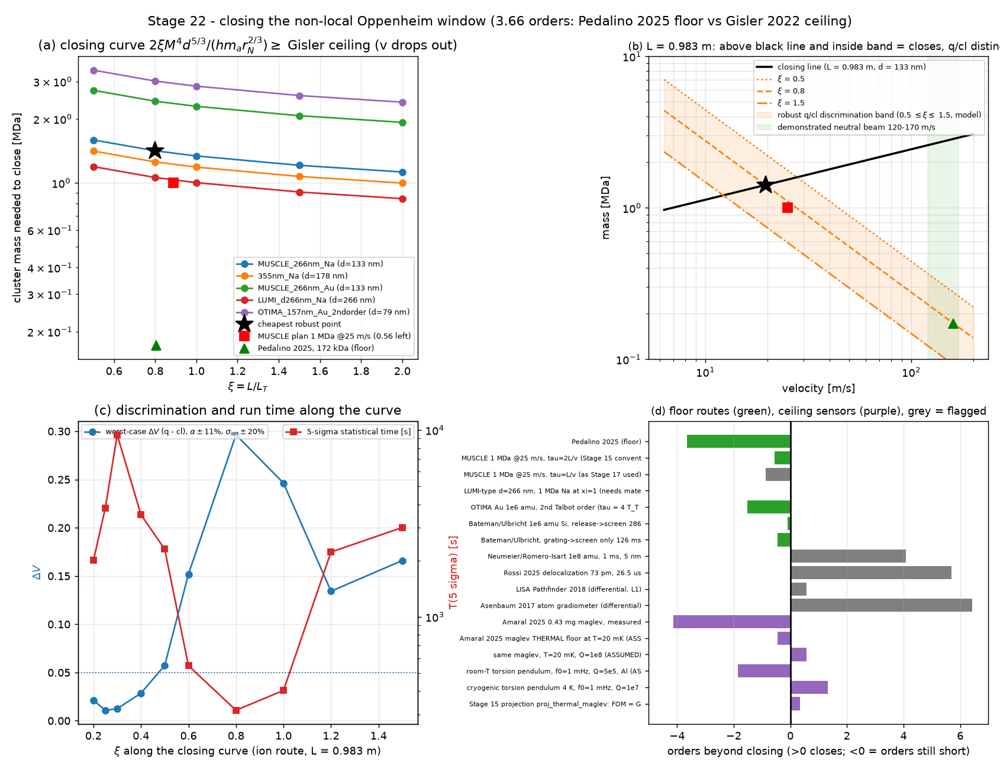

## Stage 23 — The Stage 21 space design with measured inputs

**Question.** Stage 21's best space design gave +2.0 orders: released, drag-free, no plate, $D=273\,\mu$m diamond, $m=2.8\times10^{-14}$ kg, requirement $1.03\times10^{-17}$ m s⁻²/√Hz at $N_5\le10^4$. Three inputs were ASSUMED:
- a permanent dipole of $10^{-2}$ e·cm;
- E-field noise extrapolated from ion traps, with electrodes 1 mm away;
- spacecraft jitter of 1 nm/√Hz with a 500 kg / 0.5 m self-gravity term.

Here each input is replaced by a measured value, and the residual is recomputed with the unchanged Stage 21 exact model and filter (`stage21_run.proto` / `residual_orders`).

**Files.** Scripts: `scripts/stage23_run.py` (about 1 s) and `scripts/stage23_fig.py`. Data: `results/stage23.json`. Figure: `figures/stage23_space.png`.

**Answer.** The design as drawn, with electrodes at 1 mm, is **+8.1 orders**, not +2.0. Two measured mitigations bring diamond to **+4.0**:
- electrodes moved to 1 cm (a design choice);
- spin-averaging of the dipole (×120, measured by Afek 2021).

The binding input is the **permanent electric dipole** coupling to measured stray-potential noise. Even with all electrostatics removed, the measured LPF spacecraft jitter times the measured self-gravity stiffness leaves a floor of **+2.6** (+3.1 at the worst axis). Osmium reaches +2.7, but only through an ASSUMED patch-dipole estimate.

### 23.1 Measured inputs vs required

| input | measured (source) | used for the design | required | gap (orders) |
|---|---|---|---|---|
| permanent dipole | silica r=2.5 µm: **151±6, 89±10, 192±30 e·µm** (Rider 2016); 15 µm silica $p_0=-200\pm360$ e·µm, consistent with 0 (Afek 2021); O(100 e·µm) "observed in all techniques" (Priel 2022) | diamond R=1.24 µm. **No diamond measurement exists**, so silica surface density is used, scaled as R²: **37 e·µm** (R³ gives 18) | at 1 mm: 3×10⁻⁷ e·µm; at 1 cm: 3×10⁻⁵ e·µm (Stage 21 said 1 e·µm at 1 mm) | +8.1 (1 mm), +6.1 (1 cm), **+4.0** (1 cm with spin ×120) |
| induced dipole | α = 401 e·µm/(V/mm) for 15 µm silica, 2.2× Clausius–Mossotti (Afek 2021) | scaled R³ to 2.9×10⁻²⁸ C m²/V, in a 100 mV static stray potential (LPF lab level) | — | +5.8 (1 mm), +2.8 (1 cm) |
| stray-potential noise | LPF: **34±2 µV/√Hz at 1 mHz, 190±30 at 0.1 mHz**, PSD ∝ 1/f (ASD ∝ f^-1/2) (Armano 2017; arXiv:2404.08340) | extrapolated, 1.08 µV/√Hz at 1 Hz; field = Δ/z, gradient = Δ/z² (geometry ASSUMED) | — | **5.8 orders above** Stage 18/21's ion-trap model at 1 mm. 60% of the dipole-term variance comes from the LPF-measured band (1–20 mHz), so this is mostly measured, not extrapolated |
| spacecraft-to-TM jitter | LPF: **8–30 nm/√Hz** maximum, 20–200 mHz (Armano 2016); 0.2 nm/√Hz at 1 mHz simulated (Vitale & Weber) | shape: flat in 20–200 mHz, f⁻² above (ASSUMED) | **2.2×10⁻¹¹ m/√Hz** (Stage 21: 1.9×10⁻¹¹) | **+2.6 / +3.1** |
| self-gravity stiffness | LPF: **ω² = −(525±30)×10⁻⁹ s⁻²**, gravitation-dominated, model agrees to 10% (Armano 2016) | measured value used | 1.4×10⁻⁹ s⁻² at 8 nm jitter | 2.6 |
| release velocity | LPF requirement < 5 µm/s; **~10 µm/s typical in flight** (Dalla Ricca, ESMATS 2021; ESA) | — | ≤ **0.91 µm/s** to hold D to 1% over 3 s, i.e. $T_{\rm eff}\le1.7$ mK (DERIVED) | 1.0 |
| free flight of a levitated particle (silica nanoparticles) | **5–6 µs usable**; 9 µs could not be separated (first microgravity release-recapture, GraviTower Bremen; Prakash, npj Microgravity 2026) | — | 3 s | **5.7** in time |
| charge | LPF charging λ_eff = 2220±260 s⁻¹ for both TMs; UV discharge to ±80 mV (Armano 2017); exact 0 e with visible charge quantisation in levitated microspheres (Rider 2016) | area-scaled to the sphere (ASSUMED): 1.7×10⁻⁶ s⁻¹, one event per **6.9 days**, 5×10⁻⁶ per shot | q = 0 exactly: one electron at 1 mm gives **+9.5** | holdable |

**Holding D during a shot.**
- At the LPF release velocity, D drifts by 30 µm (11%) over 3 s. The Casimir ratio at closest approach becomes 0.20, which breaks the 0.1 cut, and Φ shifts by 33%.
- The DC self-gravity differential drift is only 0.6 nm, which is negligible.
- So D can be held only with sub-µm/s release, i.e. feedback cooling to about 1 mK before release. That is not shown here. The demonstrated free-flight time, 6 µs, is 5.7 orders short of 3 s.

**Comparison with servoed electrostatic accelerometers.** GOCE achieved 3.1–6.7×10⁻¹² m s⁻²/√Hz in flight against a 2×10⁻¹² specification (MICROSCOPE's specification is also 2×10⁻¹²). That is +5.5 orders over the requirement. LPF's 1.74 fm is +2.2.

### 23.2 Recomputed space residual (orders)

| scenario | permanent dipole | induced dipole | jitter (8 nm) | **total** |
|---|---|---|---|---|
| diamond, electrodes 1 mm (Stage 21 design as drawn) | +8.1 | +5.8 | +2.6 | **+8.1** |
| same, R³ dipole scaling | +7.8 | +5.8 | +2.6 | +7.8 |
| diamond, 1 cm | +6.1 | +2.8 | +2.6 | +6.1 |
| **diamond, 1 cm, spin-averaged ×120** | +4.0 | +2.8 | +2.6 | **+4.0** |
| same, 30 nm jitter | +4.0 | +2.8 | +3.1 | +4.0 |
| silica, 1 cm, spin (D=296 µm; requirement −0.05 orders) | +4.2 | +3.0 | +2.6 | +4.2 |
| osmium, 1 mm (D=187 µm; requirement +0.25 orders looser) | +6.8 | +4.6 | +2.3 | +6.8 |
| osmium, 1 cm (patch dipole 2.7 e·µm, ASSUMED 10 mV patches) | +4.8 | +1.6 | +2.3 | +4.8 |
| osmium, 1 cm, spin (spin-averaging of a patch dipole ASSUMED) | +2.7 | +1.6 | +2.3 | **+2.7** |
| diamond, 1 mm, one stray electron | +8.1 | +5.8 | +2.6 (charge +9.5) | +9.5 |

**Material, DERIVED.** With the 10% Casimir–Polder curvature cut, D is independent of mass and scales as (coef·CM²/ρ²)^{1/6}. The resulting D values are:
- diamond 273 µm;
- silica 296 µm;
- osmium 187 µm (perfect-conductor e+m coefficient 143/16π).

Osmium buys only 0.25 orders of requirement. Its real advantage is that a metal has no bulk dipole; only patch potentials remain, and their size is unmeasured. Stage 16 found that Os in space also needs to be at 2.7 K for blackbody reasons.

**What closing the gap would take (DERIVED):**
- **Dipole term (diamond, spin-averaged):** electrodes at about **1.0 m**, since the term scales as z⁻²; or a further ×10⁴ cut in dipole. For osmium with spin, 22 cm.
- **Jitter term:** spacecraft-to-TM jitter about 400–1400× below LPF's measured value, or a self-gravity gradient compensated to ≤1.4×10⁻⁹ s⁻² (LPF achieved 5.25×10⁻⁷; the LISA tolerance quoted in Stage 21's source is 4×10⁻⁷).
- **Free flight:** about 5.7 orders longer than demonstrated, plus sub-µm/s release.

**Coincidences flagged.**
- Stage 21's assumed self-gravity term, 2GM/r³ = 5.34×10⁻⁷ s⁻², agrees with LPF's measured −5.25×10⁻⁷ s⁻² to 2%. The assumption was arbitrary (500 kg at 0.5 m), so this is a coincidence.
- Schut's default dipole (10⁻² e·cm = 100 e·µm) lies within a factor 1.5 of Rider's median of 151 e·µm. The Rider spheres are 3.4× larger than our cheap-point sphere, and Schut does not cite Rider.

**Honest negatives.**
- Measured stray-potential noise is 5.8 orders worse than the Stage 18/21 ion-trap model. The Stage 21 space design as drawn moves from +2.0 to **+8.1**.
- No levitated-diamond dipole has been measured.
- Spin-averaging a diamond that carries a spatial superposition and an NV spin is untested.
- The LPF numbers include actuation-electronics noise. They are an upper bound for a passive housing, but they are the only measured space values.
- The 6 µs → 3 s free-flight gap is outside the noise budget entirely.

**Sources (all opened this stage).**
- Rider et al., PRL 117, 101101 (2016): https://web.stanford.edu/group/grattalab/Publications/PhysRevLett.117.101101.pdf
- Afek et al., PRA 104, 053512 (2021): https://arxiv.org/abs/2108.04406
- Priel et al. 2022: https://pmc.ncbi.nlm.nih.gov/articles/PMC9565793/
- Rotating levitated diamonds: arXiv:2309.01545
- Armano et al., PRL 118, 171101 (2017): https://eprints.gla.ac.uk/141213/1/141213.pdf
- LPF patch-noise estimate: https://arxiv.org/abs/2404.08340
- Armano et al., PRL 116, 231101 (2016): https://journals.aps.org/prl/abstract/10.1103/PhysRevLett.116.231101 (jitter 8–30 nm/√Hz; ω₂² = −525×10⁻⁹ s⁻²)
- Vitale & Weber: arXiv:1012.5968
- LPF release: https://www.esmats.eu/esmatspapers/pastpapers/pdfs/2021/dalla-ricca.pdf and https://sci.esa.int/web/lisa-pathfinder/-/56868-lisa-pathfinder-test-mass
- Prakash et al., npj Microgravity (2026): https://doi.org/10.1038/s41526-026-00596-y
- GOCE in-orbit accelerometer verification: https://sf2a.eu/proceedings/2010/2010sf2a.conf..0113C.pdf

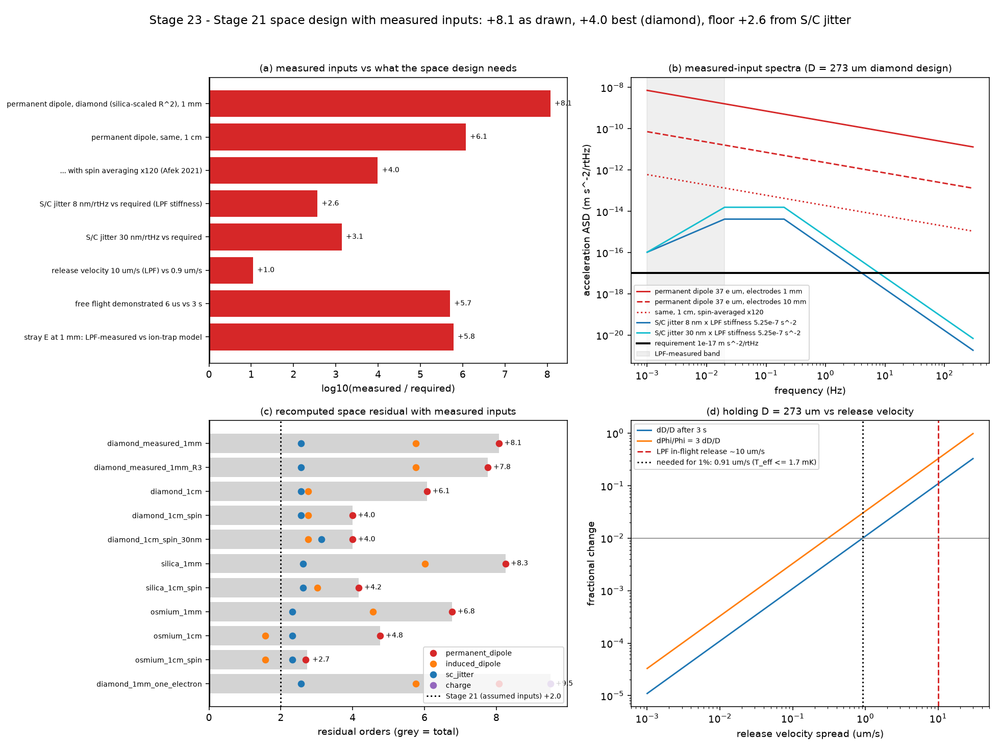

## Stage 24 — How much of Stage 22 is convention? Smearing length, superposition size, constituent counting

**Question.** Stage 22's floor side used the Stage 15 conventions of Oppenheim et al. Eq. (47): superposition size Δx = d, smearing length $r_N=10^{-15}$ m, and $N=M/m_{\rm atom}$. The theory does not fix the smearing length $\ell$.

This stage sweeps each convention and recomputes three things:
- (a) the non-local window in orders;
- (b) the Stage 22 closing mass at the cheapest MUSCLE point (L = 0.983 m, d = 133 nm, ξ = 0.8);
- (c) whether the window is open or already closed.

Scripts: `scripts/stage24_run.py`, `scripts/stage24_fig.py`. Output: `results/stage24.json`.

**Where the conventions enter (DERIVED from published Eq. 47).**
- Floor: $N M^2\tau/(\ell^2\Delta x)^{1/3}$, which scales as $\ell^{-2/3}$.
- Ceiling: $S_aN\,\ell^3/G^2$. **The ceiling depends on the convention as well**, as $\ell^3$ and through $N$.
- Two modes:
  - **floor-only**: the ceiling stays at Stage 15's $10^{-15}$ m. The window then moves 0.67 orders per decade of $\ell$, and $M_{\rm close}\propto\ell^{1/6}$.
  - **consistent**: the same $\ell$ on both sides. The window then moves 3.67 orders per decade, and $M_{\rm close}\propto\ell^{11/12}$.
- For $\ell\ge\Delta x$, ASSUMED: the smeared-DP small-separation suppression $(\Delta x/\ell)^2$ with $R\to\ell$.
- Ceiling inputs: the Gisler sensor with CITED FOM 0.298 and $N_{\rm atoms}=2.79\times10^{11}$ (mean 20.1 u). For rigid-body counting it is treated as an equivalent sphere of 0.89 µm, using an ASSUMED density of 3100 kg m⁻³; a string is not a sphere (flagged).
- Reach criterion (ASSUMED): gravity sag ≤ 31.7 mm, the largest sag among the Stage 22 designs that passed every constraint. This means $M\le2.27$ MDa at ξ = 0.8.

| convention | mode | window (orders) | ceiling shift | M_close @ cheapest point | v | Stage 22 still closes it? |
|---|---|---|---|---|---|---|
| **baseline** (ℓ=1e-15, Δx=d, atoms) | — | **+3.66 open** | 0 | **1.415 MDa** | 19.6 m/s | yes |
| ℓ = cluster Compton ħ/Mc (1.5e-22 m) | floor-only | −0.89 **closed** | 0 | 0.10 MDa | — | already closed by Pedalino |
| | consistent | −21.4 closed | −20.5 | — | — | already closed |
| ℓ = Na-atom Compton (9.2e-18 m) | floor-only | +2.30 open | 0 | 0.65 MDa | 42.8 | yes |
| | consistent | −3.81 closed | −6.1 | — | — | already closed |
| ℓ = nucleon Compton (2.1e-16 m) | floor-only | +3.21 | 0 | 1.09 MDa | 25.4 | yes |
| | consistent | +1.18 | −2.0 | 0.34 MDa | 81.8 | yes |
| ℓ = 1e-12 m (Oppenheim's published R_λ, used as ℓ) | floor-only | +5.66 | 0 | 4.5 MDa | 6.2 | **no** (sag 12 cm) |
| | consistent | +14.7 | +9.0 | 796 MDa | 0.03 | no |
| ℓ = 0.54 Å (Donadi 2020 DP limit) | floor-only | +6.81 | 0 | 8.7 MDa | 3.2 | no |
| | consistent | +21.0 | +14.2 | 3.1e4 MDa | — | no |
| ℓ = 1e-10 m (atomic) | floor-only | +6.99 | 0 | 9.6 MDa | 2.9 | no |
| | consistent | +22.0 | +15.0 | 5.4e4 MDa | — | no |
| ℓ = cluster radius (4.1 / 8.2 nm) | floor-only | +8.06 | 0 | 23.5 MDa | 1.2 | no |
| | consistent | +34.9 | +26.9 | 5e9 MDa | — | no |
| ℓ = 1e-7 m (CSL/DP r_C) | floor-only | +8.99 | 0 | 30.5 MDa | 0.9 | no |
| | consistent | +33.0 | +24.0 | 3e7 MDa | — | no |
| Δx = d/2, ℓ=1e-15 | floor-only | +3.56 | 0 | 1.34 MDa | 20.7 | yes |
| Δx = ξd (TL path separation at G2), ℓ=1e-15 | floor-only | +3.63 | 0 | 1.39 MDa | 20.0 | yes |
| Δx = d/2, ℓ=1e-7 | floor-only | +9.30 | 0 | 36.5 MDa | 0.8 | no |
| Δx = ξd, ℓ=1e-7 | floor-only | +8.96 | 0 | 29.9 MDa | 0.9 | no |
| N = nucleons (both sides), ℓ=1e-15 | consistent | +3.60 | +1.3 | 1.37 MDa | 20.3 | yes |
| N = 1, rigid body (ℓ = body radius) | consistent | +27.4 | +15.4 | >1e16 amu | — | no |
| N: independent-constituent DP sum M²/N (DERIVED, flagged) | — | +11.4 | 0 | 8.7e4 MDa | — | no |
| arXiv v1 Eq. 47 (no N, R ~ 1e-9 m) | — | +10.8 | 0 | 699 MDa | — | no |
| paired: atoms + atomic radius | consistent | +22.0 | +15.0 | 5.4e4 MDa | — | no |
| paired: atoms + Donadi 0.54 Å | consistent | +21.0 | +14.2 | 3.1e4 MDa | — | no |
| paired: rigid body + body radius | consistent | +27.4 | +15.4 | >1e16 amu | — | no |

**Thresholds (DERIVED).**
- The Stage 22 design (1.4 MDa at about 20 m/s) still closes the window only if **ℓ ≤ 1.7×10⁻¹⁴ m** (floor-only) or **ℓ ≤ 1.65×10⁻¹⁵ m** (consistent).
- The window is already closed if ℓ ≤ 3.3×10⁻²¹ m (floor-only) or ℓ ≤ 1.0×10⁻¹⁶ m (consistent).

**Verdict.**
- **Robust:**
  - The superposition-size convention. Δx = d, d/2 or ξd moves the window by ≤ 0.1 orders and $M_{\rm close}$ within 1.34–1.415 MDa, as long as ℓ ≪ Δx. Only in the ℓ > Δx regime does Δx enter as $\Delta x^2$.
  - Atoms versus nucleons, when counted the same way on both sides: 3.60 vs 3.66 orders.
- **Fragile:**
  - The smearing length dominates everything. Over the physically motivated range (Compton scales up to 1e-7 m) the window runs from −21 to +35 orders.
  - The Stage 22 conclusion survives only within a factor 1.65 above Oppenheim's own nuclear choice (consistent reading), or a factor 17 above it (floor-only).
  - At any atomic or larger ℓ, the window is ≥ 6.8 orders (floor-only) or ≥ 21 orders (consistent). Closing it needs ≥ 8.7 MDa, beyond the Stage 22 geometry.
  - Rigid-body counting and the independent-constituent sum also make it unreachable (+11 to +27 orders).
- **Stage 22's "1.4 MDa closes it" is a statement about the Eq. 47 conventions as Oppenheim et al. chose them, not about classical-gravity models in general.**

**Flags.**
- **Independent-constituent counting (DERIVED, not adopted).** For N separated constituents of mass M/N, a DP-type sum gives $N(M/N)^2=M^2/N$. The published floor uses $N_\lambda M_\lambda^2$ with total mass, which is a factor $N^2$ larger (7.7 orders for Pedalino). The ceiling's $\sigma_a^2\propto1/N$ already uses the independent-constituent picture. The published text says "total mass M_λ", so we keep it, but this is a possible internal inconsistency in Eq. 47 worth checking with the authors.
- **Donadi et al. 2020.** Their experiment bounds the DP mass-density size $R_0>0.54$ Å. If that bound transfers to the CQ decoherence kernel, which is ASSUMED and not shown here, the nuclear choice would be excluded, and with it the closable regime.
- **Cluster Compton row.** ℓ is fixed at the 1.4 MDa value for both experiments.
- **Regularisation for ℓ ≥ Δx** is ASSUMED.

**Coincidences.**
1. The consistent-mode window closes at ℓ = 1.005×10⁻¹⁶ m, almost exactly 0.1 r_N. This is only because 3.66 orders ÷ 3.67 orders per decade ≈ 1.00. It is close to the nucleon Compton wavelength (2.1e-16) but unrelated.
2. Nucleon counting barely changes the window because Na (23 u) and the SiN sensor (20.1 u) have almost the same mass per atom. A heavy-atom ceiling sensor (e.g. Au) would break this.

**Honest negative.** No convention in this sweep that is plausible on its own physical grounds (atomic, Donadi, body, CSL scales) leaves the window closable by any cluster-interferometer route in Stages 17 or 22. The closable regime exists only at sub-femtometre to ~10 fm smearing.

**Sources (verified this stage).**
- Oppenheim et al., Nat. Commun. 14, 7910 (2023), Eq. 47 and the r_N, R_λ choices (re-read in Stage 22): https://www.nature.com/articles/s41467-023-43348-2
- Donadi et al., Nat. Phys. 17, 74 (2021), $R_0>0.54\times10^{-10}$ m: https://www.nature.com/articles/s41567-020-1008-4 , https://arxiv.org/abs/2111.13490
- Bassi et al., RMP 85, 471 (2013), CSL $r_C=10^{-7}$ m: https://arxiv.org/abs/1204.4325
- Smearing-length note (unrefereed): https://doi.org/10.5281/zenodo.24089422

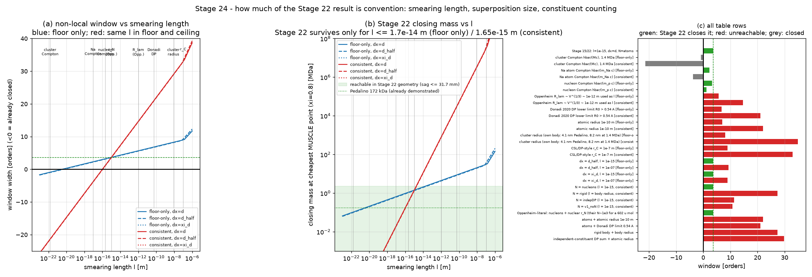

## Stage 25 — Testing the two Stage 24 flags: Eq. 47 N-counting and the Donadi carry-over

**Question.** Stage 24 raised two flags without testing them:
- **(A)** Eq. 47's floor uses $N_\lambda M_\lambda^2$ with the total mass, while the ceiling counts constituents independently.
- **(B)** The Donadi-type spontaneous-radiation bound on the DP smearing length might carry over to Oppenheim's kernel.

Both are now tested. Scripts: `scripts/stage25_run.py` and `scripts/stage25_fig.py`. Results: `results/stage25.json`. Runtime is 168 s.

### (A) N-counting: derived from the paper's own master equation

**Starting point (CITED, Methods Eqs. 135–137).**
- Integrating out the classical field gives
  $\dot\rho_Q=\tfrac12\int D_0(x,y)[\hat m(x),[\rho_Q,\hat m(y)]]$.
- The L/R coherence decays at
  $\lambda=\int D_0(x,y)\,[m_L-m_R](x)\,[m_L-m_R](y)$ (Eq. 137).

**Applying it to a rigid body (DERIVED).**
- Take N nuclei of mass $m_a$, each Gaussian-smeared at ℓ, and DP kernel $D_0(x,y)=\kappa G/(\hbar|x-y|)$. The position-basis decoherence function at displacement Δx is then exactly
  $\lambda=\kappa\frac{G}{\hbar}m_a^2 S$, with
  $S=\sum_{ij}[2K(r_{ij})-K(|\mathbf r_{ij}+\Delta x\hat e|)-K(|\mathbf r_{ij}-\Delta x\hat e|)]$ and $K(r)=\mathrm{erf}(r/2\ell)/r$, $K(0)=1/(\sqrt\pi\ell)$.
- The body's own density enters, not the c.o.m. expectation density. Eq. 137 with $\langle\hat m\rangle$ is only the localized-branch limit.

**Regimes for Δx larger than the body (TL case; DERIVED).**
- $S\simeq 2N/(\sqrt\pi\ell)$ (incoherent, ∝ $M^2/N$) for ℓ ≪ ℓ* = R/(1.2√π N).
- $S\simeq 2.4N^2/R$ (coherent body self-energy, ∝ $M^2/R$, i.e. $N^{5/3}$) for ℓ* ≪ ℓ ≪ R.
- $S\simeq 2N^2/(\sqrt\pi\ell)$ for ℓ ≫ R.
- ℓ* is 2.6e-13 m at 172 kDa and 6.4e-14 m at 1.415 MDa.
- The atom spacing is not a transition when Δx ≫ R.
- It becomes one only for Δx < a. Then the crossover is at ℓ ≈ R/N^{1/3} = 2.1 Å, i.e. the lattice spacing.

**Numerical double sum (DERIVED).**
- Model: bcc Na clusters with a = 4.29 Å (CITED). N = 7,482 (172 kDa, R = 4.13 nm) and N = 61,600 (1.415 MDa, R = 8.34 nm).
- Method: exact sums over j for 1,200 or 600 random rows i, at 16 values of ℓ from 1e-16 to 1e-7 m. Standard errors are ≤ 1.4%.
- Check: the exact shell histogram gives $\sum_{i\neq j}1/r$ = 0.996 and 0.999 of the uniform-sphere value $6N^2/5R$.
- At Pedalino, ℓ = 1e-15 m, Δx = 133 nm: S = 8.47e18 m⁻¹, of which 99.6% is incoherent.
- The effective exponent p in S ∝ N^p (from 7,482 to 61,600 atoms) is:

| ℓ [m] | 1e-16 | 1e-15 | 1e-14 | 1e-13 | 1e-12 | 1e-10 | 1e-9 | 1e-8 | 1e-7 |
|---|---|---|---|---|---|---|---|---|---|
| p (Δx = 133 nm) | 1.00 | 1.01 | 1.05 | 1.28 | 1.57 | 1.65 | 1.69 | 1.97 | 2.00 |
| p (Δx = 1 Å) | 1.00 | 1.00 | 1.00 | 1.00 | 1.00 | 1.01 | 1.13 | 1.93 | 2.00 |

**The decoherence rate never scales as N·M² (p = 3).** Its range is p = 1 (M²/N) to p = 2 (M²).

**What the paper encodes (CITED).**
- Eq. 151: $\lambda\sim N_\lambda M_\lambda^2/(V_\lambda D_2)$, "M_λ is the mass of a composite particle … made up of N_λ particles, each with volume V_λ".
- The numbers in Eq. 152 (M = 1e-24 kg, N = 1e3, V = 1e-37 m³, λ = 10 s⁻¹ → 1e-9) reproduce only with the **total** mass.
- The paper's own single-particle result from Eq. 137 is $\lambda=2D_0M^2/V$. Applied per constituent, this gives $N(M/N)^2/V=M^2/(NV)$.
- The ceiling side (Eqs. 147–150) keeps only the $i=j$ self-terms, "$\mathbb E[\sum_{ij}F_iF_j]\sim\sum_i\mathbb E[F_i^2]$". That is independent nuclei.

**Verdict A.**
- **The inconsistency is real (DERIVED).** It is in the published text, not our misreading. Stage 15/22 followed the text and Table 1 correctly.
- **Floor at Pedalino.** The derived Eq. 137 floor is 7.59e-35, against 1.47e-29 published. It moves down by **5.29 orders**:
  - −7.75 from N²;
  - +2.46 because the self-energy scale is ℓ = r_N, not R_λ = (r_N²Δx)^{1/3} = 5.1e-13 m.
- **Window.** The ceiling is unchanged because it already counts incoherently. The window widens from 3.66 to **8.95 orders**.
- **Closing mass at the cheapest MUSCLE point** (ξ = 0.8, d = 133 nm): rises from 1.39 MDa to **3,930 MDa**, at 7 mm/s with a 95 km sag. That is unreachable. **Stage 22's conclusion does not survive the corrected counting.**
- **Robustness.**
  - Resolving nucleons inside the Na nucleus (A = 23, r_nuc = 3.4 fm) changes the floor by −0.18 orders.
  - The paper's δ-kernel exclusion survives: 1e-9 becomes 1e-15 (V = 1e-37) or 1e-7 (V = r_N³), against an upper bound of 1e-41.
- **Correction to Stage 24.** Its "indepDP" row (window 11.41, M_close 87,147 MDa) kept R_λ. The derived values are 8.95 and 3,930 MDa.
- **No erratum found.** There is no correction notice on the Nat Commun article page. Janse et al. 2024 (arXiv:2403.08912) addresses only the ceiling, multiplying N by nuclei per molecule. No 2024–26 paper re-derives the floor's N scaling that we could find. Aguiar & Matsas (arXiv:2409.14155, PRD 112, 046004) discuss N-sensitivity in a different model.

### (B) Donadi carry-over: same kernel, same ℓ, same Lindblad term

**Why it carries over (DERIVED).**
- Oppenheim's Eq. 135 is $-\tfrac12\int D_0[\hat m(x),[\hat m(y),\rho]]$. With $D_0=\kappa G/(\hbar|x-y|)$, κ = 1 is exactly Diósi's master equation, $G/2\hbar$.
- Donadi 2021 Eq. 3 uses $4\pi G/\hbar$ (Penrose convention), i.e. κ = 8π.
- Check: from the momentum diffusion $\dot{\langle p^2\rangle}=\kappa G\hbar m^2/(2\sqrt\pi\ell^3)$ and Larmor, $d\Gamma/d\omega=\kappa Z^2e^2G/(12\pi^{5/2}\epsilon_0c^3\ell^3\omega)$. This is exactly 1/(8π) of Donadi's Eq. 4.
- So the X-ray bound is a bound on κ/ℓ³:
  - $\kappa\le(\ell/0.184\,\text{Å})^3$ for Donadi, whose 0.54 Å becomes 0.184 Å in Diósi convention;
  - $\kappa\le(\ell/4.5\,\text{Å})^3$ for XENONnT 2026 (95% CL, stated in Diósi convention).
- The CQ model's D0 term is Markovian, so the white-noise radiation calculation applies unchanged.
- D0(Φ_b) is evaluated at the same terrestrial Φ_b for interferometer, torsion balance and Ge detector.

**Numbers at ℓ = 1e-15 m (DERIVED).**
- The torsion ceiling, via the trade-off in Eq. 47 normalisation ($l_P^2D_2\ge\hbar/(2G\kappa)$ = 7.9e-25/κ), requires **κ ≥ 11.8**.
- Pedalino interferometry, with derived counting, gives only κ ≤ 1.0e10.
- Donadi gives **κ ≤ 1.6e-13**. XENONnT gives **κ ≤ 1.1e-17**.
- **Excluded by 13.9 orders (Donadi) and 18.0 orders (XENONnT).**
- In Donadi's Ge setup the minimal-κ model predicts 8.5e15 signal counts, against 114 allowed at 95%.
- Heating would be 4.5e-25 W per Na atom, i.e. dT/dt = 0.022 K/s for a free gas.
- Resolving nucleons inside the Ge nucleus (A = 73) suppresses the radiation by 1/A, which still leaves 12.0 orders.
- **Prior work agrees.** Layton, Oppenheim, Russo & Weller-Davies (arXiv:2307.02557, Sec. 7) already state, citing Tilloy & Diósi 2017 (arXiv:1706.01856), that a cut-off below 1e-15 m is "inconsistent with experiments due to excess heating". Piccione (arXiv:2511.00644) notes that radiation gives the strongest DP/Tilloy–Diósi bounds and that optimal smearing changes them by ≤ 22%.

**Smallest allowed ℓ (DERIVED).**

| reading | Donadi | XENONnT |
|---|---|---|
| consistent ($r_N=\ell$ in the ceiling) | 2.05e-13 m | 1.01e-12 m |
| floor-only (ceiling fixed at r_N = 1e-15) | 4.2e-11 m | 1.02e-9 m |

- At every ℓ the X-ray floor lies ≥ 20 orders above the interferometric floor. At ℓ = 1e-15 the gap is 22.8 orders (Donadi) or 27.0 (XENONnT).

**Verdict B.**
- If the radiation calculation carries over (argued above; not contested in the sources we found), **the nuclear-scale choice ℓ = 1e-15 is excluded by 13.9–18.0 orders.**
- **Matter-wave interferometry cannot be the binding floor** for the DP-kernel CQ model at any ℓ.
- **The Stage 22 experiment is moot for this kernel.** The window it was designed to close is either already closed by X-ray data (ℓ below 2e-13 to 1e-9 m, depending on reading) or ≥ 20 orders out of interferometric reach.
- **Our own error.** Stage 24 quoted Donadi's 0.54 Å as if it were in the same normalisation as Oppenheim's D0. In matched (Diósi) convention it is 0.184 Å.

**Coincidences.**
1. $F\kappa=\hbar/2G$ exactly. This is forced by our Eq. 47 normalisation, not physics. Only the O(1) prefactor is conventional, because $l_P^2D_2$ has the units of ħ/G.
2. The floor-only threshold is ℓ ≈ 2.3 R0_bound, close to the DP bound itself. This is because κ_req ≈ 12 ≈ 2.3³.

**Honest negatives.**
- Our Stage 22 "1.4 MDa closes it" result rested on a counting the paper's own master equation does not support.
- Under correct counting **and** the radiation data, it is irrelevant.
- The trade-off constant (dropped "constant factors" in Eq. 47) is uncertain by O(1–10). The margins of 12–18 orders swamp it.
- Relativistic corrections at 1e-15 m (Layton Sec. 7) and coloured or dissipative extensions are outside this test.

**Sources (verified this stage).**
- Oppenheim et al., Nat. Commun. 14, 7910 (2023), Methods Eqs. 131–137 and 147–152: https://www.nature.com/articles/s41467-023-43348-2
- Layton et al., arXiv:2307.02557: https://arxiv.org/abs/2307.02557
- Tilloy & Diósi, PRD 96, 104045 (2017): https://arxiv.org/abs/1706.01856
- Donadi et al., Nat. Phys. 17, 74 (2021), Eqs. 3–6: https://arxiv.org/abs/2111.13490
- XENONnT, PRL 136, 120201 (2026): https://arxiv.org/abs/2506.05507
- Piccione, arXiv:2511.00644: https://arxiv.org/abs/2511.00644
- Piccione, arXiv:2602.19377: https://arxiv.org/abs/2602.19377
- Janse et al., arXiv:2403.08912: https://arxiv.org/abs/2403.08912

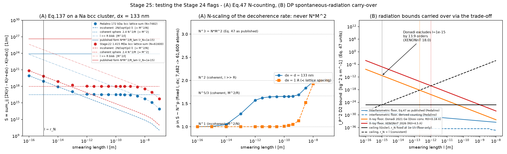

## Stage 26 — What survives of classical-quantum Newtonian gravity, and who can reach it

**Question.** Stage 25 showed that the X-ray data exclude Oppenheim's DP-kernel model at $\ell=10^{-15}$ m. This stage asks the constructive question. Which part of the $(\ell,\,D_0)$ / $(\ell,\,D_2)$ plane survives *all* data, for which kernels, and which existing or planned experiment can reach it, at fixed published sensitivities?

Scripts: `scripts/stage26_run.py`, `scripts/stage26_fig.py`. Results: `results/stage26.json`. Figure: `figures/stage26_window.png`. Runtime is 8 s.

### 26.1 One structure for every probe (DERIVED, cross-checked against Tilloy & Diósi 2017)

**Model.** The classical field couples to the mass density smeared over a Gaussian of width $\ell$. The decoherence term is $-\tfrac12\int D_0[\hat m(x),[\hat m(y),\rho]]$, and the decoherence–diffusion trade-off is saturated. Following Layton et al. 2023, we use the equivalence of the saturated CQ dynamics with continuous measurement plus feedback (ASSUMED). The classical field noise is then the measurement imprecision $\langle\delta m\,\delta m\rangle=D_0^{-1}/4$, and the decoherence is its back-action. These two obey the standard-quantum-limit product.

**Result.** For the DP kernel $D_0=\kappa G/(\hbar r)$, with $\kappa=1$ being Diósi's equation, every probe E sees

$$N_E(\kappa,\ell)=A_E(\ell)\,\Big(\kappa+\frac{1}{4\kappa}\Big),$$

where $A_E(\ell)$ is what plain Diósi ($\kappa=1$) predicts for that probe.
- The $\kappa$ term is the $D_0$ back-action, i.e. heating and decoherence.
- The $1/4\kappa$ term is the classical-field noise. This is $D_2$ at saturation, $l_P^2D_2=\hbar/(16\pi G\kappa)$ in this normalisation. Stage 25's Eq. 47 normalisation gives $\hbar/(2G\kappa)$; the two differ by a convention factor of 8π.

The same body integral appears in both terms:
- Acceleration noise of a body (two-sided, per axis): $A=\frac{2G\hbar}{3\pi}\int k^2e^{-k^2\ell^2}|\tilde\rho(k)/M|^2dk$.
- Interferometric decoherence: $A=\frac{G}{\hbar}\frac{2}{\pi}\int e^{-k^2\ell^2}|\tilde\rho(k)|^2(1-\mathrm{sinc}\,k\Delta x)\,dk$.

Two checks:
- A single nucleus gives $A=G\hbar/(6\sqrt\pi\ell^3)$ and $\lambda=Gm^2/(\sqrt\pi\hbar\ell)$.
- Pedalino at $\ell=10^{-15}$ reproduces the Stage 25 lattice rate to within the factor 2 noted below.

The minimum sits at $\kappa=1/2$, where the total noise equals Diósi $\kappa=1$. This is exactly the Tilloy–Diósi "principle of least decoherence" model (PRD 96, 104045, arXiv:1706.01856). Their Eq. 11 has the same two-term decoherence kernel and is minimised mode by mode.

**Consequences.**
1. An experiment with bound $B_E$ allows $\kappa\in[\kappa_-,\kappa_+]$, where $\kappa_\pm=(u\pm\sqrt{u^2-1})/2$, $u=B_E/A_E$ and $\kappa_+\kappa_-=1/4$.
2. Every allowed interval contains $\kappa=1/2$. So the model at a given $\ell$ survives all data **iff $\min_E u_E(\ell)\ge1$**. One experiment with $u_E<1$ excludes that $\ell$ for every $\kappa$.
3. **Kernel independence (DERIVED).** Take any positive $D_0$, including state-dependent ones such as Oppenheim's discrete $\delta(x-y)/m(x)$. Cauchy–Schwarz gives $N_E\ge\eta_K A_E$, with $\eta_K\ge1$ and equality only for DP. So DP is the most permissive kernel, and the condition $u_E\ge1$ is *necessary for every kernel*. Computed for a single Gaussian nucleus:

| kernel | η | ℓ_min / R0 |
|---|---|---|
| DP | 1.000 | 1.000 |
| Oppenheim ultra-local discrete (self-sourced only, so a lower bound) | 1.136 | 1.043 |
| Ultra-local continuous | √3 = 1.732 | 1.201 |

4. **X-rays see both terms.** The classical field noise shakes the nucleus just as the $D_0$ kicks do, and it is white in a Markovian model. So the X-ray bound $R_0$ (Diósi convention, CITED Stage 25) becomes, for any kernel, **$\ell\ge R_0$**:
   - **4.5 Å** (XENONnT 2026);
   - **0.18 Å** (Donadi 2021).
   
   This is exact by construction, because $u_X=(\ell/R_0)^3$. Stage 25 let only the $D_0$ part radiate. That was the gap.

### 26.2 Inputs (CITED unless marked)

**Force noise.** Janse et al. 2024, Table I, gives $\sqrt{S_a}$ (one-sided). We convert to the two-sided per-test-mass value (DERIVED):
- $\Gamma=S_a/2$ for absolute measurements;
- $S_a/4$ for LISA Pathfinder, which is differential with two independent test masses.

| experiment | $\sqrt{S_a}$ | notes |
|---|---|---|
| Gisler 2022 | 1.03e-6 | ρ = 3100 ASSUMED |
| LPF (Armano 2018) | 1.74e-15 | at L1 |
| aLIGO | 3.92e-14 | |
| Fuchs 2024 | 1.25e-9 | |
| Westphal 2021 torsion | 4.16e-9 | |
| Monteiro 2020 | 9.32e-7 | |
| LISA requirement | 3 fm s⁻²/√Hz per test mass | Definition Study Report 2024 |

Bodies are treated as equal-volume spheres (ASSUMED; shape matters only when ℓ ~ size). Each $|\tilde\rho|^2$ is a coherent continuum form factor plus incoherent nuclei above the Debye wavenumber, using the composition $\langle m^2\rangle$.

**Interferometers.** The rule is λ ≤ 1/τ (Stage 15). The rows:
- Pedalino 2025: 172 kDa, Δx = 133 nm, 12.3 ms.
- Kovachy 2015: Rb, 54 cm, 2.08 s.
- MAGIS-100: Sr, 1 m, 9 s.
- MAQRO baseline (QST 8, 014006 (2023)): 1e10 u silica, R = 122 nm, Δx ≈ R, 100 s.
- MAQRO maximum (EPJ QT 3, 5 (2016)): 1e11 u. Δx = R and 100 s are carried over from the baseline.
- Pino 2018: Nb, 3.3e-14 kg, 1 µm, Δx = 0.5 µm, 0.596 s.
- Our own designs (Stages 12, 16 and 22).

**X-rays.** $R_0$ = 0.184 Å (Donadi, Ge) and 4.5 Å (XENONnT, Xe), both in Diósi convention. For ℓ near the nuclear size we include a nucleon-resolved correction; it is irrelevant above 1e-14 m.

**Cold atoms.** Kovachy 2015 measured the heating rate as 20 ± 30 pK/s; we take a 95% upper value of 69 pK/s (ASSUMED Gaussian).

**Upper end of ℓ.** Lee et al. 2020 test 1/r² down to **52 µm**. We use that as the largest allowed smearing length (ASSUMED).

### 26.3 The surviving region (DERIVED; figure panels a and c)

Primary scenario S1: all existing data, Markovian noise.

| ℓ | window log10(κ+/κ−) | κ− … κ+ | binding probes |
|---|---|---|---|
| < 4.5 Å | **excluded** (every kernel) | — | XENONnT |
| 4.5 Å | 0 (edge) | κ = 1/2 only | XENONnT |
| 1 nm | **2.68** | 0.023 … 11.0 | XENONnT on both sides |
| 10 nm | **8.68** | 2.3e-5 … 1.1e4 | XENONnT |
| 100 nm | **14.7** | 2.3e-8 … 1.1e7 | XENONnT |
| ≥ 0.63 µm up to 52 µm | **19.4** (flat) | 1.0e-10 … 2.5e9 | LISA Pathfinder (plateau $(4\pi/3)G\hbar/V$) |

- The window grows by 6 orders per decade of ℓ, because both edges scale as $\ell^3$, until LPF takes over at 0.63 µm.
- **Published vs corrected N-counting changes nothing here.** Across the whole surviving range, Pedalino's interferometric bound stays weaker than the binding probe:
  - by ≥ 8.2 orders under corrected counting (12.8 orders at 4.5 Å);
  - by ≥ 1.2 orders under the published N·M² form, coming closest at 0.63 µm.
  
  So S1 is identical either way.
- No other existing probe matters:

| probe | log10 u at best ℓ |
|---|---|
| LPF | 9.40 |
| Gisler | 13.7 |
| aLIGO | 14.7 |
| Fuchs | 15.2 |
| Monteiro | 15.8 |
| Kovachy interferometry | 16.5 |
| Westphal torsion | 18.5 |
| Pedalino | 12.8 |
| Donadi | 4.2 |

**Other scenarios (same data, different physics assumption).**
- **S2**, Stage 25's assumption (X-rays see only $D_0$): ℓ_min = 4.0e-12 m with LPF, or 7.1e-13 m with on-Earth absolute data only. Stage 25 had 1.0e-12 m.
- **S3**, noise coloured below the X-ray band (the non-Markovian loophole): ℓ_min = **5.6e-14 m** (LPF) or **1.7e-15 m** (Gisler alone). In both cases the window reaches the 19.4-order plateau above about 0.6 Å.

### 26.4 Can anything reach it? Orders short at fixed published sensitivity (DERIVED; panel b)

**log10 u** is the number of orders an experiment is short of the least-noise point. A negative value means the experiment alone excludes that ℓ for every kernel.

| experiment | status | log10 u at ℓ = 4.5 Å | at 1 µm | ℓ range it would exclude |
|---|---|---|---|---|
| **Pino 2018 Nb sphere** | proposal | **−1.65** | −0.56 | **0.5 nm – 1.6 µm** |
| **MAQRO at 1e11 u** | planned (max mass) | **−0.33** | +2.26 | 0.5 – 112 nm |
| MAQRO baseline 1e10 u | planned | **+1.34** | +4.92 | none |
| LISA Pathfinder | flown | +9.40 | +9.40 | none (sets the plateau) |
| LISA (requirement) | planned | +10.17 | +10.17 | none |
| Stage-22 MUSCLE 1.4 MDa | our design | +10.3 | +15.7 | none |
| Pedalino 172 kDa | existing | +12.8 | +18.3 | none |
| Gisler nanowire | existing | +13.7 | +15.0 | none |
| MAGIS-100 | planned | +15.8 | +19.2 | none |
| Kovachy 54 cm atoms | existing | +16.5 | +19.8 | none |
| Westphal torsion | existing | +18.5 | +18.5 | none |
| Stage-12 BMV diamond / Stage-16 Pb | our designs | −1.84 / −2.02 | −1.15 / −1.10 | 0.5 nm – 2.8 µm |

**Why massive superpositions win (DERIVED).** For spacing ≪ ℓ ≪ R the decoherence is the coherent self-energy, of order $GM^2/(\hbar R)$ and independent of ℓ. X-ray reach, by contrast, grows only as $\ell^3$. Force sensors are limited by $\Gamma\,V$ against $(4\pi/3)G\hbar$, so large test masses are penalised and torsion balances come out worst.

**Published counting would overstate the reach massively.** Under Eq. 47's N·M² counting, MAQRO baseline would sit at −6.4 and Pino at −13.2. Under the corrected counting they are +1.34 and −1.65.

**After all planned and proposed literature experiments (S4).** Only **ℓ = 1.8 – 52 µm** survives, with a window of up to 5.2 orders at 10 µm and 9.4 at 52 µm. Nothing planned reaches that range. LPF, the closest, is 9.4 orders short there. Adding our own designs (S5) moves the edge to 3.2 µm.

### 26.5 Kernel-by-kernel verdict

| conclusion | DP / non-local | ultra-local discrete | ultra-local continuous | depends on |
|---|---|---|---|---|
| ℓ < R0 excluded (4.5 Å XENONnT, 0.18 Å Donadi) | yes (ℓ ≥ 1.00 R0) | yes (ℓ ≥ 1.04 R0, lower bound) | yes (ℓ ≥ 1.20 R0) | Markovian noise up to MeV; Newtonian D1 |
| window sizes in 26.3 | exact (most permissive) | smaller (u → u/η) | smaller | saturation |
| Oppenheim's own nuclear smearing | excluded: 17.0 (XENONnT, point nucleus; 15.6 nucleon-resolved) / 12.8 (Donadi; 11.7) orders at ℓ = 1e-15 | **excluded:** heating alone needs $\hat D\equiv(l_P^3/m_P)D_2\ge$ 944–7,000 kg vs the Eq. 46 ceiling 4e-14 kg, i.e. **16.4–17.2 orders** (XENONnT), 12.6–13.3 (Donadi) | already excluded (paper) | X-ray carry-over |
| Pino/MAQRO-1e11 reach | yes | yes (stronger) | yes | λ ≤ 1/τ rule |

**Honest reading.** The X-ray kill is *not* DP-specific. It hits every positive kernel and every smearing below 4.5 Å. What survives everywhere is a family of models whose mass density is smeared over **≥ 4.5 Å to ≤ 52 µm**. That is far from any nuclear or Planckian scale. Stage 17's discrete window of 9.41 orders and the non-local 3.66 → 8.95 orders (Stage 25) are both closed at Oppenheim's $r_N$.

### 26.6 Corrections to our earlier numbers

1. **Stage 25 ℓ_min.**
   - Was 2.05e-13 (Donadi) and 1.01e-12 m (XENONnT), consistent reading.
   - Is now **1.84e-11 and 4.5e-10 m**, i.e. +1.95 and +2.65 orders, because the classical-field noise radiates too.
   - Under Stage 25's own assumption with explicit constants: 7.1e-13 m (on-Earth absolute) or 4.0e-12 m (with LPF).
2. **Stage 25 exclusion at ℓ = 1e-15.**
   - Was 18.0 (XENONnT) / 13.9 (Donadi) orders.
   - Is now 17.0 / 12.8 (point nucleus) or 15.6 / 11.7 (nucleon-resolved).
   - Cause: Eq. 47's dropped constants. The ceiling-required κ is 11.8 there and 0.56 with explicit constants, a factor of 21.
3. **Stage 25 text, "X-ray ≥ 20 orders above interferometry at every ℓ".**
   - True only for ℓ ≲ 1e-12 m.
   - At 1 nm the margin is 11.8 orders; at 10 nm it is 9.5. Stage 25's own scan shows 8.2 at 1e-8 m.
4. **Stage 24 "consistent" ceiling rows** (shifts of +14 to +27 orders at atomic and larger ℓ).
   - Extrapolating the ceiling as $\ell^3$ fails above about 0.6 Å.
   - The force-noise ceiling saturates at the bulk plateau $(4\pi/3)G\hbar/V$ once ℓ exceeds the interatomic spacing.
5. **Gisler alone at $r_N$.** Counting the $D_0$ heating in the nanowire itself, Gisler alone excludes ℓ = 1e-15 by **0.70 orders** (ℓ_kill = 1.7e-15 m). Two caveats:
   - This is marginal and within O(1) conventions.
   - It is in a rare-kick regime: 0.011 kicks per second of 6e-20 kg m/s each.
6. **Interferometric rate convention.** Stage 25 used λ = ∫D0ΔmΔm (Eq. 137 as printed). The Lindblad form with the ½ gives half that. So Pedalino's κ bound is 2.1e10, not 1.0e10 (+0.3 orders, immaterial).

### 26.7 Flags, coincidences and honest negatives

**Coincidences.**
- ℓ_min = R0(XENONnT) exactly. This is not a coincidence: the least-noise CQ model *is* Diósi κ = 1.
- Pino's exclusion range ends at 1.6 µm, close to its own 1 µm radius. That is expected, because the coherent plateau ends at ℓ ~ R.
- MAQRO 1e11 vs 1e10 differs by 1.67 orders, which is $(10)^{5/3}$ from $M^2/R$.
- Gisler's 0.70-order margin at $r_N$ is close to the O(1) convention uncertainty. Treat it as marginal.

**Honest negatives.**
- **Cold atoms do not constrain.** A naive heating translation gives ℓ ≥ 4.6e-13 m. But for ℓ < 10.6 µm each kick ħ/ℓ ejects an atom instead of heating the cloud, and in the valid range they are 22 orders short.
- **Atom interferometers (Kovachy, MAGIS-100) are irrelevant**, at 16–20 orders short. A single atom carries no coherent self-energy.
- **LISA does not improve on LPF**: its requirement sits 0.8 orders above LPF's achieved noise.
- **Torsion balances are the worst class** in this metric.
- **The 1.8–52 µm band is out of reach** of everything planned. It is bounded above only by the 1/r² tests.

**Assumptions to watch.**
- Markovian (white) noise up to the MeV X-ray band. If the noise is coloured, scenario S3 applies and ℓ_min drops to 5.6e-14 m.
- Measurement–feedback equivalence of saturated CQ.
- D0(Φ_b) at L1 for LPF.
- Equal-volume spheres for wires and cubes.
- The λ ≤ 1/τ rule for planned interferometers.
- The ISL translation for the upper end of ℓ.

**Sources (verified this stage).**
- Tilloy & Diósi, PRD 96, 104045 (2017): https://arxiv.org/abs/1706.01856
- Oppenheim et al., Nat. Commun. 14, 7910: https://www.nature.com/articles/s41467-023-43348-2
- Janse et al., PRR 6, 033076, Table I: https://arxiv.org/abs/2403.08912
- Donadi et al.: https://arxiv.org/abs/2111.13490
- XENONnT: https://arxiv.org/abs/2506.05507
- LISA Definition Study Report: https://arxiv.org/abs/2402.07571
- MAQRO 2023: https://wigner.hu/~diosi/prints/2023qst8_014006.pdf
- MAQRO 2016: https://doi.org/10.1140/epjqt/s40507-016-0043-7
- Pino et al.: https://arxiv.org/abs/1603.01553
- Kovachy et al. 2015: https://arxiv.org/abs/1407.6995
- Bilardello et al.: https://arxiv.org/abs/1605.01891
- Angeli et al.: https://arxiv.org/abs/2501.13030
- Lee et al., PRL 124, 101101 (2020): https://doi.org/10.1103/PhysRevLett.124.101101
- Pedalino et al.: https://arxiv.org/abs/2507.21211
- MAGIS-100: https://arxiv.org/abs/2104.02835

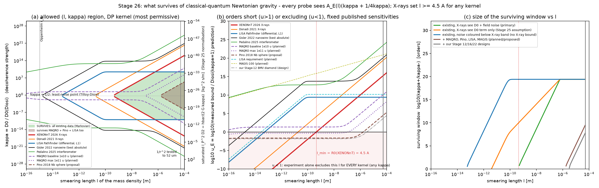

## Stage 27: what the CQ noise looks like, and whether we can tune an experiment to it

**Question (Dan):** "If the noise is constant or consistent, can we tune the experiment for that, figure out what the noise is, or both?"
**Files:** `scripts/stage27_run.py`, `scripts/stage27_fig.py`, `results/stage27.json`, `figures/stage27_signature.png`.
**Labels:** DERIVED means computed here. CITED means taken from a source. ASSUMED means our choice, stated. This stage builds on Stage 26, where every probe sees A_E(ℓ)(κ+1/4κ) and the minimum is at κ = 1/2 (= Diósi κ = 1).

### 27.1 The signature: how CQ noise differs from ordinary noise (DERIVED)
1. **Spectrum.** White (Markovian), flat from DC upward. The model has no cutoff. For the X-ray bound to apply at all, the noise must stay flat to at least about 1e21 rad/s. *Honest negative:* residual-gas Brownian noise is also white, so spectral shape alone cannot separate CQ from gas. It does separate CQ from patch noise and internal damping (1/f), seismic noise (coloured) and readout noise (f⁴ in acceleration).
2. **The "volume law".** Above the Stage 26 floor (ℓ ≥ 4.5 Å), every body larger than ℓ sits in the plateau. There, Γ_CQ·V = (4π/3)Għ(κ+1/4κ) ≥ **2.95e-44 m⁵ s⁻³**, one universal constant. The acceleration noise depends only on the body's volume. It does not depend on mass, composition, temperature, pressure, charge, magnetic field or laser power. Bodies smaller than ℓ all see the same Għ/(6√π ℓ³).
   - Gas scales as P·√T·R⁻⁴·ρ⁻² and blackbody as T⁵R⁻⁴ρ⁻². A two-size or two-pressure series separates them from CQ (exponent −3 in R, 0 in P and T).
   - Composition dependence appears only in the incoherent regime (ℓ < 0.6 Å), which is already excluded. *Honest negative:* in the surviving window, an EP-style composition differential gives a CQ signal of exactly 0. It is useful only as a veto.
3. **Spatial correlation.** For two bodies the cross-spectrum is S_AB = 4πGħ(κ+1/4κ)·J_AB. Along the line joining them it is **−2Għ/d³** (anti-correlated); transverse it is **+Għ/d³** (κ = 1/2).
   - It is independent of mass and ℓ, and exact for non-overlapping spheres by the shell theorem. Both the kick term and the field-noise term carry the same angular kernel. So the correlation coefficient is independent of κ.
   - This is exactly the Kafri–Taylor–Milburn mutual noise (arXiv:1401.0946). Its sign agrees with the anti-correlated cross-spectrum (plus the π phase) of Kryhin & Sudhir (arXiv:2309.09105, PRL 134, 061501).
   - For equal spheres, ρ_long = −(3/2π)V/d³. Values: touching spheres −0.25; d = 3R −0.074; **LPF TM1–TM2 −8.7e-4** (cross 2.65e-43 against self 3.03e-40 m²/s³); torsion dumbbell (ASSUMED 40 mm) −8.4e-5. |ρ| reaches 1% only for d ≤ 5.85 R.
   - Point-like bodies (R ≪ ℓ), using the erf kernel: ρ → +1 for d ≪ ℓ (common mode, so a differential instrument is blind to it). It crosses zero at d = 1.93 ℓ and falls as −12√π(ℓ/d)³ beyond that.
   - The cross term is long-range (1/d³). ℓ sets only the self term, so the "correlation length" is fixed by geometry, not by ℓ.

**Bottom line for "figure out what the noise is":** a CQ excess would be (i) white, (ii) unchanged when you vary pressure, temperature, composition or mass at fixed volume, (iii) scaling as 1/V, and (iv) anti-correlated between neighbouring bodies at −(3/2π)V/d³. No ordinary source does all four.

### 27.2 Tuning: honest gains (DERIVED, with published or ASSUMED T and B)
White noise has no carrier. A lock-in or matched filter cannot pull it out of white backgrounds; one can only estimate excess PSD.
- **(a) PSD integration.**
  - The statistical floor is 1/√(TB): LPF (1.1e6 s, 19 mHz band) gives 2.2 orders; torsion 2; levitated 3.
  - The binding limit is background-model accuracy ε. ASSUMED ε of 10% or 5% gives **1.0–1.3 orders**.
- **LPF public-data reanalysis (feasible).** Fit the white Brownian branch against the decaying pressure over about 500 days (Armano 2024, arXiv:2405.05207). The Brownian PSD fell by a factor of 8.9; the cold run at 274.8 K already sits below the warm runs. The intercept is S_0 ⊇ CQ.
  - ASSUMED inputs: 20 runs at 5% each. That gives intercept error 5.0% of the final PSD, which is a **1.0-order** gain (2σ).
  - Data: LPF Legacy Archive https://lpf.esac.esa.int/lpfsa/ (HEASARC mirror) has Δg and housekeeping. Boileau et al. (arXiv:2204.03867) already used the public data.
  - *Not possible:* a correlated-noise search. LPF records only Δg, has no independent TM channels, and the correlated part is 1e-3 of the self term.
- **(b) Modulation.**
  - For the DP / translation-invariant kernel there is **no external handle**: the noise is identical in vacuum and nothing outside the body changes it. Only body swaps (V) or modulating the backgrounds (P, T) are possible, which is the same limit as (a).
  - **New:** a state-dependent (ultralocal "discrete") kernel is different, because its field noise is sourced by matter.
    - Body self-term: Γ_x = πρG²D̂/(15R). LPF therefore gives D̂ ≤ **1.17e-15 kg**. Combined with XENONnT heating (D̂ ≥ ħ²/(ℓ² m_Xe Γ_X)), **the discrete kernel needs ℓ ≥ 2.5 µm**. This corrects the Stage 26 treatment, but only for that kernel.
    - Remaining window: 1.2 orders at 10 µm, 2.6 at 50 µm.
    - A moving source mass modulates the noise as Γ = (G²D̂/4)M_s/r⁴. That is a true lock-in handle.
    - An LPF-class sensor with an ASSUMED 10 kg source at 5 cm reaches D̂ = 1.2e-17. It would cover the whole discrete window for ℓ ≲ 24 µm and ≥ 76% of it up to 52 µm. No such instrument exists.
    - A Westphal-class torsion balance with 1 kg at 1 cm is 9.4 orders short.
- **(c) Cross-correlation.** The 2σ threshold on the correlated part is 2√(Γ_AΓ_B/TB).
  - LPF (hypothetical independent channels): 10.6 orders short, worse than the self route.
  - Levitated pair at d = 3R: 14.3. Nanowire pair: 13.4. Torsion pair: 20.9.
  - It never closes a gap, because the correlated part is only the small mutual term. Common mode (ℓ > d) is invisible to differential instruments.
- **(d) Composition differential:** 0 (see 27.1).

| Probe | Stage 26 log10 u | Best Stage 27 | Route |
|---|---|---|---|
| LPF (1.8–52 µm gap) | +9.40 | **+8.1** (+8.4 from public-data reanalysis) | (a) |
| MAQRO baseline | +1.34 | **−0.20** (1 run, 1e4 detections), **−0.95** (30 runs, ASSUMED) | contrast statistics instead of λτ ≤ 1 |
| Westphal torsion | +18.5 | +17.2 | (a) |
| Monteiro levitated | +16.0 | +14.3 | (c) pair at d = 3R |

**MAQRO with statistics.** Visibility resolution 2√(2/N) (ASSUMED Poisson) gives λ_min = 2.9e-4 s⁻¹ against λ_DP = 4.6e-4 s⁻¹. That excludes 0.5–35 nm, or 0.5–112 nm with 30 runs. It assumes environmental decoherence is known at the 0.5–3% level (ASSUMED).
- *Coincidence flag:* the single-run value (−0.20) is within a factor of 2 of zero.
- It does **not** reach the 1.8–52 µm band left after Stage 26 S4.

### 27.3 Verdict
- **Does tuning close any Stage 26 gap?** No for the DP kernel in the surviving 1.8–52 µm band: the best realistic gain is about 1.3 orders against 9.4.
- **What tuning does buy:** MAQRO's baseline moves to a reach of 0.5–112 nm, which is already covered by Pino/MAQRO-1e11 in S4. For state-dependent kernels, the noise becomes *modulatable* with a source mass, and LPF self-noise already squeezes that class to ℓ ≥ 2.5 µm.
- **What would identify the noise if an excess is seen:** the volume law plus the −2Għ/d³ anti-correlation.

### 27.4 Literature (verified IDs)
- Kafri, Taylor & Milburn, arXiv:1401.0946 (mutual noise is equivalent to Diósi).
- Altamirano et al., arXiv:1612.07735 (pairwise classical channels differ from DP).
- Tilloy & Diósi, arXiv:1706.01856.
- Helou et al., arXiv:1606.03637 (LPF bounds DP at σ ≥ 40 fm; their D_DP equals our incoherent formula).
- arXiv:2411.17588 (LPF update, σ_DP > 285.5 fm).
- Kryhin & Sudhir, arXiv:2309.09105 (closest prior art for the correlation signature).
- Angeli et al., arXiv:2501.13030.
- Armano et al. 2024, arXiv:2405.05207.
- Boileau et al., arXiv:2204.03867.

What I did not find in these sources: the explicit volume-law constant used as a discriminator, the κ-independence of ρ, and source-mass modulation of state-dependent kernels. That is not proof that they are new.

**Honest negatives:**
- Spectrum cannot separate CQ from gas.
- Composition tests give a null CQ difference.
- Cross-correlation is weaker than the self route.
- Lock-in fails for DP.
- The LPF reanalysis gains only about 1 order.
- The gains above rest on ASSUMED ε, run counts and source geometry.

## Stage 28 — LISA Pathfinder pressure-free white floor: the public-data reanalysis proposed in Stage 27

**Files:** `scripts/stage28_run.py`, `scripts/stage28_fig.py`, `results/stage28.json`, `figures/stage28_lpf.png`.
**Labels:** DERIVED means computed here. CITED means taken from a source. ASSUMED means our choice, stated.

### 28.1 Data actually used
- **Not raw time series.**
  - The ESA LPF Legacy Archive (https://lpf.esac.esa.int/lpfsa/) is a single-page GWT web app with CAS login (`auth_method: "cas"`). It has an anonymous role, but no documented scripted or TAP interface (`tap_adql_interface_active: "false"`; `/lpf-tap/` returns 404). I did not reverse-engineer its private query backend.
  - The HEASARC mirror (https://heasarc.gsfc.nasa.gov/FTP/lpf/data/) downloads freely, but it contains only NASA DRS (ST7) telemetry. It has no LTP interferometric Δg, so it is useless at the fm s⁻² level.
  - Getting raw Δg needs someone to drive the ESA web UI by hand. That is a possible follow-up.
- **Used instead: published per-run white (Brownian) Δg PSD floors.** These are S_Brown,k with 1σ bars for the 13 noise runs plus the cold run, **digitized** from Fig. 3 of Armano et al. 2024 (PRD 110, 042004, arXiv:2405.05207v3). The script downloads the figure and calibrates pixels against the printed log grid.
  - Grid residual is ≤ 3e-4 decades. Digitized run times match Table 1 to 0.4% rms (max 1.0%).
  - ASSUMED: 2% digitization error on S, added in quadrature. Where an error bar is hidden inside the marker, σ is taken as half the marker size, which is conservative.
- **Temperatures** and mean times come from Table 1; t_v = launch + 62.4 d (CITED).
- **Validation.** With the floor fixed at zero, our fit gives γ = 0.789 and T_a = 6.91 kK. The paper gives 0.80 ± 0.02 and 7.0 ± 0.2 kK. Our a = 25.4 against the paper's 27.0 ± 0.7 is a 2.3σ offset, probably from different weighting. The paper fits scaled data.

### 28.2 Model and fit (DERIVED; outgassing model ASSUMED, in the paper's own form)
- **There is no pressure gauge in the LPF GRS.** "Pressure" is inferred from S_Brown itself, so the extrapolation to zero pressure has to go through a model of P(t, T):
  S_k = a·(t_v/(t_k−t_v))^γ·exp[−T_a(1/T_k − 1/293 K)] + **S_0**,
  with a, γ, T_a and S_0 all floated.
- The 284 K runs (10 and 11) provide the temperature lever arm: about 11 K lower temperature means 2.5× less gas noise at the same age.
- The 95% upper limit comes from the profile likelihood, using Δχ² = 2.71 one-sided.

| Variant | S_0 best [fm² s⁻⁴ Hz⁻¹] | 68% | 95% upper | χ²/dof | Floor vs 0 |
|---|---|---|---|---|---|
| A: all 13 runs (**baseline**) | **1.13** | 0.16–1.90 | **2.26** | 6.6/9 | 1.15σ |
| B: drop runs 1–2 | 1.54 | 0.42–2.22 | 2.49 | 5.1/7 | 1.3σ |
| C: 13 runs + cold run (274.8 ± 0.5 K) | 1.21 | 0.98–1.42 | 1.55 | 6.6/10 | **4.4σ** |
| D: runs 8–13 only | 1.01 | 0–2.04 | 2.45 | 2.6/2 | 0.6σ |
| Model-independent: cold-run level (95%) | — | — | 1.86 | — | — |

- **Coincidence/anomaly flag.** Every variant prefers a non-zero pressure-free floor of about 1.0–1.5 fm² s⁻⁴ Hz⁻¹, which is about 1.1 (fm s⁻²)²/Hz in Δg. That is about 37% of the run-10 PSD.
  - Without the cold run the preference is 1.2σ, i.e. not significant.
  - With the cold run it is 4.4σ. But the paper itself excludes that run (temperature not measured directly, poor data quality). The result also hinges on the Arrhenius law holding down to 275 K.
  - Ordinary explanations are far more likely: the single-activation outgassing model breaking down, a second gas species, white actuation or electrostatic noise, or bias from the paper's "minimum-PSD point = Brownian" step.
  - Reading it as CQ would need κ ≈ 1e9 at the plateau. Nothing excludes that, but this data cannot test the volume law or the anti-correlation that would identify it.

### 28.3 Bound on the CQ volume-law noise and κ (Stage 26 conventions)
- **Conversion.** Γ = S_0/4 (differential, one-sided to two-sided per axis). V = M/ρ = 9.74e-5 m³. The plateau DP rate at κ = 1 is Γ_DP = (4π/3)Għ/V = 3.03e-40 m² s⁻³.
- **Baseline bound.** S_0 ≤ 2.26 fm² s⁻⁴ Hz⁻¹ gives **Γ ≤ 5.7e-31 m² s⁻³**, i.e. **Γ·V ≤ 5.5e-35 m⁵ s⁻³**. The minimum CQ value is (4π/3)Għ = 2.95e-44, so the bound is **9.27 orders short**. Stage 26 was 9.40, so the gain is **0.13 orders**.
- **Spread across variants:** 9.11–9.31 orders short (gain 0.09–0.29). The model-independent cold-run limit gives 9.19 (gain 0.21).
- **κ at the plateau (0.63–52 µm):** allowed κ ∈ [1.3e-10, 1.9e9]. Stage 26 had [1.0e-10, 2.5e9].
- **ℓ exclusion.** LPF alone still excludes only ℓ < 5.6e-14 m, inside the incoherent regime the X-rays already exclude. The 1.8–52 µm band left after Stage 26 S4 survives.

### 28.4 Verdict against the Stage 27 projection (9.4 → 8.4)
**Not achieved.** The real gain is 0.1–0.3 orders, not 1.0.

Stage 27 assumed a 5% intercept error. The real one is 0.86 fm² s⁻⁴ Hz⁻¹, about 28% of the final PSD, for two reasons:
1. With no pressure gauge, the pressure model (γ, T_a) must float, and it is strongly degenerate with S_0.
2. The data prefer S_0 ≈ 1.1 rather than 0, so the upper limit sits above the statistical width.

**What would help:**
- raw Δg from the ESA archive, to refit S_Brown with full covariance and use the 10 Hz data above the readout rise;
- an independent gas-species and pressure handle (housekeeping temperatures across the cold run);
- or LISA's own TMs.

None of these reaches the 9-order gap.

### 28.5 Honest caveats
- Digitized figure data, not raw telemetry.
- The outgassing model is ASSUMED.
- The cold-run temperature is a proxy.
- The Stage 26 Γ = S/4 convention is carried over unchanged.
- The anti-correlation term (+4Għ/d³) is neglected, at 1e-3 of the total.
- No tuning: all fits float every gas parameter. The 2% digitization error is the only ASSUMED number in the error budget.

## Stage 29 — Stress test of the three "possibly new" Stage 27 claims

**Question.** Stage 27 named three results it had not found in the literature. Are they right, and are they new?
1. The volume law.
2. The −2Għ/d³ cross-correlation.
3. Source-mass modulation for the matter-sourced kernel, with ℓ ≥ 2.5 µm from LPF.

**Files:** `scripts/stage29_run.py`, `scripts/stage29_fig.py`, `results/stage29.json`, `figures/stage29_checks.png` (runtime 13 s).

**Labels:** DERIVED means computed here. CITED means taken from a source. ASSUMED means our choice, stated.

**Method.**
- Everything was re-derived from the Diósi master equation, −(G/2ħ)∫∫[m(x),[m(y),ρ]]/|x−y|, and Tilloy–Diósi Eq. 11, D = γ/4 + V∘γ⁻¹∘Vᵀ. No Stage 27 code was reused.
- Γ is the two-sided acceleration PSD per axis.
- Units were checked by exponent vectors (kg, m, s). All pass.

### 29.1 Claim 1, the volume law: confirmed for spheres and cubes, already known, scope corrected
- **Re-derivation (DERIVED).**
  - Γ_ij = 4πGħ(κ+1/4κ) ∫d³k/(2π)³ (k_ik_j/k²)|μ̃/M|² = 4πGħ(κ+1/4κ)·N_ij/V_eff.
  - V_eff = M²/∫ρ², and N_ij is the **magnetostatic demagnetization tensor** of the body shape (trace 1).
  - The classical-field term has the same 1/k² kernel, C_Φ = πGħ/(κk²), so the (κ+1/4κ) factor multiplies the same structure.
- **Numbers.**
  - Independent radial integral for a sphere: ΓV = 2.9483e-44 m⁵ s⁻³, ratio to (4π/3)Għ = 1.00000.
  - Spheroid N from the k-space integral matches Osborn's analytic demagnetizing factors to 1e-12.
- **Correction 1, shape.** The law ΓV = (4π/3)Għ(κ+1/4κ) is exact only where N = 1/3, which means spheres and cubes (cubic symmetry).
  - c/a = 0.1 plate: ×2.58 along the normal, ×0.21 in-plane.
  - c/a = 10 rod: ×1.47 transverse, ×0.06 axial.
  - Long rod: ×1.5 transverse, → 0 axial.
  - Impact:
    - LPF (cubes), MAQRO, levitated spheres, Westphal spheres and Stage 28 are unchanged.
    - A nanowire read transversely is ×1.5 (+0.18 orders) above an isotropic estimate.
- **Correction 2, composition.** Mass and composition independence holds only for **homogeneous** bodies. In general V → V_eff ≤ V by Cauchy–Schwarz.
  - Example (ASSUMED): a 10 µm silica sphere with a 1 µm Au shell has Γ ×2.31 above the volume law.
- **Smaller corrections.**
  - Finite ℓ/R deficit: 0.17% at ℓ/R = 1e-3, 1.7% at 1e-2, 17% at 0.1.
  - Lattice graininess at ℓ ≥ 4.5 Å: below 1e-30 relative (Au, Si, Pt-Au).
- **Scaling exponents, rechecked numerically.**
  - CQ: R⁻³, ρ⁰.
  - Gas: R⁻⁴, P¹, T^0.5, ρ⁻².
  - Blackbody: R⁻⁴, T⁵.
- **Literature: already known (CITED).**
  - Diósi, arXiv:quant-ph/0607110, Eq. 8: "ω_G² = (4π/3M) G ∫ f²(r) dr … At constant mass density ω_G² = (4π/3) G f̄ = GM/R³". Eq. 13 gives the decoherence time 2ħR³/(GM²|x−y|²). So Γ = ħω_G²/M = (4π/3)Għ/V; the ∫f² form *is* the V_eff law. Original source: Diósi, PRA 40, 1165 (1989).
  - Diósi, arXiv:1302.5365: ω_G "does not depend on the size but on the density".
  - Nimmrichter–Hornberger–Hammerer, arXiv:1405.2868, Eq. 11: "D_DP = (Għ/2π²)∫d³k (k_x²/k²)|ρ̃(k)|²". This is the shape-dependent form, and our N_ij is its G = 0 term.
  - **The volume scaling as the CQ signature** is already in Oppenheim et al., arXiv:2203.01982, Sec. V: "masses with smaller volume should yield larger uncertainty and this would be the effect to look for".
  - We did not find the demagnetization-tensor reading stated explicitly. It is a one-line consequence of NHH Eq. 11.
- **Verdict:** confirmed (constant); already known; corrected in scope (shape, homogeneity).

### 29.2 Claim 2, the cross-correlation: confirmed, already known, wording corrected, KTM attribution wrong
- **Re-derivation (DERIVED).** Cross term of the same double commutator: Γ^AB_ij = Għ(κ+1/4κ)(δ_ij − 3n_in_j)/d³ for non-overlapping spheres.
- **Numbers.** Independent Fourier integral (4πGħ∫(k_z²/k²)F²cos(k_zd)) at d/R = 2.5, 3 and 5:
  - longitudinal −2.0000 Għ/d³, transverse +1.0000 Għ/d³;
  - ρ_long = −0.1280, −0.07407 and −0.01600 respectively, equal to −(3/2π)V/d³ to 1e-7;
  - point-like limit: self term 1/(6√π)ℓ⁻³ ✓, zero crossing d = 1.936ℓ ✓, far field −12√π(ℓ/d)³ ✓ (ratio 1.000003).
- **Correction 1, κ.** The cross term is **−2Għ(κ+1/4κ)/d³**, so |Γ_AB| ≥ 2Għ/d³ with equality only at κ = 1/2. Only the correlation *coefficient* is κ-independent. Even that holds only inside the one-parameter DP family, where all three Tilloy–Diósi terms share the 1/k² kernel.
- **Correction 2, KTM.** The Stage 27 line "exactly the Kafri–Taylor–Milburn mutual noise" is **wrong**.
  - KTM (arXiv:1401.0946, Eq. 16) has only self terms, −(K/2ħ)Σ_k[x_k,[x_k,ρ]], so its noises are uncorrelated (ρ = 0).
  - *Coincidence flag:* KTM's self-noise magnitude ħK = 2Għm₁m₂/d³ equals |Γ_AB|M_AM_B, because both come from the tidal constant. They are not the same physics.
  - Tilloy–Diósi with local monitoring (γ = γ₀δ) gives a cross term ∝ (δ_ij − n_in_j)/d, i.e. **zero longitudinal correlation**.
  - So the sign and axis pattern discriminates kernels:
    - DP: anti-correlated along d, correlated transverse;
    - KTM: none;
    - local-γ TD: transverse only.
  - We did not find this pattern stated in this form.
- **Literature: already known (CITED).**
  - Gaona-Reyes, Carlesso & Bassi, arXiv:2007.11980 (PRD 103, 056011), Eq. 47, Tilloy–Diósi two-particle term: "− m₁m₂(η₁₂[x̂₁,[x̂₂,ρ̂]] + η₂₁[x̂₂,[x̂₁,ρ̂]])". They also write: "the corresponding term in Eq. (47) contains also position operators of different particles … the TD model cannot be reduced to that of KTM".
  - Kryhin & Sudhir, arXiv:2309.09105 (PRL 134, 061501): Eq. 6 is ε × the Diósi kernel, and Eq. 8 is "L_G ≈ −ε Gm₁m₂/(ħR³)[x̂₁,[x̂₂,ρ̂Q]]". They propose measuring S_x₁x₂.
  - *Flag on KS:* expanding their Eq. 6 directly, with both x along +d, gives +2εGm₁m₂/(ħR³)[x̂₁,[x̂₂,ρ̂]]. Their Eq. 8 has half the magnitude and the opposite sign. Their main-text H_G = Gm₁m₂x₁x₂/(2R³) is 4× below the K = 2Gm₁m₂/R³ implied by their appendix μ. This is absorbed in their free ε, and the sign depends on axis convention. Flagged, not resolved.
- **Verdict:** confirmed (−2Għ/d³ at κ = 1/2); already known (Gaona-Reyes 2021, Kryhin–Sudhir 2023); "independent of κ" corrected to "≥, equality at κ = 1/2"; KTM attribution wrong.

### 29.3 Claim 3, source-mass modulation: DP part confirmed, concept already known, LPF bound corrected from 2.5 µm to 5.5 nm
- **Rechecked (DERIVED).**
  - DP: Γ_AA contains no term from body B (B enters only through cross terms), so there is no modulation handle. **Confirmed.**
  - Matter-sourced kernel (D₀ = δ/(D̂ρ), ⟨δmδm⟩ = (D̂/4)ρδ):
    - Self term Γ = πρG²D̂/(15R): Monte Carlo/analytic = 1.0009.
    - Source term G²D̂M_s/(4r⁴) longitudinal, 0 transverse: confirmed.
    - LPF ceiling: D̂ ≤ 1.169e-15. **The units are kg s, not kg.** This is a label error in Stages 26–27; Oppenheim also writes "kg s".
- **Correction (DERIVED, ASSUMED kernel reading).** The X-ray heating lower bound on D̂ used the *isolated* nucleus, ∫(∂μ)²/μ = m/ℓ². In a field theory the denominator m(x) is the **total** smeared density. In liquid Xe (a = 4.20 Å) it includes the neighbours once ℓ ≳ a/3.
  - Lattice integral (ASSUMED simple cubic; the liquid is the same at ℓ > a) relative to the isolated case:
    - 0.98 at ℓ = 0.15a;
    - 0.40 at 0.3a;
    - 0.090 at 0.5a;
    - 0.011 at a;
    - 1.8e-4 at 4a.
  - For ℓ ≥ 0.5a it equals the dense formula m²/(16π^{3/2}ρℓ⁵) to 0.3%. So D̂_min ∝ ℓ⁻⁵, not ℓ⁻².
  - Cross-check: the dense limit gives η = √3 = 1.732 ≥ 1, so the Stage 26 bound ℓ ≥ η^{1/3}R₀ is untouched.
- **Result.** The matter-sourced kernel needs **ℓ ≥ 5.5 nm**, not 2.5 µm. Our script reproduces Stage 27's 2.51 µm when it uses the isolated formula.
  - Beyond about 2 µm, molecule interferometry is the binding lower bound: D̂ ≥ M_λ/λ ≈ 1e-25 kg s, falling as (Δx/ℓ)² for ℓ > Δx. M_λ and λ are CITED from Oppenheim App. F; Δx = 100 nm is ASSUMED.
  - Window: 1.3 orders at 10 nm, 6.3 at 100 nm, 11.3 at 1 µm, 14.1 at 10 µm, 15.1 at 50 µm. Stage 27 had 1.2 and 2.6 orders at 10 and 50 µm.
  - The Stage 27 source-mass lock-in (10 kg at 5 cm, D̂ = 1.18e-17) now covers 100% of the window at 10 nm but only **32 / 18 / 14 / 13%** at 0.1 / 1 / 10 / 50 µm. Stage 27 had "whole window for ℓ ≲ 24 µm".
- **Literature: already known in concept (CITED).**
  - Oppenheim et al., arXiv:2203.01982, Sec. V / App. F: "the discrete models appear less constrained due to the suppression of the noise away from the mass density … ⟨D₂⟩ = (l_P³/m_P) D₂ m(x)". They give the Cavendish/torsion squeeze "10⁻¹ kg s ≥ (l_P³/m_P)D₂ ≥ 10⁻²⁵ kg s". So matter-sourced noise tested with source masses is already in the paper.
  - Carney & Taylor, arXiv:2301.08378, give source-mass-sourced noise Γ_incoh = G²Mm²ℓ²σ²/(d⁶v²) and write that "the entire remaining parameter space can be tested by … atom interferometers coupled to oscillating source masses".
  - What is ours: the LPF self-noise ceiling 1.17e-15 kg s, which is 14 orders below Oppenheim's 10⁻¹, and the lock-in numbers.
- **Open points (honest).**
  - For ℓ > a, neighbouring nuclei get strongly correlated kicks. Collective X-ray emission was not modelled. The same open point applies to the Stage 26 DP X-ray mapping for ℓ > a.
  - The LPF ceiling uses the TM self-term only. Spacecraft masses would tighten it.
  - The D̂ normalisation mapping to Oppenheim's (l_P³/m_P)D₂ was inherited from Stage 26 and not re-derived.
- **Verdict:** DP no-modulation confirmed; matter-sourced modulation already known in concept; the Stage 27 bound **ℓ ≥ 2.5 µm is corrected to ℓ ≥ 5.5 nm**, with a window 10–14 orders wider and lock-in coverage 13–32% rather than complete.

### 29.4 What changes in Stage 27 and in what Dan has been told
- **No DP number changes.**
  - The volume constant 2.95e-44 m⁵ s⁻³ stands for the LPF cubes and the spheres.
  - The Stage 26/27/28 DP shortfalls, the 1.8–52 µm gap and the tuning gains all stand.
- **Novelty claims withdrawn.** None of the three is new:
  - (1) Diósi 1989/2007, NHH 2014, and the signature use in Oppenheim 2023;
  - (2) Gaona-Reyes–Carlesso–Bassi 2021 Eq. 47 and Kryhin–Sudhir 2023;
  - (3) Oppenheim 2023 App. F (matter-sourced) and Carney–Taylor 2023 (oscillating source mass).
  - What survives as possibly ours:
    - the demagnetization-tensor statement;
    - the kernel-discriminating sign pattern (DP / KTM / local-γ);
    - the LPF numbers for the discrete kernel.
- **Corrections.**
  - "Independent of the model's free parameters" → the coefficient is κ-independent; the magnitude is ≥ 2Għ/d³.
  - "Exactly KTM" → KTM predicts zero correlation.
  - Discrete kernel ℓ_min: 2.5 µm → 5.5 nm.
  - D̂ in kg s.
- **Honest negatives.**
  - Nothing here helps close the 1.8–52 µm DP gap.
  - The discrete-kernel window got *larger*, so that model is less constrained than Stage 27 said.

## Stage 30 — Big G vs test-mass volume: can CQ/DP noise explain the ~500 ppm G spread?

**Question (Dan).** Could the volume-law noise make lab G values depend on test-mass geometry, and so explain a 551 ppm max–min spread when the quoted errors are tens of ppm?
- The volume law, from Stages 27 and 29: Γ_ii V = 4πGħ(κ+1/4κ)N_ii.
- Prior art: Oppenheim et al. (arXiv:2203.01982, Sec. V) already floated exactly this: "it is perhaps intriguing that different experiments to measure Newton's constant G yield results whose relative uncertainty differ by as much as 5·10⁻⁴ … masses with smaller volume should yield larger uncertainty and this would be the effect to look for".

**Verification pass (Stage 30v, this revision).** Dan: "recheck it yeah? nothing from memory when its like this."
- The first version had 10 of 16 geometries marked ASSUMED, meaning recalled and not checked. Every one has now been re-read from a document fetched during this pass.
- Each row of `results/stage30_G_table.csv` now has `source` (document plus page, table or line) and `quote` columns.
- Documents used:
  - CODATA-98 (RMP 72, 351, NIST PDF), Sec. III.Q;
  - CODATA-02 (RMP 77, 1, NIST PDF), item (h);
  - CODATA-06 (arXiv:0801.0028), p. 58;
  - CODATA 2022 (arXiv:2409.03787), Table XXX;
  - Gundlach & Merkowitz (gr-qc/0006043);
  - Schlamminger et al. 2006 (gr-qc/0609027);
  - Parks & Faller 2010 (arXiv:1008.3203);
  - Kleinevoß PhD thesis (Wuppertal WUB-DIS 2002-2);
  - Quinn, Speake, Parks & Davis, Phil. Trans. A 372, 20140032 (2014);
  - Li et al., Nature 560, 582 (2018), Extended Data Tables 1, 2 and 4;
  - Rosi et al. 2014 (arXiv:1412.7954).
- **Not re-fetched:**
  - UCI-14: the publisher PDF is behind Cloudflare. The plate dimensions from Stage 30 are corroborated by a search snippet ("40.5902 mm wide, 40.5900 mm high, and 2.9430 mm thick").
  - HUST-09: still taken from the Luo review, PMC4173272, as fetched in Stage 30.
  - Both were already CITED, not ASSUMED.
- **Handbook densities.** For JILA-18, UWup-02 and HUST-05 the papers give mass and material but no dimensions, so V = m/ρ uses a handbook density (W 19300, Cu 8960, Pyrex 2230 kg/m³). These rows are labelled `V_how = m/rho (ASSUMED-handbook)`, and a sensitivity run drops them.
- **Naming correction.** The task called JILA-18 "Newman et al."; that is wrong. CODATA 2022 Table XXX lists JILA-18 as "Parks and Faller (2019)", which is the revised JILA-10 (PRL 105, 110801). Newman et al. is UCI-14.

**Files:** `scripts/stage30_run.py`, `scripts/stage30_fig.py`, `results/stage30.json`, `results/stage30_G_table.csv`, `figures/stage30_bigG.png`.

**Labels:** DERIVED means computed here. CITED means taken from a fetched source, with a quote in the CSV. ASSUMED means our choice, stated.

### 30.1 Data
**The values.** These are the 16 CODATA input values (CITED). CODATA 2022 (Table XXX) is the same set as CODATA 2018: "there is no new relevant input datum for the 2022 adjustment".
- Recomputed weighted mean: 6.674290; χ² = 197.8 for 15 degrees of freedom, so the Birge ratio is 3.63 (CODATA uses 3.9).
- DerSimonian–Laird excess scatter: τ = **83 ppm**. The median quoted error is 39 ppm.

**Verified test-body geometry, per suspended body, and what changed.**

| id | ppm | u | verified test body (CITED) | V_eff (m³) before → now | source mass / distance (CITED) | change |
|---|---|---|---|---|---|---|
| NIST-82 | −273 | 64 | W dumbbell: 2 W **disks** 2.5 mm × 7.2 mm dia + W rod ~1 × 29 mm, ~7 g | 1.81e-7 → **1.02e-7** | 2 W spheres ~10.2 cm, ~10.5 kg, centres ~14 cm apart | was "W sphere 3.5 g"; V ×0.56 |
| TR&D-96 | −210 | 75 | 1.6 g spheres, 7.2 mm dia, on 23 cm beam (version-3 apparatus) | — → **1.95e-7** | brass 8.0 kg (also bronze 4.9, steel 4.3 kg) at 19.2–47.2 cm | was UNKNOWN; **now included** |
| LANL-97 | −48 | 105 | "the same dumbbell test mass and tungsten source masses" as NIST-82 | 1.81e-7 → **1.02e-7** | as NIST-82 | V ×0.56 |
| UWash-00 | −7 | 14 | Pyrex plate 1.506 × 76 × 41.6 mm | 4.79e-6 → 4.76e-6 | #316 SS spheres 124.89 mm, ≈8.140 kg, at ρ = 16.76 cm | 42 → 41.6 mm |
| BIPM-01 | +193 | 40 | Cu-0.7%Te cylinders h = d = 55 mm, ~1.2 kg | 1.35e-4 → 1.31e-4 | Cu-Te h = d = 118 mm, ~11 kg (PRL 2001: 12 kg); separation ~107 mm | dimensions now explicit |
| UWup-02 | −12 | 147 | 2 pendulum bodies m ≈ 3.3 kg: OFHC-Cu mirror ~198 mm dia in Al mount | 3.76e-4 → 3.68e-4 (Cu lower bound; Al upper 1.22e-3) | 2 brass cylinders 440 × 430 mm, ~576 kg, at 0.915 m | was "~3.2 kg brass"; source r 0.4 → 0.915 m |
| MSL-03 | −64 | 40 | 532 g horizontal Cu cylinder, 19 mm dia × 220 mm | 5.58e-5 → **6.24e-5** | Cu and SS cylinders; mass and distance not in fetched sources | was "Cu ~0.5 kg, h = d"; now a needle, L/d = 11.6 |
| HUST-05 | −312 | 130 | Cu test mass ~32 g (32.26 g sphere) | 3.60e-6 (unchanged) | 2 SS cylinders 6.25 kg, 100 × 100 mm, faces 60 mm apart | — |
| UZur-06 | −7 | 18 | 2 Au-plated Cu cylinders, 45 mm dia × 77 mm, 1.1 kg | 1.228e-4 → 1.225e-4 | 2 field masses of 7.5 t each; signal 784.9 µg | source "13.5 t total" → 2 × 7.5 t |
| HUST-09 | −121 | 27 | glass/quartz block 91.47 × 12.01 × 26.22 mm, 63.38 g | 2.88e-5 (unchanged) | SS316 spheres 778.18 g | — |
| BIPM-14 | +186 | 24 | **new** Mk II test masses "similar in size" to Mk I, ~1.2 kg | 1.35e-4 → 1.31e-4 | Mk I sources cut to 115 mm height, ~11.2 kg | flag: Mk II test masses are new bodies |
| LENS-14 | −358 | 148 | ⁸⁷Rb atoms, 1e5 detected, T = 160 ms, 1.9 s per shot | point-like | 24 W cylinders 99.90 × 150.11 mm, ~516 kg; Δφ = 0.547870 rad | atom numbers now CITED |
| UCI-14 | +7 | 19 | fused-silica plate 40.59 × 40.59 × 2.943 mm, 10.60 g | 4.85e-6 (unchanged) | 2 OFHC Cu rings 59 kg | — |
| HUSTT-18 | −17 | 12 | TOS pendulum 1: 91.006 × 11.087 × 30.668 mm, 68.10 g | 2.86e-5 → **3.09e-5** | SS spheres 57.15 mm, 778.0–778.2 g; centre distance 157.19 mm | was "HUST-09-like" |
| HUSTA-18 | +28 | 12 | AAF pendulum 3: **91.052 × 4.002 × 49.924 mm, 40.04 g** | 2.86e-5 → **1.82e-5** | SS spheres 127.0 mm, ~8.542 kg; 342.29 mm horizontal, 139.79 mm vertical | **same-body assumption false**: V ×0.64 |
| JILA-18 | −255 | 37 | 2 OFHC Cu bobs, 780 g each (shape not given) | 8.71e-5 (unchanged) | 4 × 120 kg W-alloy cylinders; ΔF = 480 nN per bob | source "~120 kg" → 4 × 120 kg |

**Shapes.**
- N_rel is the equivalent-spheroid demagnetization factor along the signal direction. The values are UWash 0.96, UCI 0.90, HUSTA 0.91, HUSTT 0.74, HUST-09 0.71, MSL 0.49 (transverse to a needle), BIPM 1/3, UZur 0.20 (axial).
- Where the shape or orientation is not given (NIST/LANL disk orientation, UWup mirror thickness, JILA bob shape), the row is excluded from the CQ-proxy test. Its physics N_rel is set to an upper value: N_axis(disk) = 0.63 or 1.

### 30.2 Statistics (DERIVED; n = 15 macroscopic bodies, TR&D-96 now included)

**Before and after verification.**

| test | before (n = 14) | after (n = 15) |
|---|---|---|
| Spearman ρ (ppm vs log V) | +0.45, p = 0.11 | **+0.50, p = 0.059** |
| WLS with τ, slope per decade | +70 ± 29 ppm, perm p = 0.066 | **+69 ± 25 ppm, perm p = 0.035** |
| jackknife slope range | +44 … +90 | +54 … +86 (no sign change) |
| with method fixed effects | +82 ± 39, p = 0.034 | +75 ± 33, p = 0.023 |
| density (perm p) | 0.34 | 0.35 |
| log mass (perm p) | 0.18 | 0.086 |
| CQ proxy log(3N/V) (perm p) | 0.13 (n = 14) | 0.045 (n = 11, shape-verified only) |
| look-elsewhere, Bonferroni(5) / Šidák | 0.33 / 0.29 | **0.18 / 0.16** |
| "documented" subset | n = 5 CITED: ρ = 0.87, p = 0.054 | n = 12 with V from cited dimensions: ρ = 0.59, p = 0.042; WLS perm p = 0.0022 |
| \|z\| vs log V (the CQ prediction) | ρ = +0.15, p = 0.60 | ρ = +0.09, p = **0.76** |
| \|ppm\| vs log V | ρ = −0.08, p = 0.79 | ρ = −0.20, p = 0.47 |
| method: Kruskal–Wallis / RE χ² | p = 0.085 / 18.1 on 4 dof, p = 0.0012 | unchanged |

**Sensitivity of the signed trend (WLS permutation p).**
- UWup V_eff at the Al upper bound: 0.033.
- HUSTT pendulum 2 instead of pendulum 1: 0.032.
- Dropping TR&D-96: 0.077.
- Dropping the three handbook-density rows: 0.0026.
- **Dropping the three old W/7 mm dumbbell time-of-swing results (NIST-82, TR&D-96, LANL-97): ρ = +0.30, slope +55 ± 45, perm p = 0.38.**
- **Dropping all dynamic torsion runs: perm p = 0.74.**
- Within class: TB-dyn ρ = +0.45, p = 0.31 (n = 7); TB-comp ρ = +0.67, p = 0.22 (n = 5).

**Same-volume pairs.**
- BIPM-14 vs UZur-06: V ratio 1.07, ΔG = +193 ppm (6.5σ).
- BIPM-14 vs JILA-18: V ratio 1.50, ΔG = +440 ppm (9.9σ).
- BIPM-01 vs BIPM-14: V ratio ≈ 1.0, ΔG = +7 ppm (0.2σ).
- UCI-14 vs UWash-00: V ratio 1.02, ΔG = +14 ppm (0.6σ).
- HUSTT-18 vs HUSTA-18 is **no longer a same-body pair**: V ratio 1.70, ΔG = −45 ppm (2.7σ). The smaller AAF body gives the *higher* G, which is opposite to the overall trend.

**Coincidence flag.**
- After verification the signed trend (bigger V gives higher G) got nominally *stronger*: p 0.066 → 0.035, Bonferroni 0.33 → 0.18. On the dimension-only subset it reaches p = 0.002. That subset was chosen after looking, so with about 10 looks it is about 0.02.
- The trend is carried entirely by three pre-2000 dynamic experiments with ~0.1–0.2 cm³ tungsten or bronze-like bodies at −48 to −273 ppm. Without them, p = 0.38.
- Volume is confounded with method: median log₁₀V is −5.4 for dynamic torsion runs, −4.2 for compensation balances, and −3.7 to −3.9 for suspended and beam balances.
- Log mass tracks log V almost as well (dimension subset p = 0.004), so the data cannot tell "volume" from "mass" from "old time-of-swing apparatus".
- The sign has no CQ meaning, because CQ noise has zero mean (30.3).

### 30.3 Physics: what CQ noise can do to a G measurement
**Ceilings used.**
- Most permissive Stage 28 bound: (ΓV)_max = 7.76e-35 m⁵ s⁻³.
- Atoms: the X-ray ceiling Γ ≤ Għ/(6√π R₀³) = 7.3e-18 m² s⁻³.
- Matter-sourced kernel: D̂ ≤ 1.17e-15 kg s (Stage 29).

**Inputs.**
- Signal acceleration a_sig, now from verified numbers only:
  - GM_s/r² with cited M_s and r for NIST, LANL, TR&D, UWash, BIPM, UWup, HUST-05 and HUST-18;
  - JILA: 480 nN / 0.78 kg = 6.2e-7 m s⁻²;
  - UZur: 784.9 µg · g / (4 · 1.1 kg) = 1.7e-6 m s⁻² (the factor 4 is conservative);
  - LENS: Δφ/(k_eff T²) = 1.33e-6 m s⁻² (DERIVED).
- **Dropped from the physics table** because no source-distance number was found in a fetched source: MSL-03, HUST-09, UCI-14. Before verification they sat at 1e-4 to 1e-3 ppm.
- Integration time T = 1 day (ASSUMED; shorter than any real campaign, so conservative).
- LENS uses 1e5 atoms per shot (CITED) and 1e5 s / 1.9 s = 5.3e4 shots (DERIVED). Before verification this was 1e5 atoms and 1e5 shots, ASSUMED.

**Mean bias: none at linear order (DERIVED/CITED).**
- White force noise has zero mean, so it adds variance only.
- CQ models reproduce the Newtonian mean: Tilloy–Diósi Eq. 10 and Kryhin–Sudhir Eq. 5.
- DP self-noise does not depend on where the source mass is (Stage 29), so any heating shift cancels in the near–far difference.

**Second order.** The time-of-swing rectification bound, with the same generous inputs as before, is now ≤ 1.6e-4 ppm (NIST/LANL), up from ≤ 5e-5. The change comes from the smaller verified disk volume and the larger N.

**Excess scatter at the maximum allowed noise, before → now.**
- Torsion and suspended bodies: 2.5e-7–1.2e-3 → **1.1e-6–1.1e-3 ppm**.
- LENS atoms: 0.036 → **0.057 ppm**.
- DP floor: ≤ 2e-8 ppm (unchanged).
- Matter-sourced kernel: ≤ 6e-5 → ≤ 6.1e-5 ppm.

**Distance from 500 ppm.** Every experiment is **at least 3.9 orders** below 500 ppm (LENS; it was 4.1), and torsion and suspended bodies are 5.6–8.7 orders below. Producing 500 ppm in a day would need ΓV = 1.5e-23 to 1.5e-17 m⁵ s⁻³, which is **11.3–17.3 orders above** the Stage 28 bound (was 11.3–18.6).

### 30.4 Verdict (unchanged in substance after verification)
- **No CQ explanation.**
  - At the maximum allowed strength the noise is ≥ 3.9 orders too small (≥ 5.6 for macroscopic bodies).
  - It has no linear mean-bias mechanism.
  - The scatter test it actually predicts is null (p = 0.76).
- **The volume trend is not robust evidence of anything new.**
  - The signed trend strengthened on verified geometry: +69 ± 25 ppm per decade, permutation p = 0.035, about 0.18 after look-elsewhere.
  - But it comes entirely from the three old small-dumbbell time-of-swing results. Without them, p = 0.38.
  - It is confounded with method (within-class p = 0.22–0.31).
  - It is contradicted by same-volume pairs that differ by 193–440 ppm.
  - HUST's two 2018 bodies point the opposite way.
- **Method remains the stronger, already-known pattern.** Dynamic torsion runs sit at −110 ± 38 ppm, compensation runs at +66 ± 39, suspended bodies at −200 ± 80 (random-effects p = 0.001).
- **Honest negatives and open items.**
  - The CQ idea (Oppenheim's own speculation) is excluded for G by 11–17 orders in ΓV.
  - The verification found two of the earlier assumptions wrong: the HUST-18 AAF body is not the TOS body (V ×0.64), and NIST/LANL use disks, not spheres (V ×0.56). MSL-03 is a 220 mm needle, not an h = d cylinder.
  - The smallest margin moved by only 0.2 orders (4.1 → 3.9, LENS). Individual rows moved by up to 1 order (UWup-02, because the verified source distance is 0.915 m, not the assumed 0.4 m).
  - Not verified, and therefore dropped from the physics: the source distances for MSL-03, HUST-09 and UCI-14.

## Stage 31 — Dan's "do-si-do" (hooked-arm) hypothesis: minimal model, every element tested

**Question (Dan).** Treat particles as locked, localized field states. Locking and unlocking work like square dancers' hooked arms:
- the hook lets go gradually, not instantly (a release time τ, maybe a plastic stage, rate dependence);
- hooks differ in how open they are (a spread of lock strengths);
- they have carabiner gates (a threshold to open, a spring that closes them again);
- release depends on frequency, amplitude and above all **angle of incidence**, the idea that started this work 8 months ago;
- locking and unlocking need not be mirror images (hysteresis).

Dan: "I'd like all of those tested."

**Standing rule (new from Stage 30v).** Every experimental input was read from a source fetched during this stage. The source and quote for each are in `results/stage31_sources.csv` and `results/stage31.json → sources`. Nothing is recalled. Two values were **DIGITIZED** from a fetched figure, and they are labelled as such.

**Files:**
- `scripts/stage31_run.py`, `scripts/stage31_fig.py`
- `results/stage31.json`, `results/stage31_sources.csv`
- `data/stage31/grundmann2020_Fig3_data.txt` and `grundmann2020_Fig2_data.txt`: the authors' Zenodo histograms, 10.5281/zenodo.3899920
- `data/stage31/grundmann2020_fig3C_crop.png`
- `figures/stage31_dosido.png`

**Labels:** DERIVED means computed here. CITED means taken from a fetched source. ASSUMED means our choice, stated. DIGITIZED means read off a fetched figure.

### 31.1 The model (ASSUMED structure, one knob per element)
A probe (a photon, a field or a particle) meets a lock with incidence angle θ relative to the lock axis, angular frequency ω and amplitude A. Two readings are tested.

- **R1, "replacement":** the hooks *are* the mechanism of ordinary particle events (absorption, detection, emission). Each element must then reproduce standard QM within the best experiment's precision, and only the surplus counts as the hook's.
- **R2, "add-on":** the hooks are an extra localization channel on top of QM, with a rate per nucleon
  Λ = Λ₀ · g(θ) · G(A) · L(ω) · h, where:
  1. **angle:** g = 1 + a₁cosθ + a₂P₂(cosθ). For probability laws, P = cos²Θ + δ·f(Θ). For release timing, the delay is t = R cosβ/c + d₁cosβ + d₂P₂(cosβ).
  2. **gate:** G = logistic((A − A_th)/w_A). The spring return recloses the gate.
  3. **resonance:** L = Lorentzian(ω; ω₀, Q).
  4. **amplitude:** a Weinberg-type energy term ε|c|², where |c|² is the state population.
  5. **openness:** h ~ p(h), with relative width σ_h.
  6. **release time:** a kernel e^(−t/τ)/τ, with jitter σ_τ.
  7. **hysteresis:** Γ_lock/Γ_unlock = e^(−ΔE/kT)·(1+η).

**Standard QM already does a lot of this.** Any hook effect must come *on top of*:
- Malus's cos²Θ, Fresnel and dipole patterns;
- the photon's own travel time across a molecule (R cosβ/c, which has been measured; see 31.2);
- resonant absorption;
- a threshold in *frequency* (the photoelectric work function), but none in amplitude;
- gradual, continuous quantum jumps that can be reversed mid-flight. Minev et al. 2019 show a G→D jump flying continuously over 2–10 µs, with a mid-flight time of 3.95 µs against about 4.3 µs from first-approximation theory, and reversal fidelity of 83.1 ± 0.3 %. All of this is CITED and fully described by quantum-trajectory theory "essentially without adjustable parameters".

So the gradual-release picture by itself is **not new physics**. It is what QM already says about jumps.

### 31.2 Element by element

**(1) Angle of incidence.** Four tests.
- **(a) Generic angle law.** A deviation δ·f(Θ) from Malus is bounded to **≲ 1 %**, about 10⁻¹³ s after a preceding measurement (CITED: Papaliolios 1967, as reported by Valentini & Varma, arXiv:2505.07510, Sec. 1). This is the only bound for shapes that vanish at 0°, 45° and 90°, such as Valentini–Varma's f = −cos2Θ sin²2Θ.
- **(b) Extra leak at crossed polarizers (90°).** It is **< 2.4×10⁻¹⁰** for 6.457 keV X-rays (CITED: Marx et al. PRL 110, 254801, abstract via INSPIRE). That figure includes every imperfection, so it is an upper bound.
- **(c) Lab orientation against the fixed stars.** Electron energy anisotropy is **< h×11 mHz = 4.6×10⁻¹⁷ eV, or 1×10⁻¹⁸ fractional** (CITED: Pruttivarasin et al., arXiv:1412.2194).
  - For an add-on *rate*, the anisotropic part is bounded by the total rate bound in (3), because 0 ≤ g ≤ 2 for |a₁|, |a₂| ≤ 1.
- **(d) Angle of incidence against release time: the most direct test of Dan's idea.**
  - **The experiment.** Grundmann et al. (Science 370, 339 (2020), arXiv:2010.08298) measured when the photoelectron is "born" at each end of H₂ as a function of β, the angle between the photon direction and the molecular axis. The setup was 800 eV photons with fast electrons at E_e = 735 ± 15 eV and R = 0.74 ± 0.02 Å.
  - **What standard physics predicts.** The light-travel time R cosβ/c gives a slope of **246.8 zs** (CITED value 247 zs).
  - **Our reanalysis** (DERIVED) of their public Fig. 3 histogram:
    - Method: a Poisson-likelihood Gaussian+constant fit to the central fringe per cosβ row, parametric-bootstrap errors, and their Eq. 2, τ_b = cosα₀·R/v_ph with v_ph = E_e/p_e. That gives 9204 zs per unit cosα₀.
    - Result: slope **504.5 ± 36.2 zs** (stat), χ² = 13.9/13.
    - Window variants (ASSUMED |cosα| ≤ 0.3 / 0.4 / 0.5): 480.7, 504.5, 523.0. A tilted-envelope variant gives 582 ± 47.
    - The paper's own dashed fit (DIGITIZED) is about 440 zs, inside our errors, so the reanalysis reproduces their result.
  - **The comparison model.** The paper's refined model, nondipole tilt plus travel time (their red line, DIGITIZED), is about **270 zs**.
  - **The residual over that model.**
    - With the paper's systematic band (DIGITIZED half-width about 120 zs): **+235 ± 128 zs (1.8σ)**. Using the paper's own fit instead: +170 ± 120 zs (1.4σ).
    - With only our narrower systematics (momentum zero ±0.04 a.u. → ±50 zs, R ±2.7 % → ±14 zs, window ±24 zs), the residual over light-travel alone is 3.8σ. Our estimate is less complete than the authors', so we do **not** use it as the headline.
  - The authors themselves wrote: "more theoretical work including electron-electron correlation is needed to clarify the deviation."
  - **Bound (95 %).**
    - The extra angle-dependent release term beyond light-travel plus nondipole is **|d₁| < 485 zs per unit cosβ**, about 2× the light-travel term.
    - The cos² (P₂) term: |d₂| < 102 zs (fit c = −2.7 ± 48.6 zs).
  - **What this test cannot see.** It is blind to any delay that does not depend on angle. CITED note [19]: "our interferometric technique is blind to this absolute delay".

**(2) Gate threshold.**
- **R1.**
  - Single **24.86 µeV** (6.011 GHz) microwave quanta are individually registered, and the cavity "collapses to a Fock state … rather than being absorbed and destroyed".
  - The detector response is linear in the injected mean photon number n̄ ≪ 1: n_meas = η n_inj + δ, with η = 0.409 ± 0.055 and δ = (4.3 ± 1.1)×10⁻⁴ (CITED: Dixit et al., arXiv:2008.12231).
  - So E_th ≤ 2.5×10⁻⁵ eV per quantum, and there is **no amplitude gate down to sub-single-photon amplitudes**.
  - A lock also needs no energy to be transferred, since the readout is non-demolition.
- **R2.** A gate just hides the add-on below A_th, so A_th on its own is **untestable**, because it cannot be separated from Λ₀.

**(3) Frequency-selective (resonant) release.** For an add-on resonance at f₀, only experiments sensitive near f₀ count. This is the logic of colored CSL. Bounds on the extra lock rate per nucleon (CSL-equivalent, r_C = 100 nm, CITED):

| band | bound (s⁻¹) | source |
|---|---|---|
| 0.7–20 mHz | ≤ 2.96×10⁻⁸ | LISA Pathfinder, Helou et al. arXiv:1606.03637 |
| 8174 Hz | ≤ 10⁻⁷·⁷ = 2.0×10⁻⁸ | Vinante et al. arXiv:1611.09776; attributes all of an **unexplained excess force noise** to the effect |
| 19–100 keV (4.6×10¹⁸–2.4×10¹⁹ Hz) | ≤ 5.2×10⁻²⁰ (n-m-p), 4.9×10⁻¹⁵ (m-p, nuclei), 1.7×10⁻¹³ (m-p, electrons only) | Majorana, arXiv:2202.01343, λ/r_C² values |

- Between 20 mHz and 4.6×10¹⁸ Hz, apart from the 8174 Hz line, **no bound was verified this stage**. That is about 20 decades.
- Other bounds do exist in the literature (cold atoms, bulk heating, other cantilevers), but they were not fetched, so they are not used. This gap means "not checked here", not "allowed".
- Majorana itself notes that colored-noise models "are required to evade such stringent constraints".

**(4) Amplitude.**
- **Test.** Bollinger et al. alternated the first Ramsey pulse between 0.325π and 0.675π, which changes the state populations. The 303 MHz ⁹Be⁺ clock frequency did not move.
- **Bound.** |ε| < 5.8 µHz × h = **2.4×10⁻²⁰ eV**, which is **1.9×10⁻¹⁴ of the transition energy** and 4×10⁻²⁷ of the binding energy per nucleon (CITED: NIST proceedings PDF tf.nist.gov 898, Eq. 5, and the PRL 63, 1031 abstract; the exponent was lost in the PDF text, so eV was DERIVED from the 5.8 µHz).
- Correction to my own search notes: a search summary had said "2.4×10⁻²⁷ eV". That is wrong. It mixes in the 4×10⁻²⁷ binding-energy fraction.
- **Formal match:** Weinberg's nonlinear QM.

**(5) Spread of hook openness.**
- **Intrinsic label.** If two electrons can carry different, distinguishable openness, they escape the exclusion principle. VIP-2 finds β²/2 ≤ **8.6×10⁻³¹** (90 % CL, simple diffusion model; CITED: Acta Phys. Pol. A 142, 361, Eq. 2). So the fraction of "differently hooked" electrons is ≲ 10⁻³⁰. The mapping is an ASSUMED O(1).
- **Extrinsic (set by context).** The release-time difference between "harder" shake-up and "softer" direct photoemission in He agrees with ab initio theory to **0.50 ± 0.51 as**, χ² = 1.34/4 (DERIVED from CITED Ossiander et al. Nat. Phys. 13, 280, Table 1). That bounds an extra channel-dependent release difference to **< 1.5 as** (95 %).
- Otherwise the extrinsic case cannot be separated from Λ₀.

**(6) Release time τ.**
- angle-dependent: < 485 zs (see 1d);
- channel-dependent: < 1.5 as;
- random lock jitter: < 2.7 ± 0.2 ps for the whole detector (CITED: Korzh et al., arXiv:1804.06839);
- plastic stage after locking: the Born rule holds to 1 % within about 10⁻¹³ s (Papaliolios).
- A **universal constant τ** cannot be told apart from cable delay in any relative-timing data, so it is **not bounded** (open, but also untestable as stated).

**(7) Hysteresis (lock/unlock asymmetry).**
- **Derivation (DERIVED).**
  - Absorption goes as A·n and emission as E·(1+n). In steady state, n/(1+n) = E/A. QM gives E/A = e^(−x).
  - If E/A = e^(−x)/(1+η), then n = 1/((1+η)eˣ − 1). That is a Bose–Einstein spectrum with μ = ln(1+η).
- **Bound.** FIRAS gives |μ| < 9×10⁻⁵ (95 % CL, CITED: Fixsen et al. astro-ph/9605054), so **|η| < 9.0×10⁻⁵**.
- **Assumption (ASSUMED).** The asymmetry acts in the photon-number-changing processes that thermalized the CMB, which FIRAS places at z ≳ 3×10⁶, and does not depend on frequency. A frequency-dependent η(x) is bounded by the rms instead: < 50 ppm of the peak.

### 31.3 Verdict table

| element | best constraint (source) | bound | verdict |
|---|---|---|---|
| 1 angle: probability laws | Papaliolios (via Valentini–Varma); Marx 2013 | generic ≲ 1e-2; 2.4e-10 at 90° | constrained |
| 1 angle: lab orientation | Pruttivarasin 2015 | 1e-18 (4.6e-17 eV) | excluded beyond 1e-18 |
| **1+6 angle-dependent release time** | Grundmann 2020 reanalysis | \|d₁\| < 485 zs/cosβ (≈ 2× light-travel); residual +235 ± 128 zs (1.8σ) | **open, with real room** |
| 2 gate threshold | Dixit 2021 | R1: E_th ≤ 24.86 µeV, no amplitude gate; R2: not separable from Λ₀ | R1 excluded; R2 untestable alone |
| 3 resonant release | LPF; Vinante; Majorana | 3e-8 / 2e-8 / 5e-20 to 1.7e-13 s⁻¹ | constrained in 3 bands; **≈20 decades unverified here** |
| 4 amplitude | Bollinger/Heinzen 1989 | 2.4e-20 eV = 1.9e-14 of transition | excluded |
| 5 openness spread | VIP-2; Ossiander 2017 | intrinsic ≲ 1e-30; extrinsic channel Δτ < 1.5 as | intrinsic excluded; extrinsic degenerate |
| 6 release time | Grundmann; Ossiander; Korzh; Papaliolios | see above; universal τ unbounded | constrained; universal τ untestable |
| 7 hysteresis | FIRAS μ | \|η\| < 9e-5 | constrained |

### 31.4 Already-known equivalents
These references come from the reference lists of the papers fetched this stage.

| element | known model |
|---|---|
| add-on white rate Λ₀ | **CSL/GRW** (Ghirardi, Pearle & Rimini PRA 42, 78 (1990)) |
| resonant release | **colored CSL** (Adler & Bassi J. Phys. A 40, 15083 (2007); 41, 395308 (2008); Pearle PRA 48, 913 (1993)) |
| asymmetry with energy flow | **dissipative CSL** (Smirne & Bassi Sci. Rep. 5, 12518 (2015)) |
| release time set by the lock energy | **Diósi–Penrose / Penrose OR**, τ = ħ/E_G (PRA 40, 1165 (1989); GRG 28, 581 (1996)) |
| amplitude | **Weinberg** nonlinear QM (PRL 62, 485 (1989)) |
| plastic stage after a lock, with Born deviations right after a measurement | **Bohm & Bub** (RMP 38, 453 (1966)), the model Papaliolios tested |
| hidden openness spread relaxing to Born statistics | **pilot-wave quantum non-equilibrium** (Valentini PLA 156, 5 (1991)) |
| gradual, reversible locking | ordinary **quantum-trajectory theory** (Carmichael 1993; Minev 2019) |

Element (1d), an angle-*dependent* release time beyond light travel, did not match any of these in what we checked. That does not prove nobody has proposed it.

### 31.5 Flags, coincidences and honest negatives
- **Coincidence flag.** Our fitted slope is 2.04 × R/c (504.5 against 246.8 zs).
  - It is tempting to read "exactly 2×" into this. For a free non-relativistic electron, v_ph = v/2, so a phase-versus-group velocity mix-up would give exactly a factor of 2.
  - But the paper's Eq. 1–2 use the phase velocity consistently, and that is the right choice for a phase delay. Their own fit is about 440 zs, which is 1.8×. Within the errors (±128) the factor is anything from about 1.5 to 2.5.
  - We treat it as a coincidence, not a signal.
- **Anomaly flagged in a source.** Vinante 2017 reports "a nonthermal force noise of unknown origin" at 8174 Hz. Read as CSL, it would correspond to λ = 10⁻⁷·⁷ s⁻¹, in line with Adler's proposed 10^(−8±2) s⁻¹. Here it is used only as an upper bound.
- **Honest negatives.**
  - The amplitude, intrinsic-spread, lab-anisotropy, crossed-polarizer and R1-threshold versions of the hooks are excluded by 4 to 30 orders of magnitude.
  - Gradual, reversible "release" by itself is already standard QM (Minev).
  - The R2 threshold, the extrinsic spread and a universal τ can't be falsified as stated. They need a prediction for Λ₀ first.
- **Not done (dropped under the standing rule):**
  - frequency bounds between 20 mHz and 4.6×10¹⁸ Hz other than 8174 Hz;
  - tests of the exponential decay law (a spread of rates would show up as non-exponential decay);
  - Hong–Ou–Mandel identical-photon tests;
  - the paper's exact red-line numbers, which are only digitized.

### 31.6 What survives, and the single best test
**Survivor: the angle-dependent release time, (1)+(6).** This is Dan's original angle-of-incidence idea, put in timing form.
- The best existing data allow an extra term of up to **485 zs per unit cosβ**, about 2× the light-travel effect.
- The data even show a 1.4–1.8σ excess over the best standard model, which the authors say needs more theory (electron–electron correlation, nondipole effects).

**Best test.** Repeat the Grundmann COLTRIMS birth-time measurement in a way that separates the hook term from known physics:
- use H₂ *and* D₂ and split by KER into several bond-length bins. Their public Fig. 2 data cover KER 16.0–22.7 eV (5–95 %), which is R ≈ 0.64–0.90 Å (DERIVED via the paper's KER = e²/4πε₀R). Light travel then runs from 212 to 300 zs; a hook term d₁ would not scale with R;
- use two photon energies, because the nondipole term changes with photon energy;
- use single ionization, to remove e–e correlation;
- get ≥ 10× statistics, which brings the statistical error per slope to about 11 zs. The momentum-zero systematic, ±0.04 a.u. → about 50 zs, then dominates and needs calibrating, for example with an atomic reference.

**Cheapest first step.** The 300,000 recorded coincidences already contain both β and R. The public files only have them separately: Fig. 3 is β-resolved for the R ≈ 0.74 Å subset, and Fig. 2 is R-resolved but averaged over β. The R-scaling test could therefore run on the authors' existing event-level data if they share it. This would be a request to the Frankfurt group (Grundmann / Dörner); nothing has been sent.

A null result at the 50 zs level would push |d₁| below about 0.2 × R/c. A d₁ that stays constant while R changes would be the first evidence for something beyond standard QED timing.

**Second survivor.** A frequency-selective release hiding somewhere in the roughly 20 decades between 20 mHz and 4.6×10¹⁸ Hz that were not verified here. It is formally colored CSL. It needs a predicted f₀ before it can be tested in any meaningful way.

## Stage 32 — Forecast: can a joint emission-angle × bond-length split of the Grundmann 2020 H₂ data tell a do-si-do release term from ordinary R-scaling?

**Question (Dan, "A and b").** While we wait for the Frankfurt group's reply to our data request, work out what the joint (cos α, cos β, R) data *can* show. Two hypotheses are tested:
- **H0.** The birth-delay slope scales with the bond length R: light travel R cosβ/c (paper Eq. 3) plus the paper's nondipole correction.
- **H1.** H0 plus a do-si-do finite-release term d₁·cosβ whose size does **not** scale with R.

**Standing rule.** Every input was fetched this session:
- the arXiv PDF;
- the Zenodo record and both data files (md5 identical to the Stage 31 copies);
- the CODATA 2022 listing from NIST;
- Fig. 3C, re-rendered at 600 dpi and re-digitized.

The quotes and their locations are in `results/stage32_sources.csv`. Nothing is recalled.

**Labels:** CITED, DIGITIZED, DERIVED, ASSUMED.

**Files:**
- `scripts/stage32_run.py` (forecast plus Monte Carlo), `scripts/stage32_fig.py`;
- **`scripts/stage32_analyze_joint.py`**, the ready-to-run analysis for the real joint data (see 32.7);
- `results/stage32.json`, `results/stage32_forecast.csv`, `results/stage32_curves.csv`, `results/stage32_sources.csv`;
- `data/stage32/`: the CODATA listing, the Zenodo record JSON, the paper text, and the 600 dpi Fig. 3C crop;
- `figures/stage32_split_forecast.png`.

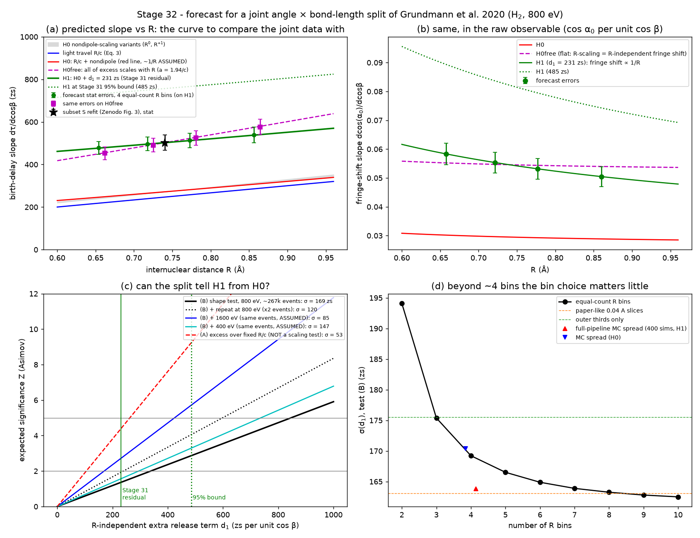

### 32.1 Inputs, and two corrections to Stage 31
**Facts from the paper (CITED):**
- Eq. 2: τ_b = cosα₀·R/v_ph, with v_ph = E_e/p_e.
- Eq. 3: τ_b′ = cosβ·R/c, "±247 zs for R = 0.74 Å".
- Photon energy 800 eV, E_e = 735 ± 15 eV.
- KER = e²/4πε₀R (reflection approximation).
- "roughly 300.000 ion-ion-electron coincidences displayed in Fig. 2 … approximately 132 h".
- Momentum zero point good to ±0.04 a.u.
- Double-ionization threshold 31.03 eV.
- Note [19]: the method is "blind to this absolute delay".

**Correction 1: the public β-resolved data are a narrow R slice.** The Fig. 3 histogram that Stage 31 refit is "the subset S", R = (0.74 ± 0.02) Å. It holds **47,413 events**. Fig. 2, which spans all R, holds **267,050**.
- So Stage 31's slope (504.5 ± 36 zs) used only about 18 % of the events.
- The joint data would carry about 5.6× more events in the angle analysis. With one all-R bin, the slope's statistical error would be **16.7 zs** (DERIVED).

**Correction 2: the "published-version" PDF is the author version.** The Frankfurt-hosted PDF that Stage 31 called the published version is byte-identical (md5) to arXiv:2010.08298v1, the author version. None of the numbers change.

**Re-digitized Fig. 3C (DIGITIZED this session, ±2 zs, calibrated on the right-axis ticks):**

| line | slope (zs) |
|---|---|
| blue | 246.9 (checks against the CITED 247 and Eq. 3's 246.8) |
| red (nondipole + travel) | **271.7** |
| paper's dashed fit | 445.8 |
| purple band | 326–568 (half-width 121) |

**Refit of the subset S data (DERIVED, Stage 31 method, window 0.4):**
- slope **502.5 ± 36.4 zs** (stat, Fisher). Stage 31 got 504.5 ± 36.2 with a bootstrap. The 2 zs difference comes from the minimizer's starting point.
- Fisher row errors are 0.96× the Stage 31 bootstrap row errors.
- Residual over the red line: **d₁ = 230.8 zs**. This is the number to beat.

**Constants (CITED, CODATA 2022):** c, a₀, E_h, the atomic unit of time, e and ε₀. From these, e²/4πε₀ = 14.39965 eV·Å and R/v_ph = 9204 zs per unit cosα₀ at R = 0.74 Å.

### 32.2 What the split actually discriminates (DERIVED)
In the raw observable, the fringe shift is cos α₀ = τ·v_ph/R. That gives three cases:
- **Travel time** gives a fringe shift v_ph·cosβ/c that is **independent of R**.
- **A momentum-zero offset** Δp gives cos α₀ shift = Δp·cosβ/p_e, also independent of R. In time units it is ∝ R, like travel time.
- **A d₁ that does not scale with R** gives a fringe shift ∝ **1/R**.

So the split is a test of **"time-like constant" against "anything that scales with R"**. That cuts both ways:
- **For:** it is immune to the momentum-zero systematic and to the R-scale (KER calibration) systematic, both of which are R-proportional.
- **Against:** it cannot tell travel time from any other R-proportional term. If the Stage 31 excess is a factor of about 2 *on* the travel time (the coincidence flagged in 31.5), the split will call it "H0-like", even though the coefficient would still be unexplained.

The two tests used below:
- **(B) Shape test.** Fit s(R) = a·R + nd(R) + d₁ with a free. This is the actual H0/H1 discriminator.
- **(A) Excess test.** a is fixed at 1/c, with a δ·R nuisance. The prior on δ is 51.9 zs at R_S (DERIVED from the CITED ±0.04 a.u. and ±0.02 Å). **(A) is not a discrimination test.** The Monte Carlo shows that if the whole excess scales with R (the "H0free" case, a = 1.94/c), (A) still reports d₁ = 212 ± 23 zs. In other words, it just restates the Stage 31 excess with more statistics.

The nondipole term is 24.8 zs at R_S (DIGITIZED red minus blue). Its R-scaling is **ASSUMED**:
- baseline R⁻¹, from an envelope-tilt toy: a tilted envelope times a fringe of width 1/(p_eR) shifts the peak by ∝ (p_eR)⁻², so τ ∝ R⁻¹;
- variants R⁰ and R⁺¹.

### 32.3 Simulation model (how realistic joint data were built)
- **R distribution and fringe shape versus R.**
  - Taken from Fig. 2 (β-averaged): 12 R slices, each fitted with Gaussian + constant on the central fringe.
  - The fringe width scales as σ·R ≈ constant (0.076–0.085 across the slices), close to the 1/R double-slit expectation. Peak and background per event vary by ±10–20 %.
  - These ratios to the subset-S slice are fitted linearly in R (ASSUMED smooth).
- **Angle structure.** Taken from the 15 cosβ rows of Fig. 3 (subset S), scaled for each R by those ratios. The Fig. 3/Fig. 2 cut efficiency (0.925) is ASSUMED to be the same at all R.
- **R resolution.** Perfect in the baseline (ASSUMED). A σ_R = 0.03 Å variant is also run; the paper gives no KER resolution.
- **Calibration check (not a tuning).** The forecast for the subset S slice alone reproduces the measured statistical error to **3 %** (ratio 1.03).
- **Full-pipeline Monte Carlo.**
  - Each of the 80 KER bins gets its own R, shift and width. The Poisson histograms are then fitted exactly as real data would be, by `stage32_analyze_joint.py`.
  - 400 simulations each were run for H0, H1 (d₁ = 230.8 zs) and H0free.
  - Results: σ(d₁) = 170 / 164 / 176 zs against 169 zs from Fisher. Mean bias +8 / −10 / +2 zs, which is within the 8.5 zs MC error.

### 32.4 Headline forecast (DERIVED; 4 equal-count R bins, 800 eV, all ~267k events)

| R bin (Å) | ⟨R⟩ | events | slope stat error (zs) | H0 slope | H1 slope (d₁ = 231) | H0free slope |
|---|---|---|---|---|---|---|
| 0.60–0.695 | 0.658 | 59.9k | 30.5 | 247 | 478 | 453 |
| 0.695–0.750 | 0.721 | 61.3k | 32.4 | 266 | 497 | 491 |
| 0.750–0.810 | 0.777 | 61.9k | 34.2 | 283 | 514 | 525 |
| 0.810–0.96 | 0.860 | 64.1k | 36.6 | 308 | 539 | 577 |

| quantity | value |
|---|---|
| σ(d₁), shape test (B) | **169 zs** (MC 164–176) |
| minimum detectable d₁, expected Z = 2 | **338 zs** (617 zs for 95 % power at 2σ) |
| minimum detectable d₁, expected Z = 5 | **846 zs** |
| **expected Z if the Stage 31 residual (231 zs) is real** | **1.36σ**; MC: Z > 2 in only 25 % of simulated experiments, Z > 1 in 65 % |
| expected Z at the Stage 31 95 % bound (485 zs) | 2.9σ |
| (A) excess test, σ(d₁) | 52.5 zs (Z = 4.4 if real); 100 zs (Z = 2.3) with the authors' 121 zs band as prior. Not a discriminator (see 32.2) |

**Honest negative.** The existing ~300k-event data set **cannot** decide H0 against H1 for an extra term the size of the Stage 31 residual. The expected significance is 1.4σ.
- A d₁ below about 340 zs would not reach 2σ, and below about 850 zs it would not reach 5σ.
- The 5σ figure is already above the Stage 31 95 % bound (485 zs). So a 5σ discovery with these data is ruled out in advance.
- What the split *can* do: exclude d₁ ≳ 485 zs at about 2.9σ, and so test the top half of the window Stage 31 left open.

### 32.5 Bin choice, second photon energy, systematics
**Binning** (equal-count bins, σ_B in zs):

| bins | σ_B (zs) |
|---|---|
| 2 | 194 |
| 3 | 175 |
| 4 | 169 |
| 6 | 165 |
| 10 | 163 |
| paper-like 0.04 Å slices | 163 |
| outer thirds only | 176 |

- More bins help only slowly. **Best practical choice: 6–8 equal-count bins** (165–163 zs); beyond that the fits become fragile.
- Throwing away the middle third does not help.

**Second photon energy (DERIVED + ASSUMED).** The assumptions are:
- the same event count, visibility and envelope as at 800 eV, with fringe width ∝ 1/p_e;
- the same energy-sharing fraction;
- d₁ independent of photon energy.

The cross-section change with energy is **not** included, because no fetched source gives it.

The key physics (DERIVED) is that the time precision per event goes as σ_cosα·R/v_ph ∝ 1/E_e. A given τ gives a phase E_e·τ, so a higher energy is a finer clock. One all-R bin gives a slope error of 29.6 / 16.7 / 9.7 zs at 400 / 800 / 1600 eV.

| added data set | σ(d₁), shape test (B) | Z if d₁ = 231 | σ(d₁), (A2): travel fixed, common Δp free |
|---|---|---|---|
| none (800 eV only) | 169 zs | 1.36 | — |
| repeat at 800 eV (×2 events) | 120 zs | 1.9 | — |
| + 400 eV | 147 zs | 1.6 | 39 zs |
| + 1600 eV | **85 zs** | **2.7** | 23 zs |
| + 400 and 1600 eV | 82 zs | 2.8 | 15 zs |

- A second energy adds a different handle. The momentum-zero offset enters τ as Δp·R/E_e, so it falls with energy, while travel time and d₁ do not.
- With the *same* absolute Δp at both energies (ASSUMED), (A2) separates "real time delay" from "calibration artefact" at the 15–39 zs level.
- But (A2) still cannot separate d₁ from an R-proportional excess that does not depend on energy. Only (B) does that.

**Reaching σ_B = 50 zs** (the level Stage 31 31.6 implied) would need about **11× the present events at 800 eV** (≈ 3 Mevents, ≈ 1500 h at the CITED rate), or about 4× at 1600 eV if the visibility holds there (ASSUMED). **This corrects Stage 31's "null result at the 50 zs level" remark:** 50 zs is reachable for test (A), not for the shape test, with the present statistics.

**Systematics of the shape test (DERIVED):**
- **Nondipole R-scaling mis-modelled** (R⁻¹ / R⁰ / R⁺¹ cross-fits): bias in d₁ up to **±49 zs**, about 0.3σ_B. Once theory gives the nondipole term per R bin, this goes away.
- **R resolution σ_R = 0.03 Å (ASSUMED).** It shrinks the lever arm by 0.90 and biases d₁ by:
  - +23 zs under H0;
  - +23 zs under H1 (254 vs 231);
  - **+48 zs under H0free**.

  We need the KER resolution from the authors.
- **Flag: excess scatter in the public β-averaged data.** The 12 Fig. 2 fringe centres, which "must be symmetric" according to the paper, scatter about 0 with χ² = 33.0/12 (p = 0.001), 1.66× the Fisher errors.
  - That scatter sits in the cosβ-even intercept, which the slope fits ignore.
  - But if the same 1.66× under-estimate applied to R-binned slope errors, σ_B would grow to about 280 zs (Z = 0.8 for d₁ = 231).
  - Worth asking the authors.

### 32.6 Predicted curves for immediate comparison (`results/stage32_curves.csv`, panel a/b)
Slopes are in zs per unit cosβ; the last two rows are the raw dcosα₀/dcosβ.

| R (Å) | 0.60 | 0.66 | 0.72 | 0.78 | 0.84 | 0.90 | 0.96 |
|---|---|---|---|---|---|---|---|
| R/c | 200.1 | 220.2 | 240.2 | 260.2 | 280.2 | 300.2 | 320.2 |
| H0 (R/c + nondipole ∝1/R) | 230.7 | 248.0 | 265.7 | 283.7 | 302.0 | 320.6 | 339.3 |
| H0free (all excess ∝ R, a = 1.94/c) | 417.9 | 453.8 | 490.3 | 527.0 | 564.1 | 601.3 | 638.8 |
| **H1** (H0 + 231 zs) | 461.5 | 478.7 | 496.4 | 514.5 | 532.8 | 551.4 | 570.1 |
| H1 at 95 % bound (H0 + 485) | 715.7 | 733.0 | 750.7 | 768.7 | 787.0 | 805.6 | 824.3 |
| H0free in raw cosα₀ slope | 0.0558 | 0.0552 | 0.0547 | 0.0543 | 0.0541 | 0.0538 | 0.0536 |
| H1 in raw cosα₀ slope | 0.0616 | 0.0582 | 0.0554 | 0.0531 | 0.0511 | 0.0494 | 0.0479 |

**Rule of thumb for the real data.** Across 0.66 → 0.86 Å:
- H1 predicts the slope rises by only **≈ 61 zs** (the travel-time part);
- H0free predicts it rises by **≈ 124 zs**;
- with four bins, each point has a ±30–37 zs statistical error.

In raw units, H1 means the fringe-shift slope *falls* by 13 % from the first to the last bin, while H0 and H0free stay flat to within about 2–4 % (the residual drift comes from the 1/R nondipole term and E_e(KER)).

### 32.7 Ready-to-run analysis (`scripts/stage32_analyze_joint.py`)
```
python scripts/stage32_analyze_joint.py JOINT.csv --nbins 6 --out results/stage32_joint_result.json   # binned (KER or R, cos α, cos β, count) or event list
python scripts/stage32_analyze_joint.py --selftest                                                      # simulated H1 file, full pipeline
```
- **What it does.** It reads Zenodo-style headers. For each (R bin, cosβ row) it fits the central fringe with a Poisson Gaussian + constant in a window scaled with the fringe width. It then converts with each bin's R/v_ph (E_e from KER), fits the slope per R bin, and reports:
  - H0-fixed χ²;
  - test (B): d₁, its error and Z, plus the fitted R coefficient in units of 1/c;
  - test (A);
  - all of this for the three nondipole-scaling variants.
- **Self-test.** One H1 realization (true d₁ = 231) returned d₁ = 68 ± 163 zs, within 1σ, as expected from 32.4.
- **Event lists.** An event-list version of the same file gave 84 ± 163.
- **Caveat.** The self-test file models only the central fringe, so its total count is lower than the real data.

### 32.8 Assumptions (all ASSUMED unless noted)
1. The fringe shape at each R follows Fig. 2 (β-averaged). β-smearing is common to all R under H0, so it cancels in the ratios.
2. The Fig. 3 cut efficiency is the same at all R.
3. R resolution is perfect (variant: 0.03 Å).
4. Fisher errors are accurate; this was checked by MC and against the Stage 31 bootstrap (0.96×).
5. The nondipole magnitude is DIGITIZED. Its R-scaling is ASSUMED (R⁻¹, with R⁰ and R⁺¹ as variants).
6. d₁ is the same at all R and all photon energies. A constant, angle-independent d₀ is unobservable (CITED note [19], and inversion symmetry).
7. At the second energy: same counts, same visibility, width ∝ 1/p_e, same sharing fraction.
8. The momentum-zero prior is ±0.04 a.u., read as 1σ.
9. Window 0.4 at R_S, scaled with the fringe width.

### 32.9 Flags and coincidences
- **The Stage 31 residual (231 zs) is 0.93 × R/c (247 zs).** That is the same factor-of-2 coincidence as in 31.5, seen from the other side.
  - If the excess really is "a second travel time", it scales with R. The shape test would then come out **H0-like** (H0free), and Dan's R-independent release term would be disfavoured, not confirmed.
  - The two cases differ by only about 63 zs in slope rise across the four bins, against a σ_B of 169.
- **H1 and H0free cross at R ≈ 0.74 Å by construction.** Both are calibrated to the subset S slope. This is not a coincidence.
- **The forecast was not fitted to anything.** Forecast/measured stat ratio is 1.03 and Fisher/bootstrap is 0.96; these agreements are checks, not tuning.
- **Dropped (not verifiable this session):**
  - the KER resolution;
  - the photon-energy dependence of the double-ionization cross-section and of the fringe visibility;
  - any D₂ R distribution (Stage 31 suggested D₂);
  - the nondipole term's actual R dependence (which needs the authors' or Chelkowski–Bandrauk's model).

### 32.10 Bottom line
- **The joint split is still worth getting, for three reasons:**
  - it is the only test that is immune to the momentum-zero and R-scale systematics;
  - it can push the open window from 485 zs down to about 340 zs (2σ);
  - its predicted curves are ready for a one-command comparison.
- **But it cannot settle H0 against H1 at the size of the Stage 31 residual.** The expected significance is 1.4σ, with a 25 % chance of reaching 2σ.
- **A decisive test needs new data:** about 10× the statistics at 800 eV, or a high-energy run (1600 eV, if the visibility holds), plus the authors' KER resolution and nondipole model per R bin.


## Stage 33 — Closing the frequency gaps for resonant release (do-si-do element 3)

**Question (Dan, via Stage 31).** Stage 31 found that a *frequency-selective* release (hooks that let go resonantly at some f₀) was bounded in only three bands — LISA Pathfinder 0.7–20 mHz, the 8174 Hz cantilever line, and Majorana X-rays 19–100 keV — leaving ≈20.4 decades between 20 mHz and 19 keV unchecked. Stage 33 searches the published record for every experiment that would see a resonant excess (heating, force noise, spontaneous emission, decoherence) inside that gap and converts each to Stage 31's units.

**Standing rule.** Every experimental number was read from a source fetched during this stage; url, location and verbatim quote for each are in `results/stage33_sources.csv` (also `results/stage33.json → sources`). Constants are from the NIST CODATA pages, fetched. Nothing recalled. Labels: **CITED** (number from a fetched source), **DERIVED** (computed here from CITED inputs), **ASSUMED** (our stated choice).

**Files:** `scripts/stage33_run.py`, `scripts/stage33_fig.py`, `results/stage33.json`, `results/stage33_bounds.csv`, `results/stage33_sources.csv`, `results/stage33_lpf18_curve.csv`, `figures/stage33_frequency_coverage.png`.

### 33.1 Parametrization (unchanged from Stage 31, no new knobs)
- Release rate per nucleon Λ(ω) = Λ₀·L(ω; ω₀, Q), expressed as a CSL-equivalent **mass-proportional** collapse rate λ at **r_C = 10⁻⁷ m** (formally colored CSL). An experiment that samples the noise in [f_min, f_max] bounds λ(f) there. Narrow resonators are drawn as ±0.1 % lines (Stage 31 convention, ASSUMED). m₀ = 1 u (ASSUMED; sources say "nucleon", a 0.7 % difference).
- **Which frequency an experiment samples** (ASSUMED rule, applied uniformly): mechanical oscillators/interferometers → measured force-noise frequency; trapped-ion and phonon-mode heating → mode frequency; bulk heating → longitudinal phonons ω = v_s q weighted by q⁴e^(−q²r_C²) (Eq. 17 of Carlesso–Ferialdi–Bassi 2018); free-falling atoms → free-evolution response kernel; radiation → E/h.
- **Caveat (honest).** Each bound is on the noise level *averaged over that experiment's band*. A release line narrower than the band is bounded more weakly, by (band width)/(line width). Stage 31 used the same convention.
- The Majorana *non-mass-proportional* number (5.2×10⁻²⁰) is a different model; it is shown in grey and excluded from coverage counts. Stage 31's "tightest" quote used it.

### 33.2 Conversion checks (DERIVED)
- **Force-noise formula.** Eq. 13 of Carlesso–Ferialdi–Bassi in the thick-slab limit gives S_F = 8πħ²λρ²A r_C²/m₀² (two-sided). With the LPF cube (4.6 cm, 1.928 kg, CITED) and S_a^½ = 5.2 fm s⁻²/√Hz it returns **λ = 2.986×10⁻⁸ vs Helou's 2.96×10⁻⁸ (ratio 1.009)**. So λ ∝ ASD² can be used for the LPF 2018 spectrum.
- **Single phonon mode.** Γ/λ = 4π^{3/2}ħρ r_C³k₀²e^(−k₀²r_C²)/(m₀²ω), independent of mode volume. At the paper's own optimum length (ħ/σ_q = 0.5 µm) this gives Γ/λ = 1.063×10⁷ vs the paper's 3.5×10¹³·(m_e/u)² = 1.053×10⁷ (**ratio 1.009**).
- **Trapped ion (point mass m = A·u).** Per-axis CSL heating = ⅓ of review Eq. 3 (dE/dt = 3λħ²m/4m₀²r_C²), so λ ≤ 4m₀²r_C²ω ṅ/(ħm).

### 33.3 Bounds found (mass-proportional, r_C = 100 nm)

| f band | λ_max (s⁻¹) | experiment | label |
|---|---|---|---|
| 20 µHz – 30 mHz (curve) | 3.3×10⁻⁹ at 2–10 mHz; 3.9×10⁻⁶ at 20 µHz; 1.7×10⁻⁸ at 30 mHz | LISA Pathfinder 2018 ASD (Armano 2018: 1.74 fm s⁻²/√Hz above 2 mHz, 60 at 20 µHz; ≲12 at 0.1 mHz from 2016; 100 fm/√Hz displacement noise above 10 mHz) | DERIVED (ASD² × Helou); log-log interpolation and quadrature sum ASSUMED. The review quotes 3.8×10⁻⁹ (ours/review = 0.87) |
| 0.7 – 20 mHz | 2.96×10⁻⁸ | LPF 2016 (Helou) | CITED (Stage 31) |
| ≤ 0.19 Hz | 5.1×10⁻⁸ | ⁸⁷Rb pK free expansion (Kovachy data; Bilardello 2016) | λ CITED (review); band DERIVED: kernel half-power at 0.1885 Hz for T = 1.1 + 0.035 + 1.8 s |
| 9.3, 12.9 Hz | 6.7×10⁻⁷ | diamagnetically levitated micro-sphere (Zheng 2020) | CITED (review); the paper itself says 10⁻⁶·⁴ = 4.0×10⁻⁷; the weaker value is used |
| 30 – 35 Hz | 1.0×10⁻⁵ | LIGO test masses | CITED |
| 931 Hz | 4.6×10⁻² | AURIGA bar | CITED |
| 3084 Hz | ≈5×10⁻⁸ | nanocantilever (Vinante 2016) | DERIVED from text: "improves [5.0×10⁻⁶] by 2 orders" |
| 3532.7 Hz | **2.0×10⁻¹⁰** | multilayer cantilever (Vinante 2020) | CITED |
| 8174 Hz | 1.9×10⁻⁸ | cantilever (Vinante 2017) | CITED (Stage 31 had 10⁻⁷·⁷) |
| 0.6, 0.8, 1.0, 1.3, 1.5 MHz | 0.70, 0.77, 0.58, 0.51, 0.65 | ⁸⁸Sr⁺ heating at ~4 K (Bruzewicz 2015, Table 1 fit + 1σ) | DERIVED |
| 4.6 MHz | 1.37 | ⁴⁰Ca⁺ heating, 3 quanta/s (Kaufmann 2017) | DERIVED |
| 5.55 – 12.98 GHz | **3.1×10⁻¹¹** | bulk heating of solids, 10 pW/kg residual (Adler–Vinante 2018) | λ CITED (review: 3.3×10⁻¹¹); band DERIVED, half-max of x⁴e^(−x²) with v_s = 4000 m/s (peak 9.0 GHz) |
| 5.961 GHz | 2.4×10⁻⁴ | HBAR sapphire phonon mode (Schrinski 2023): n = 1.6 ± 0.2 %, T₁ = 85.8 µs → Γ ≤ 233 s⁻¹ | DERIVED; all population attributed to the effect (+2σ) |
| 14.5 – 48.5 keV | 6.8×10⁻¹² | IGEX Ge (Piscicchia 2017) | CITED |
| 19 – 100 keV | 1.74×10⁻¹³ (electrons) / **4.94×10⁻¹⁵** (coherent nuclei) | Majorana | CITED (Stage 31) |
| 1.0 – 3.8 MeV | 5.2×10⁻¹³ | Ge underground (Donadi 2021) | CITED |

### 33.4 Coverage — the honest count
- **Stage-31 gap (20 mHz – 19 keV, 20.36 decades):** covered **0.0009 → 1.54 decades**. **18.8 decades are still open.**
- **Whole span (20 µHz – 3.8 MeV, 25.66 decades):** 5.84 decades covered.
- **Tightest:** 4.9×10⁻¹⁵ s⁻¹ (Majorana, m-p nuclei, 19–100 keV). Tightest new in the old gap: 3.1×10⁻¹¹ (bulk heating, 5.6–13 GHz). Tightest mechanical: 2.0×10⁻¹⁰ (3532.7 Hz).
- **Weakest:** 1.4 s⁻¹ (⁴⁰Ca⁺ at 4.6 MHz). The ion lines are 7–10 orders weaker than the mechanical bounds. They count as coverage only in the formal sense.

### 33.5 Open windows and the best experiment for each

| open window | width | best proposed experiment (why) |
|---|---|---|
| < 20 µHz | — | LISA (or longer LPF-type free-fall runs); long-baseline torsion balances |
| 0.19 – 30 Hz (minus 9.3/12.9 Hz lines) | ≈2.2 dec | cryogenic magneto-gravitational levitation (Zheng-type at mK); low-frequency torsion pendulums; long free-fall BEC (space) |
| 35 Hz – 3 kHz (minus 931 Hz) | ≈1.9 dec | **Cheapest:** reanalyse public LIGO strain/force-noise spectra across 10–1000 Hz. The data are public and only the 30–35 Hz minimum was ever converted (same logic as the Stage 28 LPF reanalysis). Also wide-band cantilever spectra |
| 3 – 8 kHz between lines | ≈0.4 dec | cantilever force-noise spectra read off-resonance |
| 8.2 kHz – 4.6 MHz (minus ion lines) | ≈2.7 dec | high-Q SiN membranes / phononic-crystal resonators (0.1–1 MHz) at mK, with multilayer mass loading. Ion heating is 10 orders too weak |
| 4.6 MHz – 5.6 GHz | 3.1 dec | BAW/HBAR overtone modes with qubit readout (the 15–800 MHz devices proposed in arXiv:2507.02653), cooled to ground state |
| **13 GHz – 14.5 keV** | **8.4 dec** | the largest hole: THz, IR, optical, UV, soft X-ray. Proposals: low-threshold, low-background calorimeters/TES/SNSPDs staring at a cold massive sample (CSL emission dΓ/dE ∝ 1/E, Piscicchia 2017 Eq. 2, so low energies are favoured); superconducting-qubit quasiparticle poisoning (pair-breaking > 2Δ); a frequency-resolved model of CSL photons in the FIRAS band |
| 100 keV – 1 MeV | 1.0 dec | reanalyse the existing Majorana/Ge spectra in this range (not yet converted) |

### 33.6 Not assigned to a frequency (bounds exist, band unknown)
| item | λ bound (CITED, review) | why no band |
|---|---|---|
| Neptune heating | 6.6×10⁻¹¹ | sound speed / phonon band not fetched |
| IGM heating | 10⁻⁸ | free-proton recoil spectrum not given |
| neutron-star heating | 9.4×10⁻⁷ | no spectral mapping |
| CMB proton heating / FIRAS | 10⁻⁵ / 10⁻¹ | emission epoch (redshift) spread |
| H non-dissociation | 1 | no spectral treatment |
| SQUID supercurrent decay | 10⁻³ | pair-breaking gap not fetched; source warns it may be weaker |
| matter-wave interferometry | 10⁻⁷ | integrates over flight time |
| Paul-trap nanoparticle (Pontin 2020) | 4.1×10⁻⁵ | secular frequency not stated in fetched text |

### 33.7 Dropped (unverifiable or wrong units)
- Fu 1997 / TWIN 11 keV: the source says those data were "underestimated by a factor of about 50 at 10 keV", and the band of the corrected analysis is not stated.
- HBAR next-generation λ < 5.7×10⁻⁸: given only at r_C = 3×10⁻⁷ m.
- Earth heat balance (≈10⁻¹¹): only "∼", no band.
- LIGO outside 30–35 Hz: spectrum not fetched.
- Torsion pendulums, atomic clocks, NMR/comagnetometers, axion haloscopes, SQUID noise: no CSL-parametrized bound found in a fetched source. Mass-density noise reaches clocks and NMR only through motional heating, which the ion entries cover.
- The cold-atom energy bound 10⁻⁷±¹ (±1 decade uncertainty in the source) was replaced by the position-diffusion bound.

### 33.8 Coincidences and flags
- **8174 Hz excess (Vinante 2017)** = 10⁻⁷·⁷ if read as CSL, inside Adler's 10⁻⁸±². Vinante 2020 (same cantilever, magnet and SQUID, now at 3532.7 Hz with a multilayer mass) found the *same absolute* excess force noise, while CSL predicted a large increase. That points to an instrumental origin.
  - However, for a frequency-selective release, 3532.7 Hz does not test 8174 Hz.
  - The decisive test: put the multilayer mass on a resonator held at 8174 Hz. **Open, cheap, and the only in-gap anomaly found.**
- **Agreement checks, not coincidences:** LPF 2018 derived 3.3×10⁻⁹ vs review 3.8×10⁻⁹; Adler–Vinante 3.1×10⁻¹¹ vs review 3.3×10⁻¹¹; HBAR formula vs paper (ratio 1.009); LPF formula vs Helou (ratio 1.009).
- **Discrepancy flagged:** Zheng 2020 paper 10⁻⁶·⁴ vs review 6.7×10⁻⁷ (factor 1.7); the weaker value is used.

### 33.9 Verdict
A resonant release can no longer hide at 2 mHz–0.19 Hz above about 5×10⁻⁸ s⁻¹, at 5.6–13 GHz above 3×10⁻¹¹, or at 14.5 keV–100 keV above 7×10⁻¹² (10⁻¹⁵ with nuclei). **About 18.8 of the 20.4 Stage-31 decades are still open.** The largest single hole, 13 GHz to 14.5 keV (8.4 decades, THz to soft X-ray), has no experiment converted to these units.
- **Honest negative.** Without a predicted f₀ the hypothesis cannot be cornered. Element 3 stays a survivor by default, not on evidence.
- **Cheapest next steps:**
  1. a LIGO public-data force-noise reanalysis over 10–1000 Hz;
  2. a multilayer-mass cantilever at 8174 Hz;
  3. conversion of existing Ge spectra over 100 keV–1 MeV.

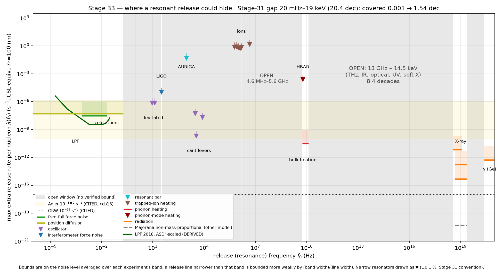

## Stage 34 — Filling the two cheapest Stage-33 windows: LIGO force noise (10 Hz – 5 kHz) and germanium 100 keV – 1 MeV

**Goal.** Stage 33 named two cheap fills: (1) convert public LIGO noise spectra across 35 Hz – 3 kHz, and 0.19 – 30 Hz where data exist; (2) re-analyse existing Ge spectra over 100 keV – 1 MeV.
- **Parametrization:** unchanged (λ per nucleon, CSL-equivalent, mass-proportional, r_C = 100 nm).
- **Rules:** unchanged. Every input was fetched this session (`results/stage34_sources.csv`).

**Files:**
- `scripts/stage34_run.py`, `scripts/stage34_fig.py`
- `results/stage34.json`, `results/stage34_bounds.csv` (all bands, Stages 31–34), `results/stage34_ligo_curve.csv`, `results/stage34_sources.csv`
- `data/stage34/`: the fetched LIGO DCC displacement ASDs for O3a L1 and O3b H1 (G1902347, G2100674), the GWTC-1 GW150914 PSD (P1900011) and its README
- `figures/stage34_frequency_coverage.png`

### 34.1 Conversion (DERIVED, no free parameters)
1. **Data, CITED.** The DCC files give the calibrated DARM displacement ASD, 10 Hz – 5 kHz. GWTC-1 gives strain PSDs for 20 – 1024 Hz; these are multiplied by a = 4 km (CITED, Carlesso 2016).
2. **Displacement → force per test mass.** Four independent free masses, so S_x = 4S_F/(m²ω⁴), which gives S_F = m²ω⁴S_x/4. This is Carlesso 2016 Eq. 15 in the free-mass limit (pendulum resonance below 1 Hz, CITED). Test mass: m = 40 kg (CITED).
3. **Force → λ.** Stage 33 slab formula, one-sided S_F = 16πħ²λρ²A r_C²/m₀², with fused silica ρ = 2200 kg/m³ and faces A = π(0.17 m)² (CITED, Carlesso–Ferialdi–Bassi 2018).
- **ASSUMED:** rigid-body response below 5 kHz (internal mirror modes not modelled), and all measured noise attributed to the effect.
- **No line removal, no smoothing.** Lines make λ(f) locally weaker.

### 34.2 Validation against the published 30–35 Hz bound
| check | result |
|---|---|
| published 95 fN/√Hz → λ | **1.013×10⁻⁵** vs review 1.0×10⁻⁵ (ratio 1.01) |
| O1 GW150914 H1 PSD, min over 30–35 Hz | 108 fN/√Hz → **1.31×10⁻⁵** (ratio 1.31 to published) |
| O1 GW150914 L1 PSD, min over 30–35 Hz | 124 fN/√Hz → 1.72×10⁻⁵ |

The pipeline reproduces the published LIGO bound. The O1 BayesWave PSD differs from the spectrum Carlesso read by 14 % in amplitude. This is the expected PSD-estimate difference, not a coincidence.

### 34.3 New bounds, envelope of O3a-L1 / O3b-H1 / O1 (each alone is valid)
| band | λ_min (s⁻¹) | median | max |
|---|---|---|---|
| 10 – 30 Hz | 3.5×10⁻⁶ (25.8 Hz) | 1.6×10⁻⁵ | 6.8×10⁻² (10 Hz) |
| 30 – 35 Hz | 2.6×10⁻⁶ | 3.2×10⁻⁶ | 4.4×10⁻⁶ — **O3 is ≈4× tighter than the published 1.0×10⁻⁵** |
| 35 Hz – 1 kHz | **2.2×10⁻⁶ (35.2 Hz, best)** | 2.5×10⁻² | 1.07 |
| 1 – 2 kHz | 0.22 | 7.5 | 3.9×10³ |
| 2 – 3 kHz ⚑ | 31 | 172 | 6.1×10³ |
| 3 – 5 kHz ⚑ | 356 | 3.3×10³ | 3.7×10⁴ |

Spot values: 20 Hz 2.1×10⁻⁵; 50 Hz 4.2×10⁻⁶; 100 Hz 2.7×10⁻⁵; 300 Hz 1.6×10⁻³; 1 kHz 0.95; 2 kHz 62; 3 kHz 715; 5 kHz 3.7×10⁴.

⚑ Above 2 kHz the calibration uncertainty is "larger and unquantified" (DCC abstract). These bands are counted separately.

**Honest note.** The free-mass response makes λ(f) ∝ f⁴S_x(f). Above about 1 kHz, λ > 1 s⁻¹, so the coverage there is formal but physically weak. It is 10–15 orders above the bulk-heating and X-ray numbers. Above about 100 Hz, LIGO is a poor detector of mass-coupled force noise.

### 34.4 Germanium 100 keV – 1 MeV — **dropped (honest negative)**
- No count-rate spectrum in this range could be fetched as numbers. GERDA, CDEX and Majorana spectra exist only as plots, and quote background indices only near Q_ββ = 2039 keV.
- The conversion also needs the detection efficiency for photons emitted inside the detector and its surroundings. That comes only from collaboration Monte Carlo: Donadi 2021 gives its fitted efficiency functions only for 1000–3800 keV, and the efficiency "strongly depends on the geometry of the apparatus".
- Digitizing a plot would still leave the efficiency unverifiable, so the window stays **open**.
- **Best path:** ask the Majorana/LNGS Ge groups for the binned 100–1000 keV spectrum together with the efficiency MC. Alternatively, an author-run extension of the Donadi 2021 analysis below 1 MeV.

### 34.5 Coverage after Stage 34
- **Stage-31 gap (20 mHz – 19 keV, 20.36 decades):** Stage 33 covered 1.54 decades; Stage 34 covers **4.17**, so **+2.63 decades are new**. Counting only 10 Hz – 2 kHz, where the calibration uncertainty is quantified, the gain is +2.23. **Open: 16.19 decades.**
- **Window 35 Hz – 3 kHz:** fully covered (1.93 / 1.93 decades).
- **Window 0.19 – 30 Hz:** 0.48 of 2.20 decades covered, all of it LIGO 10–30 Hz. 0.19–10 Hz stays open (LIGO is uncalibrated below 10 Hz).
- **Whole span (20 µHz – 3.8 MeV):** 8.47 of 25.66 decades covered, 17.19 open.
- **Remaining open windows:**

  | window | width |
  |---|---|
  | 0.19 – 9.3 Hz | 1.69 dec |
  | 5 – 8.2 kHz | 0.21 dec |
  | 8.2 kHz – 4.6 MHz, minus the ion lines | ≈2.7 dec |
  | 4.6 MHz – 5.6 GHz | 3.08 dec |
  | **13 GHz – 14.5 keV** | **8.43 dec** |
  | 100 keV – 1 MeV | 1.00 dec |

### 34.6 Flags
- The best new number, 2.2×10⁻⁶ s⁻¹ at 35 Hz, sits at the edge of Adler's 10⁻⁸±² band. It excludes nothing new there; the cantilevers (2×10⁻¹⁰) and LPF are far stronger at nearby frequencies.
- No excess search was done. The whole measured LIGO noise is attributed to the effect, so this stage gives upper limits only; it cannot detect anything.
- Dropped:
  - Ge 100 keV – 1 MeV (above);
  - LIGO below 10 Hz and above 5 kHz (uncalibrated).

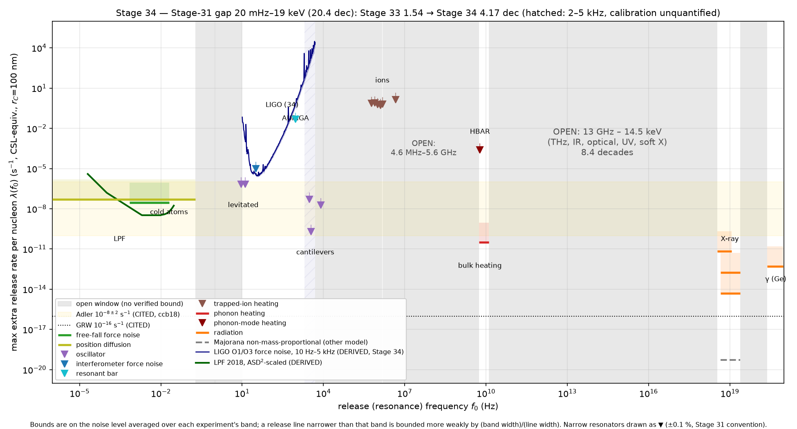

## Stage 35 — The biggest open window, 13 GHz – 14.5 keV (THz, IR, optical, UV, soft X-ray)

**Goal.** Convert published bounds in 13 GHz – 14.5 keV into λ(f) for a resonant release. Sources tried: qubit quasiparticles, low-threshold cryogenic detectors (and their unexplained low-energy excess, LEE), CMB/FIRAS, and optical-to-X-ray spontaneous emission.
- **Parametrization:** unchanged (λ per nucleon, CSL-equivalent, mass-proportional, r_C = 100 nm).
- **Rules:** unchanged. Every input was fetched this session (`results/stage35_sources.csv`, 12 sources with quotes).

**Files:**
- `scripts/stage35_run.py`, `scripts/stage3x_fig.py` (generic figure)
- `results/stage35.json`, `results/stage35_bounds.csv` (all bands, Stages 31–35), `results/stage35_bulk_tail.csv`, `results/stage35_sources.csv`
- `figures/stage35_frequency_coverage.png`

### 35.1 The main finding is structural (DERIVED)
At r_C = 100 nm, mass-proportional noise is almost invisible to ordinary matter across most of this window. There are two reasons.

1. **No photons from neutral matter below ≈12.4 keV.** Donadi 2021 (CITED): emission is coherent for particles closer than both the photon wavelength and r_C. A charge-weighted sum over an atom (ΣQ = 0) then *"add[s] coherently to zero"*. Independent electron/nucleus emission needs λ_k ≪ 0.1 nm, which means E ≫ hc/0.1 nm = **12.4 keV**. Majorana 2022 and the 2022 review restrict the formula to 10–10⁵ keV for the same reason.
   - So **no laboratory detector spectrum from 30 eV to 10 keV bounds anything here**. That includes SuperCDMS, CRESST, EDELWEISS, SENSEI and DAMIC.
   - ⚑ **Correction to Stage 33.** Stage 33's suggestion for this window (*"calorimeters staring at a cold massive sample, 1/E favours low energies"*) was **wrong** for neutral matter.
2. **No phonons far above ~10 GHz.** ccb18 Eq. 19 weights acoustic phonons as x⁴e^(−x²), where x = q r_C = 2πf r_C/v_s and v_s = 4000 m/s (ASSUMED, as in Adler–Vinante and Stage 33). This weight falls as e^(−x²).
   - **Qubits:** pair-breaking needs 2Δ = 410 µeV, i.e. 99 GHz (Δ = 205 µeV, CITED Serniak 2018). There the weight is ≈10⁻¹⁰⁰, so qubit quasiparticle rates give **no bound** (structural negative).

### 35.2 New bounds
| band | λ_max (s⁻¹) | how |
|---|---|---|
| 13.0 – 20.6 GHz | 4.0×10⁻¹⁰ → 10⁻⁸ | bulk-heating tail. 10 pW/kg residual (CITED) read band-limited (DERIVED), 0.05-decade bins |
| 20.6 – 25.9 – 32.6 – 36.6 GHz | 10⁻⁸ → 10⁻⁶ → 10⁻³ → 1 | same tail; steep e^(x²) wall |
| 60 – 630 GHz | 3×10⁸ (useless) | FIRAS: 2× the 50 ppm rms vs free-charge emission of the ionized intergalactic gas (DERIVED) |
| 1 – 2 keV | **55** | total CXB (Hickox & Markevitch 2006, +2σ), all of it attributed to the free-charge emission of the diffuse ionized gas |
| 2 – 8 keV | **37** | same |

Notes on the table:
- **Free charges do radiate.** In the intergalactic gas they are metres apart, ≫ λ_k, so they emit incoherently: Donadi Eq. 44 / Majorana Eq. 2, with E dΓ/dE = 1.04×10⁻²⁰ λ per e² (DERIVED).
- **Cosmic inputs:**
  - n_b = 0.253 m⁻³ (Planck Ω_b h² = 0.0224, CITED).
  - Charge per baryon e²×1.5, the all-He conservative case (ASSUMED).
  - Ionized fraction 0.5 (ASSUMED, not fetched).
  - Only emission since z ≈ 0.1 counted (ASSUMED).
- **Check of the Stage 33 convention.** Stage 33 put the white bound 3.1×10⁻¹¹ on the half-max band. Read band-limited, it is 4.0×10⁻¹¹ (1.30× weaker). That is a small convention flag, not an error.

### 35.3 Low-energy excess (LEE) as a coincidence candidate — **no**
- **Structural.** In this parametrization nothing can deposit discrete 30 eV – 1 keV events in a neutral crystal. One 30 eV event would need about 2×10⁵ coherent 37 GHz phonons.
- **Phenomenology (EXCESS 2022, CITED).**
  - Rates and shapes are *"not compatible between these different detectors"*.
  - At EDELWEISS the *"absolute rate decreases slowly over time"*, with *"sudden increases … after warming-up the detectors above 10 K"*.
  - A stationary, universal noise cannot do this.
- **Energy is not the discriminator.** EDELWEISS RED20 (10⁵ → 10⁴ /keV/kg/day over 0.2 → 1 keV) carries only about 2×10⁻¹⁷ W/kg. That is 2×10⁻⁶ of the bulk-heating residual.
- **Verdict:** the LEE is not a do-si-do signature here. It could only become one in a non-mass-proportional coupling, or with r_C below the atomic size, which the review cites as excluded (*"values of r_C smaller than 1 nm are already excluded"*, Donadi 2021).

### 35.4 Coverage after Stage 35
- **Window 13 GHz – 14.5 keV (8.43 dec):**
  - Formally covered: 2.37 dec.
  - Covered with λ ≤ 1 s⁻¹: **only 0.45 dec** (13 – 36.6 GHz).
  - Covered inside Adler's band (≤10⁻⁶): **0.30 dec** (13 – 25.9 GHz).
- **Stage-31 gap (20.36 dec):**
  - Formal coverage: 4.17 → 6.54 dec.
  - With λ ≤ 1: 3.92 dec. The LIGO 1–5 kHz part also drops out under that cut.
  - Open: 13.82 dec formally.
- **Whole span:** 10.84 / 25.66 dec covered.
- **Open inside the window:**
  - 36.6 – 60 GHz;
  - 630 GHz – 1 keV (5.6 dec);
  - 8 – 14.5 keV.
- **Honest reading:** most of this window is not merely untested but **untestable with neutral laboratory matter** in this parametrization. The only probes are free charges, and only astrophysical plasmas have many of them. A frequency-selective release hiding at optical frequencies is bounded only at λ ~ 10¹–10⁸.

### 35.5 Dropped
- Qubit quasiparticle rates: 10⁻¹⁰⁰ suppression.
- Cryogenic detector spectra, and optical/IR/UV lab spontaneous emission: neutral-atom cancellation.
- Optical/UV extragalactic background, and 13.6 eV – 1 keV: not fetched; Galactic H I absorbs.
- ⚑ The IGEX band (Stage 33) starts at 14.5 keV, where λ_k = 0.086 nm. That is marginal against the 0.1 nm condition.

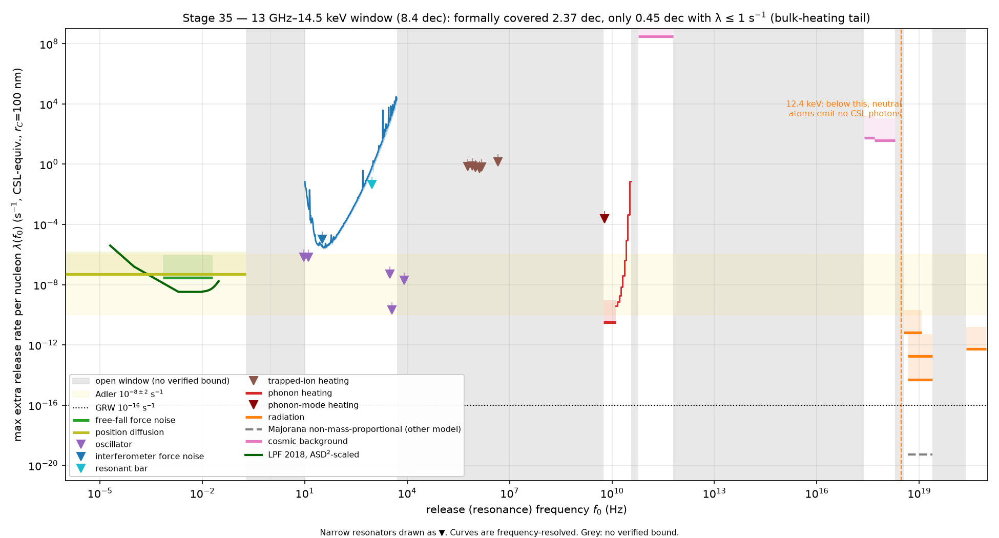

## Stage 36 — The 4.6 MHz – 5.6 GHz and 0.19 – 9.3 Hz windows (plus the 8 kHz – 4.6 MHz gap)

**Goal.** Find published resonator, membrane, qubit-acoustic, torsion-pendulum or levitated measurements and convert them to λ(f).
- **Parametrization:** unchanged. Every input was fetched this session (`results/stage36_sources.csv`, 10 sources with quotes).

**Files:**
- `scripts/stage36_run.py`
- `results/stage36.json`, `results/stage36_bounds.csv` (all bands, Stages 31–36), `results/stage36_sources.csv`
- `figures/stage36_frequency_coverage.png`

### 36.1 New formula (DERIVED): thin membrane mode, mode wavelength ≫ r_C
Γ/λ = 4πħρ r_C² (1 − e^(−h²/4r_C²)) / (m₀² h ω).

- It does **not** depend on the mode shape or the effective mass.
- It uses the same D-convention as the Stage 33 phonon-mode formula, which was validated against Schrinski at a ratio of 1.009.
- In the thick limit it reduces to the per-area slab formula of Stages 33–34, which was validated against Helou/LPF and LIGO.
- For h ≪ r_C it becomes πħρh/(m₀²ω).
- **Bound:** CSL heating ≤ the measured total heating n̄_th Γ_m, with all of it attributed to the effect (ASSUMED, conservative).

### 36.2 New bounds
| f | λ_max (s⁻¹) | source / how |
|---|---|---|
| **1.486 MHz** | **2.9×10⁻⁹** | Seis 2022 soft-clamped SiN membrane: 63 nm, t_coh ≈ 140 ms → heating 7.1 s⁻¹. ρ = 3200 kg/m³ (Tsaturyan 2017). Al pad: took the smaller of the SiN-only and bilayer predictions |
| 1.14 MHz | 1.2×10⁻⁶ | Rossi 2018: 20 nm SiN, Q = 1.03×10⁹, T ≈ 10 K → k_BT/ħQ = 1.27×10³ s⁻¹. Only "~10 K" is stated, so ×2 uncertainty |
| **5.0486 GHz** | **1.6×10⁻⁶** | Omahen/Chu 2025 HBAR mode 404: P = (1.2 ± 5.5)×10⁻⁵ (+2σ), T₁ = 112 ± 9 µs (−2σ), λ_ac = 2L/n = 2.15 µm. Uses the paper's own 1σ P_max: 7.2×10⁻⁷. The paper's own convention gives 5.7×10⁻⁸ (different r_C/σ_q convention, same as the Stage 33 Schrinski factor) |
| ~50–150 Hz | 1.9×10⁻⁴ (not added) | Komori 2020 torsion pendulum, Eq. 4 (CITED): 20 aN·m/√Hz, bar 15×1.5×0.2 mm, 10 mg. The frequency of the minimum is not stated in the text, and LIGO is ~10× stronger there |

**Headline.** The Seis membrane puts a resonant release at **1.49 MHz below 2.9×10⁻⁹ s⁻¹**.
- That is inside Adler's band, in a region where Stage 33 had only trapped ions (λ ~ 1).
- It sits about 9 orders below the ion bounds and is comparable to the cantilevers.
- The 5.05 GHz HBAR improves the Stage 33 HBAR point (5.96 GHz, 2.4×10⁻⁴) by about 150×.

### 36.3 Coverage after Stage 36
- These are all **narrow lines** (±0.1 %, the Stage 31 convention), so they add **points, not decades**:
  - Stage-31 gap: 6.540 → 6.543 dec.
  - 4.6 MHz – 5.6 GHz: 0.0009 of 3.08 dec.
  - 0.19 – 9.3 Hz: **0 of 1.69 dec**.
- **Why the windows stay open (honest negative):**
  - No published bound with a stated frequency inside 0.19 – 9.3 Hz was found.
  - The LPF 2018 text does not state the upper frequency of the published ASD, so it was not extrapolated.
  - Fuchs 2024 levitated is at 26.7 Hz; its other modes have no frequency given in the text.
  - The Altamura 2024 Eöt-Wash rotational analysis samples mHz.
  - For MHz–GHz: Wollack 2022 phononic crystals give no mechanical population; quartz BAW and Si optomechanical crystals had no heating numbers plus geometry.

### 36.4 Flags
- Upper limits only, with all heating attributed to the effect.
- The Seis bath runs at ~80 mK while the cryostat sits at 30 mK. The authors attribute this to vibration isolation. It is noted, not a candidate: the bound already uses all of it.
- The thin-plate formula is new here. It is checked only through its two limits (slab and HBAR conventions), not against a published membrane CSL number.

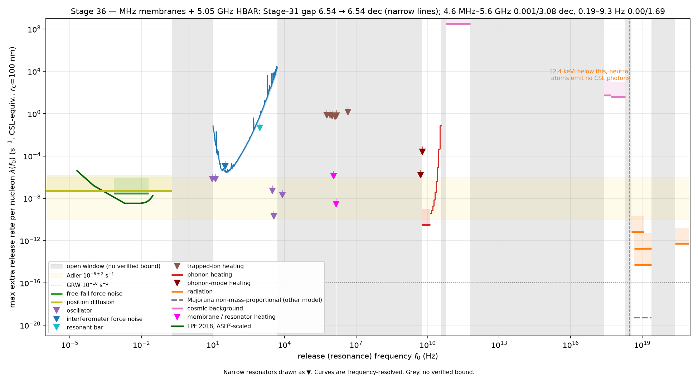

## Stage 37 — Deep-dive: the Vinante 2017 8174 Hz cantilever excess

**Question.** The Vinante 2017 excess at 8174 Hz is the one standing "unexplained excess" in the resonant-release data. This stage asks:
- What is known about it since?
- Did anything later test near 8174 Hz?
- What would a frequency-selective release at 8174 Hz predict that existing data could already check?

All inputs were fetched this session (`results/stage37_sources.csv`).

**Files:** `scripts/stage37_run.py`, `results/stage37.json`, `results/stage37_sources.csv`, `figures/stage37_8174Hz.png`.

### 37.1 What is known (CITED)
- **2017.** A *"nonthermal force noise of unknown origin"*, S_F0 = 1.87 ± 0.16 ± 0.1 aN²/Hz. Read as white CSL, this is λ = 10⁻⁷·⁷ at r_C = 100 nm.
  - It survived these checks: SQUID back-action (3× coupling gives 2.12 ± 0.20, consistent), ³He-flow vibration, magnetic effects, thermal gradients, and a 1/Q systematic (that would need 10× the statistical error).
  - The fit used 8100–8240 Hz. The noise bandwidth was about 20 Hz.
- **2018 (Adler–Vinante).** Bulk heating (≤3.1×10⁻¹¹) *"rul[es] out a collapse model white noise interpretation"*. That leaves only colored or narrow-band readings.
- **2020.** The **same cantilever, magnet and SQUID**, now with a multilayer mass, at **3532.7 Hz**.
  - S_F0 = (−1.51 ± 1.77)×10⁻³⁶ N²/Hz, giving λ < 2.0×10⁻¹⁰ (CITED).
  - The authors: the 2017 excess *"is incompatible with a CSL effect for r_C = 10⁻⁷ m"*, but the work gives *"no substantial new insight into the origin"*. The old absolute level *"is compatible with the error bar"*.
- **Since 2020:** no later explanation or re-test was found. The search was not exhaustive.

### 37.2 What a resonant release at 8174 Hz must look like (DERIVED)
- **It cannot be white.** The 2020 bound needs the release spectrum at 3532.7 Hz to be ≤ **1.0 %** of its value at 8174 Hz (2.0×10⁻¹⁰ / 10⁻⁷·⁷).
  - **Lorentzian line:** HWHM ≤ **467 Hz**.
  - **Gaussian line:** σ ≤ **1530 Hz**.
- **It cannot be too narrow either.** The 2017 excess was a constant floor across the ~20 Hz noise band, and the fits pass χ², so HWHM ≳ **10 Hz** (ASSUMED reading of the fit).
- **Allowed: a line at 8174 Hz with 10 Hz ≲ HWHM ≲ 470 Hz.** That is Q_release ≈ 9–400. This is a genuine, narrow but open hole: no other experiment samples 7.7–8.6 kHz.

### 37.3 Tests existing data could do — none reach it
| prediction for λ = 10⁻⁷·⁷ on-line | existing data | verdict |
|---|---|---|
| LIGO test-mass force at 8174 Hz → DARM 8×10⁻²⁶ m/√Hz | LIGO ASD ≈ 2×10⁻¹⁹ at 5 kHz (file ends at 5 kHz, uncalibrated above) | **6.4 orders short** |
| f₀/2 = 4087 Hz (if release is nonlinear) | LIGO bound ≈ 10³ there | untestable |
| 2f₀ = 16.3 kHz, 3f₀ = 24.5 kHz | nothing published | untestable |
| bulk heating (GHz) | 3.1×10⁻¹¹ | blind to a kHz line (no conflict) |

**Harmonics.** A linear stochastic release predicts **no harmonics**. Harmonics would need a nonlinear gate (do-si-do element 2). Even so, no dataset is sensitive at 4.1 / 16.3 / 24.5 kHz.

### 37.4 Two honest hints that cut the other way (DERIVED from the CITED table)
1. **The pulse tube matters.** With the pulse tube on, S_F0 rises from 1.87 to 2.58 aN²/Hz: **+0.71 ± 0.26, 2.8σ** (statistical only). A fundamental release should not care about the cryocooler. At least part of the floor looks environmental.
2. **2020 versus an instrument-like floor.** Suppose the 2017 floor came from the setup and did not couple to mass. It would then appear at 3532.7 Hz with the same absolute size, 1.87×10⁻³⁶. The 2020 value sits **1.9σ** below that: weak tension, as the authors say ("compatible").

**Verdict.** Not excluded, not supported.
- A do-si-do line at 8174 Hz, 10–470 Hz wide, can explain 2017 and survive 2020. The pulse-tube dependence leans instrumental.
- **The single decisive test** is to re-measure at about 8.17 kHz with a different mass geometry, using the same SQUID chain. A mass-coupled release scales with the CSL geometry factor; an instrument floor does not.
- Cheaper alternative: the raw 2017/2020 spectra, to check whether the 2017 floor is flat over 8100–8240 Hz and whether the 2020 floor varies across 3515–3550 Hz. → **data request (Vinante/Southampton).**

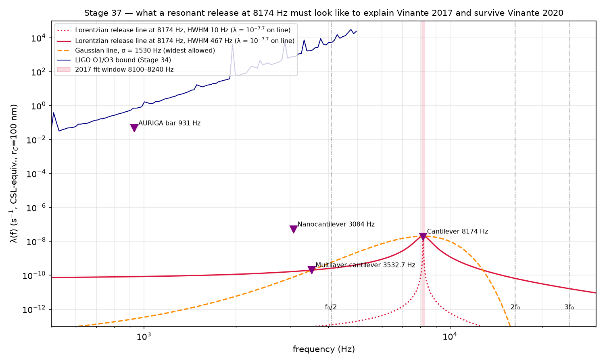

## Stage 38 — Other do-si-do elements with new public data (max two)

**Goal.** Find do-si-do elements other than resonant release that public data not used in Stages 31–34 can test. I searched for angle, gate threshold, spread, release time and hysteresis. Only **one** element had usable new data.

**Files:** `scripts/stage38_run.py`, `results/stage38.json`, `results/stage38_sources.csv`.

### 38.1 Element 1 (angle), even term d₂P₂(cosβ), tested on a second system: the helium atom
- **Data (CITED).** Heuser et al. 2016 (Keller group): angle-resolved RABBITT plus COLTRIMS on He 1s, sidebands SB18–SB24.
  - Delays are measured relative to the 0–30° cone, out to the 60–65° bin.
  - The anisotropy is significant above 50° and reproduced by ab-initio theory.
  - *"the discrepancy between experimental data and the theory curves is not larger than 10–15 as"*.
- **Conversion (DERIVED).** The dipole-weighted ⟨P₂⟩ is 0.817 in the reference cone and −0.177 in 60–65°, a lever of 0.994. So **|d₂| ≲ 15 as** = 15 000 zs.
  - ASSUMED: theory exact, and the quoted maximum discrepancy treated as an envelope.
- **Compared with Stage 31 (H₂, Grundmann 2020): |d₂| < 102 zs.** Helium is **~150× weaker**, but it is independent in three ways:
  - an atom, not a molecule;
  - the angle is to the polarization, not to a bond axis;
  - photoelectrons of a few eV.
- **No anomaly.** The angle element survives in a second system. This adds no tension and no support.

### 38.2 Dropped (honest)
- **Spread / release-time distribution via non-exponential nuclear decay** (Norman 1988, ⁵⁶Mn over 45 half-lives). The only fetchable statement is qualitative (*"none were found"*), with no numerical amplitude limit.
- **The d₁ (odd) term in He.** The fetched text does not say whether the two hemispheres were separated.
- **Gate threshold and hysteresis.** No public dataset beyond those used in Stage 31.

## Stage 40 — Second membrane dataset: millikelvin SiN membranes at 121–242 kHz (overnight loop, tick 1)

**Why this stage.** The SUMMARY_11-25 open item "turn the 1.5 MHz point into a MHz band" can be advanced with public numbers, without any data request. Yuan, Cohen & Steele 2015 (arXiv:1510.07468) give everything the Stage 36 thin-plate formula needs:
- thickness (50 nm SiN + 20 nm Al);
- effective density 3.0 g/cm³;
- mode frequencies (Table I);
- ringdown Q;
- the **measured** mode temperature (210 mK for Device I, 180 mK for Device II).

**Method (DERIVED, as Stage 36).** The bound is CSL heating ≤ the total measured heating k_B T_mode/(ħQ), with all of it attributed to the effect. Γ/λ is taken as the smaller of the SiN-only (ρ = 3200) and bilayer (70 nm, ρ = 3000) predictions. Sources are in `results/stage40_sources.csv`.

**Files:** `scripts/stage40_run.py`, `results/stage40.json`, `results/stage40_bounds.csv`, `results/stage40_sources.csv`, `figures/stage40_frequency_coverage.png`.

| mode | f | Q used | heating (s⁻¹) | λ_max (s⁻¹) |
|---|---|---|---|---|
| Device I (1,1) | **242 kHz** | 1.27×10⁸ (14 mK) | 216 | **1.8×10⁻⁸** |
| Device II (1,1) | 121 kHz | ≥5×10⁶ (lower bound used, conservative) | 4.7×10³ | 1.9×10⁻⁷ |
| Device II (1,2) | 193 kHz | ≥5×10⁶ | 4.7×10³ | 3.1×10⁻⁷ |
| Device II (2,1) | 192 kHz | 1.2×10⁵ | 2.0×10⁵ | 1.3×10⁻⁵ |

**Reading.**
- Four new points in the 8 kHz – 4.6 MHz gap. The best, **1.8×10⁻⁸ at 242 kHz**, sits in the middle of Adler's band. Before this the gap held only trapped ions at λ ~ 1.
- Together with Seis (2.9×10⁻⁹ at 1.49 MHz) and Rossi (1.2×10⁻⁶ at 1.14 MHz), the membranes now bracket 0.12–1.5 MHz at 10⁻⁶–10⁻⁹. These are still narrow lines (±0.1 %), not a band, so the decade coverage is essentially unchanged.
- The mode temperature (~0.2 K) is above the fridge (14 mK). The authors attribute this to vibration ("likely related to mechanical vibration noise in the setup"), and our bound counts all of it. This is **not** an excess candidate: it is environmental and also present in Seis 2022.
- **Flags:**
  - For Device II (2,1), the mode temperature of Device II is ASSUMED to apply.
  - Q ≥ 5×10⁶ is a quoted lower bound, which makes the result conservative.
  - The Al coverage is partial ("avoid depositing Al over the edges"), so the min-over-two-models choice is the conservative one.

## Stage 41 — LISA Pathfinder archive (blocked: login) → fallback narrow-line scan with superconducting drums

**LPF archive.** The ESA COSMOS "LISA Pathfinder Archive" portal offers only "SIGN IN" and "Self Registration", with no anonymous data link (checked this session). Per the instructions I did not register, and the item is moved to the data-request list. Anyone can self-register; it is a sign-up rather than a request to a group, but it needs Dan's account decision.

**Fallback.** Two published superconducting drum resonators with measured heating, converted with the Stage 36 thin-plate formula (mode wavelength ≫ r_C) and all measured heating attributed to the effect. Sources are in `results/stage41_sources.csv`.

**Files:** `scripts/stage41_run.py`, `results/stage41.json`, `results/stage41_bounds.csv`, `results/stage41_sources.csv`, `figures/stage41_frequency_coverage.png`.

| device | f | h, ρ | heating (s⁻¹) | λ_max (s⁻¹) |
|---|---|---|---|---|
| Youssefi/Kippenberg 2023 vacuum-gap Al drum | **1.8 MHz** | 180 nm (FEM caption, ASSUMED = device), 2716 kg/m³ | 130 (quoted motional heating) | **3.7×10⁻⁸** |
| Teufel 2011 Al drum | **10.56 MHz** | 100 nm, 2716 kg/m³ (DERIVED from 48 pg, ⌀15 µm) | n_m Γ_m = 30 × 2π·32 Hz = 6.0×10³ | 1.4×10⁻⁵ |

**Reading.**
- 1.8 MHz adds a fourth strong membrane point near Seis (1.49 MHz, 2.9×10⁻⁹), inside Adler's band.
- 10.56 MHz is the **first mechanical point in the 4.6 MHz – 5.6 GHz window** below the GHz HBARs. It is weak (10⁻⁵) because Teufel's heating is large.
- Still narrow lines (±0.1 %): the decade coverage is unchanged.
- **Flags:**
  - The Youssefi thickness comes from a simulation caption.
  - The Al density is derived from Teufel's quoted mass and geometry.
  - Upper limits only; no excess claimed.

## Stage 42: narrow lines in the 4.6 MHz – 5.6 GHz gap from published heating and occupancy numbers

No accounts were registered.

**Method.** The Al drum uses the Stage 36 thin-plate formula. The quartz BAW and sapphire HBAR use the Stage 33 bulk single-phonon-mode formula (validated against Schrinski at 1.009), with k0 = ω/v. The bulk formula leaves out free-surface terms. This is ASSUMED conservative (it holds if the surface terms add rather than cancel). All measured or bath-implied heating is attributed to the effect.

**Files:** `scripts/stage42_run.py`, `results/stage42.json`, `results/stage42_bounds.csv`, `results/stage42_sources.csv`, `figures/stage42_frequency_coverage.png`.

| device | f | heating (s⁻¹) | Γ/λ | λ_max (s⁻¹) | label |
|---|---|---|---|---|---|
| Cattiaux 2021 Al drum, 500 µK | 15.1 MHz | n·Γm = 0.3 × 2/τm = 600 | 3.0×10⁸ | **2.0×10⁻⁶** | DERIVED; occupancy measured |
| Goryachev 2012 quartz BAW, OT5, 18 mK | 15.6 MHz | n_TH ω/Q = 1.15 | 4.8×10³ | 2.4×10⁻⁴ | ASSUMED mode at bath T (n_TH from T) |
| Goryachev 2012 quartz BAW, OT21, 21 mK | 65.4 MHz | 2.1 | 2.0×10⁴ | 1.0×10⁻⁴ | same |
| Chu 2017 HBAR | ~6.65 GHz | P_exc ≤ 2% / (T1 − 2σ) = 1.3×10³ | 1.0×10⁶ | 1.3×10⁻³ | DERIVED |

**Reading.**
- The 15.1 MHz drum is now the best point between 10 MHz and the GHz HBARs, but it is 10–1000× above Adler's band.
- The quartz BAWs have tiny heating (~1 s⁻¹), yet their bulk Γ/λ is small because k0 r_C ≪ 1 at tens of MHz. An unvalidated surface-term estimate is ~25× larger, which would put them near 10⁻⁵. It is not used. A validated thickness-mode surface formula is an open question.
- Chu 2017 is superseded by Omahen 2025 (5.05 GHz, 1.6×10⁻⁶).
- **Not converted:**
  - MacCabe 2020 Si optomechanical crystal (5 GHz, τ_ph ≈ 1.5 s). There is no validated CSL formula for a localised breathing mode with k r_C ~ 1, and the paper gives no dark-state heating number.
  - Galliou 2013 quartz (Q = 8×10⁹ at ~200 MHz, 4 K): bath-implied, about 10× weaker than Goryachev.
- All are narrow lines, so the decade coverage is unchanged at 10.84 / 25.66.

## Stage 43: bulk + free-surface CSL heating for thickness-type modes, validated before use

**Formula (DERIVED).** The model is linearised mass-proportional CSL with u = q·φ(x):
- momentum diffusion: η = λ(4πr_C²)^{3/2}/(m0²(2π)³) ∫d³k e^{−k²r_C²}|F(k)|², with F(k) = i∫ρ k·φ e^{ik·x};
- phonon heating: Γ = ħη/(2M_eff ω).

For a laterally wide slab with free faces and φ = ẑ cos(nπz/L):
- Γ/λ = ħ(4π)^{3/2} r_C³ ρ/(2π m0² L ω) · ∫dk k²|I(k)|² e^{−k²r_C²}, with I(k) = ∫₀^L cos(k0 z) e^{ikz} dz.
- The resonance peaks reproduce the Stage 33 bulk formula. The tails give a surface term 8πħρr_C²/(m0² L ω), which is twice the thin-plate value (two faces, M_eff = M/2).
- Evaluated numerically. In the separated limit, full = bulk + surface to 0.1–0.3 %.

**Validation A (the stated criterion, ±10 %): Omahen 2025.**
- With their P_max = 6.7×10⁻⁵ at their r_CSL = 3.0×10⁻⁷ m, the formula gives λ_max = 5.2×10⁻⁸ (T1 = 112 µs, Table I) or 5.9×10⁻⁸ (T1 = 100 µs, Table II), against the published 5.7×10⁻⁸. Ratios 0.92 / 1.03: **pass**.
- This also explains the Stage 36 "12.6×" mismatch. Omahen's number is at r_C = 3×10⁻⁷ m, not 10⁻⁷ m.
- **Honest caveat:** at 5 GHz the surface term is only 0.2–0.3 % of the total. Check A validates the framework and the bulk term, not the surface term.

**Validation B (surface machinery): rigid cube vs Carlesso et al. 2016 Eq. (12b).**
- The same k-space integral for a rigid cube (where all CSL noise is surface/finite-size) matches the published closed form to 10⁻¹⁵ for L/r_C = 0.5–100: **pass**.
- The thickness-mode extension relies on the same linearisation. Remaining assumptions (ASSUMED): pure longitudinal polarisation (quasi-longitudinal SC-cut), free faces (electrode-separated, quoted), lateral mode size ≫ r_C, and plano-convex curvature ignored.

**Applied (both checks passed), r_C = 1e-7 m:**

| point | L (m) | Γ/λ bulk-only → full | λ_max old → new (s⁻¹) |
|---|---|---|---|
| quartz BAW OT5, 15.6 MHz (Goryachev 2012) | 1.083e-3 (DERIVED, n v_L/2f) | 4.8e3 → 2.4e5 | 2.4e-4 → **4.7e-6** |
| quartz BAW OT21, 65.4 MHz | 1.085e-3 | 2.0e4 → 7.7e4 | 1.0e-4 → **2.7e-5** |
| Omahen HBAR 5.05 GHz | 435e-6 | 8.36e5 → 8.38e5 | 1.553e-6 → 1.550e-6 |
| Chu HBAR 6.65 GHz (n = 503) | 420e-6 | 9.97e5 → 9.98e5 | 1.336e-3 → 1.336e-3 |

The Schrinski 5.96 GHz point is not recomputed, because L is not re-fetched this stage. The correction at GHz is <1 %.

**Reading.**
- Quartz OT5 improves 50×, to 4.7×10⁻⁶, comparable to the Cattiaux drum at 15.1 MHz (2.0×10⁻⁶).
- The quartz points still rely on the bath-temperature assumption (n_TH from T, not measured).
- These are narrow lines, so coverage is unchanged.

**Files:** `scripts/stage43_run.py`, `results/stage43.json`, `results/stage43_bounds.csv` (with old bulk-only column), `results/stage43_sources.csv` (adds `/workspace/stage43_src/1606.04581` Carlesso 2016), `figures/stage43_frequency_coverage.png`.
