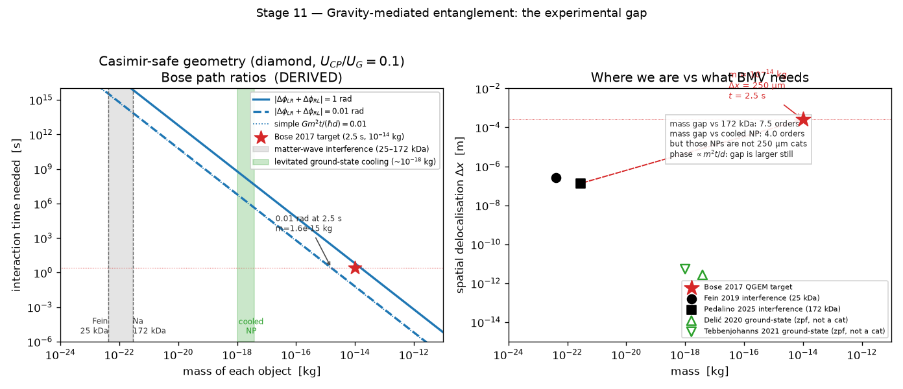
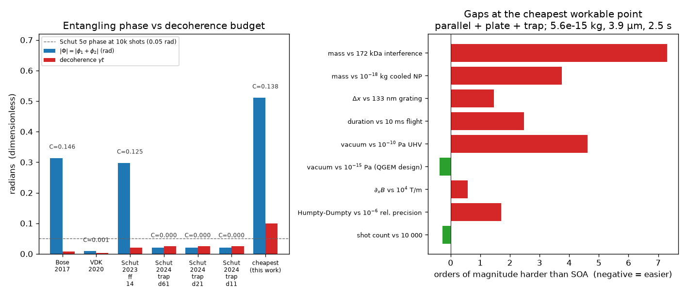
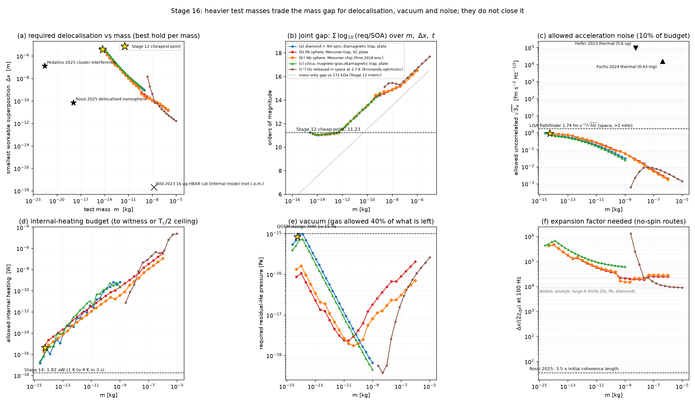
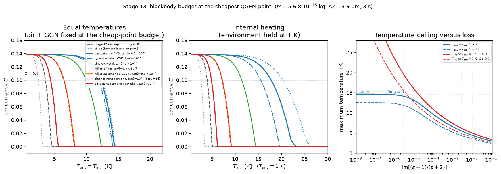
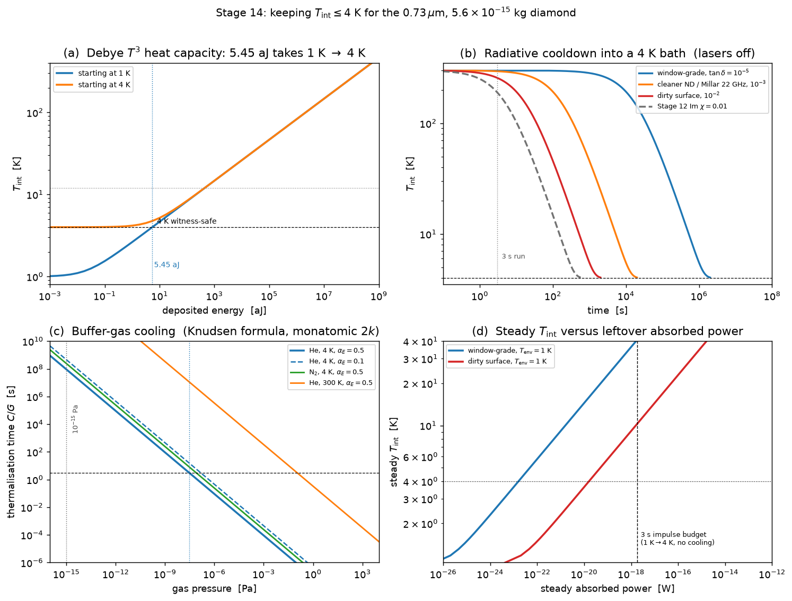
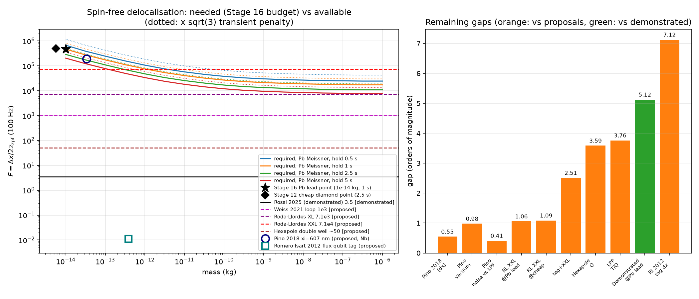
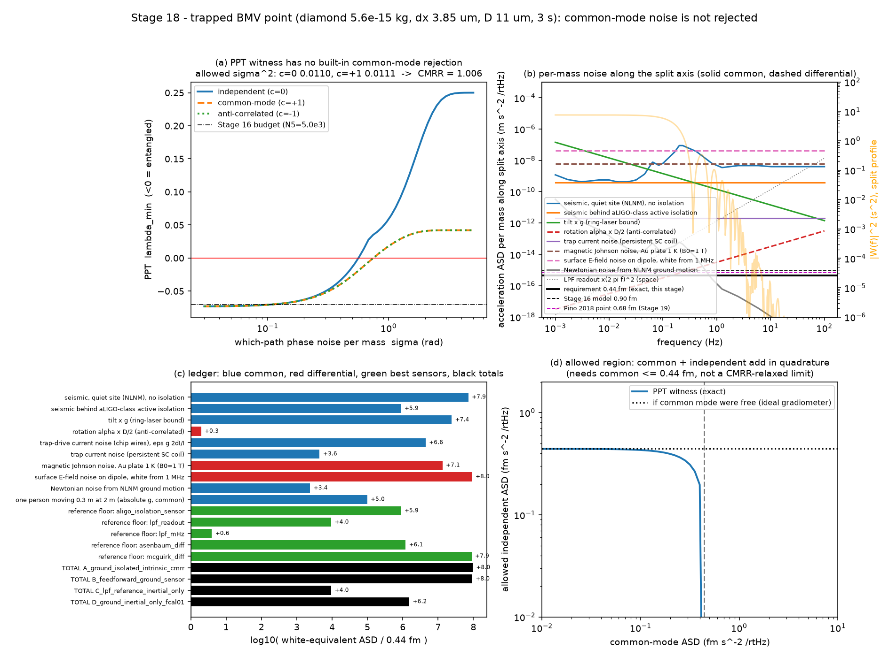
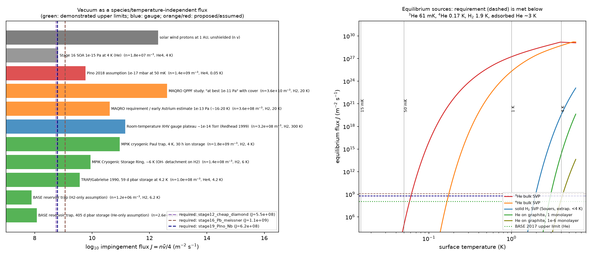
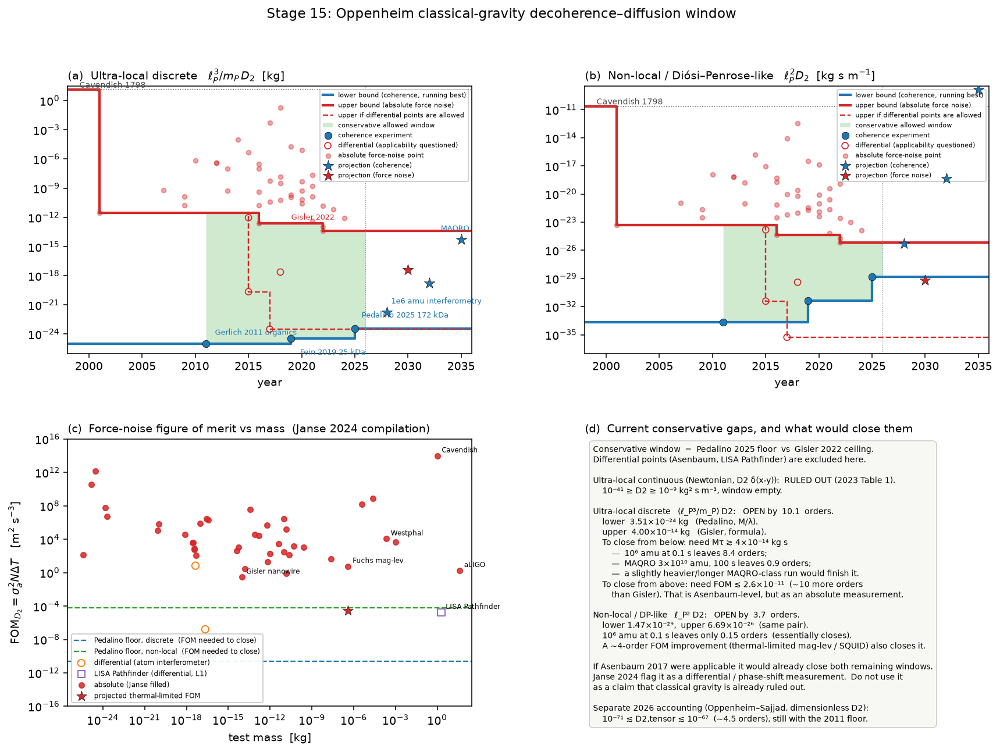
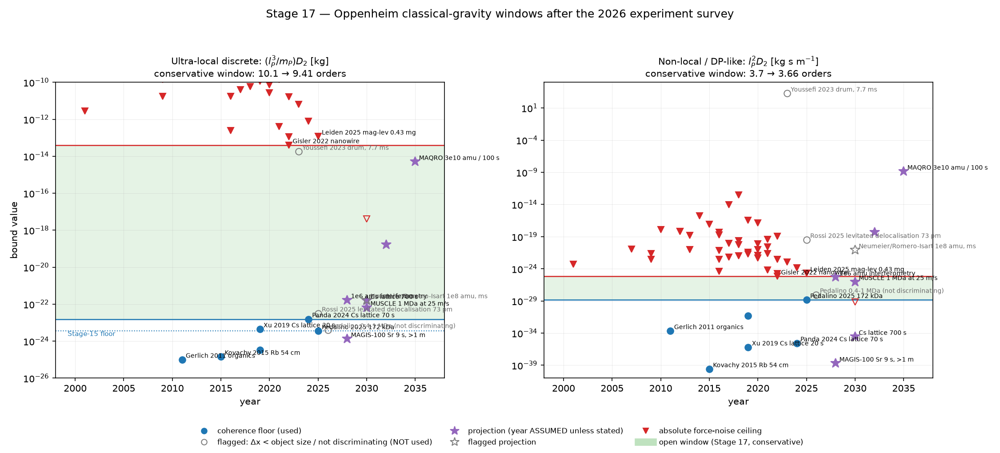

# What stands between today's experiments and a test of quantum gravity: an audited gap budget

*Summary of HYPERFIELD Stages 11–20, covering gravity-mediated entanglement (BMV/QGEM) and Oppenheim classical-gravity tests. Every number below is taken from `HYPERFIELD_RESULTS.md` and `results/stage11.json`–`results/stage20.json`, always at its latest corrected value. Where a value was superseded, the old value is noted. The full derivations, scripts and source checks are in the per-stage sections.*

---

## Abstract

We rebuilt the feasibility budget of the Bose–Marletto–Vedral (BMV) gravity-entanglement test and of Oppenheim's decoherence–diffusion test of classical gravity. We used one uniform set of rules: no tuned parameters, every number labelled DERIVED, ASSUMED or CITED, and every source opened and checked. Three design points were carried through every bottleneck:
- the cheapest workable trapped diamond (5.6e-15 kg, Δx = 3.85 μm, 2.5 s hold, plate at 11 μm);
- a 1e-14 kg Pb sphere in a Meissner trap at 15 mK;
- the Pino-type 3.3e-14 kg Nb chip at 50 mK.

**Mass.** Against the heaviest demonstrated spatial superposition (172 kDa), the designs are **7.3, 7.5 and 8.1 orders** too heavy. The joint gap over mass, size and time is **11.0–11.2 orders**. Going heavier does not help: the best heavier candidate closes 0.20 of 11.23 orders, because the phase is set by $m\Delta x\sqrt t$ at fixed plate separation.

**Path tagging.** Without an embedded spin, the needed coherent expansion is 3.9–4.7e5 zero-point widths. The demonstrated record is 3.5, leaving **5.0–5.2 orders**. The best spin-free proposals reduce this to **0.55 orders** (Pino free expansion) and **1.06 orders** (Roda-Llordes double-well loop), but none is built.

**Acceleration noise.** The exact requirement at the cheap point is **0.44 fm s⁻² Hz⁻½ per mass, relative to its own trap**. The PPT witness rejects common mode by only a factor of 1.006. The best ground inertial floor is **6.0–6.2 orders** above this. Including surface electric-field noise from the 5 μm plate, it is **8.0 orders** above. A space-grade (LISA Pathfinder readout) reference leaves **4.0 orders**.

**Vacuum.** Expressed as an impingement flux, which is species- and temperature-independent in the saturated regime, the vacuum requirement is *met* by the best demonstrated cryogenic upper limit (BASE 2017), with **0.67–0.98 orders of margin**. It is still 0.5–0.8 orders short against every other demonstration. No such limit has been shown in a levitation chamber.

**Internal temperature.** This is not binding if a fully dark protocol works. The diamond ceiling is 15.7 K, with a 436 aW heat budget over the 3 s run. That protocol has not been demonstrated.

**Oppenheim windows.** The ultra-local continuous model is excluded. The discrete window is open by **9.41 orders** and the non-local (Diósi–Penrose-like) window by **3.66 orders**. The closest named near-term experiment, a 1 MDa slow-cluster interferometer, would leave **0.86 orders**.

**Corrections.** We found and corrected eight errors in our own earlier stages and several inconsistencies in published papers. None reverses the headline. The binding obstacles to BMV are coherent delocalisation and differential acceleration noise, not vacuum or mass per se. The nearest decisive measurement on quantum-versus-classical gravity is the Oppenheim non-local window, not BMV.

---

## 1. Introduction

**BMV/QGEM.** Two masses, each in a spatial superposition, become entangled if their only interaction is gravity. A classical (LOCC) channel cannot produce entanglement (Bose et al. 2017; Marletto & Vedral 2017). The entangling phase is $\Phi\sim Gm^2t\,\Delta x^2/(\hbar d^3)$ in the parallel geometry. Every source of which-path information must stay below $|\Phi|/2$:
- gas collisions;
- blackbody radiation;
- acceleration noise;
- recombination error.

A clean positive result would rule out a classical gravitational channel and many collapse models. It would not detect gravitons (Stage 11.4).

**Oppenheim's tradeoff.** Any consistent coupling of quantum matter to classical gravity must decohere matter and diffuse spacetime. Coherence experiments put a *floor* on the diffusion coefficient $D_2$, and absolute force-noise experiments put a *ceiling* on it (Oppenheim et al., Nat. Commun. 14, 7910 (2023)). A window closes when floor > ceiling. This needs no entanglement and no two cats, which makes it the nearer test (Stages 11, 15, 17).

## 2. Method and rules

1. **No tuning.** Inputs are either cited values or fixed design rules declared before computing. The design rules are:
   - the 5σ PPT witness with $N\le10^4$ shots;
   - gas allowed 40% of the remaining $|\Phi|/2$;
   - acceleration noise allowed 10%;
   - $d\ge11\,\mu$m and $z\ge5\,\mu$m plate geometry (Schut 2024's closest);
   - a 100 Hz trap for zero-point units.

   Optimisers choose the smallest Δx that passes every cut. Nothing is adjusted toward a target.
2. **Labels.** Every number is DERIVED (computed here), ASSUMED (a stated design choice or extrapolation) or CITED (from a paper opened this stage).
3. **Verified sources.** Every paper number was read from the paper, arXiv HTML or PDF. Where a publisher blocked automated fetches, the same public text was read via arXiv or curl. Where we could not verify something, we say so.
4. **Gap metric.** A gap is $\log_{10}$(required / demonstrated), with positive meaning short. "Demonstrated" and "proposed" are scored separately. Upper limits inferred from lifetimes are treated as upper limits, not measurements.
5. **Honest negatives and coincidence flags** are reported in the text, not footnoted.

## 3. Results per bottleneck

### 3.1 Phase and mass (Stages 11, 12, 16)

- **Reproducing Bose 2017** (m = 1e-14 kg, d = 450 μm, Δx = 250 μm, t = 2.5 s): the subtracted phases are +0.126 and −0.440 rad, and the concurrence is **C = 0.156**. Their witness $W\sim1.16$ cannot be reconstructed, and $W>1$ is not a valid entanglement test (§5).
- **Cheapest workable point** (Stage 12, re-run with the Stage 16 He correction):
  - parallel geometry, plate, trap;
  - $m=5.62\times10^{-15}$ kg, $R=0.73\,\mu$m, $d=11\,\mu$m, $\Delta x=3.85\,\mu$m, 2.5 s hold (3 s total);
  - $\Phi=-0.511$ rad, $C=0.141$, $N_{5\sigma}=5.0\times10^3$.

  It is Schut 2024's close-trap layout with a larger cat and a longer hold. That change is needed once the van de Kamp gas rate is used instead of an assumed $\gamma=0.01$ Hz.
- **Mass gap versus demonstrated interference** (Pedalino 2025, 172 kDa = 2.86e-22 kg):
  - **7.29 orders** at the cheap point;
  - **7.54** for the Pb Meissner sphere at 1e-14 kg;
  - **8.06** at the Pino 3.3e-14 kg point (DERIVED from the stated masses).

  Against a ground-state-cooled nanoparticle (1e-18 kg, not a cat), the gap is 3.8 orders.
- **Joint gap** over (m, Δx, t) against the state-of-the-art ledger:
  - 11.23 for the cheap point;
  - **11.03** for Pb;
  - 11.04 for Nb (Stage 16, 1e-14 kg, 1 s).

  Heavier masses close 0.20 orders, and that comes from the shorter hold, not the mass. Above about 1e-13 kg everything gets worse. The near-equality across materials (11.01–11.07) is the plate-limited invariant $m\Delta x\sqrt t$ at fixed $D$. It is structure, not coincidence.
- **Space (Os, Krisnanda-style, 2.7 K):** joint gap 15.58, needing $\sqrt{S_a}=0.0087$ fm s⁻² Hz⁻½. MAQRO's 20 K requirement version is infeasible.
- **Status:** no superposition has been demonstrated at any of these masses. Stage 11's phase gap against the cluster interferometers is 16–18 orders, because $\Phi\propto m^2$.

### 3.2 Thermal and internal heating (Stages 12, 13, 14, 16)

- **Blackbody.** Stage 12's "dead at 5 K" came entirely from an assumed $\mathrm{Im}\,\chi=0.01$ ($\tan\delta\approx0.035$). Measured window-grade and single-crystal CVD diamond has $\tan\delta=2\times10^{-6}$ to $10^{-5}$. With those values, a 4 K cryostat leaves $C$ unchanged at 0.138. Blackbody only bites near 12–15 K, and mostly through *scattering*, which no material choice removes. A dirty sp²-shelled particle ($\tan\delta=10^{-2}$) still has $C=0.116$ at 4 K.
- **Internal temperature is the thermal variable that binds.**
  - The diamond's heat capacity is tiny: **5.45 aJ**, i.e. fifteen absorbed 532 nm photons, takes it from 1 K to 4 K.
  - Radiative self-cooling takes days (clean) or minutes (dirty), so it cannot help within a run.
  - The latest witness-derived ceiling is **$T_{\rm int}\le15.7$ K**, a heat budget of **436 aW** over the run (Stage 16). This supersedes Stage 14's conservative 4 K line and its 1.82 aW.
- **Meissner spheres** have larger budgets:
  - Pb: ceiling 3.6 K ($T_c/2$), budget 2.3 fW;
  - Nb: ceiling 4.6 K, budget 0.75 fW.
- **Status:** the pieces are demonstrated separately:
  - laser-free diamagnetic trapping;
  - buffer-gas cooling;
  - optical-trap heating data (Frangeskou 2018 and others).

  The assembled protocol is *not* demonstrated: laser-free trap, He buffer-gas thermalisation, spin initialisation while gas is present, a dark pump-down, a dark run, and readout at the end. **Gap: 0 orders if that protocol works. Not demonstrated.**

### 3.3 Path tagging and delocalisation (Stages 16, 19)

- **Diamond.** The NV spin provides the which-path tag through Stern–Gerlach splitting. That is proposed, not demonstrated, for a trapped microdiamond. The Humpty-Dumpty recombination precision needed is $2.0\times10^{-8}$ for a 1 MHz ground-state packet (1.7 orders beyond a 1e-6 ambition) or $1.7\times10^{-6}$ for a 100 Hz ground state.
- **Superconducting spheres have no demonstrated tag.**

  | Point | Required expansion (zero-point widths at 100 Hz) | Gap vs demonstrated 3.5 |
  |---|---|---|
  | Pb, 1e-14 kg, 1 s | $F=4.65\times10^5$ | **5.12 orders** |
  | Pino Nb, 0.5 s | $F=3.87\times10^5$ | 5.04 |
  | Cheap point, spin removed | $F=4.99\times10^5$ | 5.15 |

  The 3.5 record is Rossi 2025, in optically trapped silica.
- **Best spin-free proposals:**
  - **Pino 2018 free expansion:** a coherent state with $\xi=607$ nm over 483 ms. It leaves **0.55 orders** at its own mass, including a √3 time-averaging penalty (DERIVED; 0.31 without the penalty).
  - **Roda-Llordes 2024 "XXL" double-well loop** ($F=7.1\times10^4$): **1.06 orders** at the Pb point and 1.09 at the cheap point. It needs 97 dB of squeezing and a loop of about 16 s, longer than the hold.
  - **Tag-then-inflate** (Romero-Isart 2012 flux-qubit tag plus the XXL loop): 2.51 orders. The qubit tag on its own gives only 0.37 zero-point widths, which is 7.1 orders short.
  - **Lami–Pedernales–Plenio 2024 coherent-state test:** needs mHz modes and $T/Q<10^{-13}$ K, 3.8 orders beyond Hofer 2023. In a 100 Hz trap it would need 5e5 s per run.
  - **Hanif 2024** still needs spins.
- **Status:** all spin-free routes are proposed. No Meissner sphere has reached its ground state or been coupled to a qubit.

### 3.4 Acceleration noise (Stages 16, 18)

- **Requirement.** For uncorrelated white noise, $\Gamma=m^2S_a\Delta x^2/4\hbar^2$. The plate-free limit is $S_a\ll2G\hbar/d^3$, independent of mass; this reproduces Großardt 2020 (0.060 vs 0.07 fm at 157 μm). With the exact witness model, the cheap point needs **0.44 fm s⁻² Hz⁻½**. Stage 16's 0.90 put noise only on the $\sin(\Phi/2)$ term and is superseded. The Pb and Pino values (0.85 and 0.68) are still Stage 16-rule values, not exact-model corrected; the correction tightened the cheap point by 0.31 orders.
- **No common-mode rescue.** The PPT witness's built-in CMRR is **1.006**. The requirement applies to each mass relative to its own trap, whatever the correlation between masses.
- **Floors** (Stage 18; cheap / Pino; Pb added here from the same floors):
  - ground, inertial-only: **+6.2** / +6.0 / +5.9;
  - ground with surface E-field noise on the permanent dipole at 5 μm: **+8.0** / +7.8 / (+7.7, cheap-geometry specific);
  - LPF-grade space reference, inertial only: **+4.0** / +3.8 / +3.7.
- **Other derived limits:**
  - LPF's 1.74 fm is within 0.6 orders, but only in the mHz band and only in space.
  - The exclusion radius for one walking person is 92 m.
  - A running pulse tube is excluded.
  - Normal-metal plate eddy damping is 14.2 orders too high.
- **Space Os option:** needs 0.0087 fm, 2.3 orders below LPF.
- **Status:** the requirement is far below every demonstrated sensor on the ground. **This is the binding engineering obstacle.**

### 3.5 Vacuum (Stages 12, 16, 20)

- **Correct figure of merit.** All designs are in the saturated regime: $\Delta x/\lambda_{\rm th}=268$–$8830$. The Stage 12/16 rate is therefore exactly $(32\pi^2/3)R^2J$, and the requirement is a **flux**:

  | Design | Required flux $J_{\rm req}$ (m⁻² s⁻¹) |
  |---|---|
  | cheap | 5.5e8 |
  | Pb | 1.1e9 |
  | Pino | 6.2e8 |

  Pressures quoted at different temperatures cannot be compared.
- **Gaps** (cheap / Pb / Pino, negative = margin):
  - **BASE 2017**, 405-day antiproton storage, Langevin-reconverted $n_{\rm He}<2.6\times10^6$ m⁻³: **−0.67 / −0.98 / −0.72**;
  - Gabrielse 1990: +0.83 / +0.51 / +0.78;
  - CSR: +1.2 / +0.89 / +1.15;
  - room-temperature XHV plateau: +2.1 to +2.4;
  - MAQRO-type space vacuum: +1.6 to +3.9.
- **Equilibrium sources** fall below the requirement under these temperatures: ³He 61 mK, ⁴He 0.17 K, condensed H₂ 1.94 K, He adsorbed on graphite about 3 K. At 15–50 mK only non-thermal sources remain: leaks, beaming and stimulated desorption. The allowed leak into a 10 cm cold box is about 4.7e-13 mbar L/s, at the floor of the best He leak detectors.
- **Status:** the margin exists only against an upper limit from a hermetic 6.2 K can. It has never been reproduced around a levitated sphere with optical or SQUID access. **Gap: 0 to 0.8 orders, undemonstrated in the needed geometry.**

### 3.6 Oppenheim windows (Stages 11, 15, 17)

- **Ultra-local continuous:** excluded, as in the 2023 paper and reproduced here.
- **Ultra-local discrete:** open by **9.41 orders**. The floor is Panda 2024 (70 s Cs lattice, 1.55e-23 kg) and the ceiling is Gisler 2022 (4.0e-14 kg). This supersedes Stage 15's 10.06, after including spatial atom interferometers (§5).
- **Non-local / Diósi–Penrose-like:** open by **3.66 orders**. The floor is Pedalino 2025 (1.47e-29) and the ceiling Gisler (6.7e-26).
- **Nearest named step:** MUSCLE at 1 MDa and 25 m/s would leave **0.86 orders**. About 1.9 MDa at 25 m/s, or a 3.7-order better absolute force noise, would close it. Stage 15's generic "1e6 amu, 0.1 s → 0.15 orders" was not a named apparatus.
- **Projection:** two-point trends give about 2031 for the non-local window and about 2046 for the discrete one (ASSUMED trend, not a schedule). The ceiling side has stalled since 2022.
- **Status:** these are the only quantum-vs-classical-gravity windows that existing-class instruments can plausibly close within a decade.

## 4. Consolidated gap table

Orders of magnitude, $\log_{10}$(required/demonstrated). Positive means short; negative means margin. "Prop." is the gap against the best *proposal*.

| Bottleneck | Cheap diamond (5.6e-15 kg, 4 K gas, 1 K env) | Pb Meissner (1e-14 kg, 15 mK) | Pino Nb (3.3e-14 kg, 50 mK) | Status |
|---|---|---|---|---|
| Mass vs demonstrated interference (172 kDa) | 7.29 | 7.54 | 8.06 | no superposition at these masses |
| Joint gap (m, Δx, t) vs SOA ledger | 11.23 | 11.03 | 11.04 (Nb at 1e-14 kg) | — |
| Path tag / delocalisation, vs demonstrated (Rossi ×3.5) | NV spin (proposed); spin-free 5.15 | 5.12 | 5.04 | demonstrated: none |
| Path tag / delocalisation, vs best proposal | Humpty-Dumpty 1.7 (1 MHz packet) to 0 (100 Hz packet); spin-free XXL 1.09 | XXL loop 1.06; tag+inflate 2.51 | Pino expansion 0.55 | proposed only |
| Internal temperature | 0 if dark protocol works (ceiling 15.7 K, 436 aW) | 0 (3.6 K, 2.3 fW) | 0 (4.6 K, 0.75 fW) | protocol not demonstrated |
| Blackbody at 4 K (window-grade) | 0 (C = 0.138 unchanged) | 0 | 0 | measured loss tangents |
| Acceleration noise, ground inertial-only | **+6.2** (0.44 fm) | +5.9 (0.85 fm, uncorrected) | +6.0 (0.68 fm, uncorrected) | demonstrated sensors |
| Acceleration noise, ground incl. plate surface noise | +8.0 | (+7.7) | +7.8 | extrapolated surface-noise data |
| Acceleration noise, space (LPF readout reference) | +4.0 | +3.7 | +3.8 | LPF demonstrated in space |
| Vacuum (flux) vs best demonstrated upper limit (BASE) | −0.67 | −0.98 | −0.72 | upper limit, hermetic 6.2 K can |
| Vacuum vs next demonstrated (Gabrielse 1990) | +0.83 | +0.51 | +0.78 | upper limit |
| Vacuum, space (MAQRO requirement / QPPF estimate) | +1.88 / +3.88 | +1.56 / +3.56 | +1.83 / +3.83 | proposed / study |
| 5σ shots (≤ 1e4) | 5.0e3 (0) | 9.5e3 (0, by construction) | 1.0e4 (0, by construction) | rule |

Space BMV alternative (Os, 7.9e-8 kg, 2.7 K): joint gap 15.58; noise 2.3 orders below LPF.

Oppenheim windows (not per design): continuous **excluded**; discrete **9.41**; non-local **3.66**. A named 1 MDa step would leave 0.86.

**Reading the table.** For BMV, two axes dominate:
- delocalisation without a demonstrated tag, about 5 orders against what exists;
- differential acceleration noise, 6–8 orders on the ground and 4 in space.

Vacuum and temperature are at or below zero on paper, but only if hardware that has never been assembled around a levitated particle works as its components do.

## 5. Errata and corrections

**In published work** (no authors contacted; Dan decides):
- **Bose et al. 2017:** the written witness $W=|\langle XZ\rangle-\langle YZ\rangle|$ reaches $\sqrt2$ on product states, so $W>1$ is not an entanglement test. $W\sim1.16$ cannot be reconstructed. The quoted phases (~0.7, ~−0.2) match the *unsubtracted* magnitudes (0.79, 0.23), not their own subtracted eq. (2). The state is entangled, with $C=0.16$. The "Casimir a tenth" is 0.050 with the standard retarded SI formula; their (m, R) pair is slightly inconsistent with diamond density.
- **Schut et al., PRR 6, 013199 (2024):** the "approximately 3.4 μm" sentence does not match Table I under a single Φ convention. The Table I points are not entangled at 1e-15 Pa with the van de Kamp gas rate.
- **van de Kamp et al. 2020:** the working point is phase-starved and cannot recombine in free fall under Schut's later default dipole. This is a model addition, not a typo.
- **Oppenheim et al. 2023, Table 1:** it is about 2 orders more conservative than a literal plug-in of its own figure of merit (discrete upper bound about 13 kg rather than 1e-1; non-local about 2.2e-11 rather than 1e-9). The 0.1 s Gerlich flight time looks unsupported; a Zenodo note by D. Nguyen reached the same suspicion independently.
- **Romero-Isart et al., PRL 109, 147205 (2012):** with the paper's own numbers, $2t^*=2\pi/\omega_t=36\,\mu$s exceeds $T_2=10\,\mu$s. That violates its own condition $2t^*\ll T_2$.
- **Lami, Pedernales & Plenio, PRX 14, 021022 (2024):** recomputing γ from their m and R gives 2.4e-4 Hz, against the quoted 1.6e-4 Hz (×1.49). Flagged, not resolved.
- **INSPIRE abstract of the Fei thesis:** "more than 10³ days" is a lost superscript of "103 days" (3.4 months). The Langevin reconversion reproduces their n < 100 cm⁻³.
- **Pino et al. 2018:** the assumed 1e-17 mbar at 50 mK reuses a 4 K Penning-trap pressure. That implies 9.5× more flux than the density it came from. It is conservative, not wrong, but it produced our Stage 19 artifact (below).

**In our own stages** (superseded value → current value):

| Stage | Was | Is now | Found in |
|---|---|---|---|
| 11–12 | residual gas N₂ (geometric σ, then "air"), P = 2.4e-15 Pa | He at 4 K (rate ×2.65), P = 8.4e-16 Pa; cheap point still works (C = 0.141) | 16 |
| 12 | Krisnanda et al. cited as arXiv:1906.09008 (an unrelated maths paper) | arXiv:1906.08808 | 16 |
| 12 | blackbody cliff "dead at 5 K" | artifact of assumed Im χ = 0.01; measured diamond is fine at 4 K, ceiling 12–15 K | 13 |
| 14 | $T_{\rm int}\le4$ K line, 1.82 aW budget | conservative; witness ceiling 15.7 K, 436 aW | 16 |
| 15 | spatial atom interferometers excluded; discrete gap 10.06 | they are valid mass superpositions; discrete gap 9.41 (Panda 2024) | 17 |
| 15 | "1e6 amu, 0.1 s closes non-local to 0.15" | generic target; named MUSCLE step leaves 0.86 | 17 |
| 16 | acceleration-noise requirement 0.90 fm s⁻² Hz⁻½ | 0.44 (exact witness model; 0.31 orders tighter) | 18 |
| 16 | premise that a shared platform cancels common mode | witness CMRR = 1.006; no rescue | 18 |
| 19 | Pino "vacuum 0.98 orders short" | unit artifact (pressure at 50 mK vs 4 K); −0.72 margin vs BASE in flux | 20 |
| 15/17 | Pedalino 2025 dated 2025 | journal publication 21 Jan 2026 (CSV keeps the arXiv year) | 17 |

## 6. Coincidences flagged

- Our 0.060 vs Großardt's 0.07 fm s⁻² Hz⁻½ is the same formula, not a coincidence.
- The best joint gaps across materials (11.01–11.07) agree because of the invariant $m\Delta x\sqrt t$. That is structure.
- The Pb delocalisation needed at 1e-8 kg sits 7.5 orders above Bild's 2.1e-18 m. This is numerically close to the 7.3 mass gap but is an accident of where Bild's mass lands.
- Xu 2019 and Pedalino 2025 land within 26% of each other on the discrete axis (133 u for 20 s vs 1.7e5 u for 12 ms). This is an accident.
- Two independent trends project the non-local window closing in the same year, within 0.2 yr. This is an accident of the rates.
- Stage 18's rotation term sits within a factor 2 of the requirement, but it uses an instrument resolution, i.e. an upper bound. LPF's mHz floor is within 0.6 orders, but in the wrong band.
- Roda-Llordes XL ($7.1\times10^3$) is within 8% of the heavy-mass 5 s requirement ($7.7\times10^3$). Pino's F is within a factor 2 of the requirement at its own mass. Neither was designed against this budget.
- The three vacuum requirements cluster within a factor 2, and the 1e-15 Pa-at-4 K convention sits within ±0.24 orders of all three. Both follow from the shared rules and from the cheap point having been chosen under that convention.
- The ³He vapour crossover (61 mK) lies just above Pino's 50 mK design temperature. This is not tuned, but the margin is thin.

## 7. Conclusions, and what would change the picture

1. **BMV is not mass-limited in the way usually stated.** It is limited by *coherent delocalisation of a massive object*, about 5 orders against anything demonstrated, and by *differential acceleration noise*, 6–8 orders on the ground and 4 in space. Heavier masses convert the gap; they do not shrink it.
2. **Vacuum is not the obstacle on paper.** Measured as a flux, the best demonstrated cryogenic limit beats all three designs by 0.7–1.0 orders. Building that environment around a levitated, optically or SQUID-accessed particle is the open experimental question.
3. **Internal temperature** is a protocol problem: dark loading, dark pump-down and dark hold. It is not a materials limit for clean diamond.
4. **The nearest decisive physics is Oppenheim's non-local window (3.66 orders).** A ~2 MDa slow-cluster interferometer would close it from below. A 3.7-order better *absolute* force-noise measurement would close it from above.

**What would change this budget:**
- a demonstrated coherent centre-of-mass expansion of ≥1e4–1e5 zero-point widths for any object ≥1e-15 kg, or a demonstrated which-path tag on a Meissner sphere;
- a measurement of cryogenic surface electric-field noise at 5 μm. If it is far below our 6-decade extrapolation, the ground floor drops from +8.0 to about +6;
- a dual-levitation experiment reporting relative acceleration noise between co-trapped particles;
- a BASE-class gas-density bound measured inside a levitation cryostat;
- THz loss measured on the actual NV-bearing, surface-treated microdiamonds at 1–10 K;
- any new absolute force-noise result beating Gisler 2022, or a MDa-class slow-beam interference result.

---

## References (all opened during Stages 11–20)

- Bose et al., PRL 119, 240401 (2017) — https://arxiv.org/abs/1707.06050
- Marletto & Vedral, PRL 119, 240402 (2017) — https://arxiv.org/abs/1707.06036
- QGEM white paper (2025) — https://arxiv.org/abs/2509.01586
- van de Kamp et al., PRA 102, 062807 (2020) — https://arxiv.org/abs/2006.06931
- Schut et al., Phys. Rev. Research 6, 013199 (2024) — https://doi.org/10.1103/PhysRevResearch.6.013199
- Toroš et al., Phys. Rev. Research 3, 023178 (2021) — https://arxiv.org/abs/2007.15029
- Pedernales & Plenio — https://arxiv.org/abs/2311.04745
- Krisnanda et al., npj QI 6, 12 (2020) — https://arxiv.org/abs/1906.08808
- Großardt, PRA 102, 040202 (2020) — https://arxiv.org/abs/2007.05762
- Fragkos, Kopp & Pikovski (2023) — https://arxiv.org/abs/2206.00558
- Anastopoulos & Hu — https://arxiv.org/abs/2202.02789
- Oppenheim, Sparaciari, Šoda & Weller-Davies, Nat. Commun. 14, 7910 (2023) — https://arxiv.org/abs/2203.01982
- Janse et al., Phys. Rev. Research 6, 033076 (2024) — https://arxiv.org/abs/2403.08912
- Pedalino et al. (172 kDa) — https://arxiv.org/abs/2507.21211 ; Pedalino et al., Nature (2026) — https://www.nature.com/articles/s41586-025-09917-9
- Panda et al., Nat. Phys. 20, 1234 (2024) — https://arxiv.org/abs/2210.07289 ; Xu et al. (2019) — https://arxiv.org/abs/1907.03054
- Nguyen, Zenodo note (not peer reviewed) — https://doi.org/10.5281/zenodo.24085732
- Rossi et al., PRL 135, 083601 (2025) — https://arxiv.org/abs/2408.01264
- Youssefi et al., Nat. Phys. 19, 1697 (2023) — https://arxiv.org/abs/2208.13082
- Kotler et al., Science 372, 622 (2021) — https://www.science.org/doi/10.1126/science.abf2998
- Hofer et al., PRL 131, 043603 (2023) — https://doi.org/10.1103/PhysRevLett.131.043603
- Romero-Isart et al., PRL 109, 147205 (2012) — https://arxiv.org/abs/1112.5609
- Pino et al., QST 3, 025001 (2018) — https://arxiv.org/abs/1603.01553
- Hexapole/double-well Meissner traps, QST (2026) — https://arxiv.org/abs/2607.03622
- Weiss et al., PRL 127, 023601 (2021) — https://arxiv.org/abs/2012.12260
- Roda-Llordes et al., PRL 132, 023601 (2024) — https://arxiv.org/abs/2303.07959
- Neumeier et al., PNAS 121 (2024) — https://arxiv.org/abs/2207.12539
- Lami, Pedernales & Plenio, PRX 14, 021022 (2024) — https://arxiv.org/abs/2302.03075
- Hanif, Das, Ulbricht & Bose, PRL 133, 180201 (2024) — https://arxiv.org/abs/2307.08133
- Shin et al., Optica 12, 473 (2025) — https://arxiv.org/abs/2409.02275
- LISA Pathfinder, Armano et al., PRL 120, 061101 (2018) — https://sci.esa.int/web/lisa-pathfinder/-/59964-armano-et-al ; PRL 116, 231101 (2016) — https://journals.aps.org/prl/abstract/10.1103/PhysRevLett.116.231101
- Moody, Chan & Paik, J. Appl. Phys. 60, 4308 (1986) — https://pubs.aip.org/aip/jap/article-abstract/60/12/4308/564806 ; Moody, Paik & Canavan, RSI 73, 3957 (2002) — https://doi.org/10.1063/1.1511798
- Sellner et al. (BASE), NJP 19, 083023 (2017) — https://iopscience.iop.org/article/10.1088/1367-2630/aa7e73
- Gabrielse et al., PRL 65, 1317 (1990) — https://journals.aps.org/prl/abstract/10.1103/PhysRevLett.65.1317 ; Fei thesis — https://inspirehep.net/literature/306801
- von Hahn et al. (CSR), RSI 87, 063115 (2016) — https://doi.org/10.1063/1.4953888
- Schwarz et al. (CryPTEx), RSI 83, 083115 (2012) — https://doi.org/10.1063/1.4742770
- Stutzman (XHV, citing Redhead 1999) — https://www.jlab.org/accel/inj_group/docs/2006/XHV.pdf
- Kaltenbaek (MAQRO) — https://arxiv.org/abs/1307.7021 ; Gasbarri et al., Commun. Phys. 4, 155 (2021) — https://www.nature.com/articles/s42005-021-00656-7
- ITS-90 (Preston-Thomas 1990) — https://mx.omega.com/techref/intltemp.html ; Donnelly & Barenghi ⁴He table — https://pages.uoregon.edu/rjd/vapor18.htm
- Souers et al., H₂ vapour pressures (1977) — https://www.osti.gov/servlets/purl/7110677 ; CERN cryopumping note — http://cds.cern.ch/record/2746077
- Cole, Frankl & Goodstein, RMP 53, 199 (1981) — https://doi.org/10.1103/revmodphys.53.199
- Pfeiffer ASM 340 specification — https://heliumleakdetection.net/helium-leak-detectors/pfeiffer-adixen-leak-detectors/pfeiffer-asm-340-helium-leak-detector/
- NASA solar wind — https://pwg.gsfc.nasa.gov/Education/wsolwind.html
