# What stands between today's experiments and a test of quantum gravity: an audited gap budget

*Summary of HYPERFIELD Stages 11–27, covering gravity-mediated entanglement (BMV/QGEM) and Oppenheim classical-gravity tests. Every number below is taken from `HYPERFIELD_RESULTS.md` and `results/stage11.json`–`results/stage27.json` (plus `results/summary21_pb_pino.json`, produced for the Stage 11–21 summary by `scripts/summary21_pb_pino.py` with the unchanged Stage 21 code), always at its latest corrected value. Where a value was superseded, the old value is noted. The full derivations, scripts and source checks are in the per-stage sections.*

---

## Abstract

We rebuilt the feasibility budget of the Bose–Marletto–Vedral (BMV) gravity-entanglement test and of Oppenheim's decoherence–diffusion test of classical gravity. We used one uniform set of rules: no tuned parameters, every number labelled DERIVED, ASSUMED or CITED, and every source opened and checked. Three design points were carried through every bottleneck:
- the cheapest workable trapped diamond (5.6e-15 kg, Δx = 3.85 μm, 2.5 s hold, plate at 11 μm);
- a 1e-14 kg Pb sphere in a Meissner trap at 15 mK;
- the Pino-type 3.3e-14 kg Nb chip at 50 mK.

**Mass.** Against the heaviest demonstrated spatial superposition (172 kDa), the designs are **7.3, 7.5 and 8.1 orders** too heavy. The joint gap over mass, size and time is **11.0–11.2 orders**. Going heavier does not help: the best heavier candidate closes 0.20 of 11.23 orders, because the phase is set by $m\Delta x\sqrt t$ at fixed plate separation.

**Path tagging.** Without an embedded spin, the needed coherent expansion is 3.9–4.7e5 zero-point widths. The demonstrated record is 3.5, leaving **5.0–5.2 orders**. The best spin-free proposals reduce this to **0.55 orders** (Pino free expansion) and **1.06 orders** (Roda-Llordes double-well loop), but none is built.

**Acceleration noise.** The per-mass requirement is set relative to each mass's own trap. The PPT witness rejects common mode by only a factor of 1.006, so a shared platform does not help. With the exact witness model and the Stage 16 shot cap ($N_{5\sigma}\le10^4$), the cheap point needs **1.27 fm s⁻² Hz⁻½**. The Pb and Pino points need **0.52** and **0.33**. No protocol change can push this past a hard ceiling, $\sqrt{2G\hbar/D^3}=3.25$ fm s⁻² Hz⁻½ at $D=11\,\mu$m. That ceiling is independent of mass, superposition size and hold time, and caps all protocol levers at **+0.87 orders** relative to Stage 18. The best ground redesign combines 10⁴ shots, one echo swap, a neutral dipole and a non-metal plate, and still leaves **+6.0 orders**; isolated seismic noise and tilt are the binding sources. For Pb and Pino the ground inertial residual is **+7.2/+7.3**, and echo is infeasible for them. Releasing the masses in drag-free space, with no plate at $D=273\,\mu$m, left **+2.0 orders** in Stage 21, under ASSUMED electrode distance (1 mm), dipole and spacecraft jitter. With measured inputs (Stage 23) that design as drawn is **+8.1**, and the best diamond redesign (electrodes at 1 cm plus spin averaging ×120) is **+4.0**. Even with all electrostatics removed, measured LISA Pathfinder jitter times measured self-gravity stiffness leaves a floor of **+2.6**. Demonstrated free flight of a levitated particle is **5.7 orders** short of the 3 s hold.

**Vacuum.** Expressed as an impingement flux, which is species- and temperature-independent in the saturated regime, the vacuum requirement is *met* by the best demonstrated cryogenic upper limit (BASE 2017), with **0.67–0.98 orders of margin**. It is still 0.5–0.8 orders short against every other demonstration. No such limit has been shown in a levitation chamber.

**Internal temperature.** This is not binding if a fully dark protocol works. The diamond ceiling is 15.7 K, with a 436 aW heat budget over the 3 s run. That protocol has not been demonstrated.

**Classical-quantum gravity (Oppenheim).** As published, the ultra-local continuous model is excluded, the discrete window is open by **9.41 orders**, and the non-local (Diósi–Penrose-like) window by **3.66 orders**. A named 1 MDa MUSCLE step leaves **0.56 orders** once Stage 17's $\tau=L/v$ erratum is corrected (was 0.86). Under those conventions a cheapest closer exists: **1.415 MDa Na at 19.6 m/s** in the existing MUSCLE geometry (Stage 22, DERIVED). That closer is **fragile** (Stage 24: it survives only for $\ell\le1.7\times10^{-14}$ m floor-only, or $\ell\le1.65\times10^{-15}$ m with a consistent $\ell$ on both sides) and then **moot for this kernel** (Stage 25). The paper's own master equation does not support the published $N\cdot M^2$ floor: the window widens to **8.95 orders** and the closing mass rises to **3,930 MDa**. X-ray data exclude the nuclear choice $\ell=10^{-15}$ m.

What survives (Stage 26, DERIVED) is not a nuclear-scale model. Every probe sees Diósi's prediction times $\kappa+1/4\kappa$, which is smallest at $\kappa=1/2$, the Tilloy–Diósi "least decoherence" model. One experiment that beats Diósi at a given smearing length rules that length out for every positive kernel. X-rays then exclude $\ell<4.5$ Å (XENONnT) or $0.18$ Å (Donadi) for every kernel, provided the noise is Markovian up to X-ray frequencies (ASSUMED). The surviving window grows from **2.68 orders at 1 nm** to **8.68 at 10 nm**, **14.7 at 100 nm**, and **19.4** (the LISA Pathfinder plateau) from 0.63 to 52 µm. After every planned and proposed literature experiment, only **1.8–52 µm** is left (up to 5.2 orders at 10 µm and 9.4 at 52 µm). The Pino 2018 niobium-sphere proposal would close 0.5 nm–1.6 µm, by **1.65 orders** at the 4.5 Å edge. MAQRO at its top mass ($10^{11}$ u) would close 0.5–112 nm, by **0.33 orders**. MAQRO at its baseline mass is **1.34 orders** short. Nothing planned reaches 1.8–52 µm; LISA Pathfinder, the closest, is **9.4 orders** short there.

The noise, if it exists, has a four-part signature that no ordinary source does all at once (Stage 27, DERIVED): it is white; it depends only on volume, with $\Gamma V\ge2.95\times10^{-44}$ m⁵ s⁻³; composition and temperature do not enter in the surviving window; and two neighbouring bodies are anti-correlated at $-2G\hbar/d^3$. Tuning can use that signature, but it does not close the 1.8–52 µm band: the best realistic gain is about **1.0–1.3 orders** (LISA Pathfinder to **+8.1**, or **+8.4** from a projected public-data reanalysis, ASSUMED 20 runs at 5%). For the discrete kernel only, LISA Pathfinder's self-noise already raises the floor to $\ell\ge2.5$ µm, which corrects Stage 26's discrete treatment. The remaining discrete window is 1.2 orders at 10 µm and 2.6 at 50 µm.

**Corrections.** Later stages corrected earlier numbers throughout; they are listed in §5. None of the BMV headlines reverse, except that the space residual is +4.0 at best, not +2.0. The "nearest decisive measurement" of Stages 17–22, a ~1.4 MDa closer of the published non-local window, does not survive.

---

## 1. Introduction

**BMV/QGEM.** Two masses, each in a spatial superposition, become entangled if their only interaction is gravity. A classical (LOCC) channel cannot produce entanglement (Bose et al. 2017; Marletto & Vedral 2017). The entangling phase is $\Phi\sim Gm^2t\,\Delta x^2/(\hbar d^3)$ in the parallel geometry. Every source of which-path information must stay below $|\Phi|/2$:
- gas collisions;
- blackbody radiation;
- acceleration noise;
- recombination error.

A clean positive result would rule out a classical gravitational channel and many collapse models. It would not detect gravitons (Stage 11.4).

**Oppenheim's tradeoff.** Any consistent coupling of quantum matter to classical gravity must decohere matter and diffuse spacetime. Coherence experiments put a *floor* on the diffusion coefficient $D_2$, and absolute force-noise experiments put a *ceiling* on it (Oppenheim et al., Nat. Commun. 14, 7910 (2023)). A window closes when floor > ceiling. This needs no entanglement and no two cats. Stages 11, 15 and 17 treated that window, as published, as the nearer test. Stages 22–27 ask whether the published window, and then the model itself, survive a closer reading of the paper and of the X-ray, torsion and interferometric data.

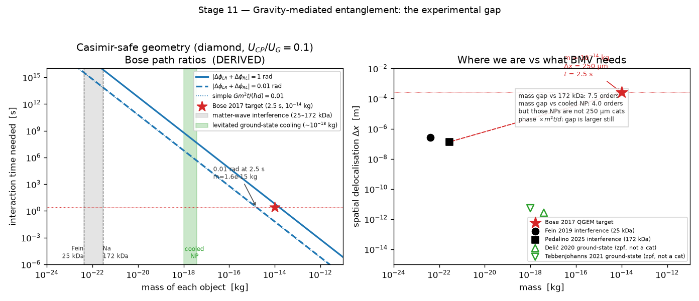

## 2. Method and rules

1. **No tuning.** Inputs are either cited values or fixed design rules declared before computing. The design rules are:
   - the 5σ PPT witness with $N\le10^4$ shots;
   - gas allowed 40% of the remaining $|\Phi|/2$;
   - acceleration noise allowed 10%;
   - $d\ge11\,\mu$m and $z\ge5\,\mu$m plate geometry (Schut 2024's closest);
   - a 100 Hz trap for zero-point units.

   Optimisers choose the smallest Δx that passes every cut. Nothing is adjusted toward a target.
2. **Labels.** Every number is DERIVED (computed here), ASSUMED (a stated design choice or extrapolation) or CITED (from a paper opened this stage).
3. **Verified sources.** Every paper number was read from the paper, arXiv HTML or PDF. Where a publisher blocked automated fetches, the same public text was read via arXiv or curl. Where we could not verify something, we say so.
4. **Gap metric.** A gap is $\log_{10}$(required / demonstrated), with positive meaning short. "Demonstrated" and "proposed" are scored separately. Upper limits inferred from lifetimes are treated as upper limits, not measurements.
5. **Honest negatives and coincidence flags** are reported in the text, not footnoted.

## 3. Results per bottleneck

### 3.1 Phase and mass (Stages 11, 12, 16)

- **Reproducing Bose 2017** (m = 1e-14 kg, d = 450 μm, Δx = 250 μm, t = 2.5 s): the subtracted phases are +0.126 and −0.440 rad, and the concurrence is **C = 0.156**. Their witness $W\sim1.16$ cannot be reconstructed, and $W>1$ is not a valid entanglement test (§5).
- **Cheapest workable point** (Stage 12, re-run with the Stage 16 He correction):
  - parallel geometry, plate, trap;
  - $m=5.62\times10^{-15}$ kg, $R=0.73\,\mu$m, $d=11\,\mu$m, $\Delta x=3.85\,\mu$m, 2.5 s hold (3 s total);
  - $\Phi=-0.511$ rad, $C=0.141$, $N_{5\sigma}=5.0\times10^3$.

  It is Schut 2024's close-trap layout with a larger cat and a longer hold. That change is needed once the van de Kamp gas rate is used instead of an assumed $\gamma=0.01$ Hz.
- **Mass gap versus demonstrated interference** (Pedalino 2025, 172 kDa = 2.86e-22 kg):
  - **7.29 orders** at the cheap point;
  - **7.54** for the Pb Meissner sphere at 1e-14 kg;
  - **8.06** at the Pino 3.3e-14 kg point (DERIVED from the stated masses).

  Against a ground-state-cooled nanoparticle (1e-18 kg, not a cat), the gap is 3.8 orders.
- **Joint gap** over (m, Δx, t) against the state-of-the-art ledger:
  - 11.23 for the cheap point;
  - **11.03** for Pb;
  - 11.04 for Nb (Stage 16, 1e-14 kg, 1 s).

  Heavier masses close 0.20 orders, and that comes from the shorter hold, not the mass. Above about 1e-13 kg everything gets worse. The near-equality across materials (11.01–11.07) is the plate-limited invariant $m\Delta x\sqrt t$ at fixed $D$. It is structure, not coincidence.
- **Space (Os, Krisnanda-style, 2.7 K):** joint gap 15.58, needing $\sqrt{S_a}=0.0087$ fm s⁻² Hz⁻½. MAQRO's 20 K requirement version is infeasible.
- **Status:** no superposition has been demonstrated at any of these masses. Stage 11's phase gap against the cluster interferometers is 16–18 orders, because $\Phi\propto m^2$.

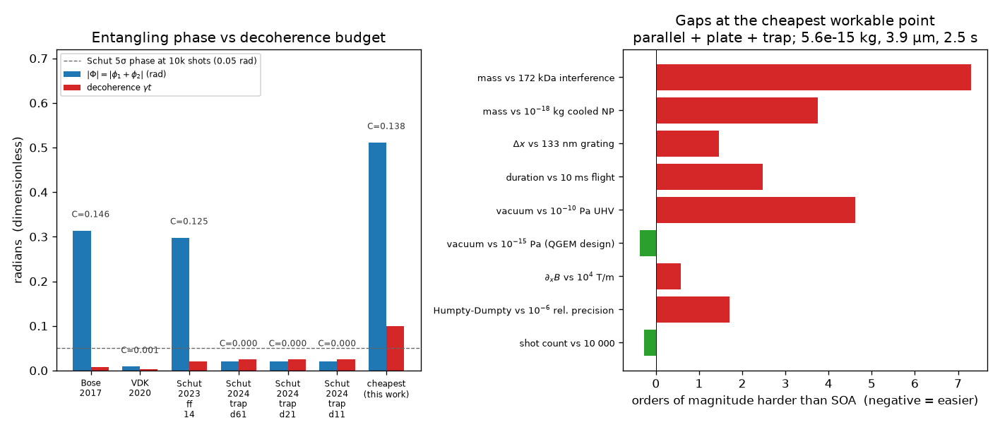
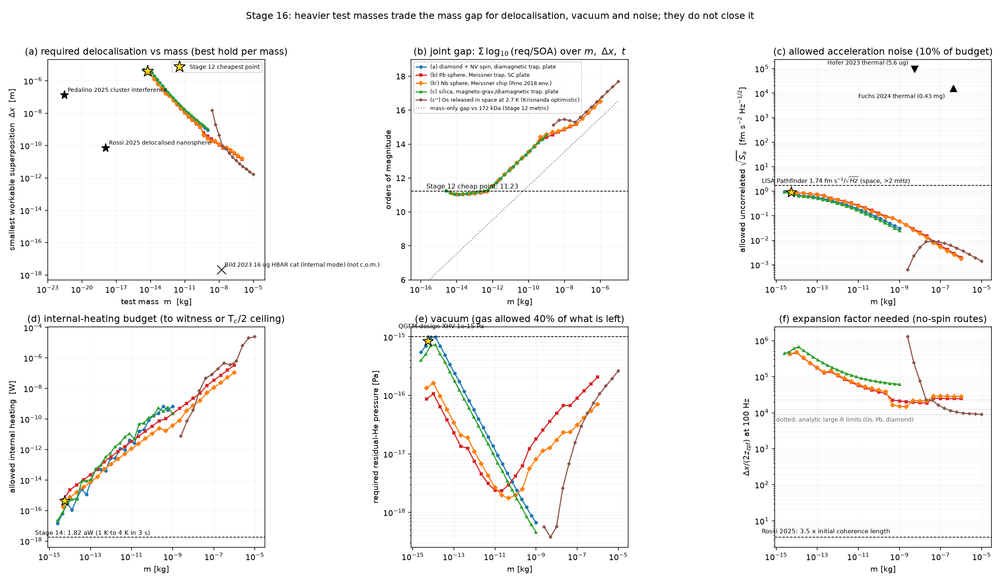

### 3.2 Thermal and internal heating (Stages 12, 13, 14, 16)

- **Blackbody.** Stage 12's "dead at 5 K" came entirely from an assumed $\mathrm{Im}\,\chi=0.01$ ($\tan\delta\approx0.035$). Measured window-grade and single-crystal CVD diamond has $\tan\delta=2\times10^{-6}$ to $10^{-5}$. With those values, a 4 K cryostat leaves $C$ unchanged at 0.138. Blackbody only bites near 12–15 K, and mostly through *scattering*, which no material choice removes. A dirty sp²-shelled particle ($\tan\delta=10^{-2}$) still has $C=0.116$ at 4 K.
- **Internal temperature is the thermal variable that binds.**
  - The diamond's heat capacity is tiny: **5.45 aJ**, i.e. fifteen absorbed 532 nm photons, takes it from 1 K to 4 K.
  - Radiative self-cooling takes days (clean) or minutes (dirty), so it cannot help within a run.
  - The latest witness-derived ceiling is **$T_{\rm int}\le15.7$ K**, a heat budget of **436 aW** over the run (Stage 16). This supersedes Stage 14's conservative 4 K line and its 1.82 aW.
- **Meissner spheres** have larger budgets:
  - Pb: ceiling 3.6 K ($T_c/2$), budget 2.3 fW;
  - Nb: ceiling 4.6 K, budget 0.75 fW.
- **Status:** the pieces are demonstrated separately:
  - laser-free diamagnetic trapping;
  - buffer-gas cooling;
  - optical-trap heating data (Frangeskou 2018 and others).

  The assembled protocol is *not* demonstrated: laser-free trap, He buffer-gas thermalisation, spin initialisation while gas is present, a dark pump-down, a dark run, and readout at the end. **Gap: 0 orders if that protocol works. Not demonstrated.**

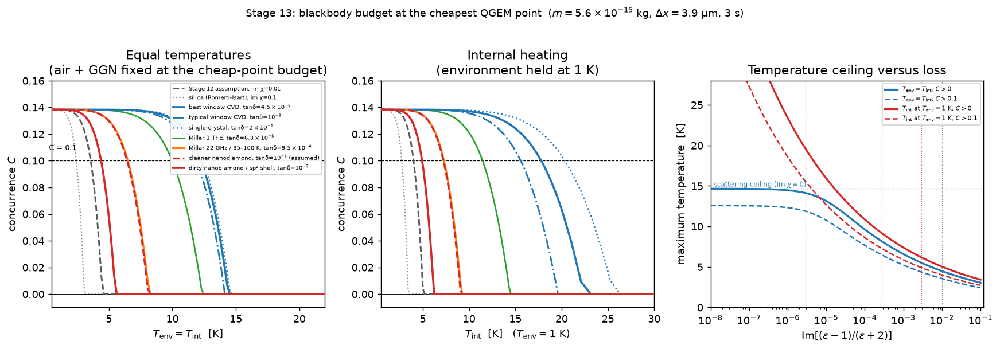
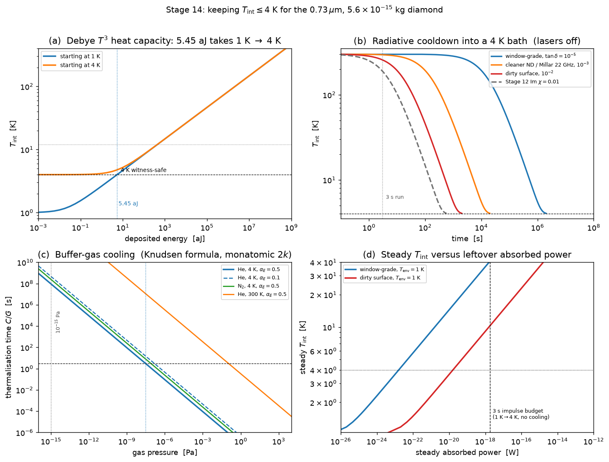

### 3.3 Path tagging and delocalisation (Stages 16, 19)

- **Diamond.** The NV spin provides the which-path tag through Stern–Gerlach splitting. That is proposed, not demonstrated, for a trapped microdiamond. The Humpty-Dumpty recombination precision needed is $2.0\times10^{-8}$ for a 1 MHz ground-state packet (1.7 orders beyond a 1e-6 ambition) or $1.7\times10^{-6}$ for a 100 Hz ground state.
- **Superconducting spheres have no demonstrated tag.**

  | Point | Required expansion (zero-point widths at 100 Hz) | Gap vs demonstrated 3.5 |
  |---|---|---|
  | Pb, 1e-14 kg, 1 s | $F=4.65\times10^5$ | **5.12 orders** |
  | Pino Nb, 0.5 s | $F=3.87\times10^5$ | 5.04 |
  | Cheap point, spin removed | $F=4.99\times10^5$ | 5.15 |

  The 3.5 record is Rossi 2025, in optically trapped silica.
- **Best spin-free proposals:**
  - **Pino 2018 free expansion:** a coherent state with $\xi=607$ nm over 483 ms. It leaves **0.55 orders** at its own mass, including a √3 time-averaging penalty (DERIVED; 0.31 without the penalty).
  - **Roda-Llordes 2024 "XXL" double-well loop** ($F=7.1\times10^4$): **1.06 orders** at the Pb point and 1.09 at the cheap point. It needs 97 dB of squeezing and a loop of about 16 s, longer than the hold.
  - **Tag-then-inflate** (Romero-Isart 2012 flux-qubit tag plus the XXL loop): 2.51 orders. The qubit tag on its own gives only 0.37 zero-point widths, which is 7.1 orders short.
  - **Lami–Pedernales–Plenio 2024 coherent-state test:** needs mHz modes and $T/Q<10^{-13}$ K, 3.8 orders beyond Hofer 2023. In a 100 Hz trap it would need 5e5 s per run.
  - **Hanif 2024** still needs spins.
- **Status:** all spin-free routes are proposed. No Meissner sphere has reached its ground state or been coupled to a qubit.

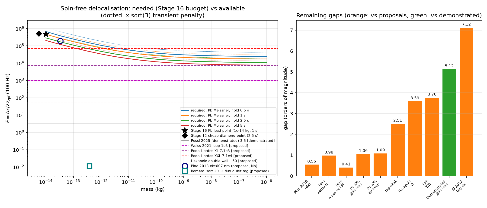

### 3.4 Acceleration noise (Stages 16, 18, 21, 23)

- **Requirement and its ceiling.**
  - For uncorrelated white noise, $\Gamma=m^2S_a\Delta x^2/4\hbar^2$. Combined with $\Phi\propto Gm^2\Delta x^2t/\hbar D^3$, this gives $S_{\rm req}\propto G\hbar/D^3$, **independent of $m$, $\Delta x$ and $t$** (Stage 21.0). This is Großardt's $2G\hbar/d^3$ (our 0.060 vs his 0.07 fm at 157 μm).
  - At $D=11\,\mu$m the ceiling is **$\sqrt{2G\hbar/D^3}=3.25$ fm s⁻² Hz⁻½**. No protocol, shot-count, mass or hold change can loosen the requirement by more than **0.87 orders** relative to Stage 18. Separating the masses tightens it as $D^{-3/2}$.
- **Exact requirement, cheap point.**
  - 0.44 fm s⁻² Hz⁻½ at Stage 18's $N_{5\sigma}=5049$. Stage 16's 0.90 put noise only on the $\sin(\Phi/2)$ term and is superseded.
  - **1.27 fm s⁻² Hz⁻½** under the Stage 16 shot cap $N_5\le10^4$, which Stage 21 adopts for every design (0.39 of the ceiling). The cap is itself worth +0.46 orders.
- **Pb and Pino recomputed.** These use the exact Stage 18/21 model, run through the unchanged `stage21_run.proto` with each point's own κ, Φ, gas exponent and hold, at $N_5\le10^4$ (`results/summary21_pb_pino.json`):

  | Point | Exact requirement (fm s⁻² Hz⁻½) | Stage 16-rule value | Fraction of its own ceiling | Echo |
  |---|---|---|---|---|
  | Pb | **0.52** | 0.85 | 0.15 of 3.37 fm ($D=10.7\,\mu$m) | infeasible (no slack) |
  | Pino | **0.33** | 0.68 | 0.11 of 3.04 fm ($D=11.5\,\mu$m) | infeasible (no slack) |

  Both points were chosen at the shot cap by the smallest healthy Δx. That leaves noise little slack, so even one echo swap's extra gas exposure makes them infeasible. The same code reproduces the cheap point's Stage 21 numbers exactly (1.27 fm; +6.92 baseline; +5.98 with echo).
- **No common-mode rescue.**
  - The PPT witness's built-in CMRR is **1.006** (Stage 18).
  - A decoherence-free subspace exists only for states that are already entangled.
  - In a one-trap relative-mode scheme, CM-mode noise kills the entanglement unless relative-mode squeezing beats it ($e^{2r}=2n+1$) (Stage 21.2).
- **Levers** (Stage 21; + loosens):
  - **Survive:**
    - shot cap 10⁴: +0.46;
    - one echo swap: +0.98 against 1/f tilt, but −0.10 to −0.36 against seismic;
    - hold 5 s: +0.15;
    - neutral dipole plus non-metal plate: +2.5 on the plate source (+7.5 → +5.0);
    - release in drag-free space with no plate.
  - **Fail:**
    - shorter shots with more repetitions (infeasible below 1 s);
    - two or more echo swaps;
    - a stiffer trap (0; a separately mounted Stern–Gerlach source makes it worse);
    - removing the plate on the ground (−2.09, since Casimir–Polder sets $D=273\,\mu$m);
    - a trapped drop tower or Einstein-Elevator (−3.9);
    - a trapped ISS experiment (−5.7);
    - relative-mode readout or a DFS (0).
- **Residual floors, cheap point** (orders over the design's own requirement):
  - ground baseline at 10⁴ shots: +6.9 (tilt binding), +7.5 with plate surface noise. Stage 18 gave +6.2 inertial and +8.0 with plate noise at 0.44 fm.
  - **best ground redesign** (echo, neutral dipole, non-metal plate): **+6.0**, with isolated seismic +5.6 and tilt +5.9;
  - space, trapped, LPF-grade readout: +3.5;
  - **space, released, drag-free, no plate, $D=273\,\mu$m: +2.0** for white electrode E-field noise, or +5.7 if that noise is 1/f. Spacecraft self-gravity jitter is +1.7.

  The space figure assumes electrodes at 1 mm, $p=10^{-2}$ e·cm, and 500 kg of spacecraft at 0.5 m with $10^{-9}$ m/√Hz jitter. Closing it needs $p\le10^{-4}$ e·cm at 1 mm and jitter $\le1.9\times10^{-11}$ m/√Hz.
- **Pb and Pino floors** (inertial spectra only):
  - ground isolated seismic: +5.9 (Pb) and +6.1 (Pino);
  - with tilt: **+7.2 and +7.3**.

  The plate E-field, Johnson and released-space entries depend on the diamond's dipole and geometry and were not transferred to superconducting spheres.
- **Space Os option** (Stage 16, Stage 16 rules): needs 0.0087 fm, 2.3 orders below LPF. Under Stage 23 measured inputs, osmium at 1 cm with spin averaging is +2.7, but only through an ASSUMED patch dipole.

- **Space with measured inputs (Stage 23).** The Stage 21 figure of +2.0 used three ASSUMED inputs: a permanent dipole of $10^{-2}$ e·cm, ion-trap E-field noise with electrodes 1 mm away, and 1 nm/√Hz jitter with a 500 kg / 0.5 m self-gravity term. Replacing each with a measured value, in the unchanged Stage 21 exact model, gives:
  - the design as drawn (electrodes at 1 mm): **+8.1**, not +2.0. The binding source is the permanent electric dipole coupling to measured LISA Pathfinder stray-potential noise, which is 5.8 orders above the Stage 18/21 ion-trap model at 1 mm (DERIVED). No levitated-diamond dipole has been measured; silica surface density scaled as $R^2$ is used (ASSUMED), giving 37 e·µm;
  - electrodes moved to 1 cm (a design choice) plus spin-averaging of the dipole (×120, measured by Afek 2021): **+4.0** for diamond. This is the best measured-input diamond redesign;
  - jitter floor, even with all electrostatics removed: **+2.6** at 8 nm/√Hz, or +3.1 at the worst LISA Pathfinder axis (30 nm/√Hz). The stiffness used is LISA Pathfinder's measured $\omega^2=-(525\pm30)\times10^{-9}$ s⁻²;
  - osmium at 1 cm with spin averaging reaches +2.7, but only through an ASSUMED patch-dipole estimate;
  - demonstrated free flight of a levitated silica nanoparticle is 5–6 µs usable (Prakash et al. 2026). The 3 s hold is **5.7 orders** longer, and this gap sits outside the noise budget;
  - holding $D$ to 1% over 3 s needs a release velocity $\le0.91$ µm/s ($T_{\rm eff}\le1.7$ mK, DERIVED). LISA Pathfinder's typical in-flight release is ~10 µm/s, which drifts $D$ by 11% and breaks the Casimir cut.

  Closing the remaining diamond dipole term would need electrodes at about 1.0 m, or a further ×10⁴ cut in dipole. Closing the jitter term would need spacecraft-to-test-mass jitter about 400–1400× below LISA Pathfinder's measured value. Spin-averaging a diamond that carries a spatial superposition and an NV spin is untested.
- **Status:** the requirement is below every demonstrated sensor by about 6 orders on the ground, after all levers. **This is the binding engineering obstacle.** The Stage 21 space figure of about 2 orders does not survive measured inputs: the design as drawn is +8.1, and the best diamond redesign is +4.0, with a +2.6 jitter floor and a 5.7-order free-flight gap.

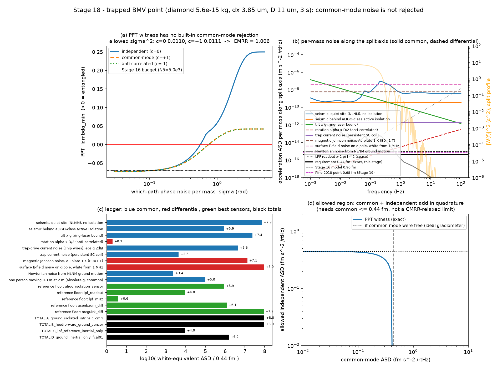
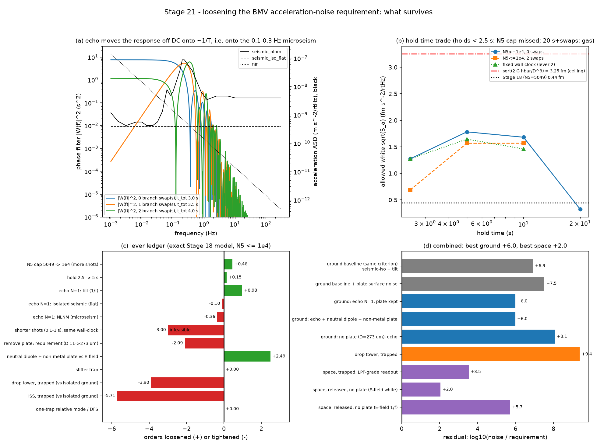
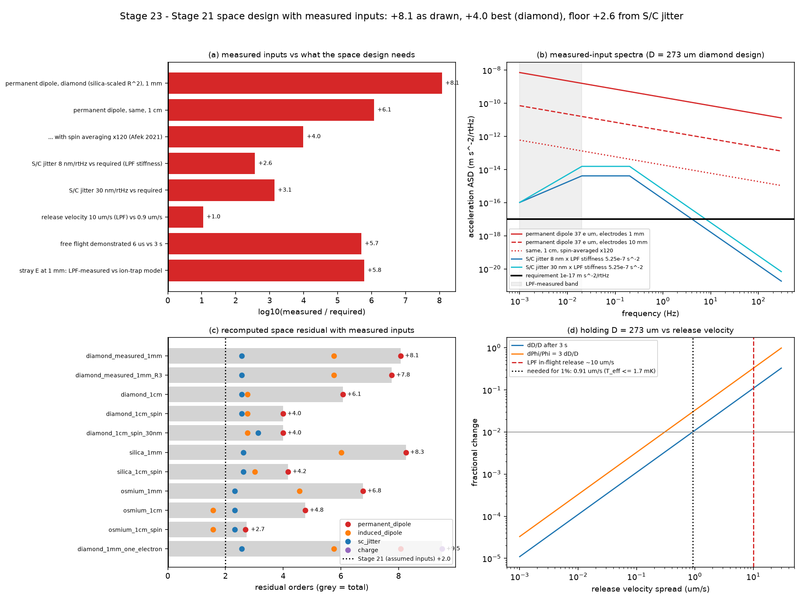

### 3.5 Vacuum (Stages 12, 16, 20)

- **Correct figure of merit.** All designs are in the saturated regime: $\Delta x/\lambda_{\rm th}=268$–$8830$. The Stage 12/16 rate is therefore exactly $(32\pi^2/3)R^2J$, and the requirement is a **flux**:

  | Design | Required flux $J_{\rm req}$ (m⁻² s⁻¹) |
  |---|---|
  | cheap | 5.5e8 |
  | Pb | 1.1e9 |
  | Pino | 6.2e8 |

  Pressures quoted at different temperatures cannot be compared.
- **Gaps** (cheap / Pb / Pino, negative = margin):
  - **BASE 2017**, 405-day antiproton storage, Langevin-reconverted $n_{\rm He}<2.6\times10^6$ m⁻³: **−0.67 / −0.98 / −0.72**;
  - Gabrielse 1990: +0.83 / +0.51 / +0.78;
  - CSR: +1.2 / +0.89 / +1.15;
  - room-temperature XHV plateau: +2.1 to +2.4;
  - MAQRO-type space vacuum: +1.6 to +3.9.
- **Equilibrium sources** fall below the requirement under these temperatures: ³He 61 mK, ⁴He 0.17 K, condensed H₂ 1.94 K, He adsorbed on graphite about 3 K. At 15–50 mK only non-thermal sources remain: leaks, beaming and stimulated desorption. The allowed leak into a 10 cm cold box is about 4.7e-13 mbar L/s, at the floor of the best He leak detectors.
- **Status:** the margin exists only against an upper limit from a hermetic 6.2 K can. It has never been reproduced around a levitated sphere with optical or SQUID access. **Gap: 0 to 0.8 orders, undemonstrated in the needed geometry.**

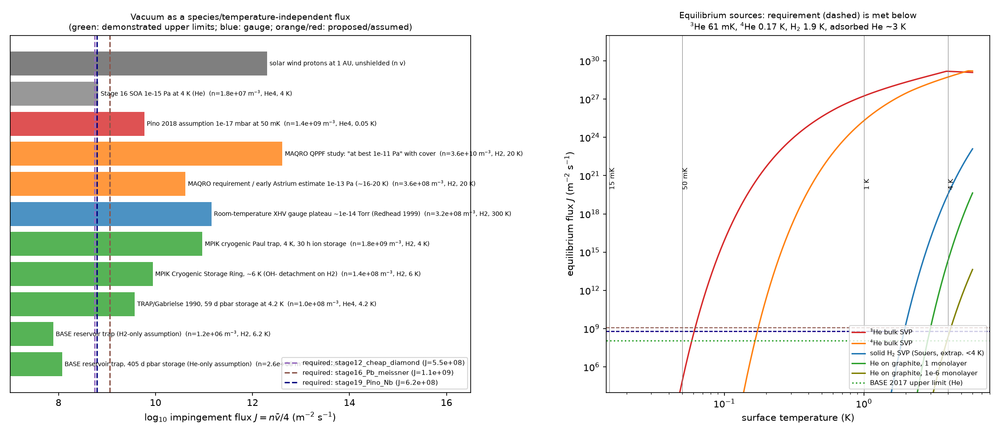

### 3.6 Oppenheim windows, as published and then corrected (Stages 11, 15, 17, 22–26)

**As published** (Stages 15 and 17, Oppenheim et al. Eq. 47 conventions: $\Delta x=d$, $r_N=10^{-15}$ m, $N=M/m_{\rm atom}$):
- **Ultra-local continuous:** excluded, as in the 2023 paper and reproduced here.
- **Ultra-local discrete:** open by **9.41 orders**. The floor is Panda 2024 (70 s Cs lattice, 1.55e-23 kg) and the ceiling is Gisler 2022 (4.0e-14 kg). This supersedes Stage 15's 10.06, after including spatial atom interferometers (§5).
- **Non-local / Diósi–Penrose-like:** open by **3.66 orders**. The floor is Pedalino 2025 ($1.47\times10^{-29}$ kg² s m⁻¹) and the ceiling Gisler ($6.69\times10^{-26}$). Stages 15 and 17 labelled the unit kg s m⁻¹; the published unit is **kg² s m⁻¹**. The numbers are unchanged.
- **Nearest named step, corrected:** MUSCLE at 1 MDa and 25 m/s leaves **0.56 orders** (Stage 22). Stage 17's 0.86, and the "1.93 MDa needed at 25 m/s", used $\tau=L/v$. Pedalino's floor, and Stage 17's own 160 m/s figure, used $\tau=2L/v$. At 25 m/s the closing mass is **1.54 MDa**.

**A closer under those conventions (Stage 22, DERIVED).** In any symmetric Talbot–Lau interferometer the velocity drops out: closing requires $2\xi M^4 d^{5/3}/(h\,m_a r_N^{2/3})\ge6.69\times10^{-26}$ kg² s m⁻¹. The cheapest point that passes every constraint and minimises statistical time, an objective fixed before the scan, is **ξ = 0.8: 1.415 MDa Na at 19.6 m/s** in the existing 0.983 m all-optical MUSCLE geometry (61,600 atoms, radius 8.2 nm, $\tau=100$ ms). Material gratings are excluded by van der Waals dispersion. The vacuum must be 85× better than MUSCLE's $9\times10^{-9}$ mbar ($\le1.06\times10^{-10}$ mbar H₂). Internal temperature must be $\lesssim350$ K. Active slowing is required; velocity selection of the demonstrated 120–170 m/s neutral beam cannot work. Projected, with ASSUMED source efficiencies: 6.2 cps and 315 s per 5σ setting. The interference model is unfitted and gives $V_q=0.105$ at Pedalino's point against a measured $0.10\pm0.01$. Closing from above needs the absolute force-noise figure of merit to fall from 0.298 to $6.54\times10^{-5}$ m² s⁻³ (3.66 orders). Nothing demonstrated in absolute mode is within 4 orders; the window is still "open" only because Stage 15 counts absolute sensors only.

**Fragile, then moot.**
- **Stage 24 (convention sweep).** The superposition-size convention is robust (window moves by $\le0.1$ orders). Atoms versus nucleons, counted the same way on both sides, give 3.60 versus 3.66 orders. The smearing length is not robust: the window runs from −21 to +35 orders over the physically motivated range, and Stage 22's closer survives only for **$\ell\le1.7\times10^{-14}$ m** (floor-only) or **$\ell\le1.65\times10^{-15}$ m** (consistent). No convention that is plausible on its own physical grounds (atomic, Donadi, body, CSL scales) leaves the window closable by any cluster-interferometer route in Stages 17 or 22. Stage 22's "1.4 MDa closes it" is a statement about the Eq. 47 conventions as Oppenheim et al. chose them, not about classical-gravity models in general. Stage 24 also flagged an $N$-counting inconsistency in Eq. 47 and a possible carry-over of the Donadi X-ray bound, without testing either.
- **Stage 25A (N-counting, DERIVED).** The inconsistency is in the published text, not a misreading. Integrating out the classical field (the paper's own Eqs. 135–137) and summing a bcc Na lattice gives a decoherence rate that scales as $N^p$ with $p$ between 1 ($M^2/N$) and 2 ($M^2$), never as $N\cdot M^2$ ($p=3$). The derived floor at Pedalino is $7.59\times10^{-35}$ against the published $1.47\times10^{-29}$, a drop of **5.29 orders**. The ceiling already counts incoherently, so the window widens from 3.66 to **8.95 orders**. The closing mass at the cheapest MUSCLE point rises from 1.39 MDa to **3,930 MDa**, at 7 mm/s with a 95 km sag, which is unreachable. Stage 24's "indepDP" row had kept $R_\lambda$ and is corrected to these values. No erratum was found.
- **Stage 25B (X-ray carry-over, DERIVED).** With $D_0=\kappa G/(\hbar r)$, $\kappa=1$ is exactly Diósi's master equation. The X-ray bound is then a bound on $\kappa/\ell^3$. At $\ell=10^{-15}$ m the nuclear choice is excluded by **13.9 orders** (Donadi) and **18.0 orders** (XENONnT). Stage 24 quoted Donadi's 0.54 Å as if it were in the same normalisation as Oppenheim's $D_0$; in matched (Diósi) convention it is 0.184 Å. Under Stage 25's own reading, the smallest allowed $\ell$ is $2.05\times10^{-13}$ to $1.01\times10^{-12}$ m (consistent) or $4.2\times10^{-11}$ to $1.02\times10^{-9}$ m (floor-only). Matter-wave interferometry cannot be the binding floor for this kernel at any $\ell$. The Stage 22 experiment is moot for this kernel: the window it was designed to close is either already closed by X-ray data or far out of interferometric reach. These Stage 25 $\ell_{\rm min}$ and "≥ 20 orders at every $\ell$" figures are themselves corrected in Stage 26 (below, and §5).

**What survives (Stage 26, DERIVED).** The constructive question is which part of the $(\ell,D_0)$ plane survives all data, for which kernels, and who can reach it at fixed published sensitivities.

Every probe $E$ sees $N_E(\kappa,\ell)=A_E(\ell)\,(\kappa+1/4\kappa)$, where $A_E(\ell)$ is what plain Diósi ($\kappa=1$) predicts for that probe. The minimum sits at $\kappa=1/2$, where the total noise equals Diósi $\kappa=1$. This is exactly the Tilloy–Diósi 2017 "principle of least decoherence" model. An experiment with bound $B_E$ allows a $\kappa$ interval only if $u_E=B_E/A_E\ge1$; one experiment with $u_E<1$ excludes that $\ell$ for every $\kappa$. For any positive kernel, including Oppenheim's discrete $\delta(x-y)/m(x)$, Cauchy–Schwarz gives $N_E\ge\eta_K A_E$ with $\eta_K\ge1$ and equality only for the Diósi–Penrose kernel, which is therefore the most permissive. Computed for a single Gaussian nucleus: $\eta=1.000$ (DP, $\ell_{\rm min}/R_0=1.000$), 1.136 (ultra-local discrete, 1.043, a lower bound), and $\sqrt{3}=1.732$ (ultra-local continuous, 1.201). X-rays see both the $D_0$ kicks and the classical-field noise, so the bound becomes $\ell\ge R_0$ for any kernel: **4.5 Å** (XENONnT 2026) and **0.18 Å** (Donadi 2021), both in Diósi convention. Stage 25 let only the $D_0$ part radiate; that was the gap.

Primary scenario S1, all existing data and Markovian noise:

| $\ell$ | window $\log_{10}(\kappa_+/\kappa_-)$ | binding probes |
|---|---|---|
| $<4.5$ Å | **excluded** (every kernel) | XENONnT |
| 4.5 Å | 0 (edge; $\kappa=1/2$ only) | XENONnT |
| 1 nm | **2.68** | XENONnT on both sides |
| 10 nm | **8.68** | XENONnT |
| 100 nm | **14.7** | XENONnT |
| $\ge0.63$ µm up to 52 µm | **19.4** (flat) | LISA Pathfinder (plateau $(4\pi/3)G\hbar/V$) |

The upper end of $\ell$, 52 µm, is taken from Lee et al. 2020 inverse-square tests (ASSUMED). Published versus corrected $N$-counting changes nothing in S1: across the whole surviving range, Pedalino stays weaker than the binding probe by $\ge8.2$ orders under corrected counting, and by $\ge1.2$ orders under the published $N\cdot M^2$ form. No other existing probe matters (LISA Pathfinder 9.40 orders short of the least-noise point; Gisler 13.7; aLIGO 14.7; Westphal torsion 18.5; Pedalino 12.8; Donadi 4.2). If the noise is coloured below the X-ray band (scenario S3, the non-Markovian loophole), $\ell_{\rm min}$ drops to **5.6e-14 m** (LISA Pathfinder) or **1.7e-15 m** (Gisler alone).

**Who can reach it** (Stage 26; $\log_{10}u$ is orders short of the least-noise point; negative means that experiment alone excludes that $\ell$ for every kernel):

| experiment | status | $\log_{10}u$ at $\ell=4.5$ Å | at 1 µm | $\ell$ range it would exclude |
|---|---|---|---|---|
| **Pino 2018 Nb sphere** | proposal | **−1.65** | −0.56 | **0.5 nm – 1.6 µm** |
| **MAQRO at $10^{11}$ u** | planned (max mass) | **−0.33** | +2.26 | 0.5 – 112 nm |
| MAQRO baseline $10^{10}$ u | planned | **+1.34** | +4.92 | none |
| LISA Pathfinder | flown | +9.40 | +9.40 | none (sets the plateau) |
| LISA (requirement) | planned | +10.17 | +10.17 | none |
| Stage 22 MUSCLE 1.4 MDa | our design | +10.3 | +15.7 | none |
| Pedalino 172 kDa | existing | +12.8 | +18.3 | none |
| Gisler nanowire | existing | +13.7 | +15.0 | none |
| MAGIS-100 | planned | +15.8 | +19.2 | none |
| Kovachy 54 cm atoms | existing | +16.5 | +19.8 | none |
| Westphal torsion | existing | +18.5 | +18.5 | none |
| Stage 12 BMV diamond / Stage 16 Pb | our designs | −1.84 / −2.02 | −1.15 / −1.10 | 0.5 nm – 2.8 µm |

After all planned and proposed literature experiments (S4), only **$\ell=1.8$–$52$ µm** survives, with a window of up to **5.2 orders at 10 µm** and **9.4 at 52 µm**. Nothing planned reaches that range. LISA Pathfinder, the closest, is 9.4 orders short there. Adding our own designs (S5) moves the edge to 3.2 µm. Massive superpositions win because, for spacing $\ll\ell\ll R$, the decoherence is the coherent self-energy, of order $GM^2/(\hbar R)$ and independent of $\ell$. Force sensors are limited by $\Gamma V$ against $(4\pi/3)G\hbar$, so large test masses are penalised and torsion balances come out worst. Under Eq. 47's $N\cdot M^2$ counting, MAQRO baseline would sit at −6.4 and Pino at −13.2; under corrected counting they are +1.34 and −1.65. Atom interferometers (Kovachy, MAGIS-100) are irrelevant, at 16–20 orders short. LISA's requirement sits 0.8 orders above LISA Pathfinder's achieved noise. Cold atoms do not constrain: in the valid range they are 22 orders short.

The X-ray exclusion is not Diósi–Penrose-specific. It hits every positive kernel and every smearing below 4.5 Å. Oppenheim's own nuclear smearing $\ell=10^{-15}$ m is excluded for the non-local kernel by 17.0 orders (XENONnT, point nucleus; 15.6 nucleon-resolved) / 12.8 (Donadi; 11.7), and for the discrete kernel by 16.4–17.2 orders (XENONnT) / 12.6–13.3 (Donadi). Stage 17's discrete window of 9.41 orders and the non-local 3.66 → 8.95 orders are both closed at Oppenheim's $r_N$. What survives everywhere is a family of models whose mass density is smeared over **$\ge4.5$ Å to $\le52$ µm**, far from any nuclear or Planckian scale.

Stage 26 also corrected Stage 25's $\ell_{\rm min}$ (now $1.84\times10^{-11}$ m Donadi and $4.5\times10^{-10}$ m XENONnT, because the classical-field noise radiates too), the exclusion at $\ell=10^{-15}$ m (18.0 / 13.9 became 17.0 / 12.8, from Eq. 47's dropped constants), and the claim that X-rays sit $\ge20$ orders above interferometry at every $\ell$ (true only for $\ell\lesssim10^{-12}$ m; 11.8 orders at 1 nm and 9.5 at 10 nm). Stage 24's "consistent" ceiling rows, with shifts of +14 to +27 orders at atomic and larger $\ell$, fail above about 0.6 Å, where the force-noise ceiling saturates at the bulk plateau.

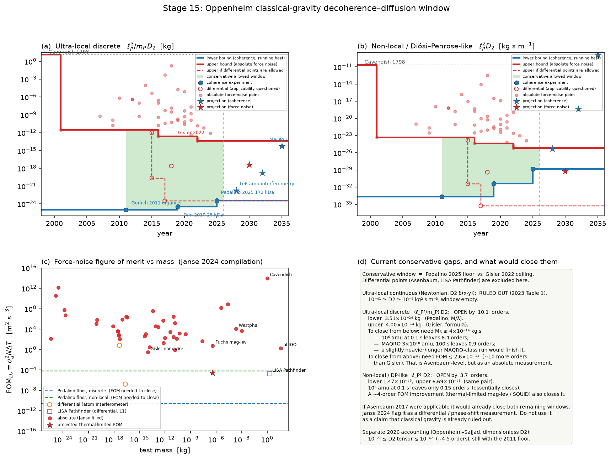
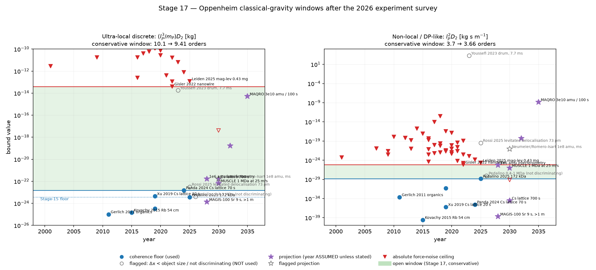
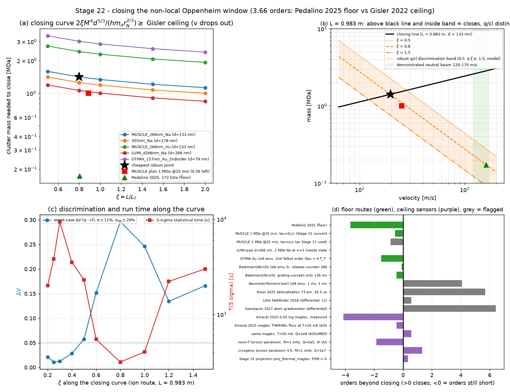
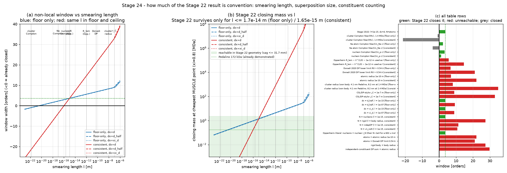
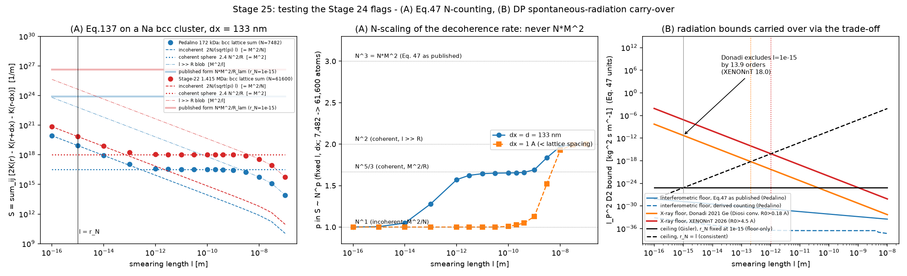
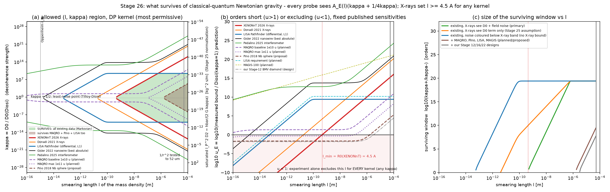

### 3.7 Signature and tuning (Stage 27)

The noise, if present, is itself random, so it cannot be filtered out of a white background the way a steady tone can. It can still be identified, and an experiment can be tuned to its signature.

**Signature (DERIVED).** A CQ excess would be all four of the following; no ordinary source does all four.
1. **White** (Markovian), flat from DC upward. Residual-gas Brownian noise is also white, so spectral shape alone cannot separate CQ from gas. It does separate CQ from patch noise and internal damping ($1/f$), seismic noise (coloured) and readout noise ($f^4$ in acceleration). For the X-ray bound to apply at all, the noise must stay flat to at least about $10^{21}$ rad/s.
2. **The volume law.** Above the Stage 26 floor ($\ell\ge4.5$ Å), every body larger than $\ell$ sits in the plateau, where $\Gamma_{\rm CQ}\cdot V=(4\pi/3)G\hbar(\kappa+1/4\kappa)\ge\mathbf{2.95\times10^{-44}}$ m⁵ s⁻³, one universal constant. The acceleration noise depends only on the body's volume, not on mass, composition, temperature, pressure, charge, magnetic field or laser power. Gas scales as $P\cdot\sqrt{T}\cdot R^{-4}\cdot\rho^{-2}$ and blackbody as $T^5 R^{-4}\rho^{-2}$, so a two-size or two-pressure series separates them (exponent $-3$ in $R$, 0 in $P$ and $T$). Composition dependence appears only in the already-excluded incoherent regime ($\ell<0.6$ Å). In the surviving window, an equivalence-principle-style composition differential gives a CQ signal of exactly 0; it is useful only as a veto.
3. **Spatial correlation.** For two bodies, the line-of-sight cross-spectrum is $\mathbf{-2G\hbar/d^3}$ (anti-correlated) and the transverse one is $+G\hbar/d^3$ (at $\kappa=1/2$). It is independent of mass and of $\ell$, and exact for non-overlapping spheres by the shell theorem. The correlation coefficient is independent of $\kappa$. This is the Kafri–Taylor–Milburn mutual noise; the sign agrees with Kryhin & Sudhir. For equal spheres, $\rho_{\rm long}=-(3/2\pi)V/d^3$: touching spheres −0.25; $d=3R$ −0.074; LISA Pathfinder TM1–TM2 $\mathbf{-8.7\times10^{-4}}$. $|\rho|$ reaches 1% only for $d\le5.85 R$. The cross term is long-range ($1/d^3$); $\ell$ sets only the self term.
4. The volume-law constant, the $\kappa$-independence of $\rho$, and source-mass modulation of state-dependent kernels were not found in the papers checked. That is not proof that they are new.

**Tuning (DERIVED, with published or ASSUMED integration time and bandwidth).** White noise has no carrier, so a lock-in cannot pull it out of white backgrounds; one can only estimate excess PSD. Honest gains:

| Probe | Stage 26 $\log_{10}u$ | Best Stage 27 | Route |
|---|---|---|---|
| LISA Pathfinder (1.8–52 µm gap) | +9.40 | **+8.1** (+8.4 from a projected public-data reanalysis) | PSD integration; background-model accuracy |
| MAQRO baseline | +1.34 | **−0.20** (1 run, $10^4$ detections), **−0.95** (30 runs, ASSUMED) | contrast statistics instead of $\lambda\tau\le1$ |
| Westphal torsion | +18.5 | +17.2 | PSD integration |
| Monteiro levitated | +16.0 | +14.3 | a pair at $d=3R$ |

- The statistical floor $1/\sqrt{TB}$ is 2.2 orders for LISA Pathfinder, 2 for torsion and 3 for levitated sensors. The binding limit is background-model accuracy $\varepsilon$. ASSUMED $\varepsilon$ of 10% or 5% gives **1.0–1.3 orders**.
- A feasible LISA Pathfinder public-data reanalysis would fit the white Brownian branch against the decaying pressure over about 500 days (the Brownian PSD fell by a factor of 8.9). ASSUMED 20 runs at 5% each give a 1.0-order gain (2σ), taking the residual from 9.4 to **+8.4**. A correlated-noise search is not possible: LISA Pathfinder records only $\Delta g$.
- For the Diósi–Penrose / translation-invariant kernel there is **no external handle**: the noise is identical in vacuum, and nothing outside the body changes it.
- **Discrete kernel (corrects Stage 26, for that kernel only).** The field noise is sourced by matter, so LISA Pathfinder self-noise gives $\hat D\le1.17\times10^{-15}$ kg. Combined with XENONnT heating, **the discrete kernel needs $\ell\ge2.5$ µm**. The remaining window is 1.2 orders at 10 µm and 2.6 at 50 µm. A moving source mass would be a true lock-in handle. An LISA Pathfinder-class sensor with an ASSUMED 10 kg source at 5 cm would cover the whole discrete window for $\ell\lesssim24$ µm and $\ge76$% of it up to 52 µm. No such instrument exists. A Westphal-class torsion balance with 1 kg at 1 cm is 9.4 orders short.
- Cross-correlation never closes a gap: LISA Pathfinder, if it had independent channels, would still be 10.6 orders short, worse than the self route. Common mode ($\ell>d$) is invisible to differential instruments.
- MAQRO with contrast statistics would exclude 0.5–35 nm in one run, or 0.5–112 nm with 30 runs, if environmental decoherence is known at the 0.5–3% level (ASSUMED). It does not reach the 1.8–52 µm band. The single-run value (−0.20) is within a factor of 2 of zero (coincidence flag).

**Verdict.** Tuning does not close any Stage 26 gap for the Diósi–Penrose kernel in the surviving 1.8–52 µm band: the best realistic gain is about 1.3 orders against 9.4. What it does buy is that MAQRO's baseline moves to a reach already covered by Pino / MAQRO at $10^{11}$ u in S4, and that for state-dependent kernels the noise becomes modulatable, with LISA Pathfinder self-noise already squeezing that class to $\ell\ge2.5$ µm. If an excess were seen, the volume law plus the $-2G\hbar/d^3$ anti-correlation would identify it.

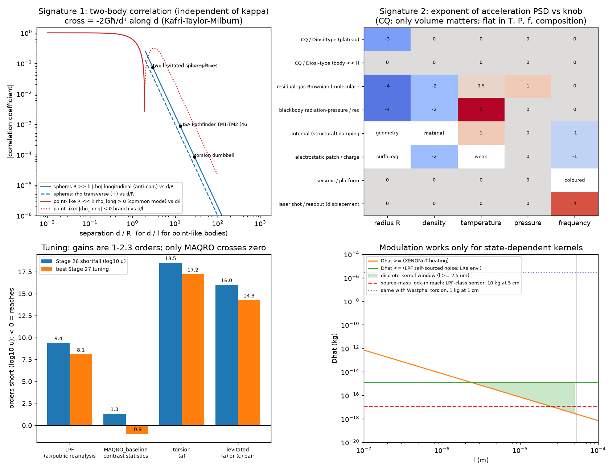

## 4. Consolidated gap table

Orders of magnitude, $\log_{10}$(required/demonstrated). Positive means short; negative means margin. "Prop." is the gap against the best *proposal*.

| Bottleneck | Cheap diamond (5.6e-15 kg, 4 K gas, 1 K env) | Pb Meissner (1e-14 kg, 15 mK) | Pino Nb (3.3e-14 kg, 50 mK) | Status |
|---|---|---|---|---|
| Mass vs demonstrated interference (172 kDa) | 7.29 | 7.54 | 8.06 | no superposition at these masses |
| Joint gap (m, Δx, t) vs SOA ledger | 11.23 | 11.03 | 11.04 (Nb at 1e-14 kg) | — |
| Path tag / delocalisation, vs demonstrated (Rossi ×3.5) | NV spin (proposed); spin-free 5.15 | 5.12 | 5.04 | demonstrated: none |
| Path tag / delocalisation, vs best proposal | Humpty-Dumpty 1.7 (1 MHz packet) to 0 (100 Hz packet); spin-free XXL 1.09 | XXL loop 1.06; tag+inflate 2.51 | Pino expansion 0.55 | proposed only |
| Internal temperature | 0 if dark protocol works (ceiling 15.7 K, 436 aW) | 0 (3.6 K, 2.3 fW) | 0 (4.6 K, 0.75 fW) | protocol not demonstrated |
| Blackbody at 4 K (window-grade) | 0 (C = 0.138 unchanged) | 0 | 0 | measured loss tangents |
| Acceleration-noise requirement, exact model, $N_5\le10^4$ (fm s⁻² Hz⁻½) | 1.27 (0.44 at $N_5$=5049) | 0.52 | 0.33 | DERIVED |
| Hard ceiling $\sqrt{2G\hbar/D^3}$; max loosening | 3.25 fm; +0.41 left (+0.87 vs Stage 18) | 3.37 fm; +0.81 | 3.04 fm; +0.97 | DERIVED |
| Acceleration noise, ground baseline (isolated seismic + tilt) | +6.9 | +7.2 | +7.3 | demonstrated sensors / bounds |
| Acceleration noise, ground with plate surface noise | +7.5 | not transferred | not transferred | extrapolated surface-noise data |
| **Acceleration noise, best redesign, ground** | **+6.0** (echo + neutral dipole + non-metal plate) | +7.2 (echo infeasible) | +7.3 (echo infeasible) | proposed redesign |
| Acceleration noise, space, trapped (LPF readout reference) | +3.5 | not recomputed | not recomputed | LPF demonstrated in space |
| **Acceleration noise, best redesign, space** (released, drag-free, no plate, $D$=273 μm) | **+4.0** (was +2.0 under ASSUMED inputs). As drawn, with measured inputs: +8.1. Jitter floor +2.6. | n/a (diamond design) | n/a | Stage 23 measured inputs; spin-averaging proposed |
| Free flight, levitated particle, vs 3 s hold | **+5.7** (5–6 µs demonstrated) | — | — | demonstrated in microgravity |
| Vacuum (flux) vs best demonstrated upper limit (BASE) | −0.67 | −0.98 | −0.72 | upper limit, hermetic 6.2 K can |
| Vacuum vs next demonstrated (Gabrielse 1990) | +0.83 | +0.51 | +0.78 | upper limit |
| Vacuum, space (MAQRO requirement / QPPF estimate) | +1.88 / +3.88 | +1.56 / +3.56 | +1.83 / +3.83 | proposed / study |
| 5σ shots (≤ 1e4) | 5.0e3 (0) | 9.5e3 (0, by construction) | 1.0e4 (0, by construction) | rule |

Space BMV alternative (Os, 7.9e-8 kg, 2.7 K): joint gap 15.58; noise 2.3 orders below LPF under Stage 16 rules. Under Stage 23 measured inputs, osmium at 1 cm with spin averaging is +2.7, but only through an ASSUMED patch dipole.

**Classical-quantum gravity, latest values (Stages 25–27; not per BMV design).**

| Item | As published / earlier stage | Latest value | Label |
|---|---|---|---|
| Ultra-local continuous | excluded | excluded | CITED / confirmed |
| Discrete window at $r_N=10^{-15}$ m | 9.41 orders open (Stage 17) | **closed** (16.4–17.2 orders, XENONnT; 12.6–13.3, Donadi) | DERIVED |
| Non-local window at $r_N$, published $N\cdot M^2$ | 3.66 orders open | 8.95 orders under corrected counting, then **closed** by X-rays at $r_N$ | DERIVED |
| MUSCLE 1 MDa @ 25 m/s, orders left | 0.86 (Stage 17, $\tau=L/v$) | **0.56** ($\tau=2L/v$); moot for this kernel | DERIVED |
| Stage 22 cheapest closer | 1.415 MDa Na @ 19.6 m/s | fragile ($\ell\le1.7\times10^{-14}$ / $1.65\times10^{-15}$ m), then moot (3,930 MDa under corrected counting) | DERIVED |
| Smallest allowed $\ell$, every positive kernel | Stage 25: $2\times10^{-13}$–$1\times10^{-9}$ m | **4.5 Å** (XENONnT) / **0.18 Å** (Donadi), Markovian noise | DERIVED |
| Surviving window (S1, existing data) | — | 2.68 / 8.68 / 14.7 orders at 1 / 10 / 100 nm; **19.4** for 0.63–52 µm | DERIVED |
| After planned literature experiments (S4) | — | only **1.8–52 µm** left (5.2 orders at 10 µm, 9.4 at 52 µm) | DERIVED |
| Best proposed closer of the 4.5 Å edge | — | Pino 2018: **−1.65** (closes 0.5 nm–1.6 µm); MAQRO $10^{11}$ u: **−0.33** (0.5–112 nm) | DERIVED; proposals |
| LISA Pathfinder vs 1.8–52 µm band | +9.40 | **+8.1** best tuning (+8.4 projected public-data reanalysis) | DERIVED; $\varepsilon$ and run count ASSUMED |
| Discrete kernel, after LPF self-noise (Stage 27) | Stage 26: excluded only at $r_N$ | $\ell\ge2.5$ µm; remaining window 1.2 orders at 10 µm, 2.6 at 50 µm | DERIVED |

**Reading the table.** For BMV, two axes dominate:
- delocalisation without a demonstrated tag, about 5 orders against what exists;
- per-mass acceleration noise: +6.0 on the ground after the best redesign (+7.2/+7.3 for Pb/Pino). In space, with measured inputs, the best diamond redesign is +4.0 (was +2.0), the design as drawn is +8.1, and demonstrated free flight is 5.7 orders short of the hold. The requirement can never be loosened past $\sqrt{2G\hbar/D^3}$.

Vacuum and temperature are at or below zero on paper, but only if hardware that has never been assembled around a levitated particle works as its components do.

For classical-quantum gravity, Oppenheim's nuclear-scale windows are closed. What survives is smearing over at least 4.5 Å. After planned experiments, only 1.8–52 µm is left, and no amount of signature-based tuning closes that band.

## 5. Errata and corrections

**In published work** (the $N$-scaling of Eq. 47 / Eq. 151 has been raised with Oppenheim as a question; no erratum is known):
- **Bose et al. 2017:** the written witness $W=|\langle XZ\rangle-\langle YZ\rangle|$ reaches $\sqrt2$ on product states, so $W>1$ is not an entanglement test. $W\sim1.16$ cannot be reconstructed. The quoted phases (~0.7, ~−0.2) match the *unsubtracted* magnitudes (0.79, 0.23), not their own subtracted eq. (2). The state is entangled, with $C=0.16$. The "Casimir a tenth" is 0.050 with the standard retarded SI formula; their (m, R) pair is slightly inconsistent with diamond density.
- **Schut et al., PRR 6, 013199 (2024):** the "approximately 3.4 μm" sentence does not match Table I under a single Φ convention. The Table I points are not entangled at 1e-15 Pa with the van de Kamp gas rate.
- **van de Kamp et al. 2020:** the working point is phase-starved and cannot recombine in free fall under Schut's later default dipole. This is a model addition, not a typo.
- **Oppenheim et al. 2023, Table 1:** it is about 2 orders more conservative than a literal plug-in of its own figure of merit (discrete upper bound about 13 kg rather than 1e-1; non-local about 2.2e-11 rather than 1e-9). The 0.1 s Gerlich flight time looks unsupported; a Zenodo note by D. Nguyen reached the same suspicion independently.
- **Oppenheim et al. 2023, Eq. 47 / Eq. 151 versus Eq. 137:** the published floor uses $N_\lambda M_\lambda^2$ with the total mass, while the paper's own master equation (Eq. 137) and a bcc Na lattice sum give a rate $\propto N^p$ with $p=1$–$2$, never $N\cdot M^2$. No erratum was found on the article page. This is reported as a derived inconsistency, not as a typo we have seen acknowledged.
- **Romero-Isart et al., PRL 109, 147205 (2012):** with the paper's own numbers, $2t^*=2\pi/\omega_t=36\,\mu$s exceeds $T_2=10\,\mu$s. That violates its own condition $2t^*\ll T_2$.
- **Lami, Pedernales & Plenio, PRX 14, 021022 (2024):** recomputing γ from their m and R gives 2.4e-4 Hz, against the quoted 1.6e-4 Hz (×1.49). Flagged, not resolved.
- **INSPIRE abstract of the Fei thesis:** "more than 10³ days" is a lost superscript of "103 days" (3.4 months). The Langevin reconversion reproduces their n < 100 cm⁻³.
- **Pino et al. 2018:** the assumed 1e-17 mbar at 50 mK reuses a 4 K Penning-trap pressure. That implies 9.5× more flux than the density it came from. It is conservative, not wrong, but it produced our Stage 19 artifact (below).

**In our own stages** (superseded value → current value):

| Stage | Was | Is now | Found in |
|---|---|---|---|
| 11–12 | residual gas N₂ (geometric σ, then "air"), P = 2.4e-15 Pa | He at 4 K (rate ×2.65), P = 8.4e-16 Pa; cheap point still works (C = 0.141) | 16 |
| 12 | Krisnanda et al. cited as arXiv:1906.09008 (an unrelated maths paper) | arXiv:1906.08808 | 16 |
| 12 | blackbody cliff "dead at 5 K" | artifact of assumed Im χ = 0.01; measured diamond is fine at 4 K, ceiling 12–15 K | 13 |
| 14 | $T_{\rm int}\le4$ K line, 1.82 aW budget | conservative; witness ceiling 15.7 K, 436 aW | 16 |
| 15 | spatial atom interferometers excluded; discrete gap 10.06 | they are valid mass superpositions; discrete gap 9.41 (Panda 2024) | 17 |
| 15 | "1e6 amu, 0.1 s closes non-local to 0.15" | generic target; named MUSCLE step leaves 0.86, then 0.56 | 17, then 22 |
| 15/17 | $l_P^2D_2$ labelled kg s m⁻¹ | kg² s m⁻¹ (published unit); numbers unchanged | 22 |
| 17 | MUSCLE 1 MDa @ 25 m/s leaves 0.86; 1.93 MDa needed at 25 m/s | 0.56 and 1.54 MDa, using $\tau=2L/v$ | 22 |
| 16 | acceleration-noise requirement 0.90 fm s⁻² Hz⁻½ | 0.44 (exact witness model; 0.31 orders tighter) | 18 |
| 16 | premise that a shared platform cancels common mode | witness CMRR = 1.006; no rescue | 18 |
| 18 | noise requirement 0.44 fm at $N_5=5049$ (noise gets 4% of slack) | 1.27 fm at the Stage 16 cap $N_5\le10^4$, used for all designs (+0.46) | 21 |
| 16/19 | Pb 0.85, Pino 0.68 fm (Stage 16 rules) | 0.52 and 0.33 fm (exact model, $N_5\le10^4$) | 11–21 summary |
| 18 | ground floor +6.2 inertial / +8.0 with plate | +6.9 / +7.5 at $N_5\le10^4$; best redesign +6.0 | 21 |
| 21 | best space redesign +2.0 (ASSUMED 1 mm electrodes, dipole, jitter) | as drawn +8.1; best diamond +4.0 (1 cm electrodes + spin ×120); jitter floor +2.6; free flight +5.7 | 23 |
| 19 | Pino "vacuum 0.98 orders short" | unit artifact (pressure at 50 mK vs 4 K); −0.72 margin vs BASE in flux | 20 |
| 15/17 | Pedalino 2025 dated 2025 | journal publication 21 Jan 2026 (CSV keeps the arXiv year) | 17 |
| 22 | 1.415 MDa closes the 3.66-order non-local window | survives only for $\ell\le1.7\times10^{-14}$ m (floor-only) / $1.65\times10^{-15}$ m (consistent) | 24 |
| 24 | "indepDP" row: window 11.41, $M_{\rm close}$ 87,147 MDa | kept $R_\lambda$; derived values are 8.95 and 3,930 MDa | 25 |
| 24 | Donadi 0.54 Å quoted in Oppenheim's $D_0$ normalisation | 0.184 Å in Diósi convention | 25 |
| 22 / 25A | 1.4 MDa closer, window 3.66 | under corrected counting: window 8.95, $M_{\rm close}$ 3,930 MDa; the closer does not survive | 25 |
| 25 | $\ell_{\rm min}$ 2.05e-13 m (Donadi) / 1.01e-12 m (XENONnT), consistent reading | **1.84e-11 / 4.5e-10 m**, because the classical-field noise radiates too | 26 |
| 25 | exclusion at $\ell=10^{-15}$ m: 18.0 (XENONnT) / 13.9 (Donadi) orders | 17.0 / 12.8 (point nucleus) or 15.6 / 11.7 (nucleon-resolved), from Eq. 47's dropped constants | 26 |
| 25 | "X-rays ≥ 20 orders above interferometry at every $\ell$" | true only for $\ell\lesssim10^{-12}$ m; 11.8 orders at 1 nm, 9.5 at 10 nm | 26 |
| 24 | "consistent" ceiling shifts of +14 to +27 orders at atomic and larger $\ell$ | $\ell^3$ extrapolation of the ceiling fails above about 0.6 Å; the ceiling saturates at $(4\pi/3)G\hbar/V$ | 26 |
| 26 | discrete-kernel treatment at the surviving $\ell$ | LISA Pathfinder self-noise plus XENONnT heating require $\ell\ge2.5$ µm for the discrete kernel; remaining window 1.2 orders at 10 µm, 2.6 at 50 µm | 27 |

## 6. Coincidences flagged

- Our 0.060 vs Großardt's 0.07 fm s⁻² Hz⁻½ is the same formula, not a coincidence.
- The best joint gaps across materials (11.01–11.07) agree because of the invariant $m\Delta x\sqrt t$. That is structure.
- The Pb delocalisation needed at 1e-8 kg sits 7.5 orders above Bild's 2.1e-18 m. This is numerically close to the 7.3 mass gap but is an accident of where Bild's mass lands.
- Xu 2019 and Pedalino 2025 land within 26% of each other on the discrete axis (133 u for 20 s vs 1.7e5 u for 12 ms). This is an accident.
- Two independent trends project the non-local window closing in the same year, within 0.2 yr. This is an accident of the rates. The projection itself is mooted by Stages 25–26.
- Stage 18's rotation term sits within a factor 2 of the requirement, but it uses an instrument resolution, i.e. an upper bound. LPF's mHz floor is within 0.6 orders, but in the wrong band.
- Roda-Llordes XL ($7.1\times10^3$) is within 8% of the heavy-mass 5 s requirement ($7.7\times10^3$). Pino's F is within a factor 2 of the requirement at its own mass. Neither was designed against this budget.
- The three vacuum requirements cluster within a factor 2, and the 1e-15 Pa-at-4 K convention sits within ±0.24 orders of all three. Both follow from the shared rules and from the cheap point having been chosen under that convention.
- The 2-swap echo requirement (0.687 fm) is within 1% of the old Pino figure (0.68 fm). The calculations are unrelated.
- In space, Stage 21's self-gravity jitter (+1.7) and electrode E-field (+2.0) land within a factor 2 of each other. Both used ASSUMED parameters, and both are superseded by Stage 23.
- The no-plate trap-surface E-field and space 1 mm E-field residuals are identical (+4.995). That is $z^{-3}/m$ algebra mirroring the 100 μm/1 mm cases.
- The ³He vapour crossover (61 mK) lies just above Pino's 50 mK design temperature. This is not tuned, but the margin is thin.
- Stage 21's assumed self-gravity term, $2GM/r^3=5.34\times10^{-7}$ s⁻², agrees with LISA Pathfinder's measured $-5.25\times10^{-7}$ s⁻² to 2%. The assumption was arbitrary (500 kg at 0.5 m), so this is a coincidence.
- Schut's default dipole ($10^{-2}$ e·cm = 100 e·µm) lies within a factor 1.5 of Rider's median of 151 e·µm. The Rider spheres are 3.4× larger than our cheap-point sphere, and Schut does not cite Rider.
- The Na closing mass at $d=266$ nm and ξ = 1 is 1.003 MDa, the same round "1 MDa" target as MUSCLE. That route is excluded anyway (material gratings).
- The Bateman/Ulbricht 2014 design lands within 0.10 orders of closing the published window. Its $10^6$ amu was chosen for free-fall reasons, not for this bound.
- LISA Pathfinder ($1.78\times10^{-5}$) and the ASSUMED $Q=10^8$ maglev ($1.75\times10^{-5}$) both give +0.57 on the published ceiling side. That is numerics, not physics.
- $\tau\approx100$ ms at the Stage 22 cheapest point equals Gerlich 2011's 0.1 s. Unrelated, because $v$ drops out.
- The consistent-mode window of Stage 24 closes at $\ell=1.005\times10^{-16}$ m, almost exactly $0.1 r_N$. This is only because 3.66 orders ÷ 3.67 orders per decade ≈ 1.00. It is close to the nucleon Compton wavelength ($2.1\times10^{-16}$ m) but unrelated.
- Nucleon counting barely changes the published window because Na (23 u) and the SiN sensor (20.1 u) have almost the same mass per atom. A heavy-atom ceiling sensor (e.g. Au) would break this.
- Stage 26's $\ell_{\rm min}=R_0$ (XENONnT) exactly is not a coincidence: the least-noise CQ model *is* Diósi $\kappa=1$.
- Pino's exclusion range ends at 1.6 µm, close to its own 1 µm radius. That is expected, because the coherent plateau ends at $\ell\sim R$.
- MAQRO $10^{11}$ versus $10^{10}$ u differs by 1.67 orders, which is $10^{5/3}$ from $M^2/R$.
- Gisler's 0.70-order margin at $r_N$ (Gisler alone excluding $\ell=10^{-15}$ m) is close to the O(1) convention uncertainty. Treat it as marginal.
- MAQRO's single-run Stage 27 value (−0.20) is within a factor of 2 of zero.

## 7. Conclusions, and what would change the picture

1. **BMV is not mass-limited in the way usually stated.** It is limited by *coherent delocalisation of a massive object*, about 5 orders against anything demonstrated, and by *per-mass acceleration noise*. Noise is about 6 orders on the ground after every protocol lever we found. In space, under measured inputs, the best diamond redesign is 4.0 orders short, the design as drawn is 8.1, a jitter floor of 2.6 remains after all electrostatics are removed, and demonstrated free flight is 5.7 orders short of the 3 s hold. The requirement cannot be loosened beyond $\sqrt{2G\hbar/D^3}$ (3.25 fm s⁻² Hz⁻½ at 11 μm), whatever the mass, size or hold time. Heavier masses convert the gap; they do not shrink it.
2. **Vacuum is not the obstacle on paper.** Measured as a flux, the best demonstrated cryogenic limit beats all three designs by 0.7–1.0 orders. Building that environment around a levitated, optically or SQUID-accessed particle is the open experimental question.
3. **Internal temperature** is a protocol problem: dark loading, dark pump-down and dark hold. It is not a materials limit for clean diamond.
4. **Oppenheim's nuclear-scale windows are closed.** The published discrete 9.41-order and non-local 3.66-order windows, the corrected 8.95-order window, and the 1.415 MDa closer of Stages 17–22, are all closed at $\ell=10^{-15}$ m, for every positive kernel, by X-ray data. What survives is a family of models whose mass density is smeared over at least 4.5 Å, and at most 52 µm, with a window of 2.68 to 19.4 orders. After every planned literature experiment, only 1.8–52 µm is left. Pino 2018 would close down to the 4.5 Å edge; MAQRO at $10^{11}$ u would close part of the way. Nothing planned, and no signature-based tuning we found, reaches 1.8–52 µm. LISA Pathfinder remains 8.1–9.4 orders short there. For the discrete kernel the floor is already $\ell\ge2.5$ µm.
5. **The one way around the X-ray floor** is if the noise is not white all the way up to X-ray frequencies (Stage 26, scenario S3). Then $\ell_{\rm min}$ drops to 5.6e-14 m.

**What would change this budget:**
- a demonstrated coherent centre-of-mass expansion of ≥1e4–1e5 zero-point widths for any object ≥1e-15 kg, or a demonstrated which-path tag on a Meissner sphere;
- a measurement of cryogenic surface electric-field noise at 5 μm. Stage 21's neutral-dipole redesign already removes the permanent-dipole channel. The remaining induced-dipole term (+5.1) sits just under seismic, so this measurement mostly tests whether that redesign's patch-field assumption (10 mV) holds;
- a dual-levitation experiment reporting relative acceleration noise between co-trapped particles (Stage 21 shows relative-mode schemes give no rejection, so what matters is each mass against its own trap);
- for space: a measured dipole on a levitated microdiamond; a demonstrated dipole reduction, or electrodes far enough away, to meet the Stage 23 requirement; spacecraft-to-test-mass jitter or self-gravity compensation well below LISA Pathfinder's measured values; and a free-flight time approaching 3 s with sub-µm/s release;
- a BASE-class gas-density bound measured inside a levitation cryostat;
- THz loss measured on the actual NV-bearing, surface-treated microdiamonds at 1–10 K;
- building the Pino 2018 niobium-sphere proposal, or MAQRO at $10^{11}$ u, which would close the surviving CQ window from 4.5 Å up to 1.6 µm or 112 nm;
- a reanalysis of LISA Pathfinder's public data as the gas pressure dropped, which would gain about one order on real data rather than a projection, and would not close the 1.8–52 µm band;
- a test of whether the CQ noise is white up to X-ray frequencies, or a tighter inverse-square test that lowers the 52 µm upper edge.

---

## References (all opened during Stages 11–27)

- Bose et al., PRL 119, 240401 (2017) — https://arxiv.org/abs/1707.06050
- Marletto & Vedral, PRL 119, 240402 (2017) — https://arxiv.org/abs/1707.06036
- QGEM white paper (2025) — https://arxiv.org/abs/2509.01586
- van de Kamp et al., PRA 102, 062807 (2020) — https://arxiv.org/abs/2006.06931
- Schut et al., Phys. Rev. Research 6, 013199 (2024) — https://doi.org/10.1103/PhysRevResearch.6.013199
- Toroš et al., Phys. Rev. Research 3, 023178 (2021) — https://arxiv.org/abs/2007.15029
- Pedernales & Plenio — https://arxiv.org/abs/2311.04745
- Krisnanda et al., npj QI 6, 12 (2020) — https://arxiv.org/abs/1906.08808
- Großardt, PRA 102, 040202 (2020) — https://arxiv.org/abs/2007.05762
- Fragkos, Kopp & Pikovski (2023) — https://arxiv.org/abs/2206.00558
- Anastopoulos & Hu — https://arxiv.org/abs/2202.02789
- Oppenheim, Sparaciari, Šoda & Weller-Davies, Nat. Commun. 14, 7910 (2023) — https://arxiv.org/abs/2203.01982
- Janse et al., Phys. Rev. Research 6, 033076 (2024) — https://arxiv.org/abs/2403.08912
- Pedalino et al. (172 kDa) — https://arxiv.org/abs/2507.21211 ; Pedalino et al., Nature (2026) — https://www.nature.com/articles/s41586-025-09917-9
- Panda et al., Nat. Phys. 20, 1234 (2024) — https://arxiv.org/abs/2210.07289 ; Xu et al. (2019) — https://arxiv.org/abs/1907.03054
- Nguyen, Zenodo note (not peer reviewed) — https://doi.org/10.5281/zenodo.24085732
- Rossi et al., PRL 135, 083601 (2025) — https://arxiv.org/abs/2408.01264
- Youssefi et al., Nat. Phys. 19, 1697 (2023) — https://arxiv.org/abs/2208.13082
- Kotler et al., Science 372, 622 (2021) — https://www.science.org/doi/10.1126/science.abf2998
- Hofer et al., PRL 131, 043603 (2023) — https://doi.org/10.1103/PhysRevLett.131.043603
- Romero-Isart et al., PRL 109, 147205 (2012) — https://arxiv.org/abs/1112.5609
- Pino et al., QST 3, 025001 (2018) — https://arxiv.org/abs/1603.01553
- Hexapole/double-well Meissner traps, QST (2026) — https://arxiv.org/abs/2607.03622
- Weiss et al., PRL 127, 023601 (2021) — https://arxiv.org/abs/2012.12260
- Roda-Llordes et al., PRL 132, 023601 (2024) — https://arxiv.org/abs/2303.07959
- Neumeier et al., PNAS 121 (2024) — https://arxiv.org/abs/2207.12539
- Lami, Pedernales & Plenio, PRX 14, 021022 (2024) — https://arxiv.org/abs/2302.03075
- Hanif, Das, Ulbricht & Bose, PRL 133, 180201 (2024) — https://arxiv.org/abs/2307.08133
- Shin et al., Optica 12, 473 (2025) — https://arxiv.org/abs/2409.02275
- LISA Pathfinder, Armano et al., PRL 120, 061101 (2018) — https://sci.esa.int/web/lisa-pathfinder/-/59964-armano-et-al ; PRL 116, 231101 (2016) — https://journals.aps.org/prl/abstract/10.1103/PhysRevLett.116.231101
- Moody, Chan & Paik, J. Appl. Phys. 60, 4308 (1986) — https://pubs.aip.org/aip/jap/article-abstract/60/12/4308/564806 ; Moody, Paik & Canavan, RSI 73, 3957 (2002) — https://doi.org/10.1063/1.1511798
- Sellner et al. (BASE), NJP 19, 083023 (2017) — https://iopscience.iop.org/article/10.1088/1367-2630/aa7e73
- Gabrielse et al., PRL 65, 1317 (1990) — https://journals.aps.org/prl/abstract/10.1103/PhysRevLett.65.1317 ; Fei thesis — https://inspirehep.net/literature/306801
- von Hahn et al. (CSR), RSI 87, 063115 (2016) — https://doi.org/10.1063/1.4953888
- Schwarz et al. (CryPTEx), RSI 83, 083115 (2012) — https://doi.org/10.1063/1.4742770
- Stutzman (XHV, citing Redhead 1999) — https://www.jlab.org/accel/inj_group/docs/2006/XHV.pdf
- Kaltenbaek (MAQRO) — https://arxiv.org/abs/1307.7021 ; Gasbarri et al., Commun. Phys. 4, 155 (2021) — https://www.nature.com/articles/s42005-021-00656-7
- ITS-90 (Preston-Thomas 1990) — https://mx.omega.com/techref/intltemp.html ; Donnelly & Barenghi ⁴He table — https://pages.uoregon.edu/rjd/vapor18.htm
- Souers et al., H₂ vapour pressures (1977) — https://www.osti.gov/servlets/purl/7110677 ; CERN cryopumping note — http://cds.cern.ch/record/2746077
- Cole, Frankl & Goodstein, RMP 53, 199 (1981) — https://doi.org/10.1103/revmodphys.53.199
- Pfeiffer ASM 340 specification — https://heliumleakdetection.net/helium-leak-detectors/pfeiffer-adixen-leak-detectors/pfeiffer-asm-340-helium-leak-detector/
- NASA solar wind — https://pwg.gsfc.nasa.gov/Education/wsolwind.html
- ZARM Bremen Drop Tower user guide — https://www.zarm.uni-bremen.de/fileadmin/user_upload/Research/Testing_and_Facilities/ZARM_BDT_PUG.pdf ; ESA drop-tower guide — https://wsn.spaceflight.esa.int/docs/EUG2LGPr3/EUG2LGPr3-4-DropTower.pdf
- Hannover Einstein-Elevator — https://www.hcmr.uni-hannover.de/en/details/einstein-elevator ; Sci. Rep. (2023) — https://www.nature.com/articles/s41598-023-46483-4
- ISS microgravity requirements, SSP 41000E — https://gipoc.grc.nasa.gov/pims/MMAP/PIMS_ORIG/MEIT/MEIT_pdfs/ISS_Requirements.pdf
- Donadi et al., Nat. Phys. 17, 74 (2021) — https://arxiv.org/abs/2111.13490
- XENONnT, PRL 136, 120201 (2026) — https://arxiv.org/abs/2506.05507
- Tilloy & Diósi, PRD 96, 104045 (2017) — https://arxiv.org/abs/1706.01856
- Layton, Oppenheim, Russo & Weller-Davies, arXiv:2307.02557 — https://arxiv.org/abs/2307.02557
- Lee et al., PRL 124, 101101 (2020) — https://doi.org/10.1103/PhysRevLett.124.101101
- Rider et al., PRL 117, 101101 (2016) — https://web.stanford.edu/group/grattalab/Publications/PhysRevLett.117.101101.pdf
- Afek et al., PRA 104, 053512 (2021) — https://arxiv.org/abs/2108.04406
- Armano et al., PRL 118, 171101 (2017) — https://eprints.gla.ac.uk/141213/1/141213.pdf ; patch-noise estimate — https://arxiv.org/abs/2404.08340
- Armano et al. 2024 (LPF Brownian / pressure), arXiv:2405.05207 — https://arxiv.org/abs/2405.05207
- Prakash et al., npj Microgravity (2026) — https://doi.org/10.1038/s41526-026-00596-y
- MAQRO 2023, QST 8, 014006 — https://wigner.hu/~diosi/prints/2023qst8_014006.pdf ; MAQRO 2016, EPJ QT 3, 5 — https://doi.org/10.1140/epjqt/s40507-016-0043-7
- Kovachy et al. 2015 — https://arxiv.org/abs/1407.6995
- MAGIS-100 — https://arxiv.org/abs/2104.02835
- LISA Definition Study Report — https://arxiv.org/abs/2402.07571
- Pedalino et al., AVS Quantum Sci. 8, 013201 (2026) — https://doi.org/10.1116/5.0301389
- Bateman, Nimmrichter, Hornberger & Ulbricht, Nat. Commun. 5, 4788 (2014) — https://www.nature.com/articles/ncomms5788
- Nimmrichter et al., PRA 83, 043621 (2011) — https://doi.org/10.1103/physreva.83.043621
- Kafri, Taylor & Milburn, arXiv:1401.0946 — https://arxiv.org/abs/1401.0946
- Kryhin & Sudhir, PRL 134, 061501 (arXiv:2309.09105) — https://arxiv.org/abs/2309.09105
- Bassi et al., RMP 85, 471 (2013) — https://arxiv.org/abs/1204.4325
- Piccione, arXiv:2511.00644 — https://arxiv.org/abs/2511.00644
